# Setup and a First Run

A robot policy is judged by what the robot does, so the unit of work in this repository is a loop:
collect demonstrations, train, run the trained policy in the simulator, count successes. This
chapter installs the environment and runs that loop once on the easiest task, `pick_cube`. The
policy and evaluation chapters change one thing in this loop and measure the difference, so it has
to run on your machine first.

## The idea

A **policy** is a function from observations to actions. Here the observations are two 224x224 RGB
camera images (`front` and `wrist`) and an 8-number state (7 joint angles and the gripper opening).
An action is 8 numbers (7 joint position targets and a gripper command, 1 = open, 0 = closed), sent
20 times per second to a simulated Franka Panda arm.

A **demonstration** is one recorded episode of something that already solves the task: here a
scripted expert, a hand-written program that reads the object's true position from the simulator
and plans a grasp. Training makes the policy imitate the demonstrations.

**Closed-loop evaluation** runs the trained policy in the simulator, where each action changes the
next observation, and counts how often the task succeeds. The training loss cannot stand in for
that count ([91-loss-is-not-success.md](91-loss-is-not-success.md)).

The worked example is `pick_cube`: one red cube at a random pose on a table, the instruction "pick
up the red cube", and success when the cube is held 8 cm above its rest height for 10 control steps
(0.5 s). An episode ends at 200 steps. Demonstrations use seeds `0..` and evaluation uses seeds
`1_000_000+`, so every evaluated layout is one the policy has not seen.

```mermaid
flowchart LR
  E["scripted expert<br/>expert.py"] -->|collect.py| L["data/lerobot/NAME<br/>episodes"]
  L -->|preprocess| S["data/preprocessed/NAME/shards<br/>training windows"]
  S -->|vla_foundry/main.py| C["experiments/pickup/RUN<br/>checkpoints"]
  C -->|policy_server.py| P["policy server<br/>local socket"]
  V["eval.py + PickupEnv"] -->|observations| P
  P -->|action chunks| V
  V --> R["results/pickup/RUN/TASK<br/>results.json"]
```



<!-- interactive: pipeline -->
*Figure: the loop as one strip, from the expert's episodes through shards, training and the policy
server to the simulator's success count.*

## How it works

### Install

The scripts assume Linux with an NVIDIA GPU: rendering goes through EGL (an interface that creates
an OpenGL context on the GPU without a display), the policy server defaults to `--device cuda`, and
`train_resilient.sh` and `eval_checkpoints.sh` call the Linux tools `setsid` and `stat -c`.

```bash
uv sync --group preprocessing --group sim
sim/pickup/scripts/fetch_assets.sh
.venv/bin/python -m sim.pickup.smoke_test pick_cube 10
```

1. `uv sync` builds one environment in `.venv` for everything. `pyproject.toml` pins Python 3.12
   and `torch==2.7.0`. A
   [dependency group](https://docs.astral.sh/uv/concepts/projects/dependencies/) is a named,
   optional set of packages declared in `pyproject.toml`; `uv sync` installs one only when it is
   requested with `--group`. The `sim` group adds `mujoco` and `rich`; `preprocessing` adds
   `pyarrow`, which `collect.py` imports, and `av`, which `eval.py` uses for videos, so both are
   needed.
2. `fetch_assets.sh` does a sparse `git clone` of MuJoCo Menagerie at a pinned commit and keeps only
   `franka_emika_panda`, under `sim/pickup/assets/third_party/`. `sim/pickup/env.py` loads the arm
   from that path (`PANDA_XML`); the model is not committed.
3. `smoke_test.py` runs the scripted expert for 10 episodes and prints its success count and the
   simulator's steps per second.

### The six steps

```bash
# 1. demonstrations -> shards
sim/pickup/scripts/make_dataset.sh pick_cube 1000 pick_cube_1k

# 2. train, restarting by itself if the run dies
sim/pickup/scripts/train_resilient.sh dp_vit pick_cube_1k dp_vit_pick_cube_1k 1500000 &

# 3. evaluate each checkpoint as it appears
PICKUP_WATCH=1 sim/pickup/scripts/eval_checkpoints.sh experiments/pickup/dp_vit_pick_cube_1k pick_cube 50 &

# 4. watch both
.venv/bin/python -m sim.pickup.monitor --task pick_cube

# 5. when 2 and 3 have finished: the final checkpoint once more, with videos
sim/pickup/scripts/eval.sh experiments/pickup/dp_vit_pick_cube_1k pick_cube 50

# 6. read the result
.venv/bin/python -m sim.pickup.grasp_map results/pickup/dp_vit_pick_cube_1k/pick_cube/results.json
.venv/bin/python -m sim.pickup.summarize --task pick_cube
```

**Step 1, `make_dataset.sh <task> <episodes> [name]`.** `sim/pickup/collect.py` runs
`ScriptedExpert` in several simulator processes, discards failed episodes, and stops at 1000
successful ones. It writes them to `data/lerobot/pick_cube_1k` in the dataset layout (v2.0) of
LeRobot, Hugging Face's robot-learning library: one parquet file (a column-oriented table format)
per episode, holding per frame the JPEG bytes of both cameras, `state` `[8]` and `action` `[8]`.
Then `vla_foundry/data/preprocessing/preprocess_robotics_to_tar.py` cuts each episode into training
windows (`sim/pickup/configs/preprocess.yaml`): the images at `t-1` and `t`, and 16 steps of the
low-dimensional data, meaning the state and action vectors, not the images (1 past, the current
one, 14 future; the current and 14 future actions are the 15-action chunk of step 5). Windows are
packed 256 to a **shard**, a tar file the data loader streams, in
`data/preprocessed/pick_cube_1k/shards/` next to `manifest.jsonl` (the list of shards) and
`stats.json` (normalisation statistics). See [70-demonstrations.md](70-demonstrations.md).

**Step 2, `train_resilient.sh <config> <dataset> <run_name> <total_samples>`.** The config name
selects `sim/pickup/configs/dp_vit.yaml`. It describes a diffusion policy, a model that produces
an action chunk by refining random noise in a few steps while looking at the observations. This one
is trained with flow matching, one way of teaching that refinement
([41-flow-matching.md](41-flow-matching.md)). Its image encoder is a small ViT (vision
transformer): each 224x224 image is cut into 16x16-pixel patches and every patch becomes a token
([20-images-to-tokens.md](20-images-to-tokens.md)). The encoder is trained from scratch, the batch
size is 64, and the instruction text is not used.

`train.sh` passes the shard manifest, the statistics, the run name and the sample budget to
`vla_foundry/main.py`. The budget is counted in samples: 1,500,000 samples at batch 64 is
`1_500_000 // 64 = 23,437` optimiser steps (`total_steps` in `main.py`). Nothing is printed while
it trains; output and tracebacks go to `experiments/pickup/dp_vit_pick_cube_1k.train.log`.

A **checkpoint** is the training state saved to disk: `save_checkpoint` in
`vla_foundry/file_utils.py` writes `checkpoint_N.pt` (model weights and the position in the data)
and `optimizer_N.pt` (optimiser state) to `experiments/pickup/<run>/checkpoints/`. `train.sh` asks
for 6 (`--num_checkpoints`); `main.py` asks the data loader for
`samples_per_checkpoint = total_train_samples // num_checkpoints` (here 250,000) per part and saves
after each. The loader rounds each part to whole shards and batches (`get_wds_dataloader` in
`vla_foundry/data/dataloader.py`), and training continues until `global_step >= total_steps`, so a
short last part and a `checkpoint_7.pt` can follow.

`train_resilient.sh` runs `train.sh` in a loop of up to 20 attempts. Each attempt resumes from the
newest checkpoint; a run whose log has not changed for 420 seconds is killed and restarted; the
loop ends when the log contains "Model has seen the desired number of samples".
[81-surviving-long-runs.md](81-surviving-long-runs.md) explains why.

**Step 3, `eval_checkpoints.sh <experiment_dir> <task> [episodes]`.** For every
`checkpoint_N.pt`, newest first, it calls `eval.sh` and writes
`results/pickup/<run>/<task>/ckpt_<N>_raw/results.json`. With `PICKUP_WATCH=1` it keeps polling
until the training log reports the end of the run. A checkpoint that already has a `results.json`
is skipped, so the script can be re-run. `_raw` marks the trained weights, as opposed to the
averaged (`_ema`) weights that runs with `--ema.enabled True` also save.

**Step 4, `monitor.py`.** A terminal dashboard that only reads log and result files, so it can be
opened and closed at any time. Per run it shows progress, loss, samples per second, time left and
restarts, then the closed-loop success of each evaluated checkpoint; GPU load is underneath. A run
is `training` while its log changed in the last 180 seconds, `stalled` after that, `done` once the
end-of-run line appears, and `waiting` when it has no live log (`Run.state` in
`sim/pickup/runstate.py`).

**Step 5, `eval.sh <experiment_dir> <task> [episodes]`.** It starts
`sim/pickup/policy_server.py`, runs `sim/pickup/eval.py` against it, and shuts the server down.
The two processes talk over a socket on `127.0.0.1`; `eval.sh` picks a free port unless
`PICKUP_PORT` is set. When its queue of actions is empty, the client sends the JPEG frames of both
cameras at `t-1` and `t`, the two states, the previous action and the instruction. The server
replies with an **action chunk**, a short sequence of future actions predicted in one call: here
15 actions, shape `[15, 8]`. It builds each chunk by refining noise in a fixed number of steps,
`--flow_steps` (default 10 in `eval.py`). The client executes the first 8 actions
(`--exec_horizon`) and asks again ([42-chunks-and-execution.md](42-chunks-and-execution.md)). The
first 5 rollouts are saved as mp4 files (`--videos`).

**Step 6, the results.** `eval.py` writes one `results.json`:

| Key | Meaning |
|---|---|
| `episodes`, `successes`, `success_rate`, `success_ci95` | the count, the rate and its Wilson 95% interval |
| `task`, `mean_steps_success`, `wrong_object_rate` | the task, the mean length of the successful episodes, and the share of episodes in which an object other than the named one was lifted (0 on `pick_cube`: one object) |
| `per_target` | successes per named object (only `cube` here) |
| `grasp` | where the gripper was when it first closed, for example `closed_gripper_rate` and `median_xy_err_target_mm` |
| `inference_latency_ms`, `wall_time_s` | the server's time per chunk (mean, median, 95th percentile) and the duration of the evaluation |
| `exec_horizon`, `flow_steps`, `seed_start`, `interventions`, `server` | the settings (`interventions`: diagnostic options, all off here) and the checkpoint that was served |
| `per_episode` | per episode: seed, target, instruction, success, steps, `wrong_object`, and the `close_*` fields (step, gripper and object positions at the first close) |

`success_ci95` is a Wilson 95% confidence interval: a range produced by a procedure that contains
the true success rate in about 95% of repeated evaluations. For 37 successes in 50 episodes it is
60% to 84%. [90-closed-loop-evaluation.md](90-closed-loop-evaluation.md) gives the formula and why
this form is used.

`grasp_map.py` turns `per_episode` into a picture; `summarize.py` prints every `results.json` under
`results/pickup` as one Markdown table.

<!-- interactive: grasp-map -->
*Figure: a top-down map, drawn in the terminal, with the object at the centre and one dot for each
episode in which the gripper closed, at the position of its first close: green for success, red
for failure, rings at 1 cm and 2 cm. One map is relative to the named object and one to the
nearest object; on `pick_cube`, with one object, they are identical.*

### Environment variables

`sim/pickup/scripts/_common.sh` is sourced by `make_dataset.sh`, `train.sh` and `eval.sh`, which
the wrappers `train_resilient.sh` and `eval_checkpoints.sh` call. It changes to the repository
root and reads:

| Variable | Default | What it does | Why it exists |
|---|---|---|---|
| `PICKUP_FOUNDRY_PYTHON` | `.venv/bin/python` | interpreter for training, preprocessing and the policy server; may be a command with arguments | to run the training side in a container or another environment |
| `PICKUP_SIM_PYTHON` | same as above | interpreter for collection and the evaluation client | the simulator side does not import PyTorch, so it can live elsewhere |
| `PICKUP_ROOT` | the repository root | repository path as the training interpreter sees it, used by `make_dataset.sh` | a container may mount the repository elsewhere |
| `PICKUP_CPU_THREADS` | 4 | exported as `OMP_NUM_THREADS`, `MKL_NUM_THREADS`, `OPENBLAS_NUM_THREADS` and `NUMEXPR_NUM_THREADS`, unless already set | numerical libraries size their thread pools to the machine's core count by default; measured below |
| `PICKUP_GPU` | unset | sets `CUDA_DEVICE_ORDER=PCI_BUS_ID` and `CUDA_VISIBLE_DEVICES` to this index | Background: CUDA numbers GPUs fastest-first by default and `nvidia-smi` in PCI bus order; `PCI_BUS_ID` makes them agree, so one index pins both compute and rendering; measured below |
| `MUJOCO_GL` | `egl` | exported if not already set | rendering without a display |

`PICKUP_WORKERS` (default 8) is read by `make_dataset.sh` itself: the number of simulator processes
for collection and of preprocessing CPUs.

## In this repository

| Path | What lives there |
|---|---|
| [`vla_foundry/`](../../vla_foundry) | the training framework: `main.py` (entry point), `train.py`, `models/`, `data/`, `params/` (config dataclasses), `config_presets/` |
| [`sim/pickup/env.py`](../../sim/pickup/env.py), [`expert.py`](../../sim/pickup/expert.py) | `PickupEnv` (scene, reset, step, cameras, success test), `TASKS`; `ScriptedExpert` |
| [`collect.py`](../../sim/pickup/collect.py), [`policy_server.py`](../../sim/pickup/policy_server.py), [`eval.py`](../../sim/pickup/eval.py) | the three programs of the loop |
| [`diagnostics.py`](../../sim/pickup/diagnostics.py) | `GraspProbe` and `summarize`, which fill the `grasp` block |
| [`monitor.py`](../../sim/pickup/monitor.py), [`grasp_map.py`](../../sim/pickup/grasp_map.py), [`summarize.py`](../../sim/pickup/summarize.py) | reading results |
| [`sim/pickup/configs/`](../../sim/pickup/configs) | one YAML per policy, plus `preprocess.yaml` |
| [`sim/pickup/scripts/`](../../sim/pickup/scripts) | the shell scripts used above |
| `data/lerobot/`, `data/preprocessed/`, `experiments/`, `results/` | produced by the loop; listed in `.gitignore` |

## What we measured

All numbers are from [`lab-notebook.md`](../lab-notebook.md). Machine A has one RTX 4090; machine B
has L40S GPUs and 128 CPU cores.

| Step | Measured | For this run |
|---|---|---|
| Collection | 1500 demonstrations took 70 s with 48 simulator processes | the default of 8 processes was not timed |
| Training | `dp_vit`: about 620 samples/s on machine A, about 540 samples/s on machine B | 1.5M samples at those rates is about 40 and about 46 minutes: arithmetic, not a measured duration, restarts excluded |
| Evaluation, disk | not recorded in the lab notebook | `wall_time_s` in `results.json`; `du -sh data/lerobot/pick_cube_1k data/preprocessed/pick_cube_1k experiments/pickup/dp_vit_pick_cube_1k` |

Every frame is stored about three times: once as LeRobot parquet and twice inside the shards,
because each window holds its own images at `t-1` and `t` and a window starts at every step
(`stride: 1` in `preprocess.yaml`).

What to expect at the end (the last row is this chapter's command): `pick_cube` on machine A, 50
evaluation layouts, one training seed. An epoch is one pass over the training windows.

| Demos | Training samples (epochs) | Final loss | Success | 95% CI |
|---|---|---|---|---|
| 1000 | 500k (8) | 0.084 | 20/50 = 40% | 28-54% |
| 1000 | 1.5M (23) | 0.058 | 37/50 = 74% | 60-84% |

The scripted expert scored 49/50 on a spot check of the same task.

The table shows that the loop works end to end, not a precise success rate: the interval on the
last row is 24 points wide. On that checkpoint, 4 actions per chunk gave 84% and 4 flow steps gave
86% against 74% at the defaults, and the intervals overlap.

The interval describes the true rate of that one checkpoint, not where a repeat will land. A new
run has its own 50-episode sampling error and its own training randomness, which the notebook did
not measure (one training seed per run). A run whose own interval overlaps 60-84% is consistent
with the table.

Threads: on the 128-core machine, without a thread cap, each policy server started 256 threads and
used 14-22 cores; twelve of them pushed the load average to 570 and roughly halved training
throughput (for example 1069 -> 410 samples/s). With `OMP_NUM_THREADS=4` a server has 12 threads
and uses under one core.

GPUs: on a multi-GPU machine the EGL device order differed from `nvidia-smi`'s: two devices in the
middle of EGL's list were GPUs 0 and 1. MuJoCo 4.0.1 orders EGL devices by `CUDA_VISIBLE_DEVICES`,
and a render with that variable set to one GPU used that GPU only, so `PICKUP_GPU` sets that
variable and no EGL index.

## Where it goes wrong

| What you see | Why | Check, then do |
|---|---|---|
| A run sits at 0% GPU; the monitor says `stalled` | a dead data-loader worker leaves the trainer waiting forever (lab notebook) | use `train_resilient.sh`; restarts are listed in `<run>.retries.log` |
| A run dies without a traceback | `sim/pickup/README.md`: a small shared-memory mount (`/dev/shm`), common in containers | lower `data.num_workers` and `data.prefetch_factor` (8 and 4 in `dp_vit.yaml`) |
| A dataset disappears | `make_dataset.sh` starts with `rm -rf` on `data/lerobot/<name>` and `data/preprocessed/<name>` | use a new name for a new dataset |
| A new run's log starts with a `Samples:` count above 0 | `train_resilient.sh` resumes from any `checkpoint_*.pt` in `experiments/pickup/<run_name>/checkpoints` | that directory should not exist before a new run; use a new run name |
| `policy server exited before it was ready` with `Address already in use`, or `eval.py` stops because the server "is serving" another checkpoint | two evaluations share a port: the same `PICKUP_PORT` for both, or the two programs started by hand on their default 6200 | the `server` entry of `results.json` names the checkpoint served; leave `PICKUP_PORT` unset |
| `nvidia-smi` shows an evaluation's processes on a GPU other than `PICKUP_GPU` | `MUJOCO_EGL_DEVICE_ID` was set by hand, and EGL's order is not `nvidia-smi`'s | unset it |
| Low loss, low success | on 200 demos, a diffusion policy whose pretrained CLIP encoder reduces each image to one vector reached loss 0.040 and 2/50 = 4%; `dp_vit`, with every patch a token, reached 0.091 and 15/50 = 30% (`pick_cube`, machine A) | judge by `results.json`; see [91-loss-is-not-success.md](91-loss-is-not-success.md) |

## Background and further reading

Background, not measured here.

- Todorov et al., *MuJoCo: A physics engine for model-based control*, 2012
  ([doi:10.1109/IROS.2012.6386109](https://doi.org/10.1109/IROS.2012.6386109)). Introduced a
  physics engine built for model-based control, with multi-joint dynamics in generalised
  coordinates; the simulator underneath `PickupEnv`.
- Zakka et al., *MuJoCo Menagerie: A collection of high-quality simulation models for MuJoCo*, 2022
  (software, [repository](https://github.com/google-deepmind/mujoco_menagerie)). A curated
  collection of robot models for MuJoCo; the source of the Panda model.
- Cadene et al., *LeRobot: State-of-the-art Machine Learning for Real-World Robotics in Pytorch*,
  2024 (software, [repository](https://github.com/huggingface/lerobot)). An open-source PyTorch
  library for robot learning with a shared dataset format, which `collect.py` writes.
- Mercat et al., *VLA Foundry: A Unified Framework for Training Vision-Language-Action Models*, 2026
  ([arXiv:2604.19728](https://arxiv.org/abs/2604.19728)). One codebase for language-model,
  vision-language-model and vision-language-action training, released with a from-scratch model
  and one built on Qwen3-VL; the framework in `vla_foundry/`.
- Chi et al., *Diffusion Policy: Visuomotor Policy Learning via Action Diffusion*, 2023
  ([arXiv:2303.04137](https://arxiv.org/abs/2303.04137)). Introduced generating robot actions with
  a conditional denoising diffusion process. `dp_vit` keeps that design but is trained with flow
  matching (`use_flow_matching_scheduler: true` in
  `vla_foundry/config_presets/models/diffusion_policy.yaml`).
- Wilson, *Probable Inference, the Law of Succession, and Statistical Inference*, 1927
  ([doi:10.1080/01621459.1927.10502953](https://doi.org/10.1080/01621459.1927.10502953)). Derived
  the interval for a proportion that `success_ci95` uses.

## Check yourself

1. Run the scripted expert through the evaluation loop and draw its map. Compare the count with
   the 49/50 spot check.

   ```bash
   .venv/bin/python -m sim.pickup.eval --task pick_cube --episodes 50 --expert --out results/pickup/expert/pick_cube
   .venv/bin/python -m sim.pickup.grasp_map results/pickup/expert/pick_cube/results.json
   ```

2. Find the lines of `sim/pickup/eval.py` that compute `success_ci95` (`centre` and `half`).
   Evaluate them for 37/50 and for 148/200, the same rate, and compare the two widths.

3. Evaluate the final checkpoint again with 4 actions per chunk, then decide from the two
   `success_ci95` intervals whether the setting made a difference.

   ```bash
   PICKUP_OUT=results/pickup/dp_vit_pick_cube_1k/pick_cube/exec4 \
     sim/pickup/scripts/eval.sh experiments/pickup/dp_vit_pick_cube_1k pick_cube 50 --exec_horizon 4
   ```
