```mermaid
flowchart LR
  E["scripted expert<br/>expert.py"] -->|collect.py| L["data/lerobot/NAME<br/>episodes"]
  L -->|preprocess| S["data/preprocessed/NAME/shards<br/>training windows"]
  S -->|vla_foundry/main.py| C["experiments/pickup/RUN<br/>checkpoints"]
  C -->|policy_server.py| P["policy server<br/>local socket"]
  V["eval.py + PickupEnv"] -->|observations| P
  P -->|action chunks| V
  V --> R["results/pickup/RUN/TASK<br/>results.json"]
```

# Setup and a First Run

A robot policy is judged by what the robot does, so the unit of work in this repository is a loop:
collect demonstrations, train, run the trained policy in the simulator, count successes. This
chapter installs the environment, runs that loop once on the easiest task as a smoke test, a quick
check that every stage works, and then starts the three-object run that later chapters build on.
Later chapters change one thing in this loop and measure the difference, so it has to run on
your machine first.

## The idea

A **policy** is a function from observations to actions. Here the observations are two 224x224 RGB
camera images (`front` and `wrist`) and an 8-number state (7 joint angles and the gripper opening).
An action is 8 numbers (7 joint position targets and a gripper command, 1 = open, 0 = closed),
sent to a simulated Franka Panda arm once per **control step**, 20 times per second.

A **demonstration** is one recorded episode of something that already solves the task: here a
scripted expert, a hand-written program that reads the object's true position from the simulator
and plans a grasp. Training makes the policy imitate the demonstrations.

**Closed-loop evaluation** runs the trained policy in the simulator, where each action changes the
next observation, and counts how often the task succeeds. The training loss cannot stand in for
that count ([91-loss-is-not-success.md](91-loss-is-not-success.md)).

Two tasks are used. `pick_cube` has one red cube on a table and the instruction "pick up the red
cube". `pick_target` has three of four objects (red cube, green can, blue hex nut, yellow T
block) and an instruction that names one. Success is the named object held 8 cm above its rest
height for 10 control steps (0.5 s); an episode ends at 200 control steps. A **layout** is which
objects are on the table, where they are, which one the instruction names and the arm's start
pose; the seed fixes it. Demonstrations use seeds `0..` and evaluation seeds `1_000_000+`, so
every evaluated layout is one the policy has not seen.



<!-- interactive: pipeline -->
*Figure: the loop as one strip, from the expert's episodes to the simulator's success count.*

## How it works

### Install

The scripts assume Linux with an NVIDIA GPU: rendering goes through EGL (OpenGL on the GPU without a
display), the policy server defaults to `--device cuda`, and `train_resilient.sh` and
`eval_checkpoints.sh` rely on the Linux tools `setsid` and `stat -c`.

```bash
uv sync --group preprocessing --group sim
sim/pickup/scripts/fetch_assets.sh
.venv/bin/python -m sim.pickup.smoke_test pick_cube 10
```

1. `uv sync` builds one environment in `.venv` at the versions in `uv.lock` and installs the
   project into it; `pyproject.toml` pins Python 3.12 and `torch==2.7.0`. The optional
   [dependency groups](https://docs.astral.sh/uv/concepts/projects/dependencies/) add `mujoco`
   and `rich` (`sim`), and `pyarrow` and `av` for writing data and videos (`preprocessing`).
2. `fetch_assets.sh` does a sparse `git clone` of
   [MuJoCo Menagerie](https://github.com/google-deepmind/mujoco_menagerie) at a pinned commit and
   keeps only `franka_emika_panda`, under `sim/pickup/assets/third_party/`, where
   `sim/pickup/env.py` looks for the arm (`PANDA_XML`); the model is not committed.
3. `smoke_test.py` runs the scripted expert for 10 episodes and prints its success count and
   speed.

### The loop in six steps: a smoke test on one cube

```bash
# 1. demonstrations -> shards
sim/pickup/scripts/make_dataset.sh pick_cube 1000 pick_cube_1k

# 2. train, restarting by itself if the run dies
sim/pickup/scripts/train_resilient.sh dp_vit pick_cube_1k dp_vit_pick_cube_1k 1500000 &

# 3. evaluate each checkpoint as it appears
PICKUP_WATCH=1 sim/pickup/scripts/eval_checkpoints.sh experiments/pickup/dp_vit_pick_cube_1k pick_cube 50 &

# 4. watch both
.venv/bin/python -m sim.pickup.monitor --task pick_cube

# 5. when 2 and 3 have finished: the final checkpoint once more, with videos
sim/pickup/scripts/eval.sh experiments/pickup/dp_vit_pick_cube_1k pick_cube 50

# 6. read the result
.venv/bin/python -m sim.pickup.grasp_map results/pickup/dp_vit_pick_cube_1k/pick_cube/results.json
.venv/bin/python -m sim.pickup.summarize --task pick_cube
```

**Step 1, `make_dataset.sh <task> <episodes> [name] [collect.py arguments]`.**
`sim/pickup/collect.py` runs `ScriptedExpert` in several simulator processes and keeps 1000
successful episodes in `data/lerobot/pick_cube_1k`, in the dataset layout (v2.0) of LeRobot: one
parquet file per episode with the JPEG frames of both cameras, `state` `[8]` and `action` `[8]`.
`vla_foundry/data/preprocessing/preprocess_robotics_to_tar.py` then cuts each episode into
**windows** (`sim/pickup/configs/preprocess.yaml`). A window is one training example: the images
at frames `t-1` and `t`, and the states and actions of 16 frames (1 past, the current one, 14
future). Every frame starts one window. Windows are packed 256 to a **shard**, a tar file the data
loader streams, in `data/preprocessed/pick_cube_1k/shards/`, next to `manifest.jsonl` and
`stats.json` (normalisation statistics); see [70-demonstrations.md](70-demonstrations.md).

**Step 2, `train_resilient.sh <config> <dataset> <run_name> <total_samples> [main.py arguments]`.**
The config is `sim/pickup/configs/dp_vit.yaml`: a diffusion policy, which refines random noise into
actions in a few **flow steps** while looking at the observations, trained with flow matching
([41-flow-matching.md](41-flow-matching.md)). Its image encoder, a small ViT (vision transformer)
trained from scratch, cuts each image into 16x16-pixel patches and makes every patch a token
([20-images-to-tokens.md](20-images-to-tokens.md)). The instruction is not used. The policy has
**history**: the images and states of frames `t-1` and `t` and its previous action are inputs.

The budget is counted in **samples**; a sample is one window drawn by the data loader. 1,500,000
samples at batch 64 are `1_500_000 // 64 = 23,437` optimiser steps (`total_steps` in
`vla_foundry/main.py`). Output and tracebacks go to
`experiments/pickup/dp_vit_pick_cube_1k.train.log`, not to the terminal.

A **checkpoint** is the training state saved at one point: `save_checkpoint` in
`vla_foundry/file_utils.py` writes `checkpoint_N.pt` (weights and the position in the data) and
`optimizer_N.pt` (optimiser state) to `experiments/pickup/<run>/checkpoints/`. `train.sh` asks for
6 (`PICKUP_NUM_CHECKPOINTS`), here 250,000 samples apart; a seventh can follow, because each part
is rounded to whole shards ([80-the-training-loop.md](80-the-training-loop.md)).
`train_resilient.sh` runs `train.sh` up to 20 times, each time from the newest checkpoint, and
kills a run whose log has not changed for 420 seconds
([81-surviving-long-runs.md](81-surviving-long-runs.md)). The pickup policy configs switch on a
running average of the weights themselves (`ema: enabled: true`; EMA, an exponential moving
average), saved as `ema_N.pt` with every checkpoint.

**Step 3, `eval_checkpoints.sh <experiment_dir> <task> [episodes]`.** For every
`checkpoint_N.pt`, newest first, it calls `eval.sh` and writes
`results/pickup/<run>/<task>/ckpt_<N>_ema/results.json` and `ckpt_<N>_raw/results.json`:
averaged and trained weights, because the config saves both. Results already written are skipped.
With `PICKUP_WATCH=1` it polls until the training log reports the end of the run.

**Step 4, `monitor.py`.** A terminal dashboard that only reads log and result files: per run,
progress, loss, throughput, time left, restarts and the success of each evaluated checkpoint. An
unfinished run whose log has been quiet for 180 seconds is `stalled` (`Run.state` in
`sim/pickup/runstate.py`).

**Step 5, `eval.sh <experiment_dir> <task> [episodes] [eval.py arguments]`.** It starts
`sim/pickup/policy_server.py` (the averaged weights unless `PICKUP_WEIGHTS=raw`), runs
`sim/pickup/eval.py` against it over a socket on `127.0.0.1` (a free port, unless `PICKUP_PORT` is
set), and shuts the server down. The client stops unless the server reports the run `eval.sh` was
called for. When its queue of actions is empty, the client sends the camera frames and states at
`t-1` and `t`, the previous action and the instruction; the server uses what the run's config asks
for and replies with an **action chunk**, a sequence of future actions predicted in one go: 15
actions, shape `[15, 8]`, made from noise in `--flow_steps` flow steps (default 10). The client
executes the first 8 (`--exec_horizon`) and asks again
([42-chunks-and-execution.md](42-chunks-and-execution.md)).

**Step 6, the results.** `results.json` holds the count, the `success_rate` and `success_ci95`, its
Wilson 95% interval: the range of true rates consistent with the count, 60% to 84% for 37 successes
in 50 episodes. The `grasp` block says where the gripper was when it first closed:
`closed_nearest_is_target_rate` is how often it **closed at the named object** (the object nearest
the gripper was the named one), `median_xy_err_target_mm` is the median miss, its distance from that
object. `per_episode` has the positions behind both, `server` the weights file that was served.
[90-closed-loop-evaluation.md](90-closed-loop-evaluation.md) goes through the whole file.

`grasp_map.py` draws `per_episode` as a map. `summarize.py` prints every `results.json` under
`results/pickup` as one row of a Markdown table and adds the **slope**: the least-squares slope of
where the gripper first closed against where the named object was. At 1 the gripper closes where
the object is; at 0 where it closes does not depend on the scene. A failing policy with a slope
near 1 is imprecise; one with a slope near 0 is not looking
([92-measuring-failure.md](92-measuring-failure.md)).

<!-- interactive: grasp-map -->
*Figure: a top-down terminal map, the object at the centre and one dot per episode where the gripper
first closed: green for success, red for failure, rings at 1 cm and 2 cm. One map is relative to the
named object, one to the nearest object.*

### Reading a run while it trains

`summarize.py` turns the evaluations of one run into a curve. `eval_checkpoints.sh` names each
result directory `ckpt_<N>_raw` or `ckpt_<N>_ema`; `checkpoint_samples` reads every
`Samples: X / Y` line of `experiments/pickup/<run>.train.log*` and maps checkpoint N to the count
logged when it was written, and the last checkpoint to the total. That count fills the Samples
column, so the rows of one run sort into success against training. A row whose `server` entry
names other weights than its directory is left out (`served_checkpoint_matches`).

`close_slope` computes the slope from `per_episode`. For each table axis, x and y, it pairs the
named object's position with the gripper's position at the first close, over every episode that
closed; it then divides the covariance summed over both axes by the summed variance of the object
positions. With fewer than three such episodes on an axis the column shows `-`.

```bash
.venv/bin/python -m sim.pickup.summarize --task pick_target --runs dp_vit_lang_reactive_pt4k
.venv/bin/python -m sim.pickup.summarize --task pick_target --best
.venv/bin/python -m sim.pickup.summarize --task pick_target --json results/pickup/summary.json
```

`--runs` keeps the runs named exactly (the monitor's `--runs` matches substrings), `--best` keeps
each run's best evaluation, and `--json` also writes the rows to a file for plotting. On a run in progress, read the
Slope and "At named object" columns before Success: they say whether a low success rate is a policy
that has not started to look or one that looks and misses.

### The first real run: three objects

```bash
sim/pickup/scripts/make_dataset.sh pick_target 4000 pick_target_4k
sim/pickup/scripts/train_resilient.sh dp_vit_lang_reactive pick_target_4k dp_vit_lang_reactive_pt4k 5000000 &
PICKUP_WATCH=1 sim/pickup/scripts/eval_checkpoints.sh experiments/pickup/dp_vit_lang_reactive_pt4k pick_target 100 &
.venv/bin/python -m sim.pickup.monitor --task pick_target
```

This is the plain version of the recipe in the repository's [`README.md`](../../README.md), under
the lab notebook's run name. The README adds `--random_start --disturb_prob 0.5` for `collect.py`:
episodes start from a random gripper pose, and in half of them the named object is moved once and
the expert recovers ([72-which-demonstrations-teach.md](72-which-demonstrations-teach.md)). The
three-object run is the smoke test's loop with three changes.

1. **Data.** 4000 layouts of `pick_target`, one demonstration each.
2. **The instruction is an input.** `sim/pickup/configs/dp_vit_lang_reactive.yaml` adds it as 32
   token slots next to the patch tokens (`text_tokens: 32`;
   [51-language-conditioning.md](51-language-conditioning.md)). `SimpleVLMProcessor` turns the
   text into token ids with a tokenizer it loads by name from the Hugging Face Hub, so the first
   start needs network access.
3. **No history.** One frame per camera (`image_indices: [0]`), the current state and no previous
   action (`lowdim_past_timesteps: 0`).

A success rate with nothing moving does not say what a policy looks at. A **probe** does: an
evaluation with one condition changed by a flag of `eval.py`. `PICKUP_OUT` keeps each result apart:

```bash
PICKUP_OUT=results/pickup/dp_vit_lang_reactive_pt4k/pick_target/stale_images \
  sim/pickup/scripts/eval.sh experiments/pickup/dp_vit_lang_reactive_pt4k pick_target 100 --stale_images
PICKUP_OUT=results/pickup/dp_vit_lang_reactive_pt4k/pick_target/disturb_reach \
  sim/pickup/scripts/eval.sh experiments/pickup/dp_vit_lang_reactive_pt4k pick_target 100 --disturb reach --disturb_step 20
```

`--stale_images` sends the first frame's images for the whole episode. `--disturb reach` moves the
named object once by `--disturb_mm` (default 80 mm) at control step `--disturb_step` (default 15);
`--disturb grasp` moves it as the gripper first closes. Without `PICKUP_OUT`, a probe would
overwrite the plain evaluation in `results/pickup/<run>/<task>/`.

### Environment variables

`sim/pickup/scripts/_common.sh`, sourced by `make_dataset.sh`, `train.sh` and `eval.sh`, reads:

- `PICKUP_GPU`: the GPU index, as `nvidia-smi` shows it, for compute and rendering (it sets
  `CUDA_VISIBLE_DEVICES`).
- `PICKUP_CPU_THREADS` (default 4): CPU threads per process (`OMP_NUM_THREADS` and its
  equivalents).
- `PICKUP_FOUNDRY_PYTHON`, `PICKUP_SIM_PYTHON`, `PICKUP_ROOT`: for running the training side or
  the simulator side in a container.

`make_dataset.sh` also reads `PICKUP_WORKERS` (default 8): simulator processes for collection,
CPUs for preprocessing.

## In this repository

| Path | What lives there |
|---|---|
| [`vla_foundry/`](../../vla_foundry) | the training framework; `main.py` is the entry point |
| [`sim/pickup/env.py`](../../sim/pickup/env.py), [`expert.py`](../../sim/pickup/expert.py) | `PickupEnv` (scene, reset, step, cameras, success test), `TASKS`; `ScriptedExpert` |
| [`collect.py`](../../sim/pickup/collect.py), [`policy_server.py`](../../sim/pickup/policy_server.py), [`eval.py`](../../sim/pickup/eval.py) | the three programs of the loop |
| [`diagnostics.py`](../../sim/pickup/diagnostics.py), [`disturb.py`](../../sim/pickup/disturb.py) | `GraspProbe` and `summarize`, which fill the `grasp` block; `Disturbance`, behind `--disturb` |
| [`monitor.py`](../../sim/pickup/monitor.py), [`grasp_map.py`](../../sim/pickup/grasp_map.py), [`summarize.py`](../../sim/pickup/summarize.py) | reading results |
| [`sim/pickup/configs/`](../../sim/pickup/configs), [`scripts/`](../../sim/pickup/scripts) | one YAML per policy, plus `preprocess.yaml`; the shell scripts used above |

## What we measured

All numbers are from [`lab-notebook.md`](../lab-notebook.md): machine A (one RTX 4090, 24 GB) and
machine B (L40S GPUs, 128 CPU cores), unseen layouts, one training seed per run. A pair such as
`a% / b%` gives the trained (raw) and the averaged (EMA) weights.

Most runs in the notebook were trained before a bug in the transformer's table of position angles
was fixed ([12-positions.md](12-positions.md)); the code you install has the fix, so the rows
marked "after the fix" are the ones to compare your own runs with.

**Cost.** `dp_vit` trains at about 620 samples/s on machine A: 1.5M samples in about 40 minutes
(arithmetic on the throughput). On machine B, with every checkpoint evaluated on the same GPU as it
appeared, the 5M-sample runs of `dp_vit_lang_reactive` took 77 to 87 minutes and the 1.5M-sample
single-cube runs 33 minutes without history and 53 with.

**The smoke test.** `pick_cube`, 1000 demonstrations, 65,391 windows; 1.5M samples are 22.9
epochs, an **epoch** being one pass over the training windows.

| `dp_vit`, 1.5M samples | Machine, layouts | Success |
|---|---|---|
| before the fix | A, 50 | 37/50 = 74% (interval 60-84%) |
| before the fix | B, 100 | 62% / 70% |
| after the fix | B, 100 | 96% / 98% |

**What it shows.** Every stage of the loop works, and the policy uses the scene: before the fix,
on machine B, its slope was 1.03 / 1.03 and its median miss 14 / 14 mm, imprecise and not blind.
The gap between the second and third rows is the position table alone.

**What it does not show.** A precise rate: the interval on the 74% is 24 points wide. That a
policy picks the object it is told to: there is one object, and `dp_vit` does not read the
instruction at all. Or anything about history, which this policy has
([52-history-and-shortcuts.md](52-history-and-shortcuts.md)).

**The real run.** `dp_vit_lang_reactive_pt4k`: 4000 demonstrations, 263,289 windows, so 5M
samples are 19.0 epochs. After the fix this recipe ends at 93% (trained weights,
`dp_vit_lang_reactive_pt4k_posfix`). Its early checkpoints are not a guide to that end: for about the first million samples
the policy rarely succeeds, and then the slope, the miss and success change quickly
([71-how-much-data-and-training.md](71-how-much-data-and-training.md) has the curve). With the
default of 6 checkpoints the evaluations are about 0.83M samples apart; the notebook's runs on
machine B saved 10 (`PICKUP_NUM_CHECKPOINTS=10`), 0.5M apart.

<!-- interactive: onset -->
*Figure: success, closed at the named object and slope against training samples for this run and
its 1500-demonstration counterparts: flat for about a million samples, then all three rise.*

Trained on these clean demonstrations, the policy looks at the scene once and then follows its own
arm: the probes introduced above show it when run
([95-what-a-policy-looks-at.md](95-what-a-policy-looks-at.md) has the results); the README's
dataset changes that ([103-case-self-correction.md](103-case-self-correction.md)).

## Where it goes wrong

| What you see | Why | Check, then do |
|---|---|---|
| A run sits at 0% GPU; the monitor says `stalled` | a dead data-loader worker leaves the trainer waiting forever | use `train_resilient.sh`; restarts are listed in `<run>.retries.log` |
| A run dies without a traceback | `sim/pickup/README.md`: a small shared-memory mount (`/dev/shm`), common in containers | lower `data.num_workers` and `data.prefetch_factor` (8 and 4) |
| A dataset disappears | `make_dataset.sh` starts with `rm -rf` on `data/lerobot/<name>` and `data/preprocessed/<name>` | use a new name for a new dataset |
| A new run's log starts with a `Samples:` count above 0 | `train_resilient.sh` resumes from any `checkpoint_*.pt` in `experiments/pickup/<run_name>/checkpoints` | use a new run name |
| `policy server exited before it was ready` with `Address already in use`, or `eval.py` stops because the server "is serving" another checkpoint | two evaluations share a port (`PICKUP_PORT`, or 6200 when both programs are started by hand) | leave `PICKUP_PORT` unset; `server` in `results.json` names the weights file served |
| `summarize.py` prints `left out N evaluations that were served by another checkpoint` | those evaluations reached another run's policy server, so their numbers belong to the wrong weights | delete the listed `results.json` files and run `eval_checkpoints.sh` again; it redoes only what is missing |
| `nvidia-smi` shows an evaluation's processes on a GPU other than `PICKUP_GPU` | `MUJOCO_EGL_DEVICE_ID` was set by hand, and EGL's order is not `nvidia-smi`'s | unset it |
| Low loss, low success | on the same 200 `pick_cube` demonstrations a policy given one pooled vector per image reached a lower loss and a lower success than `dp_vit` ([21-pooled-vs-patch-tokens.md](21-pooled-vs-patch-tokens.md)) | judge by `results.json` ([91-loss-is-not-success.md](91-loss-is-not-success.md)) |
| The real run's first checkpoints score near 0%, with a Slope near 0 | it has not started to look yet; the turn comes later (see "The real run" above) | let the run reach its budget before judging it ([71-how-much-data-and-training.md](71-how-much-data-and-training.md)) |
| A `pick_target` policy with history (`dp_vit_lang`) stays near 0% | it reads the target from its own previous action instead of from the images ([52-history-and-shortcuts.md](52-history-and-shortcuts.md)) | probe it with `eval.py --first_prev_action expert` or `--expert_prefix 10`; start without history |

## Background and further reading

Background, not measured here.

- Todorov et al., *MuJoCo: A physics engine for model-based control*, 2012
  ([doi:10.1109/IROS.2012.6386109](https://doi.org/10.1109/IROS.2012.6386109)). The physics
  engine underneath `PickupEnv`.
- Cadene et al., *LeRobot: State-of-the-art Machine Learning for Real-World Robotics in Pytorch*,
  2024 (software, [repository](https://github.com/huggingface/lerobot)). A PyTorch library for
  robot learning whose dataset format `collect.py` writes.
- Mercat et al., *VLA Foundry: A Unified Framework for Training Vision-Language-Action Models*, 2026
  ([arXiv:2604.19728](https://arxiv.org/abs/2604.19728)). The framework in `vla_foundry/`,
  one codebase for language-model, vision-language-model and vision-language-action training.
- Chi et al., *Diffusion Policy: Visuomotor Policy Learning via Action Diffusion*, 2023
  ([arXiv:2303.04137](https://arxiv.org/abs/2303.04137)). Robot actions from a conditional denoising
  diffusion process. The `dp_*` configs keep that design but train it with flow matching
  (`use_flow_matching_scheduler: true` in
  `vla_foundry/config_presets/models/diffusion_policy.yaml`).

## Check yourself

1. Run the scripted expert through the evaluation loop and draw its map. Compare the count with
   the lab notebook's 49/50 spot check.

   ```bash
   .venv/bin/python -m sim.pickup.eval --task pick_cube --episodes 50 --expert --out results/pickup/expert/pick_cube
   .venv/bin/python -m sim.pickup.grasp_map results/pickup/expert/pick_cube/results.json
   ```

2. Read the Slope column that `summarize.py` prints for the last checkpoint of the smoke test. Is
   that policy imprecise or not looking?

3. Compute the slope of the smoke test's final evaluation for the x axis alone, from
   `per_episode`, and compare it with the pooled value in the Slope column. When would the two
   differ much?

   ```python
   import json
   r = json.load(open("results/pickup/dp_vit_pick_cube_1k/pick_cube/results.json"))
   pairs = [(e["close_object_xy"][e["target"]][0], e["close_tcp_xy"][0])
            for e in r["per_episode"] if e.get("close_tcp_xy") and e["target"] in (e.get("close_object_xy") or {})]
   mx = sum(x for x, _ in pairs) / len(pairs); my = sum(y for _, y in pairs) / len(pairs)
   print(sum((x - mx) * (y - my) for x, y in pairs) / sum((x - mx) ** 2 for x, _ in pairs))
   ```

4. Before running the `--stale_images` probe on the real run, write down what you expect for
   `success_rate` and for `closed_nearest_is_target_rate`. Run it and compare with what
   [95-what-a-policy-looks-at.md](95-what-a-policy-looks-at.md) reports for the same policy.
