```mermaid
flowchart LR
  E["scripted expert<br/>expert.py"] -->|collect.py| L["data/lerobot/NAME<br/>episodes"]
  L -->|preprocess| S["data/preprocessed/NAME/shards<br/>training windows"]
  S -->|vla_foundry/main.py| C["experiments/pickup/RUN<br/>checkpoints"]
  C -->|policy_server.py| P["policy server<br/>local socket"]
  V["eval.py + PickupEnv"] -->|observations| P
  P -->|action chunks| V
  V --> R["results/pickup/RUN/TASK<br/>results.json"]
```

# Setup and a First Run

A robot policy is judged by what the robot does, so the unit of work in this repository is a loop:
collect demonstrations, train, run the trained policy in the simulator, count successes. This
chapter installs the environment, runs that loop once on the easiest task as a smoke test, a quick
check that every stage works, and then starts the three-object run, which reached 93% here.
Later chapters change one thing in this loop and measure the difference, so it has to run on
your machine first.

## The idea

A **policy** is a function from observations to actions. Here the observations are two 224x224 RGB
camera images (`front` and `wrist`) and an 8-number state (7 joint angles and the gripper opening).
An action is 8 numbers (7 joint position targets and a gripper command, 1 = open, 0 = closed),
sent to a simulated Franka Panda arm once per **control step**, 20 times per second.

A **demonstration** is one recorded episode of something that already solves the task: here a
scripted expert, a hand-written program that reads the object's true position from the simulator
and plans a grasp. Training makes the policy imitate the demonstrations.

**Closed-loop evaluation** runs the trained policy in the simulator, where each action changes the
next observation, and counts how often the task succeeds. The training loss cannot stand in for
that count ([91-loss-is-not-success.md](91-loss-is-not-success.md)).

Two tasks are used. `pick_cube` has one red cube on a table and the instruction "pick up the red
cube". `pick_target` has three of four objects (red cube, green can, blue hex nut, yellow T
block) and an instruction that names one. Success is the named object held 8 cm above its rest
height for 10 control steps (0.5 s); an episode ends at 200 control steps. A **layout** is which
objects are on the table, where they are, which one the instruction names and the arm's start
pose; the seed fixes it. Demonstrations use seeds `0..` and evaluation seeds `1_000_000+`, so
every evaluated layout is one the policy has not seen.



<!-- interactive: pipeline -->
*Figure: the loop as one strip, from the expert's episodes to the simulator's success count.*

## How it works

### Install

The scripts assume Linux with an NVIDIA GPU: rendering goes through EGL (OpenGL on the GPU without a
display), the policy server defaults to `--device cuda`, and `train_resilient.sh` and
`eval_checkpoints.sh` rely on the Linux tools `setsid` and `stat -c`.

```bash
uv sync --group preprocessing --group sim
sim/pickup/scripts/fetch_assets.sh
.venv/bin/python -m sim.pickup.smoke_test pick_cube 10
```

1. `uv sync` builds one environment in `.venv` at the versions in `uv.lock` and installs the
   project into it; `pyproject.toml` pins Python 3.12 and `torch==2.7.0`. The optional
   [dependency groups](https://docs.astral.sh/uv/concepts/projects/dependencies/) add `mujoco`
   and `rich` (`sim`), and `pyarrow` and `av` for writing data and videos (`preprocessing`).
2. `fetch_assets.sh` does a sparse `git clone` of
   [MuJoCo Menagerie](https://github.com/google-deepmind/mujoco_menagerie) at a pinned commit and
   keeps only `franka_emika_panda`, under `sim/pickup/assets/third_party/`, where
   `sim/pickup/env.py` looks for the arm (`PANDA_XML`); the model is not committed.
3. `smoke_test.py` runs the scripted expert for 10 episodes and prints its success count and
   speed.

### The loop in six steps: a smoke test on one cube

```bash
# 1. demonstrations -> shards
sim/pickup/scripts/make_dataset.sh pick_cube 1000 pick_cube_1k

# 2. train, restarting by itself if the run dies
sim/pickup/scripts/train_resilient.sh dp_vit pick_cube_1k dp_vit_pick_cube_1k 1500000 &

# 3. evaluate each checkpoint as it appears
PICKUP_WATCH=1 sim/pickup/scripts/eval_checkpoints.sh experiments/pickup/dp_vit_pick_cube_1k pick_cube 50 &

# 4. watch both
.venv/bin/python -m sim.pickup.monitor --task pick_cube

# 5. when 2 and 3 have finished: the final checkpoint once more, with videos
sim/pickup/scripts/eval.sh experiments/pickup/dp_vit_pick_cube_1k pick_cube 50

# 6. read the result
.venv/bin/python -m sim.pickup.grasp_map results/pickup/dp_vit_pick_cube_1k/pick_cube/results.json
.venv/bin/python -m sim.pickup.summarize --task pick_cube
```

**Step 1, `make_dataset.sh <task> <episodes> [name] [collect.py arguments]`.**
`sim/pickup/collect.py` runs `ScriptedExpert` in several simulator processes and keeps 1000
successful episodes in `data/lerobot/pick_cube_1k`, in the dataset layout (v2.0) of LeRobot: one
parquet file per episode with the JPEG frames of both cameras, `state` `[8]` and `action` `[8]`.
`vla_foundry/data/preprocessing/preprocess_robotics_to_tar.py` then cuts each episode into
**windows** (`sim/pickup/configs/preprocess.yaml`). A window is one training example: the images
at frames `t-1` and `t`, and the states and actions of 16 frames (1 past, the current one, 14
future). Every frame starts one window. Windows are packed 256 to a **shard**, a tar file the data
loader streams, in `data/preprocessed/pick_cube_1k/shards/`, next to `manifest.jsonl` and
`stats.json` (normalisation statistics); see [70-demonstrations.md](70-demonstrations.md).

**Step 2, `train_resilient.sh <config> <dataset> <run_name> <total_samples> [main.py arguments]`.**
The config is `sim/pickup/configs/dp_vit.yaml`: a diffusion policy, which refines random noise into
actions in a few **flow steps** while looking at the observations, trained with flow matching
([41-flow-matching.md](41-flow-matching.md)). Its image encoder, a small ViT (vision transformer)
trained from scratch, cuts each image into 16x16-pixel patches and makes every patch a token
([20-images-to-tokens.md](20-images-to-tokens.md)). The instruction is not used. The policy has
**history**: the images and states of frames `t-1` and `t` and its previous action are inputs.

The budget is counted in **samples**; a sample is one window drawn by the data loader. 1,500,000
samples at batch 64 are `1_500_000 // 64 = 23,437` optimiser steps (`total_steps` in
`vla_foundry/main.py`). Output and tracebacks go to
`experiments/pickup/dp_vit_pick_cube_1k.train.log`, not to the terminal.

A **checkpoint** is the training state saved at one point: `save_checkpoint` in
`vla_foundry/file_utils.py` writes `checkpoint_N.pt` (weights and the position in the data) and
`optimizer_N.pt` (optimiser state) to `experiments/pickup/<run>/checkpoints/`. `train.sh` asks for
6 (`PICKUP_NUM_CHECKPOINTS`), here 250,000 samples apart; a seventh can follow, because each part
is rounded to whole shards ([80-the-training-loop.md](80-the-training-loop.md)).
`train_resilient.sh` runs `train.sh` up to 20 times, each time from the newest checkpoint, and
kills a run whose log has not changed for 420 seconds
([81-surviving-long-runs.md](81-surviving-long-runs.md)). The pickup policy configs switch on a
running average of the weights themselves (`ema: enabled: true`; EMA, an exponential moving
average), saved as `ema_N.pt` with every checkpoint.

**Step 3, `eval_checkpoints.sh <experiment_dir> <task> [episodes]`.** For every
`checkpoint_N.pt`, newest first, it calls `eval.sh` and writes
`results/pickup/<run>/<task>/ckpt_<N>_ema/results.json` and `ckpt_<N>_raw/results.json`:
averaged and trained weights, because the config saves both. Results already written are skipped.
With `PICKUP_WATCH=1` it polls until the training log reports the end of the run.

**Step 4, `monitor.py`.** A terminal dashboard that only reads log and result files: per run,
progress, loss, throughput, time left, restarts and the success of each evaluated checkpoint. An
unfinished run whose log has been quiet for 180 seconds is `stalled` (`Run.state` in
`sim/pickup/runstate.py`).

**Step 5, `eval.sh <experiment_dir> <task> [episodes] [eval.py arguments]`.** It starts
`sim/pickup/policy_server.py` (the averaged weights unless `PICKUP_WEIGHTS=raw`), runs
`sim/pickup/eval.py` against it over a socket on `127.0.0.1` (a free port, unless `PICKUP_PORT` is
set), and shuts the server down. The client stops unless the server reports the run `eval.sh` was
called for. When its queue of actions is empty, the client sends the camera frames and states at
`t-1` and `t`, the previous action and the instruction; the server uses what the run's config asks
for and replies with an **action chunk**, a sequence of future actions predicted in one go: 15
actions, shape `[15, 8]`, made from noise in `--flow_steps` flow steps (default 10). The client
executes the first 8 (`--exec_horizon`) and asks again
([42-chunks-and-execution.md](42-chunks-and-execution.md)).

**Step 6, the results.** `results.json` holds the count, the `success_rate` and `success_ci95`, its
Wilson 95% interval: the range of true rates consistent with the count, 60% to 84% for 37 successes
in 50 episodes. The `grasp` block says where the gripper was when it first closed:
`closed_nearest_is_target_rate` is how often it **closed at the named object** (the object nearest
the gripper was the named one), `median_xy_err_target_mm` is the median miss, its distance from that
object. `per_episode` has the positions behind both, `server` the weights file that was served.
[90-closed-loop-evaluation.md](90-closed-loop-evaluation.md) goes through the whole file.

`grasp_map.py` draws `per_episode` as a map. `summarize.py` prints every `results.json` under
`results/pickup` as one row of a Markdown table and adds the **slope**: the least-squares slope of
where the gripper first closed against where the named object was. At 1 the gripper closes where
the object is; at 0 where it closes does not depend on the scene. A failing policy with a slope
near 1 is imprecise; one with a slope near 0 is not looking
([92-measuring-failure.md](92-measuring-failure.md)).

<!-- interactive: grasp-map -->
*Figure: a top-down terminal map, the object at the centre and one dot per episode where the gripper
first closed: green for success, red for failure, rings at 1 cm and 2 cm. One map is relative to the
named object, one to the nearest object.*

### The first real run: three objects

```bash
sim/pickup/scripts/make_dataset.sh pick_target 4000 pick_target_4k
sim/pickup/scripts/train_resilient.sh dp_vit_lang_reactive pick_target_4k dp_vit_lang_reactive_pt4k 5000000 &
PICKUP_WATCH=1 sim/pickup/scripts/eval_checkpoints.sh experiments/pickup/dp_vit_lang_reactive_pt4k pick_target 100 &
.venv/bin/python -m sim.pickup.monitor --task pick_target
```

This is the plain version of the recipe in the repository's [`README.md`](../../README.md), under
the lab notebook's run name; the README adds `--random_start --disturb_prob 0.5` to the dataset
(see below). It is the same loop with three changes.

1. **Data.** 4000 layouts of `pick_target`, one demonstration each.
2. **The instruction is an input.** `sim/pickup/configs/dp_vit_lang_reactive.yaml` adds it as 32
   token slots next to the patch tokens (`text_tokens: 32`;
   [51-language-conditioning.md](51-language-conditioning.md)). `SimpleVLMProcessor` turns the
   text into token ids with a tokenizer it loads by name from the Hugging Face Hub, so the first
   start needs network access.
3. **No history.** One frame per camera (`image_indices: [0]`), the current state and no previous
   action (`lowdim_past_timesteps: 0`).

A success rate with nothing moving does not say what a policy looks at. A **probe** does: an
evaluation with one condition changed by a flag of `eval.py`. `PICKUP_OUT` keeps each result apart:

```bash
PICKUP_OUT=results/pickup/dp_vit_lang_reactive_pt4k/pick_target/stale_images \
  sim/pickup/scripts/eval.sh experiments/pickup/dp_vit_lang_reactive_pt4k pick_target 100 --stale_images
PICKUP_OUT=results/pickup/dp_vit_lang_reactive_pt4k/pick_target/disturb_reach \
  sim/pickup/scripts/eval.sh experiments/pickup/dp_vit_lang_reactive_pt4k pick_target 100 --disturb reach --disturb_step 20
```

`--stale_images` sends the first frame's images for the whole episode. `--disturb reach` moves the
named object once, 80 mm by default, at control step `--disturb_step`
([95-what-a-policy-looks-at.md](95-what-a-policy-looks-at.md)).

### Environment variables

`sim/pickup/scripts/_common.sh`, sourced by `make_dataset.sh`, `train.sh` and `eval.sh`, reads:

- `PICKUP_GPU`: the GPU index, as `nvidia-smi` shows it, for compute and rendering (it sets
  `CUDA_VISIBLE_DEVICES`).
- `PICKUP_CPU_THREADS` (default 4): CPU threads per process (`OMP_NUM_THREADS` and its
  equivalents).
- `PICKUP_FOUNDRY_PYTHON`, `PICKUP_SIM_PYTHON`, `PICKUP_ROOT`: for running the training side or
  the simulator side in a container.

`make_dataset.sh` also reads `PICKUP_WORKERS` (default 8): simulator processes for collection,
CPUs for preprocessing.

## In this repository

| Path | What lives there |
|---|---|
| [`vla_foundry/`](../../vla_foundry) | the training framework; `main.py` is the entry point |
| [`sim/pickup/env.py`](../../sim/pickup/env.py), [`expert.py`](../../sim/pickup/expert.py) | `PickupEnv` (scene, reset, step, cameras, success test), `TASKS`; `ScriptedExpert` |
| [`collect.py`](../../sim/pickup/collect.py), [`policy_server.py`](../../sim/pickup/policy_server.py), [`eval.py`](../../sim/pickup/eval.py) | the three programs of the loop |
| [`diagnostics.py`](../../sim/pickup/diagnostics.py), [`disturb.py`](../../sim/pickup/disturb.py) | `GraspProbe` and `summarize`, which fill the `grasp` block; `Disturbance`, behind `--disturb` |
| [`monitor.py`](../../sim/pickup/monitor.py), [`grasp_map.py`](../../sim/pickup/grasp_map.py), [`summarize.py`](../../sim/pickup/summarize.py) | reading results |
| [`sim/pickup/configs/`](../../sim/pickup/configs), [`scripts/`](../../sim/pickup/scripts) | one YAML per policy, plus `preprocess.yaml`; the shell scripts used above |

## What we measured

All numbers are from [`lab-notebook.md`](../lab-notebook.md): machine A (one RTX 4090, 24 GB) and
machine B (L40S GPUs, 128 CPU cores), unseen layouts, one training seed per run. Two numbers,
`62% / 70%`, are the trained (raw) and the averaged (EMA) weights.

Most runs below were trained with a bug, since fixed, in the transformer's table of position
angles: computed in bfloat16, a 16-bit float format, it held 641 distinct positions where 2048
were meant ([12-positions.md](12-positions.md)). Trained again after the fix, the same
three-object recipe ends at 93% (trained weights), and on the single cube the policy with history
ends at 96% / 98% (lab notebook, "After the position fix"). In both pairs of runs that compare the
tables, the fixed table makes the policy start to look earlier.

**Cost.** `dp_vit` trains at about 620 samples/s on machine A: 1.5M samples in about 40 minutes
(arithmetic on the throughput). On machine B, with every checkpoint evaluated on the same GPU as it
appeared, the 5M-sample runs of `dp_vit_lang_reactive` took 77 to 87 minutes and the 1.5M-sample
single-cube runs 33 minutes without history and 53 with.

**The smoke test.** `pick_cube`, 1000 demonstrations, 65,391 windows; 1.5M samples are 22.9
epochs, an **epoch** being one pass over the training windows.

| Policy, 1.5M samples | Machine, layouts | Success |
|---|---|---|
| `dp_vit`, the command above, before the fix | A, 50 | 37/50 = 74% (interval 60-84%) |
| same, before the fix | B, 100 | 62% / 70% |
| same, after the fix | B, 100 | 96% / 98% |
| `dp_vit_lang_reactive`, no history, before the fix | B, 100 | 95% / 91% |
| same, after the fix | B, 100 | 91% (trained weights) |

**What it shows.** Every stage of the loop works, and the policy uses the scene: before the fix,
on machine B, its slope was 1.03 / 1.03 and its median miss 14 / 14 mm, imprecise and not blind.

**What it does not show.** A precise rate: the interval on the 74% is 24 points wide. That a
policy picks the object it is told to: there is one object, and `dp_vit` does not read the
instruction at all. Or that history hurts here: the second and fourth rows differ in history,
instruction input and pixel range, and the gap between them was the position bug, as the third row
shows ([100-case-pick-cube.md](100-case-pick-cube.md)).

**The real run.** `dp_vit_lang_reactive_pt4k` on machine B, 263,289 windows (5M samples are 19.0
epochs), 100 layouts per evaluation, raw / EMA, before the fix; the last column is the same
recipe after it (`dp_vit_lang_reactive_pt4k_posfix`, trained weights). Chance for "closed at the
named object" is 33%.

| Samples | Success | Closed at the named object | Slope | Median miss to named | Success after the fix |
|---|---|---|---|---|---|
| 1.0M | 0% / 1% | 35% / 32% | 0.11 / 0.14 | 138 / 154 mm | 8% |
| 2.0M | 4% / 36% | 95% / 98% | 0.81 / 0.96 | 32 / 18 mm | 40% |
| 2.5M | 56% / 70% | 98% / 100% | 0.94 / 0.98 | 14 / 13 mm | 77% |
| 5.0M (final) | 83% / 85% | 100% / 100% | 0.98 / 0.98 | 7 / 7 mm | 93% |

<!-- interactive: onset -->
*Figure: success, closed at the named object and slope against training samples for this run and
its 1500-demonstration counterparts: flat for about a million samples, then all three rise.*

Looking at the scene arrives late and all at once. After 1.0M samples where the gripper closes
still barely depends on the scene; then the slope moves, the miss shrinks and success follows,
the averaged weights leading in this run ([101-case-pick-target.md](101-case-pick-target.md)).
The notebook's rows are 0.5M samples apart (`PICKUP_NUM_CHECKPOINTS=10`); the default of 6 puts
them about 0.83M apart.

The 85% has two limits.

- **The policy looks once.** With `--stale_images` the final EMA weights scored 1/100 and still
  closed at the named object in 99% of episodes. With the object moved at control step 20 they
  succeeded in 0 of the 96 episodes in which it could be moved, closing 8 mm (median) from its
  old place. The README's demonstrations, with random start poses and recoveries, change this:
  89-94% under every disturbance, against 0-18% for every policy trained on clean demonstrations
  ([95-what-a-policy-looks-at.md](95-what-a-policy-looks-at.md)).
- **The grasp angle.** Per object, same weights, before the fix: can 26/28, hex nut 24/25, cube
  20/24, T block 15/23. After the fix the same recipe's final checkpoint has cube 23/24 and T block
  20/23: most of this limit was the position bug, not the grasp angle
  ([12-positions.md](12-positions.md)).

## Where it goes wrong

| What you see | Why | Check, then do |
|---|---|---|
| A run sits at 0% GPU; the monitor says `stalled` | a dead data-loader worker leaves the trainer waiting forever | use `train_resilient.sh`; restarts are listed in `<run>.retries.log` |
| A run dies without a traceback | `sim/pickup/README.md`: a small shared-memory mount (`/dev/shm`), common in containers | lower `data.num_workers` and `data.prefetch_factor` (8 and 4) |
| A dataset disappears | `make_dataset.sh` starts with `rm -rf` on `data/lerobot/<name>` and `data/preprocessed/<name>` | use a new name for a new dataset |
| A new run's log starts with a `Samples:` count above 0 | `train_resilient.sh` resumes from any `checkpoint_*.pt` in `experiments/pickup/<run_name>/checkpoints` | use a new run name |
| `policy server exited before it was ready` with `Address already in use`, or `eval.py` stops because the server "is serving" another checkpoint | two evaluations share a port (`PICKUP_PORT`, or 6200 when both programs are started by hand) | leave `PICKUP_PORT` unset; `server` in `results.json` names the weights file served |
| `nvidia-smi` shows an evaluation's processes on a GPU other than `PICKUP_GPU` | `MUJOCO_EGL_DEVICE_ID` was set by hand, and EGL's order is not `nvidia-smi`'s | unset it |
| Low loss, low success | on 200 `pick_cube` demos (machine A), one pooled CLIP vector per image: loss 0.040, 2/50; `dp_vit`, every patch a token: 0.091, 15/50 | judge by `results.json` ([91-loss-is-not-success.md](91-loss-is-not-success.md)) |
| The real run is near 0% after 1M samples | the transition comes later (table above). On 1500 demonstrations the same policy scored 3% / 5% with a budget of 1.0M samples and 64% / 62% with 3.0M | watch the slope in `summarize.py`; let the run reach its budget ([71-how-much-data-and-training.md](71-how-much-data-and-training.md)) |
| A `pick_target` policy with history stays near 0% | `dp_vit_lang`, same 4000 demonstrations: 2% / 2% after 3.0M samples. It takes the target from its previous action: one checkpoint scored 1/100 as served, 22/100 with the expert's first command as its first previous action, 77/100 with the expert driving the first 10 control steps (trained before the position fix; after it, on demonstrations that begin with a hold frame, `collect.py --hold_steps 1`, it ends at 0% / 4% after 5M samples) | `eval.py --first_prev_action expert`, `--expert_prefix 10`; start without history ([52-history-and-shortcuts.md](52-history-and-shortcuts.md)) |

## Background and further reading

Background, not measured here.

- Todorov et al., *MuJoCo: A physics engine for model-based control*, 2012
  ([doi:10.1109/IROS.2012.6386109](https://doi.org/10.1109/IROS.2012.6386109)). The physics
  engine underneath `PickupEnv`.
- Cadene et al., *LeRobot: State-of-the-art Machine Learning for Real-World Robotics in Pytorch*,
  2024 (software, [repository](https://github.com/huggingface/lerobot)). A PyTorch library for
  robot learning whose dataset format `collect.py` writes.
- Mercat et al., *VLA Foundry: A Unified Framework for Training Vision-Language-Action Models*, 2026
  ([arXiv:2604.19728](https://arxiv.org/abs/2604.19728)). The framework in `vla_foundry/`,
  one codebase for language-model, vision-language-model and vision-language-action training.
- Chi et al., *Diffusion Policy: Visuomotor Policy Learning via Action Diffusion*, 2023
  ([arXiv:2303.04137](https://arxiv.org/abs/2303.04137)). Robot actions from a conditional denoising
  diffusion process. The `dp_*` configs keep that design but train it with flow matching
  (`use_flow_matching_scheduler: true` in
  `vla_foundry/config_presets/models/diffusion_policy.yaml`).

## Check yourself

1. Run the scripted expert through the evaluation loop and draw its map. Compare the count with
   the lab notebook's 49/50 spot check.

   ```bash
   .venv/bin/python -m sim.pickup.eval --task pick_cube --episodes 50 --expert --out results/pickup/expert/pick_cube
   .venv/bin/python -m sim.pickup.grasp_map results/pickup/expert/pick_cube/results.json
   ```

2. Read the Slope column that `summarize.py` prints for the last checkpoint of the smoke test. Is
   that policy imprecise or not looking?

3. Before running the `--stale_images` probe on the real run, write down what you expect for
   `success_rate` and for `closed_nearest_is_target_rate`. Run it and compare with the numbers
   above.
