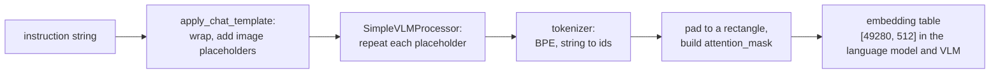

# Text Becomes Tokens

A neural network computes on numbers, so "pick up the red cube" has to become a list of integers.
The tokenizer does that: a fixed, deterministic function from a string to token ids, and back. A robot policy depends on it because the
instruction is the only input that separates "pick up the red cube" from "pick up the green can"
when both are on the table. One bug recorded in the lab notebook, and several edge cases the code
now guards against, came from how token ids are padded and batched, not from a network's layers.

## The idea

A **token** is a piece of text the model treats as one unit. The **vocabulary** is the fixed list of
all tokens, and a token's **id** is its index in that list. The model owns an **embedding table**, a
matrix of shape `[vocabulary size, width]`, where width is the length of the vector the model keeps
for each token (512 in the language model here), and turns an id into a vector by reading that row.
The tokenizer is chosen once, before training: a model trained with one tokenizer cannot read ids
produced by another.

Three units are in common use.

| Unit | Vocabulary size | Sequence length | A word never seen in training |
|---|---|---|---|
| Character | tens to hundreds | long: one token per character | always representable |
| Word | grows with the corpus | short: one token per word | becomes an "unknown" token |
| Subword | picked in advance (49,280 here) | one token for a common word, several for a rare one | split into known pieces |

Subwords are the standard compromise, and **byte-pair encoding** (BPE) is the usual way to build
them: start from single characters and repeatedly merge the most frequent adjacent pair into a new
token. Background: Sennrich et al. (2016) adapted byte-pair encoding, a compression algorithm,
to split words for translation. The procedure below leaves out their end-of-word symbol, which
makes a piece at the end of a word a different token from the same letters inside one. In both,
pairs are never counted across word boundaries.

The training corpus is four words, each split into characters, with counts:
`c u b e` (5), `c u b e s` (2), `t u b e` (3) and `b e d` (2).

Count every adjacent pair, weighted by the word counts, merge the most frequent, and repeat:

| Step | Pair counts before the merge | Merge | Corpus after the merge |
|---|---|---|---|
| 1 | `b e` 12, `u b` 10, `c u` 7, `t u` 3, `e s` 2, `e d` 2 | `b`+`e` -> `be` | `c u be`, `c u be s`, `t u be`, `be d` |
| 2 | `u be` 10, `c u` 7, `t u` 3, `be s` 2, `be d` 2 | `u`+`be` -> `ube` | `c ube`, `c ube s`, `t ube`, `be d` |
| 3 | `c ube` 7, `t ube` 3, `ube s` 2, `be d` 2 | `c`+`ube` -> `cube` | `cube`, `cube s`, `t ube`, `be d` |
| 4 | `t ube` 3, `cube s` 2, `be d` 2 | `t`+`ube` -> `tube` | `cube`, `cube s`, `tube`, `be d` |

Four merges give a vocabulary of 11 tokens, the seven characters and the four merges, numbered in
that order: `b`=0, `c`=1, `d`=2, `e`=3, `s`=4, `t`=5, `u`=6, `be`=7, `ube`=8,
`cube`=9, `tube`=10.

To encode new text, split it into characters and apply the merges in the order they were learned.
`cubes` becomes `cube` `s` = `[9, 4]`. `cubed`, never seen in training, becomes `cube` `d` =
`[9, 2]`. `bud`, where no merge applies, stays `b` `u` `d` = `[0, 6, 2]`.

The number of merges is the only setting. More merges give a larger vocabulary and shorter
sequences.

<!-- interactive: tokenizer -->
*Figure: a sentence split into tokens and ids with the tokenizer used here, and the toy corpus
above merged one click at a time.*

## How it works

### The tokenizer used here

The from-scratch path has three stages: stage 1 trains a language model on text alone, stage 2
adds images to make a vision-language model (VLM), and stage 3 adds actions to make a
vision-language-action policy (VLA). All three, and the patch-token policy
(`dp_vit_lang_reactive.yaml`, which reads image patches and instruction tokens directly), use the
tokenizer published with `HuggingFaceTB/SmolVLM2-256M-Video-Instruct`.

Background, from that model's published tokenizer files: it is a GPT-2-style BPE tokenizer with a
base vocabulary of 49,152 entries plus 128 added tokens (ids 49,152 to 49,279), 49,280 in total.
Every token id in this chapter comes from those files, not from the lab notebook. The tokenizer
merges bytes, not characters, so any string can be encoded (Radford et al., 2019). And a space is
stored at the front of the token that follows it: `cube` at the start of a string is id 36,159 and
` cube` after a space is id 20,636.

### Special tokens

A **special token** is a vocabulary entry that stands for structure, not text. The tokenizer never
splits it. The ones that matter here:

| Role | Token | Id | What it is for |
|---|---|---|---|
| Begin | `<\|im_start\|>` | 1 | starts the prompt |
| End | `<end_of_utterance>` | 49,279 | closes a message |
| Pad | `<\|im_end\|>` | 2 | fills a short row up to the batch length |
| Image placeholder | `<image>` | 49,190 | reserves a position for an image embedding |

The names do not match the roles: this tokenizer's configuration uses `<|im_end|>` as the pad
token, and its template closes a message with `<end_of_utterance>`.

### The chat template

A **chat template** is a small program stored with the tokenizer that turns a list of messages into
one string, inserting the special tokens the model was trained with. `apply_chat_template` in
[`vla_foundry/data/processor/__init__.py`](../../vla_foundry/data/processor/__init__.py) builds a
single `user` message whose content is `num_images` image entries followed by the text, and renders
it with `tokenize=False, add_generation_prompt=False`. `SimpleVLMProcessor` sets its own
`chat_template` to `None`, so the SmolVLM2 tokenizer's template is the one applied.

That template writes `<|im_start|>`, the capitalised role, a colon, the content, then
`<end_of_utterance>` and a newline. For one image and the `pick_cube` instruction the result is:

```text
<|im_start|>User:<image>pick up the red cube<end_of_utterance>\n
```

`SimpleVLMProcessor.__call__` in
[`simple_vlm_processor.py`](../../vla_foundry/models/vision_language_backbones/simple_vlm_processor.py)
then replaces every `<image>` with `image_seq_length` copies of itself, and only then calls the
tokenizer. `get_processor` sets `image_seq_length` from the config key `data.img_num_tokens`. With
[`dp_vit_lang_reactive.yaml`](../../sim/pickup/configs/dp_vit_lang_reactive.yaml), the config the
recipe in the [README](../../README.md) trains (two cameras, one frame each, `img_num_tokens: 1`),
the model receives 12 ids:

```text
ids:    1 11126 42 49190 49190 18188 614 260 2382 20636 49279 198
tokens: <|im_start|> User : <image> <image> pick Ġup Ġthe Ġred Ġcube <end_of_utterance> Ċ
```

`convert_ids_to_tokens` prints a leading space as `Ġ` and a newline as `Ċ`. `pick` has no `Ġ`
because the template puts it directly after `<image>`. `dp_vit_lang.yaml` adds **history** (each
camera's frame at t-1, the previous joint state and the previous action): four images, so four
placeholders and 14 ids. `vla_custom.yaml` has the same four images with `img_num_tokens: 256`, so
4 x 256 = 1,024 placeholders and 1,034 ids in all.



`vla_custom.yaml` adds one id after the last real token of every prompt: the **action token**, a
special token whose hidden states are the **conditioning**, the tensor `[batch, tokens, width]`
that the backbone, here the VLM, hands to the action head, the transformer that produces the
actions ([What the action head sees](50-what-the-action-head-sees.md)).
`VLMFoundryBackboneWrapper.__init__` adds a table row for it (`resize_token_embeddings`), 49,281 in
all. The patch-token policy uses its own table of shape `[49280, 256]`.

In the VLM the placeholder id never contributes its own embedding. `VLM.forward` in
[`vla_foundry/models/vlm.py`](../../vla_foundry/models/vlm.py) finds the positions where
`input_ids == image_token_id`, sets those ids to 0 for the table lookup, and overwrites the result
with the projected patch embeddings (`masked_scatter`).
[Joining vision and language](30-joining-vision-and-language.md) covers that step.

In the patch-token policy, `ViTBackboneWrapper._embed_text` in
[`vit_backbone.py`](../../vla_foundry/models/vision_language_backbones/vit_backbone.py) receives the
same `input_ids` and looks up every real id in its own `text_embedding` table, so the five wrapper
ids and the `<image>` placeholders are embedded like words and count against `text_tokens: 32`
([Language conditioning](51-language-conditioning.md)).

### Padding and the attention mask

A batch is one tensor of shape `[batch, tokens]`, so every row needs the same length. **Padding**
appends the pad id to short rows. The **attention mask** is a second tensor of the same shape with 1
for real tokens and 0 for padding. **Truncation** cuts a row longer than `max_length` down to
it. Two padding strategies are used here:

- `padding="max_length"`: every row is padded to a fixed length. `batch_tokenize` in
  `vla_foundry/data/pipelines/text_untokenized.py` and `ImageCaptionPipeline` in
  `vla_foundry/data/pipelines/image_caption.py` pad to `seq_len + 1`.
- `padding=True`: every row is padded to the longest row in that batch.
  `RoboticsProcessor.process_inputs` in `vla_foundry/data/processor/robotics_processor.py` uses
  this, so a policy's prompt length depends on what else is in the batch.

The **padding side** is the end that receives the pad ids; the **truncation side** is the end that
is cut. Background: Hugging Face tokenizers pad on the right by default, and this tokenizer's
published configuration does not change that. The side matters because the language model is
**causal**: each position attends only to itself and to earlier positions. With right padding, no
real token can see a pad. `Transformer.forward` in `vla_foundry/models/transformer.py` relies on
this: for a causal model called with `use_cache=False`, as in training, it discards the attention
mask; the mask is kept only for cached generation ([Generation](14-generation.md)). The loss is
handled separately: `TransformerBatchHandler` and `VLMBatchHandler` in
`vla_foundry/models/batch_handlers.py` exclude every position whose target is the pad id (and, for
the VLM, the image placeholder id).

## In this repository

Config keys that control the code linked above:

| What | Key |
|---|---|
| Tokenizer for the VLM and the policies | `data.processor: simple_vlm` |
| Placeholders per image | `data.img_num_tokens` |
| Tokenizer and row length for stage 1 | `data.tokenizer`, `data.seq_len` |
| Instruction slots, patch-token policy | `text_tokens: 32`, `text_vocab_size: 49280` |

Print what a model receives for an instruction (the first run downloads the tokenizer files):

```bash
.venv/bin/python - <<'EOF'
from vla_foundry.data.processor import apply_chat_template
from vla_foundry.models.vision_language_backbones.simple_vlm_processor import SimpleVLMProcessor

proc = SimpleVLMProcessor()
proc.image_seq_length = 1   # data.img_num_tokens; vla_custom.yaml uses 256
n_images = 2                # 2 cameras x 1 frame; 4 for the configs with history
tok = proc.tokenizer

text = apply_chat_template(proc, n_images, "pick up the red cube")
print(repr(text))
ids = proc(None, [text], padding=False)["input_ids"][0].tolist()
print(len(ids), ids)
print(tok.convert_ids_to_tokens(ids))
print(len(tok), tok.pad_token_id, tok.eos_token_id, proc.image_token_id, tok.padding_side, tok.truncation_side)

batch = [apply_chat_template(proc, n_images, f"pick up the {name}") for name in ("red cube", "yellow T block")]
out = proc(None, batch, padding=True)
print(out["input_ids"].shape)
print(out["attention_mask"].tolist())
EOF
```

## What we measured

Three entries of the [lab notebook](../lab-notebook.md) bear on this chapter.

- **Vocabulary size costs memory.** The stage-1 language model (91.4M parameters) ran out of
  memory at batch 128 on machine A (one RTX 4090, 24 GB): the float32 logits for 128 x 256 tokens
  over a 49,280-word vocabulary are 6.5 GB per tensor.
- **Sequence length decided which models a position bug reached.** A token's position is its index
  in the row. The table attention uses to encode positions ([Positions](12-positions.md)) was
  computed in 16-bit floats (bfloat16), and positions above 256 collapsed onto even numbers and
  above 512 onto multiples of 4: 641 distinct positions out of 2048. Stage 1's sequences are 256
  tokens long and were not affected. Stage 2's are 320 and were: one image's 256 placeholders push
  every caption token past position 256. The table is now computed in float32. Trained again with
  the fixed table, the `dp_vit_lang_reactive` run below ends at 93% (trained weights) instead of
  83%, and a second pair of runs with other seeds, differing in the table alone, ends at 96% / 96%
  against 90% / 89%; in both pairs the policy starts to look at the scene earlier
  ([Positions](12-positions.md)).
- **The instruction's ids select the object, once the policy uses them.** On machine B (L40S GPUs,
  128 CPU cores), the `dp_vit_lang_reactive` policy, trained before the position fix for 5.0M
  samples (training windows drawn by the data loader) on 4000 `pick_target` demonstrations,
  succeeded on 83% / 85% of 100 unseen layouts (trained weights / averaged weights, a running
  average of the weights saved by the same run). A layout fixes the objects, their poses, the named
  object and the arm's start pose. The policy closed at the named object in 100% / 100% of them:
  the object nearest the gripper when it first closed was the one the instruction named (chance:
  33%). Having the ids in the input was not enough. At 1.0M samples that run was at 35% / 32% on
  that measure and 0% / 1% success; with the fixed table, at 65% and 8% (trained weights)
  ([How much data and training](71-how-much-data-and-training.md)). With history, also on 4000
  demonstrations and before the fix, the policy was at 30% / 35% on that measure and 2% / 2%
  success when its run was stopped at 3.0M samples: it read the target from its previous action,
  not from the instruction. Trained after the fix, on demonstrations that begin with a hold frame
  (`collect.py --hold_steps 1`), it still ends at 0% / 4% after 5M samples
  ([History and shortcuts](52-history-and-shortcuts.md)).

## Where it goes wrong

### A token appended after the padding

`padding=True` pads a short prompt to the longest one in its training batch; the policy server
(`sim/pickup/policy_server.py`) processes one prompt per request and pads nothing. The action token
used to be appended after the pads, so a short instruction's token sat one position later, behind a
padding token, in training than when served, with no error and a normal loss;
`VLMFoundryBackboneWrapper._prepare_inputs_for_action_token` now inserts it after the last real
token, and the effect on success was not measured (in full:
[Train and inference must see the same thing](93-train-inference-skew.md)).

<!-- interactive: padding-shift -->
*Figure: two prompts of different length, padded on the right; an appended token lands after the
padding in the short row, and next to the last real token when the row is served alone or the fix is
on.*

### The same instruction, different token counts

**What you see.** Nothing for `text_tokens: 32`: `_embed_text` keeps the first 32 real ids and drops
the rest. A `ValueError` naming `conditioning_len`, a fixed prompt length that some configs set:
1040 in `vla_custom_tokens.yaml`, 528 in `vla_custom_tokens_reactive.yaml`.

**Why.** The count depends on more than the instruction's words: on the number of images times
`img_num_tokens`, on the template's five wrapper ids, and on the tokenizer. Surface details count
too: with this tokenizer a trailing full stop adds an id, while a capital `P` or a leading space
keeps the count and replaces the first id, because `pick`, `Pick` and ` pick` are three vocabulary
entries. Nor do the four `pick_target` instructions have one length (5 ids for the red cube and the
green can, 6 for the blue hex nut and the yellow T block), so the rows of a batch differ by one id
before padding.

**How to check.** Print `len(ids)` with the command above for the longest instruction, with the
config's image count and `img_num_tokens`. Set the budget from that count.

### Pad ids outside an embedding table

**What you see.** An index error on CPU or a device-side assertion on GPU, at the embedding lookup.

**Why.** An embedding table has exactly `vocab_size` rows. With the SmolVLM2 tokenizer the pad id is
2, inside the table, so the configs here do not hit this; it appears when `data.tokenizer` names a
tokenizer without a pad token. `TextUntokenizedPipeline` then adds a `[PAD]` token, and (background,
Hugging Face behaviour) an added token gets the next free id, one past the old vocabulary.

**What to do.** Never look up an id you are about to ignore. `_embed_text` multiplies the ids by the
mask before the lookup (pad positions become id 0) and the result by the mask afterwards, so pad
positions carry zeros. `test_vit_backbone_text.py` checks that left-padded, right-padded and
unpadded inputs agree.

### Vocabulary size must match the embedding table

**What you see.** Too small: the index error above. Too large: nothing in stage 1; the embedding and
output weights then have a different shape from the stage-2 VLM's.

**Why.** The preset `vla_foundry/config_presets/models/transformer_100m.yaml` has
`vocab_size: 50432`; `custom_llm.yaml` overrides it to 49,280, the size of the tokenizer named under
`data.tokenizer`. In stage 2, `VLMParams.init_shared_attributes` in
`vla_foundry/params/model_params.py` replaces a default `vocab_size` with `len(tokenizer)`.

**How to check.** `len(tok)`, printed by the command above, must equal `model.vocab_size`. Check
before stage 1, not after.

### Arguments that do not reach the tokenizer

**What you see.** Nothing while prompts fit. An over-long prompt would lose its first ids,
placeholders included, and in the VLM the `assert` on the placeholder count in `VLM.forward` would
fail ([Training a VLM](31-training-a-vlm.md)).

**Why.** `ImageCaptionPipeline` passes `padding_side="right"` and `RoboticsProcessor` a `truncation`
flag, but `SimpleVLMProcessor.__call__` hands the tokenizer only `return_tensors`, `padding` and
`max_length`, and always sets `truncation=True`. Both sides are therefore the tokenizer's own, and
its published configuration truncates on the left. Through the processor this was not exercised
here; in stage 1 `batch_tokenize` calls the tokenizer directly, and a document longer than 257 ids
keeps only its last 257.

**How to check.** The command above prints `tok.padding_side` and `tok.truncation_side`. Keep
prompts shorter than `max_length`.

## Background and further reading

- Sennrich, [Neural Machine Translation of Rare Words with Subword Units](https://arxiv.org/abs/1508.07909),
  2016. Byte-pair encoding applied to word segmentation: any word becomes subword units from a
  fixed vocabulary.
- Radford, [Language Models are Unsupervised Multitask Learners](https://cdn.openai.com/better-language-models/language_models_are_unsupervised_multitask_learners.pdf),
  2019 (GPT-2). BPE over bytes (base vocabulary 256, final 50,257), so no input needs an "unknown"
  token.
- Marafioti, [SmolVLM: Redefining small and efficient multimodal models](https://arxiv.org/abs/2504.05299),
  2025. Compact vision-language models (256M to 2.2B parameters); the tokenizer and chat template reused here are published on the
  [SmolVLM2-256M-Video-Instruct model page](https://huggingface.co/HuggingFaceTB/SmolVLM2-256M-Video-Instruct).
- Hugging Face Transformers documentation,
  [Chat templates](https://huggingface.co/docs/transformers/en/chat_templating) and
  [Padding and truncation](https://huggingface.co/docs/transformers/v4.57.3/en/pad_truncation),
  for `apply_chat_template` and the `padding`, `truncation` and `max_length` arguments.

## Check yourself

1. With the toy merge table, encode `tubed` and `bus` by hand. (`tube` `d` = `[10, 2]`; `b` `u` `s`
   = `[0, 6, 4]`.) Then add `t u b` with count 4 to the corpus and recount step 1: `u b` now has 14
   and wins. Carry on for four merges: the learned tokens become `ub`, `ube`, `cube`, `tub`, so the
   vocabulary loses `be` and `tube`, and `tube` now encodes as `t` `ube`.
2. Run the command in "In this repository". Change the text to `Pick up the red cube.` and to
   ` pick up the red cube` and compare the tokens and the count. In the same output, read the
   attention mask of the two-prompt batch: which row is padded, by how many ids, on which side.
3. Run the padding tests and read what they compare:

   ```bash
   .venv/bin/python -m pytest tests/essential/models/test_backbone_conditioning.py \
       tests/essential/models/test_vlm_foundry_backbone_conditioning.py \
       tests/essential/models/test_vit_backbone_text.py -k padding -v
   ```
