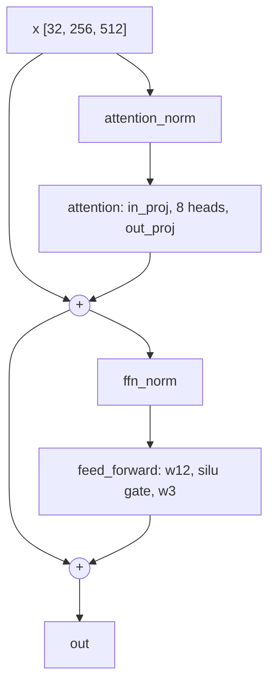

# The Transformer Block

A transformer is a stack of blocks with the same structure and separate weights. Each block lets
every position in a sequence read from other positions (attention) and then process what it read (a
feed-forward network). In this repository one class, `Transformer`, is the stage-1 language model
(the three training stages are laid out in
[62-the-from-scratch-path.md](62-the-from-scratch-path.md)), the language half of the stage-2
vision-language model and, with the causal mask switched off, the action head of the policies, the
part that outputs the robot's actions.

## The idea

A language model receives token ids (integers produced by the tokenizer, see
[10-tokens.md](10-tokens.md)) and returns, for every position, a score for each possible next
token. Four parts do this:

1. **Embedding table.** A matrix with one row per vocabulary entry. Token id 1234 selects row 1234,
   that token's starting vector.
2. **Residual stream.** The tensor `[batch, tokens, width]` that runs from the embedding to the
   output; width is the number of features in each token's vector, 512 in the model traced below.
   No block replaces it: each block reads it, computes an update and adds the update, so
   information written early stays available to every later block.
3. **Blocks.** Each has two sublayers. Attention moves information between positions. The
   feed-forward network transforms each position on its own.
4. **Output projection.** A matrix that turns each final vector into one score per vocabulary entry.
   These scores are called logits; a softmax (exponentiate, then divide by the total) turns them
   into probabilities.

Attention in one sentence: **each token writes a query and reads back a weighted mix of values.**
Every token produces three vectors from its place in the stream: a query ("what I am looking for"),
a key ("what I can be found by") and a value ("what I hand over if chosen"). The dot product of one
token's query with another token's key is a score. A softmax over the scores gives weights, and the
reading token receives the weighted sum of the values.

A worked example with invented scores: take "pick up the red cube", one token per word. The query
of `cube` is compared with the keys of all five tokens:

| Key of | pick | up | the | red | cube |
|---|---|---|---|---|---|
| Score | 0.5 | 0.1 | 0.2 | 2.0 | 1.0 |
| Weight after softmax | 0.117 | 0.078 | 0.087 | 0.525 | 0.193 |

`cube` therefore reads `0.117·v_pick + 0.078·v_up + 0.087·v_the + 0.525·v_red + 0.193·v_cube`. More
than half comes from `red`; once the update is added, the vector at `cube` also carries the colour.

A language model is trained to predict token t+1 at position t, for all positions in one pass. If
position t could read position t+1 the answer would be in its input. The **causal mask** prevents
this: before the softmax, the score from any query to a later key is set to minus infinity, so its
weight is exactly 0. In the example, `the` gets weights over `pick`, `up` and `the` only.

<!-- interactive: attention -->
*Figure: an attention matrix over a short sentence. Rows are reading tokens, columns the tokens
they read from, shade the weight. With the causal mask on, everything above the diagonal is zero;
with it off, rows spread over the whole sentence.*

## How it works

The numbers below are the stage-1 language model: 12 layers, 8 heads, width 512, vocabulary 49,280,
batch 32, 256-token sequences
([`sim/pickup/configs/custom_llm.yaml`](../../sim/pickup/configs/custom_llm.yaml)).

### Shapes from ids to logits

| Step of the forward pass | Operation | Result |
|---|---|---|
| input | token ids | `[32, 256]` |
| embedding | look up rows of a 49,280 x 512 table | `[32, 256, 512]` |
| post-embedding norm | LayerNorm | `[32, 256, 512]` |
| **in each of 12 blocks** | | |
| attention norm | LayerNorm on a copy of the stream | `[32, 256, 512]` |
| query, key, value | one linear layer 512 -> 1536, cut in three | 3 x `[32, 256, 512]` |
| split into heads | 512 = 8 heads x 64 | 3 x `[32, 256, 8, 64]` |
| positions | rotate queries and keys ([12-positions.md](12-positions.md)) | unchanged |
| scores | query · key / 8, per head | `[32, 8, 256, 256]` |
| weights | causal mask, softmax over keys | `[32, 8, 256, 256]` |
| read | weights x values, heads joined again | `[32, 256, 512]` |
| attention output | linear 512 -> 512, **added to the stream** | `[32, 256, 512]` |
| feed-forward norm | LayerNorm on a copy of the stream | `[32, 256, 512]` |
| expand | linear 512 -> 3072, cut in two | 2 x `[32, 256, 1536]` |
| gate | `silu(gate) * x` | `[32, 256, 1536]` |
| contract | linear 1536 -> 512, **added to the stream** | `[32, 256, 512]` |
| **after the last block** | | |
| final norm | LayerNorm | `[32, 256, 512]` |
| output projection | linear 512 -> 49,280 | `[32, 256, 49280]` |

LayerNorm, heads and the gate are defined below. Position enters only inside attention; nothing is
added to the embeddings.

### Attention

For one head, with queries $Q$, keys $K$ and values $V$ of shape `[256, 64]`:

$$\mathrm{Attention}(Q, K, V) = \mathrm{softmax}\left(\frac{QK^\top}{\sqrt{64}} + M\right)V$$

$M$ is the causal mask: 0 where the key position is at or before the query position, minus infinity
elsewhere. $QK^\top$ is the `[256, 256]` table of scores. Background: Vaswani et al. (2017) divide by
the square root of the head width. Their stated reason, offered as a suspicion, is that dot products
grow with dimension (for independent unit-variance components, a 64-wide dot product has variance
64) and large scores push the softmax into a region with very small gradients.

**Heads.** The 512-wide query, key and value vectors are each cut into 8 pieces of 64. Each piece is
a head with its own score table, so heads can attend to different tokens from the same position.
The 8 results are joined back into 512 and mixed by the output linear layer.

### Feed-forward network

The feed-forward network applies a non-linear transformation to each position on its own. Here it
is a SwiGLU:

$$\mathrm{FFN}(x) = W_3\left(\mathrm{silu}(W_g x) \odot W_v x\right), \qquad \mathrm{silu}(z) = z \cdot \mathrm{sigmoid}(z)$$

One half of the expanded vector ($W_g x$) passes through `silu` and multiplies the other half
($W_v x$) element by element: a learned gate per hidden unit. Background: the original feed-forward
network has two matrices and an inner width of 4 x the model width. SwiGLU has three, so Shazeer
(2020) reduces the inner width to 2/3 of that (8/3 x the model width) to keep the parameter count
equal. For width 512 that is `int(8 * 512 / 3) = 1365`, which this code rounds up to a multiple of
256: 1536. After rounding, the network here has 2,359,296 parameters per block, 12.5% more than the
2,097,152 of a two-matrix network with inner width 2048.

### Normalisation placement

LayerNorm rescales each token's vector to zero mean and unit variance across its 512 features, then
applies a learned gain and bias per feature. This model is **pre-norm**: the norm sits on the
branch, in front of each sublayer, and the stream itself is never normalised inside a block.



`TransformerBlock.forward` is two lines: `h = x + attention(norm(x))`, then
`out = h + ffn(norm(h))`. The stream after the last block is therefore the normalised embedding
(`post_embed_norm`, applied once before the first block) plus 24 unnormalised updates, with no
fixed scale, so a final norm is applied once before the output projection. Background: the
original transformer normalised after each addition (post-norm); Xiong et al. (2020) show that
pre-norm has well-behaved gradients at initialisation.

### Output projection and weight tying

The output projection is a 49,280 x 512 matrix, the same shape as the embedding table. **Weight
tying** uses one matrix for both (Press and Wolf, 2016, recommend it for language models). It is an
option here and is off in the stage-1 config.

### Parameter count

Every linear layer in the blocks and the output projection has no bias, so the count is short:

| Component | Shape | Parameters |
|---|---|---|
| `embeddings` | 49,280 x 512 | 25,231,360 |
| `post_embed_norm`, `norm` | 2 x (gain + bias, 512 each) | 2,048 |
| per block: `attention.in_proj` | 1536 x 512 | 786,432 |
| per block: `attention.out_proj` | 512 x 512 | 262,144 |
| per block: `feed_forward.w12` | 3072 x 512 | 1,572,864 |
| per block: `feed_forward.w3` | 512 x 1536 | 786,432 |
| per block: `attention_norm`, `ffn_norm` | 2 x (512 + 512) | 2,048 |
| one block | | 3,409,920 |
| 12 blocks | | 40,919,040 |
| `output` | 49,280 x 512 | 25,231,360 |
| **Total** | | **91,383,808** |

That is the 91.4M the lab notebook lists for stage 1. The two vocabulary-sized matrices hold
50,462,720 parameters, 55% of the model.

## In this repository

| What | Where |
|---|---|
| Model, block, attention | [`vla_foundry/models/transformer.py`](../../vla_foundry/models/transformer.py): `Transformer`, `TransformerBlock`, `CustomAttn` |
| Attention functions and masks | [`vla_foundry/attention.py`](../../vla_foundry/attention.py): `torch_attn`, `get_rectangular_causal_mask`, `apply_attention_mask_` |
| Feed-forward, norms | [`vla_foundry/activations.py`](../../vla_foundry/activations.py): `SwiGLU`, `get_feed_forward`; [`vla_foundry/norms.py`](../../vla_foundry/norms.py): `get_norm_class` |
| Config fields and defaults | [`vla_foundry/params/model_params.py`](../../vla_foundry/params/model_params.py): `TransformerParams` |
| Stage-1 values | [`vla_foundry/config_presets/models/transformer_100m.yaml`](../../vla_foundry/config_presets/models/transformer_100m.yaml), included by `custom_llm.yaml` |

Train it with `sim/pickup/scripts/custom_path.sh llm` (after `custom_path.sh data`); see
[13-training-a-language-model.md](13-training-a-language-model.md).

Config keys under `model:`, with the `TransformerParams` default and the stage-1 value:

| Key | Default | Stage 1 | Effect |
|---|---|---|---|
| `hidden_dim` | 96 | 512 | width of the stream |
| `n_layers` | 8 | 12 | number of blocks |
| `n_heads` | 4 | 8 | head width is `hidden_dim // n_heads` |
| `vocab_size` | 50432 | 49280 | rows of `embeddings` and `output`; `custom_llm.yaml` overrides the preset to match its tokenizer |
| `ffn_type` | `swiglu` | default | `gelu` gives two matrices with inner width `4 * hidden_dim` |
| `norm_type` | `default_layer_norm` | default | `torch.nn.LayerNorm`; `rms_norm` and gain-only variants exist |
| `post_embed_norm` | false | true | a norm directly after the embedding |
| `weight_tying` | false | false | `embeddings.weight` and `output.weight` become one tensor |
| `is_causal` | true | true | causal mask on |
| `cast_output_to_float32` | false | true | logits are cast to float32 before they are returned |

Two things about this implementation:

- **Input.** `Transformer.forward` takes `input_ids` or ready-made `inputs_embeds`. The VLM uses
  the second to pass image and text vectors together, as does the action head
  (`DiffusionPolicy.forward`).
- **Attention.** `CustomAttn.forward` calls the function chosen by `attn_name`. The default,
  `torch_attn`, hands queries, keys and values to PyTorch's `F.scaled_dot_product_attention`, in
  training with `is_causal=True` and no mask tensor, so this code never builds the
  `[32, 8, 256, 256]` table.

**The padding mask is dropped in training.** `Transformer.forward` accepts an `attention_mask` of
shape `[batch, tokens]` in which 0 marks padding. For a causal model called without the KV cache
(`use_cache=False`; the cache stores keys and values of earlier tokens during generation, see
[14-generation.md](14-generation.md)) it sets `attention_mask = None` right after
`post_embed_norm`, before the first block. In stage 1 there is nothing to drop:
`TextUntokenizedPipeline.tokenize_wrapper` returns `attention_mask: None`. In stage 2 the
processor's mask reaches `Transformer.forward` through `VLM.forward` and is discarded here.

Dropping the mask is safe when padding is on the right. For a sequence `A B C D pad pad`, with `x`
marking what each row may read:

```text
query \ key   A  B  C  D  pad pad
A             x  .  .  .  .   .
B             x  x  .  .  .   .
C             x  x  x  .  .   .
D             x  x  x  x  .   .
pad           x  x  x  x  x   .
pad           x  x  x  x  x   x
```

The rows of the real tokens contain no padding column: the pads are all to their right, where the
causal mask already hides them. The pad rows compute something meaningless and do not reach the
cross-entropy: `TransformerBatchHandler.prepare_inputs_and_targets` (`VLMBatchHandler` in stage 2)
marks every target equal to `cfg.data.pad_token_id`, and `CrossEntropyLossWithZLoss.forward`
replaces those targets with `ignore_index`. With right padding, every position whose input is a pad
also has a pad as its target. (The z-loss penalty in the same function does average over pads, but
`hparams.z_loss_coefficient` is 0.0 by default and in stage 1:
[13-training-a-language-model.md](13-training-a-language-model.md).) The shortcut avoids building a
`[batch, heads, tokens, tokens]` bias tensor in every layer, which is what `torch_attn` does when
given a mask.

With `use_cache=True` the mask is kept: generated tokens are appended after the whole prompt, so
padding on either side of it lies to their left, where the causal mask does not hide it, and
`apply_attention_mask_` adds the mask to the causal bias.

## What we measured

From the lab notebook, stage 1 on machine A (one RTX 4090, 24 GB): this model, 91.4M parameters,
trained on 61,000 DCLM-baseline web documents for 500k samples at batch 32, took about 15 min at
550 samples/s; the loss went from 6.3 to 4.1 and the text it generated was grammatical English. On
machine B (L40S GPUs, 128 CPU cores) the final loss was 4.15.

On machine A, stage 1 ran out of memory at batch 128: the float32 logits for 128 x 256 tokens over
a 49,280-entry vocabulary are 6.5 GB per tensor. At batch 32 the same arithmetic gives 1.6 GB.

The block as implemented also trains without the causal mask: six of them, 256 wide with 4 heads
and `is_causal: false` (`sim/pickup/configs/dp_vit_lang_reactive.yaml`), are the action head of the
policy that solves `pick_target`, picking up the one of three objects the instruction names
([101-case-pick-target.md](101-case-pick-target.md)). No run here compares SwiGLU with GELU,
pre-norm with post-norm, or tied with untied weights.

## Where it goes wrong

| What you see | Why | Check and fix |
|---|---|---|
| Out of memory when the batch grows | logits are `[batch, tokens, 49280]` in float32 | multiply it out before raising `per_gpu_batch_size` or `seq_len` |
| Predictions for a sequence change with the amount of padding in front of it | a left-padded batch went through `forward` without the cache; the mask was dropped and real tokens attended to pads | print `tokenizer.padding_side`. Neither stage sets it: `batch_tokenize` (`vla_foundry/data/pipelines/text_untokenized.py`) passes no side, and `SimpleVLMProcessor.__call__` does not forward the `padding_side="right"` that `vla_foundry/data/pipelines/image_caption.py` passes, so both use the tokenizer's default, `right` for the SmolVLM2 tokenizer |
| Same symptom during batched generation | `Transformer.generate(use_cache=False)` calls `forward` without the cache, so the mask is dropped there too | left-pad the prompts (`tokenizer.padding_side = "left"`) and keep `use_cache=True`, or generate one prompt at a time; `generate` takes the logits of the last position, which is a pad in a right-padded prompt (read from the code, not run) |
| `is_causal=False` passed to `forward` changes nothing | the code computes `is_causal or self.is_causal`, so the argument can switch the mask on and never off | set `is_causal: false` in the config, as the action-head configs do |
| A shape error in the position embedding, or attention narrower than the stream | `head_dim = hidden_dim // n_heads` is integer division with no check: an odd head width breaks the rotary embedding, an even one drops the remainder silently | choose `n_heads` that divides `hidden_dim` into an even head width |
| Nothing: no error, and training and serving agree, but neighbouring positions beyond 256 look alike to attention | the rotary position table that rotates queries and keys was computed in bfloat16 (16-bit floats, 8 significant bits) under `hparams.precision: amp_bf16`, so positions above 256 shared angles with their neighbours; the mechanism and what it cost the policies are in [12-positions.md](12-positions.md) | fixed in `vla_foundry/positional_embedding.py`: the angles are computed in float32, then cast (`tests/essential/models/test_rotary_precision.py`); `positional_embedding_type: rotary_legacy_autocast` reproduces the old table. Stage 1 (256 tokens) was not affected; a model whose sequences are longer, such as the action head, was |

## Background and further reading

None of the following was measured here.

- Vaswani et al., "Attention Is All You Need", 2017. <https://arxiv.org/abs/1706.03762>. Introduced
  the transformer, scaled dot-product attention and multiple heads, with post-norm blocks.
- Ba et al., "Layer Normalization", 2016. <https://arxiv.org/abs/1607.06450>. Normalises each
  example across the features of a layer instead of across the batch, so it behaves the same in
  training and at test time and at any batch size.
- Xiong et al., "On Layer Normalization in the Transformer Architecture", 2020.
  <https://arxiv.org/abs/2002.04745>. Analyses pre-norm against post-norm and why post-norm needs
  learning-rate warm-up.
- Shazeer, "GLU Variants Improve Transformer", 2020. <https://arxiv.org/abs/2002.05202>. Defines
  SwiGLU and the 2/3 width rule.
- Touvron et al., "LLaMA: Open and Efficient Foundation Language Models", 2023.
  <https://arxiv.org/abs/2302.13971>. Combines pre-normalisation (with RMSNorm; the stage-1
  model here uses LayerNorm), SwiGLU at 2/3 of 4d and rotary positions. The comment in
  `get_feed_forward` attributes its width rule and the round-up to the llama and lit-llama code.
- Press and Wolf, "Using the Output Embedding to Improve Language Models", 2016.
  <https://arxiv.org/abs/1608.05859>. Weight tying.
- Elhage et al., "A Mathematical Framework for Transformer Circuits", 2021.
  <https://transformer-circuits.pub/2021/framework/index.html>. Describes the residual stream as a
  communication channel that layers read from and write to.

## Check yourself

1. Build the stage-1 model and count its parameters. Expected: 91383808.

   ```bash
   .venv/bin/python - <<'EOF'
   from vla_foundry.models.transformer import Transformer
   from vla_foundry.params.model_params import TransformerParams

   params = TransformerParams(hidden_dim=512, n_layers=12, n_heads=8, vocab_size=49280, post_embed_norm=True)
   model = Transformer(params)
   print(sum(p.numel() for p in model.parameters()))
   EOF
   ```

2. Add `weight_tying=True` to the parameters above. Predict the new count from the table before
   running it. (66152448.)
3. Show that right padding is harmless and left padding is not. The script changes the last four
   of 16 ids and compares the first twelve logits, then changes the first four and compares the
   last twelve, without and with the mask. Expected: 0.0, a non-zero value, 0.0.

   ```bash
   .venv/bin/python - <<'EOF'
   import torch
   from vla_foundry.models.transformer import Transformer
   from vla_foundry.params.model_params import TransformerParams

   model = Transformer(TransformerParams()).eval()
   ids = torch.randint(0, 1000, (1, 16))
   right, left = ids.clone(), ids.clone()
   right[:, 12:] += 1
   left[:, :4] += 1
   mask = torch.ones(1, 16, dtype=torch.long)
   mask[:, :4] = 0
   kept = dict(attention_mask=mask, use_cache=True)
   with torch.no_grad():
       base = model(input_ids=ids).logits
       print((model(input_ids=right).logits[:, :12] - base[:, :12]).abs().max().item())
       print((model(input_ids=left).logits[:, 4:] - base[:, 4:]).abs().max().item())
       a, b = model(input_ids=ids, **kept).logits, model(input_ids=left, **kept).logits
       print((a[:, 4:] - b[:, 4:]).abs().max().item())
   EOF
   ```

4. Show that the mask is switched off by the config and not by the call, as the action head needs.
   The script changes the last eight of 16 ids and compares the first eight logits: for a causal
   model, for that model called with `is_causal=False`, and for its weights in a model built with
   `is_causal=False`. Expected: 0.0, 0.0, a non-zero value.

   ```bash
   .venv/bin/python - <<'EOF'
   import torch
   from vla_foundry.models.transformer import Transformer
   from vla_foundry.params.model_params import TransformerParams

   causal = Transformer(TransformerParams()).eval()
   ids = torch.randint(0, 1000, (1, 16))
   later = ids.clone()
   later[:, 8:] += 1
   bi = Transformer(TransformerParams(is_causal=False)).eval()
   bi.load_state_dict(causal.state_dict())
   with torch.no_grad():
       for model, kw in [(causal, {}), (causal, {"is_causal": False}), (bi, {})]:
           a = model(input_ids=ids, **kw).logits[:, :8]
           b = model(input_ids=later, **kw).logits[:, :8]
           print((a - b).abs().max().item())
   EOF
   ```
