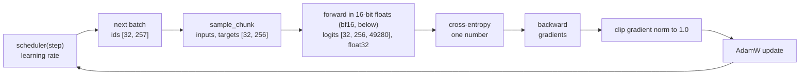

# Training a Language Model

Training a language model means adjusting its weights until, given the start of a text, it gives
high probability to the token that really comes next. Here that is stage 1 of the from-scratch
path: a 91.4M-parameter transformer trained on web text, whose weights initialise the language half
of the stage-2 vision-language model, the backbone of the stage-3 robot policy. The same loop
(`vla_foundry/main.py`, `vla_foundry/train.py`) trains the policy; see
[80-the-training-loop.md](80-the-training-loop.md).

## The idea

A language model reads a sequence of token ids (the integers a tokenizer produces, see
[10-tokens.md](10-tokens.md)) and outputs, at every position, one score per vocabulary entry,
called a logit. A softmax turns the logits at one position into a probability for each of the
49,280 possible next tokens.

No labels are needed: the target at position $t$ is the token at position $t+1$ of the same text.
The loss is the cross-entropy, the negative logarithm of the probability the model gave to the
token that actually followed, averaged over the $N$ scored positions:

$$L = -\frac{1}{N}\sum_{t=1}^{N} \log p_\theta(x_{t+1} \mid x_1, \dots, x_t)$$

Worked example. A model that knows nothing spreads its probability evenly, $p = 1/49{,}280$, and
its loss is $\ln 49{,}280 = 10.8$. A model with loss 4.1 gives the correct token a probability of
$e^{-4.1} = 0.0166$ in the geometric mean, about 1 in 60.

The causal mask ([11-the-transformer-block.md](11-the-transformer-block.md)) stops position $t$
from seeing later tokens, so one forward pass over 256 tokens gives 256 scored predictions.

## How it works

### A batch

A batch is a stack of sequences processed together. With the stage-1 config:

| Tensor | Shape | Content |
|---|---|---|
| ids from the data loader | `[32, 257]` | 32 documents, each cut or padded to 257 tokens |
| inputs | `[32, 256]` | tokens 0 to 255 |
| targets | `[32, 256]` | tokens 1 to 256: the inputs shifted by one |
| logits | `[32, 256, 49280]` | one score per vocabulary entry, per position |

One step scores up to 32 x 256 = 8,192 predictions; targets that are padding are left out of the
mean.

### Samples, steps, epochs

This framework budgets training in samples. A sample is one sequence, here one document cut to 257
tokens; stage 1 gets 500,000 (`total_train_samples`). A step is one optimiser update on one batch:
500,000 // 32 = 15,625 steps. An epoch is one pass over the dataset: 500,000 / 61,000 is about 8.2
passes, each over the same first 257 tokens of every document. `num_checkpoints` divides the budget
into windows; the weights are saved after each.

### One step



<!-- interactive: training-step -->
*Figure: one optimisation step: forward to logits, one loss value, backward to a gradient for every
weight, and an update that moves each weight a small distance against its gradient.*

### The optimiser: AdamW

The gradient says, for each weight, which direction raises the loss; plain gradient descent
subtracts it times a learning rate. Background: Adam (Kingma, 2014) keeps two running averages per
weight, of the gradient and of its square, and divides the first by the square root of the second,
so a weight moves by at most about the learning rate per step whatever the scale of its gradient,
and by less when its gradient keeps changing sign from batch to batch. AdamW (Loshchilov, 2017)
adds weight decay, a small pull of every weight towards zero, applied to the weights directly
instead of through the gradient.

`create_optimizer` (`vla_foundry/optimizer.py`) builds `torch.optim.AdamW` with learning rate
`3e-4`, betas `(0.9, 0.95)` (the fraction of each running average kept per step: the gradient
average remembers about 10 steps, the squared-gradient average about 20), epsilon `1e-8` (a
constant added to the denominator so it cannot be zero) and weight decay `0.01`. Parameters whose
name ends in `.bias` or contains `norm` go into a group with weight decay 0. Background: this is
common practice; decay is meant to keep the large weight matrices small, and pulling a bias or a
normalisation gain towards zero changes what the layer computes without that benefit.

### Learning rate: warm-up, then cosine decay

`cosine_lr` in `vla_foundry/scheduler.py` sets the learning rate for step $s$ out of $S$ steps
with warm-up length $W$ and peak rate $\eta$:

$$\text{lr}(s) = \begin{cases} \eta\,(s+1)/W & s < W \\ \tfrac{1}{2}\,\eta\,\bigl(1 + \cos\bigl(\pi\,\tfrac{s-W}{S-W}\bigr)\bigr) & s \ge W \end{cases}$$

For stage 1, $\eta = 3\times10^{-4}$, $W = 200$ and $S = 15{,}625$:

| Step | Learning rate |
|---|---|
| 0 | 0.0000015 |
| 199 | 0.0003 |
| 7,912 (halfway through the decay) | 0.00015 |
| 15,624 | about 0 |

Background: the Transformer paper (Vaswani, 2017) raised the learning rate linearly over its first
4,000 steps and then lowered it in proportion to the inverse square root of the step. The cosine
shape comes from SGDR (Loshchilov, 2016), which restarts the cosine periodically; the schedule here
is a single cosine with no restart. The usual reasoning: Adam's averages are unreliable in the
first steps, so early updates are kept small; small late updates let the weights settle.

### Gradient clipping

`grad_clip_norm: 1.0` makes the loop call `torch.nn.utils.clip_grad_norm_` before the update. It
measures the length (L2 norm) of all gradients taken as one vector and, if that exceeds 1.0, scales
every gradient down by the same factor. Direction is kept. Background: proposed for recurrent
networks by Pascanu (2012).

Reasoning, for Adam specifically: a single update is already bounded near the learning rate, so
clipping limits how much one outlier batch enters the two running averages. Unclipped, a gradient
a hundred times the usual size would dominate the first average for tens of steps and the second,
where it enters squared, for longer, shrinking the normal updates that follow.

### Mixed precision and float32 logits

Mixed precision means doing most of the forward and backward arithmetic in a 16-bit number format
and keeping the numerically sensitive parts in 32 bits. Background: bfloat16 (bf16) is a 16-bit
floating-point format with the exponent range of float32 and 8 significant bits instead of 24. It
halves memory and it is coarse: between 4 and 8 neighbouring bf16 values are 0.03125 apart.

`precision: amp_bf16` does two things here. `main.py` moves the model to the GPU with the dtype
from `get_model_precision` (`vla_foundry/distributed.py`), `torch.bfloat16`, so the weights are
stored in bf16: 91.4M x 2 bytes = 183 MB. And `train_one_checkpoint` runs the forward pass and the
loss inside the context from `get_autocast` (`vla_foundry/precision.py`),
`torch.amp.autocast(dtype=torch.bfloat16)`. Autocast is PyTorch's switch for mixed precision: inside
the context, operations on its 16-bit list (matrix products, convolutions) run in bf16 and those on
its float32 list in float32.

That resolution is enough for hidden activations and too coarse for a mean over up to 8,192
log-probabilities: a loss near 4.1 stored in bf16 could read 4.094 or 4.125 and nothing in between.
`cast_output_to_float32: true` makes `Transformer.forward` return `output.float()`, so everything
that reads the logits gets float32, inside autocast or not. Two limits on what that buys:

- The cast comes after the bf16 output layer (`self.output(x)` in
  `vla_foundry/models/transformer.py`), so the logit values are still rounded to 8 significant
  bits; only the arithmetic after them is float32.
- Background, from the [PyTorch AMP documentation](https://docs.pytorch.org/docs/stable/amp.html):
  on CUDA, autocast already runs `cross_entropy`, `log_softmax` and `softmax` in float32, so by
  that list (not tested here) the loss would be float32 without the flag too. The flag matters for
  operations outside the list, such as the `torch.logsumexp` of the optional z-loss penalty (off
  here, see "In this repository"), and for code outside autocast.

### Memory arithmetic

The logits dominate memory. One tensor of shape `[batch, 256, 49280]`:

| Batch | Elements | bf16 | float32 |
|---|---|---|---|
| 32 | 403,701,760 | 0.8 GB | 1.6 GB |
| 128 | 1,614,807,040 | 3.2 GB | 6.5 GB |

A hidden activation `[128, 256, 512]` in bf16 is 34 MB. Reasoning: besides the bf16 logits and
their float32 copy, the loss needs the log-probabilities and the backward pass the gradient with
respect to the logits, both float32 and the same shape. If all four are alive at once at batch 128
they add up to 22.6 GB (3.23 + 3 x 6.46), before the weights, the optimiser state and any
temporary, on a 24 GB card. Which tensors coexist at the peak was not profiled; the lab notebook
records only the out-of-memory failure and the 6.5 GB per float32 tensor.

### Reading the loss

The logged loss is in nats (natural logarithm). Divide by $\ln 2$ for bits per token; exponentiate
for perplexity, the size of a uniform choice that would be equally uncertain.

| Loss (nats) | Bits per token | Perplexity | What it is |
|---|---|---|---|
| 10.8 | 15.6 | 49,280 | uniform guess over the vocabulary (arithmetic) |
| 6.3 | 9.1 | 545 | start-of-run value recorded in the lab notebook (machine A); the step it was read at is not recorded |
| 4.1 | 5.9 | 60 | final value, machine A |

Each log line is a mean over about 20 steps, and the first covers iterations 0 to 20, inside the
warm-up, so expect it near 10.8, not 6.3. Reasoning: token frequencies are far from uniform, so
learning them alone, ignoring context, already takes the loss well below 10.8. To see where 6.3
falls: `grep "Train Checkpoint" experiments/pickup/custom_llm.train.log | head -8`.

A low loss says the model predicts its training targets well and nothing more. The clearest case
here is the robot policies of later chapters: the same loop logs their loss, then the simulator
tests them (closed-loop success: the fraction of test episodes in which the robot completes the
task).

<!-- interactive: loss-vs-success -->
*Figure: loss beside closed-loop success of the same checkpoints (lab notebook, machine A). The
pretrained-backbone policy (`vla_qwen`) on the pick-the-named-object task (`pick_target`): loss
0.087, 0.066, 0.039, success 0/50, 1/50, 6/50. The from-scratch policy (`vla_custom`): loss near
0.03, success 0/100. See [91-loss-is-not-success.md](91-loss-is-not-success.md).*

## In this repository

Budget, windows and saving are in `main` ([`vla_foundry/main.py`](../../vla_foundry/main.py)); the
step is `train_one_checkpoint` ([`vla_foundry/train.py`](../../vla_foundry/train.py)); defaults are
in `HyperParams` ([`vla_foundry/params/hyper_params.py`](../../vla_foundry/params/hyper_params.py)).

Details:

- `batch_tokenize` (`vla_foundry/data/pipelines/text_untokenized.py`) pads or truncates to
  `seq_len + 1 = 257` tokens; `sample_chunk` (`vla_foundry/data/sampler.py`) returns
  `input_ids[:, 0:256]` and `input_ids[:, 1:257]`.
- `TransformerBatchHandler` (`vla_foundry/models/batch_handlers.py`) builds a mask where the
  target equals the tokenizer's pad id; `CrossEntropyLossWithZLoss.forward`
  (`vla_foundry/losses.py`) sets those targets to `ignore_index` (-100). The z-loss term is off,
  because `z_loss_coefficient` defaults to 0.0. When on, it adds the coefficient times the mean
  squared `logsumexp` of the logits, a penalty that keeps the softmax normaliser near 1.
- `main.py` computes `samples_per_checkpoint = total_train_samples // num_checkpoints`, but
  `get_datastring_input` (`vla_foundry/data/dataloader.py`) selects whole shards (the tar files of
  up to 4,096 documents the data are stored in) and trims the list to a multiple of the data-loader
  worker count. With 8 workers (`data.num_workers`), the 31 shards needed for 125,000 samples
  become 24, at most 98,304 samples. The `while not done_training` loop opens windows until
  `global_step` reaches `total_steps`, so `--num_checkpoints 4` yields at least six checkpoint
  files; `latest` in `custom_path.sh` picks the highest-numbered one for stage 2.

The config is [`sim/pickup/configs/custom_llm.yaml`](../../sim/pickup/configs/custom_llm.yaml):

| Key | Value | Effect |
|---|---|---|
| `model` include | `transformer_100m.yaml` | 12 layers, 8 heads, width 512, untied embeddings (the input embedding table and the output matrix are separate weights, 49,280 x 512 = 25.2M each, `weight_tying: false`) |
| `model.vocab_size` | 49280 | matches the SmolVLM2 tokenizer used in stages 2 and 3 |
| `data.seq_len` | 256 | tokens per sample |
| `data.num_workers` | 8 | data-loader workers; shard lists are trimmed to a multiple of this |
| `hparams.global_batch_size`, `per_gpu_batch_size` | 32, 32 | one forward pass of 32 per update; no gradient accumulation (summing the gradients of several forward passes before one update) |
| `hparams.lr`, `warmup` | 3e-4, 200 | peak rate, warm-up steps |
| `model.cast_output_to_float32`, `hparams.precision`, `hparams.grad_clip_norm` | true, amp_bf16, 1.0 | see above |

The config holds no budget. `sim/pickup/scripts/custom_path.sh` passes `--total_train_samples`
(default 500000, or `PICKUP_LLM_SAMPLES`) and `--num_checkpoints` (default 4, or
`PICKUP_NUM_CHECKPOINTS`).

```bash
uv sync --group preprocessing --group sim
.venv/bin/python -m sim.pickup.text_data --out data/custom/dclm
sim/pickup/scripts/custom_path.sh llm
tail -f experiments/pickup/custom_llm.train.log                   # in another terminal
```

`sim/pickup/text_data.py` fetches one file of the Hugging Face dataset
`mlfoundations/dclm-baseline-1.0`
(`global-shard_01_of_10/local-shard_0_of_10/shard_00000000_processed.jsonl.zst`), keeps the `text`
field of up to 100,000 lines, and writes tar shards of 4,096 documents plus `manifest.jsonl` to
`data/custom/dclm`. If the manifest exists it does nothing.

The run writes `experiments/pickup/custom_llm/` (`config.yaml`, `out.log`,
`checkpoints/checkpoint_N.pt` and `optimizer_N.pt`). Arguments after `llm` go to `main.py`. Every
20 steps `Metrics` logs:

```text
Train Checkpoint: <window> [<samples>/<samples in window> (<%>)] Loss: <mean since last line> Data (t): <s> Batch (t): <s>, <samples/s>/s, <samples/s>/s/gpu LR: <rate>
```

## What we measured

From the lab notebook:

| | Machine A (RTX 4090, 24 GB) | Machine B (L40S) |
|---|---|---|
| Throughput, batch 32, 256 tokens | 550 samples/s | 520-545 samples/s |
| Loss | 6.3 -> 4.1 | final loss 4.15 |

On machine A the 500k samples took about 15 min and the output was grammatical English. Batch 128
ran out of memory (6.5 GB per float32 logits tensor, as above). By arithmetic, 550 samples/s is 17
steps/s or 140,800 token positions per second.

What this shows: the loop works.

What it does not show: the loss is a training loss on documents seen about eight times. No
validation set is configured (`total_val_samples` is unset), no held-out text was scored, no
grammar test was run, and nothing measured whether the model states facts, answers questions or
follows instructions. Judge it by what it generates ([14-generation.md](14-generation.md)) and by
what is built on it.

What it was good for: the stage-2 VLM built on it listed the objects of 300 held-out scenes in
left-to-right order 85% of the time (256/300), but the stage-3 policy scored 0/100 with that VLM
and 1/100 with a randomly initialised one
([62-the-from-scratch-path.md](62-the-from-scratch-path.md)).

## Where it goes wrong

- **Out of memory after raising the batch.** Stage 1 ran out of memory at batch 128 (lab
  notebook) because of the `[batch, 256, 49280]` tensors above. Keep the forward pass at 32 and
  accumulate instead: `--hparams.global_batch_size 128 --hparams.per_gpu_batch_size 32` gives
  `HyperParams.accum_freq = 4`: four forward and backward passes of 32 before one update. Steps
  drop to 500,000 // 128 = 3,906, so 200 warm-up steps cover four times as many samples.
- **Loss that stays near 10.8, or turns into `nan`.** Not observed in the runs recorded here; this
  is reasoning. A loss stuck near 10.8 means the weights are not moving: check that the `LR:` field
  of the log line rises over the first 200 steps. A loss that falls, then jumps or prints `nan`,
  points at a peak rate too high for the model: rerun with
  `sim/pickup/scripts/custom_path.sh llm --hparams.lr 1e-4`.
- **`warmup` changes meaning below 1.** `_parse_steps_or_fraction` reads a value below 1 as a
  fraction of total steps and anything else as a step count: `--hparams.warmup 0.05` is
  int(0.05 x 15,625) = 781 steps, `--hparams.warmup 1` is one step, not the whole run. Check the
  `LR:` field in the first log lines.
- **Updates smaller than the weights can store.** The weights are bf16 and AdamW updates them in
  place. Arithmetic on the format: a weight near 0.04 sits on a grid of 0.00024, the size of the
  peak learning rate, and an update below half the grid spacing leaves it unchanged, as late in the
  decay. The effect on the final loss was not measured here. Background: this is the problem the
  float32 master copy in Micikevicius (2017) and Kalamkar (2019) exists to avoid.
- **The run hangs.** A dead data-loader worker leaves the trainer waiting at 0% GPU (lab
  notebook). The `llm` stage calls `main.py` directly, not `train_resilient.sh`; see
  [81-surviving-long-runs.md](81-surviving-long-runs.md).

## Background and further reading

- Vaswani, [Attention Is All You Need](https://arxiv.org/abs/1706.03762) (2017): the transformer,
  trained with Adam, linear warm-up and inverse-square-root decay.
- Kingma, [Adam: A Method for Stochastic Optimization](https://arxiv.org/abs/1412.6980) (2014):
  per-weight step sizes from running averages of the gradient and its square.
- Loshchilov, [Decoupled Weight Decay Regularization](https://arxiv.org/abs/1711.05101) (2017):
  AdamW, weight decay applied separately from the gradient step.
- Loshchilov, [SGDR: Stochastic Gradient Descent with Warm Restarts](https://arxiv.org/abs/1608.03983)
  (2016): cosine learning-rate decay, restarted periodically.
- Pascanu, [On the difficulty of training Recurrent Neural Networks](https://arxiv.org/abs/1211.5063)
  (2012): clipping the gradient norm against exploding gradients.
- Micikevicius, [Mixed Precision Training](https://arxiv.org/abs/1710.03740) (2017): half-precision
  training that keeps a single-precision copy of the weights for the update.
- Kalamkar, [A Study of BFLOAT16 for Deep Learning Training](https://arxiv.org/abs/1905.12322)
  (2019): bf16 activations, gradients and forward-pass weights matching float32 results across five
  domains, with the update still done on a float32 copy of the weights, which this repository does
  not keep.
- Li, [DataComp-LM](https://arxiv.org/abs/2406.11794) (2024): the benchmark and the filtered Common
  Crawl corpus, DCLM-Baseline, that stage 1 takes one shard from.

## Check yourself

1. Print the learning rate at steps 0, 199, 200, 7912 and 15624:

   ```bash
   .venv/bin/python -c "
   import torch
   from vla_foundry.scheduler import cosine_lr
   opt = torch.optim.AdamW([torch.nn.Parameter(torch.zeros(1))], lr=3e-4)
   sched = cosine_lr(opt, 3e-4, 200, 15625, 0.0, 0.0)
   for s in (0, 199, 200, 7912, 15624): print(s, sched(s))
   "
   ```

2. Print the resolved config without training and find `beta2`, `wd` and `lr_scheduler`:

   ```bash
   .venv/bin/python vla_foundry/main.py --config_path sim/pickup/configs/custom_llm.yaml \
     --total_train_samples 500000 --resolve_configs True
   ```

3. After a run, list `experiments/pickup/custom_llm/checkpoints/`, count the `checkpoint_*.pt`
   files, and explain the count from `get_datastring_input` and `data.num_workers`. Then convert the
   last logged loss to bits and perplexity, as below for 4.15:

   ```bash
   grep "Train Checkpoint" experiments/pickup/custom_llm.train.log | tail -3
   python3 -c "import math; print(4.15 / math.log(2), math.exp(4.15))"
   ```
