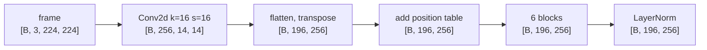

# Images Become Tokens

A transformer processes a sequence of vectors, called tokens; a camera frame is a grid of numbers.
A Vision Transformer (ViT) bridges the two by cutting the frame into small squares and turning each
square into one token. A robot policy needs this because the camera is the only input that says
where the object is, and the way the frame is cut decides how finely the policy can know that.

## The idea

A colour image is three grids of numbers, one each for red, green and blue. The simulator here
renders 224 x 224 frames, so one frame is 224 x 224 x 3 = 150,528 numbers, each an integer from 0
(dark) to 255 (bright). One token per pixel would be a sequence of 50,176 tokens. Self-attention
compares every token with every other one: 50,176 x 50,176, about 2.5 billion comparisons per
layer, against 38,416 for the 196 patches used here.

The ViT groups pixels into **patches**: non-overlapping squares of `patch_size` pixels on a side.
Each patch is flattened into a list of numbers and mapped by one learned linear layer to a vector
of the model's width. That vector is the patch's token.

Worked example with the numbers from [`dp_vit.yaml`](../../sim/pickup/configs/dp_vit.yaml):

- Image 224 px, patch 16 px: 224 / 16 = 14 patches per side, 14 x 14 = **196 patches**.
- One patch holds 16 x 16 x 3 = 768 numbers. The linear layer maps them to a vector of
  `hidden_dim: 256`, so one frame becomes a tensor of shape `[196, 256]`.

From here on the image is handled like text: the tokens go through transformer blocks
([The Transformer Block](11-the-transformer-block.md)). Two things differ from the language model
of Part 1. There is no causal mask (the rule that stops a text token from reading later tokens), so
every patch may attend to every other patch. And position is supplied differently. Attention
cannot tell which patch was top-left any more than it can tell word order; the language model
rotates queries and keys inside attention ([Telling Tokens Where They Are](12-positions.md)), while
the ViT adds a learned vector per grid position to each token once, before the first block.

<!-- interactive: patchify -->
*Figure: a front-camera frame under the 14 x 14 patch grid. Selecting a patch shows its 16 x 16
pixels and the token it becomes. A ruler shows one edge of the red cube spanning about 12 pixels
and its whole outline about 16 by 18, roughly one patch.*

## How it works

### 1. Value range and normalisation

Decoded image files and simulator renders are 8-bit: unsigned integers 0 to 255, usually laid out
`[height, width, channel]` (HWC). PyTorch layers such as `nn.Conv2d`, used here, take
floating-point tensors laid out `[channel, height, width]` (CHW). Three small operations sit
between the two; each is a place where training and inference can disagree without an error:

1. **Scale**: divide by 255 so values lie in [0, 1].
2. **Normalise**: subtract a mean and divide by a standard deviation per channel. With mean 0.5 and
   standard deviation 0.5 the result lies in [-1, 1]: $(x - 0.5) / 0.5 = 2x - 1$.
3. **Reorder** HWC to CHW, and resize if the image is not the size the model expects.

A network can be fitted to either range. What it cannot tolerate is a range at inference different
from the one its first layer's weights were fitted to. Background: inputs centred near zero with a
spread near one are the convention because they usually make optimisation easier; this repository
has not compared the two.

### 2. Patch embedding as a convolution

Cutting into patches, flattening and applying one shared linear layer is the same computation as a
convolution whose kernel size and stride both equal the patch size: a kernel of 16 moved in steps
of 16 lands on each patch once. With 256 output channels the convolution has
256 x 3 x 16 x 16 = 196,608 weights and 256 biases, and turns `[B, 3, 224, 224]` into
`[B, 256, 14, 14]`. Flattening the 14 x 14 grid and moving the channel axis last gives
`[B, 196, 256]`. Tokens run row by row: token 0 is the top-left patch, token 195 the
bottom-right.

### 3. Position embeddings

The **position embedding** is a learned table of shape `[1, 196, 256]` (50,176 numbers): one
vector per patch position, added to that patch's token. The table is tied to the grid: in this
code a model built for 196 positions cannot take an image that yields 256. Background: Dosovitskiy
et al. handle a change of resolution by interpolating the table; `vit.py` does not.

### 4. Blocks and the final norm

The 196 tokens pass through a stack of transformer blocks and one last layer normalisation. The
shape stays `[B, 196, 256]`; each output token has mixed in information from the whole frame.



### What an image costs

The pick-up configs use two patch sizes; the rows are arithmetic on the config values.

| | patch 16 (`dp_vit.yaml`) | patch 14 (`custom_vlm.yaml`) |
|---|---|---|
| Tokens per image at 224 px | 196 | 256 |
| Token pairs in self-attention, one image | 38,416 | 65,536 |

A smaller patch gives a finer grid and a longer sequence: 14 px instead of 16 px means 31% more
tokens and 71% more attention pairs.

### What a patch covers in this scene

This is an estimate from the camera definition in [`sim/pickup/env.py`](../../sim/pickup/env.py),
not a measurement. `build_model` places the `front` camera at `[1.15, -0.55, 0.62]` m, aims it at
`[0.42, 0.0, 0.10]` and sets `fovy=45`. Background: in MuJoCo
[`fovy`](https://mujoco.readthedocs.io/en/stable/XMLreference.html#body-camera-fovy) is the
vertical field of view in degrees.

Treat the camera as an ideal pinhole: every light ray passes through one point and there is no lens
distortion. A point at depth $d$ along the viewing direction and $s$ metres to the side then lands
$f \cdot s / d$ pixels from the image centre. The constant $f$, the focal length in pixels, follows
from the field of view: the top edge of the image is 112 px from the centre and 22.5° off the
viewing direction, so $f = 112 / \tan 22.5° = 112 / 0.4142 \approx 270$ px.

1. Viewing direction: aim point minus camera position, `[-0.73, 0.55, -0.52]`, length 1.052 m,
   pointing 29.6° below horizontal.
2. Objects spawn with x in `SPAWN_X = (0.38, 0.62)` and y in `SPAWN_Y = (-0.22, 0.22)`; the cube's
   centre is 0.0225 m high. Depth is the offset from the camera projected onto the unit viewing
   direction. For the centre of the spawn area, `(0.50, 0, 0.0225)`, the offset is
   `[-0.65, 0.55, -0.5975]` and the depth is
   $(0.65 \cdot 0.73 + 0.55 \cdot 0.55 + 0.5975 \cdot 0.52) / 1.052 = 1.03$ m. The same sum gives
   0.84 m for the nearest corner `(0.62, -0.22)` and 1.23 m for the farthest `(0.38, 0.22)`.

| Where the cube is | Depth $d$ | Pixels per metre, $f / d$ | 4.5 cm cube edge | One 16 px patch covers |
|---|---|---|---|---|
| Nearest spawn corner | 0.84 m | 323 | 14.6 px | 4.9 cm |
| Centre of the spawn area | 1.03 m | 261 | 11.8 px | 6.1 cm |
| Farthest spawn corner | 1.23 m | 219 | 9.9 px | 7.3 cm |

The cube's edge is 0.045 m (half-size `0.0225` in `OBJECTS["cube"]`). The table treats that edge as
facing the camera squarely, the smallest case: `PickupEnv.reset` draws the yaw uniformly, a cube
seen corner-on is up to $\sqrt{2}$ times wider, and the camera looks down at about 30°, so the
top face adds height. Projecting all eight corners of the box with the same pinhole model, over
the whole spawn area and every yaw, gives an outline 11 to 21 px wide (median 16) and 13 to 25 px
tall (median 18), still an estimate. **The cube is about one 16 px patch across** and usually
straddles a grid line in both directions: its outline touches four patches in about three
placements out of four and six in about one in six.

Two consequences for localisation:

- Knowing which patch contains the cube locates it to about 6 cm. The task needs better. In the lab
  notebook's grasp-tolerance tables (scripted expert with a fixed sideways offset added to its
  grasp point, 320 episodes per offset) the cube still succeeds 93% of the time at 20 mm but 32%
  at 30 mm, on both machines. The can and the hex nut are stricter: at 10 mm 60% and 61% on machine
  A and 94% and 97% on machine B; at 20 mm 18% and 25% on machine A and 29% and 70% on machine B.
  Ten millimetres is about 2.6 px across the image at the centre of the spawn area, and about
  half that along the viewing direction on the table ($\sin 29.6° \approx 0.49$). The position
  must be read from inside the patch: how the red pixels are split between neighbours.
- A step that reduces the 196 tokens to fewer, such as pooling them into one vector, keeps this
  only if it was trained to. [One Vector or Many Tokens](21-pooled-vs-patch-tokens.md) compares a
  pooled encoder with patch tokens on this task.

### Two cameras, two time steps, four images

One observation here is four frames: the `front` and `wrist` cameras at the previous control step
and the current one. The same ViT encodes each on its own and the four token sets are joined end
to end:

```text
pixel_values    [B, 4, 3, 224, 224]
ViT             [B, 4, 196, 256]
flatten images  [B, 784, 256]
```

Inside the ViT no token attends to a token from another image. Relating the cameras and the time
steps is left to the model that receives the 784 tokens.

## In this repository

**The ViT** is [`vla_foundry/models/vit.py`](../../vla_foundry/models/vit.py).

- `ViTPatchEmbeddings` holds the `nn.Conv2d` (`kernel_size` and `stride` equal to `patch_size`,
  `padding="valid"`) and `position_embedding`, an `nn.Parameter` of shape
  `[1, num_patches, hidden_dim]` with `num_patches = (img_size // patch_size) ** 2`. Its `forward`
  runs the convolution, `flatten(2)`, `transpose(1, 2)`, then adds the table.
- `ViTBlock.forward` is `x = x + self.attn(self.ln1(x))` then `x = x + self.mlp(self.ln2(x))`.
  `ViTMultiHeadAttention` calls `scaled_dot_product_attention` with `is_causal=False` and no mask.
- `ViT.forward` accepts `[B, 3, H, W]` or `[B, num_cameras, 3, H, W]`; a five-dimensional input is
  folded into the batch dimension and unfolded at the end. It returns `self.layer_norm(x)` for all
  patch tokens unless `cls_flag` is true; then a learned extra token is prepended and only its
  output is returned.

**Config keys** are fields of `ViTParams` in
[`vla_foundry/params/model_params.py`](../../vla_foundry/params/model_params.py). The ones that
shape the ViT are `img_size`, `patch_size`, `hidden_dim`, `inter_dim` (the MLP's inner width),
`n_heads`, `n_layers`, `dropout`, `ln_eps` and `cls_flag`. `dp_vit.yaml` sets the first six to 224,
16, 256, 1024, 4 and 6 under `model.vision_language_backbone` (`type: vit_backbone`, whose
`ViTBackboneParams` inherits these fields);
[`custom_vlm.yaml`](../../sim/pickup/configs/custom_vlm.yaml) sets the same with `patch_size: 14`
under `model.vit`.

**Four images.** `data.camera_names: [front, wrist]` and `data.image_indices: [-1, 0]` in
`dp_vit.yaml` produce the image order `front_t-1, wrist_t-1, front_t0, wrist_t0`
(`image_names` in `vla_foundry/params/data_params.py`: time index outer, camera inner).
`ViTBackboneWrapper.get_action_conditioning` in
[`vit_backbone.py`](../../vla_foundry/models/vision_language_backbones/vit_backbone.py) runs the
ViT and flattens `[B, N, 196, 256]` to `[B, N*196, 256]`.

**Processors** turn decoded images into `pixel_values`. `get_processor` in
[`vla_foundry/data/processor/__init__.py`](../../vla_foundry/data/processor/__init__.py) picks one
from `data.processor`. The two used by the configs in this chapter:

| `data.processor` | Class | Pixel range handed to the model |
|---|---|---|
| `simple_vlm` | `SimpleVLMProcessor` | [-1, 1]: uint8 input divided by 255, then mean 0.5, std 0.5 |
| `"none"` | `PassthroughProcessor` | 0 to 255 as float32, no scaling, no normalisation |

`SimpleVLMProcessor._process_image` in
[`simple_vlm_processor.py`](../../vla_foundry/models/vision_language_backbones/simple_vlm_processor.py)
has one branch each for a PIL image, a numpy array and a torch tensor. The processor also expands
every `<image>` in the prompt into `image_seq_length` copies, set by `get_processor` from
`data.img_num_tokens` (256 in `custom_vlm.yaml`): one placeholder per patch token
([Joining Vision and Language](30-joining-vision-and-language.md)).

`PassthroughProcessor.__call__` converts tensors with `.float()` and PIL or numpy images with
`torch.as_tensor(np.array(img), dtype=torch.float32)`, and returns a dummy `input_ids` of zeros
with shape `[B, 1]`. `get_processor` passes it `data.image_size` (224 in `dp_vit.yaml`), so it also
resizes to that size. `dp_vit.yaml` selects it with `processor: "none"`, so that policy's ViT is
trained on raw 0 to 255 values and receives no text. Serving uses the same path:
`sim/pickup/policy_server.py` decodes JPEG bytes with `fast_image_decoder` and calls
`RoboticsProcessor.process_inputs`, as training does.

To train this policy (the dataset is made in [Setup and a First Run](01-setup-and-first-run.md)):

```bash
sim/pickup/scripts/train.sh dp_vit pick_cube_1k dp_vit_pick_cube_1k 1500000
```

## What we measured

All numbers are from the [lab notebook](../lab-notebook.md).

**The pixel-range bug.** `SimpleVLMProcessor` scaled PIL and numpy images to [0, 1] and left uint8
tensors at 0 to 255. Training fed tensors; the captioning check
(`sim/pickup/vlm_check.py`) feeds PIL images.

| Stage-2 VLM, 300 held-out scenes, machine A | Before the fix | After the fix |
|---|---|---|
| Objects listed in left-to-right order | 1/300 | 256/300 (85%) |
| Leftmost object named correctly | 70/300 | 285/300 (95%) |

A teacher-forced check (the loss on the true caption, each token predicted from the true tokens
before it) on the pre-fix model compared the right image against a mismatched one. Fed PIL images:
1.93 against 1.89. Fed the unscaled uint8 tensors it was trained on: 0.10 against 1.18. The model
had learned to use images; at inference it was shown them in a range it had never seen.

**Raw pixels can train.** The `dp_vit` policy, whose ViT receives 0 to 255 in training and in
serving, reached 37/50 = 74% (95% interval 60-84%) on `pick_cube` with 1000 demonstrations and 1.5M
samples on machine A. An unnormalised range is workable when both sides agree; changing
`data.processor` on such a checkpoint means retraining. No run here compares raw against
normalised input.

## Where it goes wrong

**Three input types, one left unscaled.** What you see: the training loss falls normally and the
model at inference answers as if it had no image, with no error: a tensor in the wrong range has
the right shape and type. Why: the processor has one code path each for PIL, numpy and tensor
inputs, and training and inference used different ones. How to check: push one image through the
processor in every form it can arrive in and compare the outputs;
`tests/essential/models/test_simple_vlm_processor_scaling.py` does this for a random uint8 image
and asserts the three outputs are equal and within [-1, 1]. For a trained model, run the
counterfactual-input check in [Testing a VLM](32-testing-a-vlm.md) on both feeding paths, as in
the measurement above: equal losses on the inference path and different ones on the training path
mean the two paths disagree
([Train and Inference Must See the Same Thing](93-train-inference-skew.md)).

**The token count and the placeholder count disagree.** What you see: an `AssertionError` on the
first forward pass of a VLM. `VLM.forward` in `vla_foundry/models/vlm.py` asserts that the number
of `<image>` placeholder ids equals the number of image tokens it splices in, which with the
settings in `custom_vlm.yaml` is one per patch. So `data.img_num_tokens` must follow `patch_size`
and `img_size`: 256 for 224 px with patch 14, 196 with patch 16.

**The image is not the size the ViT was built for.** `position_embedding` has a fixed length, so an
input that yields a different number of patches fails at `x + self.position_embedding` with a
`RuntimeError` about tensor sizes. In the data path this happens when `data.image_size` and the
ViT's `img_size` disagree: `SimpleVLMProcessor` and `PassthroughProcessor` resize every image to
`data.image_size`, so a camera frame of another size is resized without warning, not rejected. If
`img_size` is not a multiple of `patch_size`, `padding="valid"` drops the leftover rows and
columns without warning.

**Image order.** Nothing in the ViT marks a token as front or wrist, earlier or current: all four
images share one position table, so the order must be identical in training and serving.
`data.image_names` fixes it, and `policy_server.py` reads it from the saved config. What you would
see if it differed: no error and a normal training loss, with a policy that acts as if its cameras
or time steps were swapped; this has not been observed here. How to check: compare
`data.image_names` in the run's saved config with the `image_names` passed to `process_inputs` at
serving.

## Background and further reading

Background, not measured here:

- Dosovitskiy et al., *An Image is Worth 16x16 Words: Transformers for Image Recognition at Scale*,
  2020, [arXiv:2010.11929](https://arxiv.org/abs/2010.11929). Introduced the Vision Transformer:
  fixed-size patches, a linear embedding, position embeddings and a standard transformer encoder.
- Zhai et al., *Sigmoid Loss for Language Image Pre-Training* (SigLIP), 2023,
  [arXiv:2303.15343](https://arxiv.org/abs/2303.15343). Trains an image encoder against captions
  with a sigmoid loss applied to each image-text pair independently, in place of a softmax
  normalised over the whole batch. Comments in `vit.py` point to the Hugging Face SigLIP
  implementation.

## Check yourself

1. Run the scaling test, then read it and say which assertion would have failed before the fix.

   ```bash
   .venv/bin/python -m pytest tests/essential/models/test_simple_vlm_processor_scaling.py -q
   ```

2. Build the `dp_vit` ViT, confirm the output shape and count its parameters.

   ```bash
   .venv/bin/python - <<'EOF'
   import torch
   from vla_foundry.models.vit import ViT
   from vla_foundry.params.model_params import ViTParams

   vit = ViT(ViTParams(img_size=224, patch_size=16, hidden_dim=256, inter_dim=1024, n_heads=4, n_layers=6))
   print(vit(torch.zeros(2, 4, 3, 224, 224)).shape)   # [2, 4, 196, 256]
   print(sum(p.numel() for p in vit.parameters()))    # 4986112
   EOF
   ```

3. Repeat the camera estimate for 448 x 448 renders with 16 px patches: the cube's edge at the
   centre of the spawn area and the tokens per image. (About 23.5 px; 784.)
