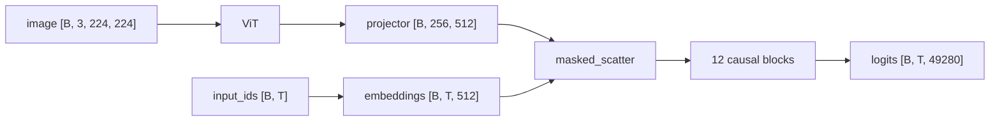

# Joining Vision and Language

A vision-language model (VLM) is a language model that also accepts images. A vision encoder turns
each image into tokens, a projector resizes them to the language model's width, and they take
reserved places in the token sequence next to the text. A robot policy built on a VLM receives its
camera frames and its instruction through this one sequence, so the order of the sequence decides
what each position can know.

## The idea

Three parts are joined.

- The **vision encoder** is the vision transformer (ViT) from
  [Images Become Tokens](20-images-to-tokens.md). It maps one 224 x 224 frame to `[1, 256, 256]`:
  256 patch tokens (16 x 16 patches), each 256 numbers wide (`hidden_dim`). The two numbers are
  equal here by coincidence.
- The **language model** is the causal transformer from
  [Training a Language Model](13-training-a-language-model.md). It looks up one vector of width 512
  per token id and predicts the next token.
- The **projector** is a small trainable map between the two: it turns each patch token from width
  256 into width 512, the shape of a word embedding.

The join itself is a substitution. The prompt contains a **placeholder token**, `<image>`, repeated
once for every patch token the image will produce. The placeholders exist so that everything that
counts tokens (the tokenizer, padding, the attention mask, the loss mask) accounts for the image
before any pixel is encoded. The language model looks up an embedding for every position, and the
vectors at the placeholder positions are then overwritten with the projected patch tokens. After
that the language model runs unchanged.

Worked example with [`custom_vlm.yaml`](../../sim/pickup/configs/custom_vlm.yaml), one `front`
camera frame and the caption `robot arm over a table. from left to right: a red cube, a green can
and a blue hex nut.`:

| Positions | Content | Count | Where the input vector comes from |
|---|---|---|---|
| 0 to 2 | `<\|im_start\|>`, `User`, `:` | 3 | embedding table |
| 3 to 258 | `<image>` repeated | 256 | ViT, then projector |
| 259 to 282 | the caption | 24 | embedding table |
| 283 to 284 | `<end_of_utterance>`, newline | 2 | embedding table |

That is 285 positions, each a vector of width 512. The counts come from running the published
tokenizer (exercise 1), not from the lab notebook. [Text Becomes Tokens](10-tokens.md) explains
the wrapper tokens.

<!-- interactive: sequence-layout -->
*Figure: a VLM prompt as a row of cells: three prompt tokens, one block of 256 image placeholders
per image, then the text and two closing tokens. With four images the image part grows to 1,024
cells and the text still comes last.*

## How it works

### 1. The prompt reserves the positions

`apply_chat_template` in
[`vla_foundry/data/processor/__init__.py`](../../vla_foundry/data/processor/__init__.py) writes one
`<image>` per image in front of the text. `SimpleVLMProcessor.__call__` in
[`simple_vlm_processor.py`](../../vla_foundry/models/vision_language_backbones/simple_vlm_processor.py)
replaces each `<image>` with `image_seq_length` copies and then calls the SmolVLM2 tokenizer it
wraps. `get_processor` sets `image_seq_length` from `data.img_num_tokens`, 256 here.

The same call prepares the pixels: `_process_image` scales uint8 input to [0, 1], resizes to
`image_size` and normalises with mean 0.5 and standard deviation 0.5. The processor returns
`input_ids`, `attention_mask` and `pixel_values` of shape `[images, 3, 224, 224]`.

### 2. The image becomes 256 vectors

`VLM.forward` in [`vla_foundry/models/vlm.py`](../../vla_foundry/models/vlm.py) calls
`self.vit(pixel_values)`. With `img_size: 224` and `patch_size: 14` the grid is 224 / 14 = 16
patches per side, so the ViT returns `[B, 256, 256]`. Attention inside the ViT is bidirectional
(`is_causal=False` in `ViTMultiHeadAttention.forward`), so every patch token has already read the
whole image.

### 3. The projector changes the width

`ModalityProjector` is one `nn.Linear(256, 512, bias=False)`: 256 x 512 = 131,072 weights, output
`[B, 256, 512]`. `create_vlm` can load weights for the language model and for the ViT from
checkpoints (`resume_from_checkpoint`) but has no such key for the projector, which starts
untrained.

### 4. The scatter

```python
special_image_mask = input_ids == self.model_params.image_token_id
safe_input_ids = input_ids.clone()
safe_input_ids[special_image_mask] = 0
token_embd = self.transformer.embeddings(safe_input_ids).to(image_embd.dtype)
special_image_mask = special_image_mask.unsqueeze(-1)
assert special_image_mask.sum() == image_embd.shape[0] * image_embd.shape[1]
special_image_mask = special_image_mask.expand_as(token_embd).to(token_embd.device)
inputs_embeds = token_embd.masked_scatter(special_image_mask, image_embd)
```

1. Find the placeholder positions: a boolean mask `[B, T]`.
2. Replace the placeholder ids with 0 and look up all embeddings: `[B, T, 512]`. A placeholder id
   need not be a row of the table, and point 4 overwrites what the lookup returns there.
3. Check that the number of placeholders equals images times tokens per image.
4. `masked_scatter` copies the projected patch tokens into the masked positions in reading order:
   first row of the batch first, left to right. Patch token 0 of image 0 lands in the first
   placeholder.

`Transformer.forward` in [`transformer.py`](../../vla_foundry/models/transformer.py) receives the
result as `inputs_embeds`. It applies `post_embed_norm`, a normalisation of the input vectors
before the first block (`post_embed_norm: true` in `transformer_100m.yaml`), to image and text
positions alike, then the 12 causal blocks, and returns logits `[B, T, 49280]`.



### Pixel shuffle: fewer, wider tokens

Every image token costs one position in every layer of the language model. **Pixel shuffle**
shortens the image part: each `r` x `r` block of neighbouring patch tokens is concatenated into one
token that is `r²` times wider, and the projector maps it to the language model's width.

`ModalityProjector.pixel_shuffle` does the regrouping with one `einops.rearrange`, and the
projector's input width is `hidden_dim * projector_pixel_shuffle_factor**2`. For the 16 x 16 grid of
this ViT:

| Factor | Tokens per image | Projector input width | Pixels covered by one token |
|---|---|---|---|
| 1 (`custom_vlm.yaml`) | 256 | 256 | 14 x 14 |
| 2 | 64 | 1,024 | 28 x 28 |
| 4 | 16 | 4,096 | 56 x 56 |

The pick-up configs use factor 1, where `pixel_shuffle` returns its input unchanged. The preset
`vla_foundry/config_presets/models/vit_smolvlm2_256m.yaml` uses factor 2 at 512 px with patch 16:
1,024 patch tokens become 256.

Background: SmolVLM (Marafioti et al., 2025) notes that higher ratios impair precise
localisation, yet its small models did better with `r` = 4 than with 2. The cube's edge is
10 to 15 pixels in the `front` camera ([Images Become Tokens](20-images-to-tokens.md)), about one
patch here; at factor 2 one token would cover two to three times that edge.

### One image, four images

With **history** (the previous frame, joint state and action as extra inputs) a policy's
observation is four frames: two cameras at the previous control step, t-1, and the current one, t.
`RoboticsDataParams` builds the image order from `camera_names: [front, wrist]` and
`image_indices: [-1, 0]` with the time index in the outer loop, and
`RoboticsProcessor.process_inputs` passes that count to `apply_chat_template`. With
[`vla_custom.yaml`](../../sim/pickup/configs/vla_custom.yaml) the prompt for
`pick up the red cube` is:

| Positions | Content | Count |
|---|---|---|
| 0 to 2 | `<\|im_start\|>`, `User`, `:` | 3 |
| 3 to 258 | `front`, t-1 | 256 |
| 259 to 514 | `wrist`, t-1 | 256 |
| 515 to 770 | `front`, t | 256 |
| 771 to 1026 | `wrist`, t | 256 |
| 1027 to 1031 | `pick up the red cube` | 5 |
| 1032 to 1033 | `<end_of_utterance>`, newline | 2 |

That is 1,034 positions. With `conditioning: action_token`,
the default that `vla_custom.yaml` keeps, `VLMFoundryBackboneWrapper` inserts the **action token**
after the newline: one special token whose hidden states (the vectors the blocks output at its
position) condition the **action head**, the network that turns the VLM's output into robot
actions ([What the Action Head Sees](50-what-the-action-head-sees.md)). The VLM then processes
1,035 positions.

Without history (`image_indices: [0]`, as in
[`vla_custom_tokens_reactive.yaml`](../../sim/pickup/configs/vla_custom_tokens_reactive.yaml)) the
same prompt holds the two current frames: 522 positions. Start there. In the patch-token policies,
which have no language model ([Language conditioning](51-language-conditioning.md)), 3M samples
on 4000 demonstrations on machine B (L40S GPUs, 128 CPU cores) took the one without history
(`dp_vit_lang_reactive`) to 81% / 75% of `pick_target` episodes (trained / averaged weights)
and the one with it (`dp_vit_lang`) to 2% / 2%: it had learned to read the target from
its previous action ([History and shortcuts](52-history-and-shortcuts.md)). Both predate the
position fix; after it, a history policy trained on demonstrations that begin with a hold frame
still ends at 0% / 4% after 5M samples.

`SimpleVLMProcessor` flattens the per-sample image lists, so a batch of `B` samples gives
`pixel_values` of `[4B, 3, 224, 224]`, the ViT returns `[4B, 256, 256]`, the assert checks for
1,024 x `B` placeholders, and the scatter's reading order gives the first four images to the
first row. The ViT encodes each frame on its own; frames meet only in the language model.

### What causal attention implies

The language model is causal (`is_causal: true` in `transformer_100m.yaml`): position `i` attends
to positions 0 to `i` and to nothing later ([The Transformer Block](11-the-transformer-block.md)).
Applied to the sequences above:

- **Image tokens cannot see the instruction**, which sits after them. The hidden state of an image
  position is the same, at every layer, whatever the instruction says.
- **Earlier images cannot see later ones.** A `front` t-1 token attends only to the three prompt
  tokens and its own frame's earlier tokens (the rest of the frame it knows from the ViT); a
  `wrist` t token also sees the three frames before it.
- **Text tokens see everything before them.** Any combination of "what was asked" and "what is in
  view" is formed at text positions.
- **The last position sees the whole prompt.** This is why next-token prediction can caption an
  image, and why the action token, placed last, can summarise the prompt for the action head.
- **Padding goes on the right**, after the text, so no real token can attend to it, and
  `Transformer.forward` drops the attention mask in a causal pass without a key-value cache (the
  keys and values stored during generation, [Generating Text](14-generation.md)). The side is the
  SmolVLM2 tokenizer's default. A token appended after the padding would attend to it, as the action token did until
  it was moved ([train/inference skew](93-train-inference-skew.md)).

This decides what `VLMFoundryBackboneWrapper` can hand to the action head as **conditioning**, a
tensor `[batch, tokens, width]`. With `conditioning: action_token` the head gets one vector that
has seen everything. With `conditioning: all_tokens` it gets every position's hidden states: the
image states (1,024 with history, 512 without) are blind to the instruction, and only the few
text states depend on it.

## In this repository

| What | Where | Config key |
|---|---|---|
| Assemble the parts; encode, project, scatter | `create_vlm`, `VLM.forward` in `vla_foundry/models/vlm.py` | `model.type: vlm` |
| Pixel shuffle and projection | `ModalityProjector` | `model.vit.projector_pixel_shuffle_factor` |
| Vision encoder, language model | `ViT`, `Transformer` | `model.vit`, `model.transformer` |
| Placeholder expansion, image preprocessing | `SimpleVLMProcessor` | `data.processor: simple_vlm`, `data.image_size` |
| Placeholders per image | `get_processor` | `data.img_num_tokens` |

Three details of the configuration:

- `VLMParams.init_shared_attributes` in `vla_foundry/params/model_params.py` takes
  `image_token_id` from the processor and replaces the default `vocab_size` of 50432 with the
  tokenizer's length, so the language model in `custom_vlm.yaml` has the same 49,280-entry table as
  stage 1 and the stage-1 weights load.
- Nothing derives `data.img_num_tokens` from the ViT. It has to equal
  `(img_size // patch_size)**2 / factor**2`. `compute_num_image_tokens` in
  `vla_foundry/models/utils.py` computes that value, but only the tests call it.
- `data.seq_len: 320`. `ImageCaptionPipeline` pads or truncates every sample to `seq_len + 1` =
  321 ids. 259 go to the prompt start and the image, which leaves 62 for the caption and the two
  closing tokens ([Training a VLM](31-training-a-vlm.md) has the loss mask).

Training the stage-2 model needs the stage-1 checkpoint and the caption data from
`custom_path.sh data`; the check needs a CUDA GPU and the held-out captions from the same command:

```bash
sim/pickup/scripts/custom_path.sh vlm
sim/pickup/scripts/custom_path.sh check
```

Tests, on a CPU:

```bash
.venv/bin/python -m pytest tests/essential/models/test_vlm_models.py tests/essential/models/test_pixelshuffle.py -q
```

## What we measured

From the lab notebook. The stage-2 VLM (96.5M parameters, 91.4M of them stage 1) after 400k
samples on 40,000 captioned sim renders on machine A (one RTX 4090, 24 GB), and the same stage
trained again on machine B, before and after the position-table fix described below (same data
and budget):

| 300 held-out scenes | Machine A | Machine B | Machine B, after the fix |
|---|---|---|---|
| Lists the objects in left-to-right order | 256/300 = 85% | 249/300 = 83% | 267/300 = 89% |
| Names the leftmost object | 285/300 = 95% | 279/300 = 93% | 286/300 = 95% |

Each column is one training seed. The ordering result shows that coarse left-to-right position
survives the path from patch token to language model: to list objects in order, text positions
must read where things are from the image positions. It does not show that position
survives at the precision a grasp needs. It was measured on renders from the caption generator,
and no other shuffle factor or projector was trained.

Nor does it show that a policy built on this VLM uses the image. The first-round `vla_custom`
policy scored 0/100 on `pick_target` (machine A) and **closed at the named object** (the object
nearest the gripper when it first closed was the one the instruction named) in 33% of episodes,
chance with three objects: where it closed did not depend on the scene. That does not test the
join: one action-token vector, history, and 1M samples on 1500 demonstrations, a budget that left
even `dp_vit_lang_reactive` at 3% / 5% (trained / averaged weights;
[How much data and training](71-how-much-data-and-training.md)). Rerun with
every token passed to the action head (`vla_custom_tokens_reactive.yaml`), no history, 4000
demonstrations and 3M samples, the same VLA ends at 86% / 87% on the retrained stage-2 backbone and
at 75% / 85% on a randomly initialised one. The pretrained backbone starts to look after 0.25M
samples, the random one after about 1.0M ([field notes](../notes.md), "Pretraining a backbone:
mainly an earlier start"). History and data changed with the conditioning, so this does not test
the conditioning alone.

With 5M samples on 4000 demonstrations `dp_vit_lang_reactive` solved `pick_target`: 83% / 85% of
100 unseen layouts before the position-table fix and 93% (trained weights) after it
([the `pick_target` case study](101-case-pick-target.md)).

## Where it goes wrong

**`AssertionError` in `VLM.forward`.** The number of placeholders differs from the number of
projected patch tokens. Causes: `data.img_num_tokens` does not match the ViT and the shuffle factor;
or truncation cut placeholders off. The limit is `seq_len + 1` in `ImageCaptionPipeline` and
`data.max_text_seq_len` in the robotics pipeline; when that is unset (the default), the
tokenizer's own `model_max_length`, 8192, since `SimpleVLMProcessor.__call__` always truncates
(`seq_len` plays no part there). The SmolVLM2 tokenizer truncates from the left, so an over-long
sample loses the prompt start and its first placeholders, not the end of its text. The config check in
`vla_foundry/params/train_experiment_params.py` only requires `seq_len >= img_num_tokens`; it
ignores the three prompt tokens and the text.

**Shapes are right and the image is ignored.** Nothing raises an error and the model answers from
the text alone. A train/inference skew in the pixel range did this here: the stage-2 model scored
1/300 on exact ordering until it was fixed
([Train and Inference Must See the Same Thing](93-train-inference-skew.md)). The check is to swap
the image for a mismatched one: if the loss on the true caption does not change, the join is not
carrying information ([Testing a VLM](32-testing-a-vlm.md)).

**Text positions that share a rotation.** Images push text past position 256: the caption example
ends at 284, the four-image prompt at 1,033. Until it was fixed, the language model's table of
position angles (`vla_foundry/positional_embedding.py`) was computed in bfloat16, a 16-bit float
exact for whole numbers only up to 256: of 2048 positions, 641 distinct ones remained (lab
notebook, bug table), and the 24 caption tokens of the worked example shared 12 (exercise 4).
Nothing looked wrong, because training and inference built the same table.
[Telling Tokens Where They Are](12-positions.md) has the fix and `rotary_legacy_autocast`, the
setting for weights trained before it. The fix took the patch-token policy from 83% to 93%
(trained weights; above), and a second pair of runs that differ in the table alone from 90% / 89%
to 96% / 96%; in both pairs the policy starts to look earlier.

**`ValueError` from `pixel_shuffle`.** With a factor above 1 the token count must be a perfect
square, which an encoder that adds a class token (one extra learned token next to the patch
tokens) breaks, and the grid side must be divisible by the factor. Weights trained with one factor
do not fit a model built with another, and `data.img_num_tokens` has to change with the factor.

**Expecting image states to reflect the instruction.** Under the causal mask they cannot, so
conditioning on image positions alone leaves the instruction out (exercise 3).

## Background and further reading

- Liu et al., [Visual Instruction Tuning](https://arxiv.org/abs/2304.08485), 2023. LLaVA: a linear
  projection maps CLIP patch features into the word-embedding space of a language model.
- Beyer et al., [PaliGemma: A versatile 3B VLM for transfer](https://arxiv.org/abs/2407.07726),
  2024. Image tokens first, but full attention over image and task text; its ablation with a
  causal mask there performed worse. Not compared here.
- Alayrac et al., [Flamingo: a Visual Language Model for Few-Shot Learning](https://arxiv.org/abs/2204.14198),
  2022. The other way to join: visual features enter a frozen language model through added
  cross-attention layers, not as tokens.
- Marafioti et al., [SmolVLM: Redefining small and efficient multimodal models](https://arxiv.org/abs/2504.05299),
  2025. Pixel shuffle as token compression by `r²`.
- Shi et al., [Real-Time Single Image and Video Super-Resolution Using an Efficient Sub-Pixel Convolutional Neural Network](https://arxiv.org/abs/1609.05158),
  2016. The origin of the operation, run there from depth to space.

## Check yourself

1. Print the sequence length for one image, for two and for four (the first run downloads the
   tokenizer files). Expected: 285 tokens with text from position 259, 522 with text from 515, and
   1,034 with text from 1,027.

   ```bash
   .venv/bin/python - <<'EOF'
   from vla_foundry.data.processor import apply_chat_template
   from vla_foundry.models.vision_language_backbones.simple_vlm_processor import SimpleVLMProcessor

   proc = SimpleVLMProcessor()
   proc.image_seq_length = 256
   samples = [
       (1, "robot arm over a table. from left to right: a red cube, a green can and a blue hex nut."),
       (2, "pick up the red cube"),
       (4, "pick up the red cube"),
   ]
   for n_images, text in samples:
       ids = proc(None, [apply_chat_template(proc, n_images, text)], padding=False)["input_ids"][0]
       is_image = ids == proc.image_token_id
       print(n_images, len(ids), int(is_image.sum()), int(is_image.nonzero().max()) + 1)
   EOF
   ```

2. For shuffle factor 2 with this ViT, work out `data.img_num_tokens`, the number of projector
   weights and the four-image prompt length for `pick up the red cube`. (64; 1,024 x 512 = 524,288;
   3 + 4 x 64 + 5 + 2 = 266.)

3. Confirm that image positions are blind to the text, using the small randomly initialised VLM
   from the tests. The first number should be zero; the second should not.

   ```bash
   .venv/bin/python - <<'EOF'
   import torch
   from vla_foundry.models import create_model
   from vla_foundry.models.utils import compute_num_image_tokens
   from vla_foundry.params.model_params import ModelParams
   from vla_foundry.params.train_experiment_params import load_params_from_yaml

   params = load_params_from_yaml(ModelParams, "tests/essential/params/dummy_configs/dummy_vlm_model_config.yaml")
   vlm = create_model(params).eval()
   object.__setattr__(vlm.model_params, "image_token_id", 0)  # an id inside the test vocabulary
   n = compute_num_image_tokens(vlm.model_params.vit)

   image = torch.randn(1, 3, 224, 224)

   def last_layer(text_ids):
       ids = torch.cat([torch.zeros(n, dtype=torch.long), torch.tensor(text_ids)]).unsqueeze(0)
       with torch.no_grad():
           return vlm(input_ids=ids, pixel_values=image, output_hidden_states=True).hidden_states[-1][0]

   a, b = last_layer([11, 12, 13, 14]), last_layer([21, 22, 23, 24])
   print("image positions:", (a[:n] - b[:n]).abs().max().item())
   print("text positions: ", (a[n:] - b[n:]).abs().max().item())
   EOF
   ```

4. The old position table rounded positions to bfloat16. Count the distinct ones it left to
   caption tokens 259 to 282 and to all 2048. (12 and 641.)

   ```bash
   .venv/bin/python - <<'EOF'
   import torch

   rounded = torch.arange(2048).float().to(torch.bfloat16).float()
   for first, last in [(259, 282), (0, 2047)]:
       print(first, last, rounded[first : last + 1].unique().numel())
   EOF
   ```
