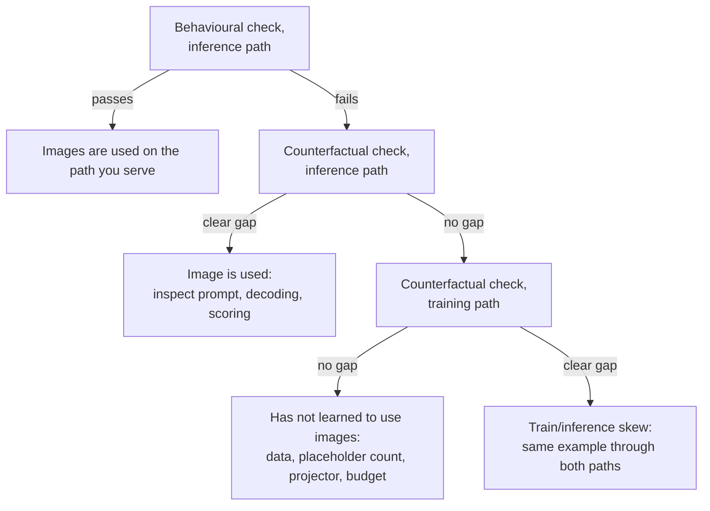

# Testing a VLM

A vision-language model (VLM) can finish training with a low loss and still answer, when it is run,
as if it had been given no image, and no error is raised. A robot policy built on such a backbone
receives the instruction and no usable view of the scene. Three checks find this before anything is
built on the model; in this repository the first of them returned 1 correct answer out of 300.

## The idea

A low training loss can mislead in two ways. Part of a caption can be predicted from the words
before it, so some of the loss falls without any image. And the loss is computed on the tensors
training fed, which says nothing about the tensors the model is given when it is served. What a
model can predict about text from text alone is called its **language prior**. Take one caption
written by `caption()` in
[`sim/pickup/caption_data.py`](../../sim/pickup/caption_data.py):

```text
robot arm over a table. from left to right: a red cube, a green can and a blue hex nut.
```

Everything up to the colon is fixed for a given camera (`robot arm over a table` for `front`,
`view from the robot gripper` for `wrist`). The list after it is not: the `pick_target` scene holds
3 of 4 objects, so by arithmetic there are 4 x 3 x 2 = 24 ordered lists of three, and 4 x 3 = 12
ordered pairs when one object is out of view. Which one is right is written only in the image. A
test of vision has to score that part.

Three checks follow; an **example** is one held-out image with its caption.

| Check | Question | Needs |
|---|---|---|
| Behavioural | Served as it will be used, does the model give answers that exist only in the image? | generation and a computed ground truth, on held-out inputs |
| Counterfactual input | Does the output depend on the image? | two forward passes per example (right image, mismatched image), no generation |
| Same example, both paths | Do training and inference hand the model the same tensors? | the two preprocessing paths, no model |

The behavioural check says whether there is a problem. The other two say where it is.

## How it works

### 1. The behavioural check

A behavioural check gives the model an input it has not seen, lets it generate, and compares the
output with a known answer. Five properties make the score of
[`sim/pickup/vlm_check.py`](../../sim/pickup/vlm_check.py) worth trusting.

1. **Held-out inputs**, meaning inputs not used in training. Training captions come from scene
   seeds starting at 2,000,000 (`SEED0` in `caption_data.py`), the held-out set from seeds starting
   at 3,000,000.
2. **The answer is only in the image.** The check keeps captions that contain
   `from left to right:` and prompts with the caption up to that colon.
3. **Ground truth is computed.** `caption()` projects each object into the camera with `project()`,
   sorts the visible ones by horizontal image coordinate and joins their labels.
4. **The prompt is built by the training code.** The full caption goes through
   `apply_chat_template`, which applies the tokenizer's **chat template** (its rule for wrapping a
   message in role markers) and puts one `<image>` marker in front. `ImageCaptionPipeline` applies
   the same function to every training caption. The check then cuts the string after the colon,
   leaving `<|im_start|>User:<image>robot arm over a table. from left to right:`
   ([Generating Text](14-generation.md)).
5. **Decoding is greedy**: the highest-scoring token is taken at every generation step. `top_k=1`
   masks every logit below the largest one, so the random draw that `VLM.generate` makes at its
   default temperature of 1.0 returns that token. The one exception is an exact tie for the
   maximum, which the bfloat16 logits of the script's `torch.autocast` make possible: the draw
   then picks among the tied tokens, and the script sets no seed.

One example goes through these shapes. The JPEG is opened with PIL and the processor returns
`pixel_values` of shape `[1, 3, 224, 224]` and `input_ids` of shape `[1, T]`, in which the single
`<image>` has been expanded to 256 placeholder ids, copies of the `<image>` token id that mark where
image embeddings go. Inside `VLM.forward` the ViT and projector turn the image into
`[1, 256, 512]`, which replaces the embeddings at those 256 positions
([Joining Vision and Language](30-joining-vision-and-language.md)). `generate` appends up to 28
tokens. The script decodes only the new tokens, keeps the text before the first period, and computes
two scores:

- **Exact ordering**: the prediction equals the true list as a string, so every object must be
  named and in the right place.
- **Leftmost object**: the first item of the prediction equals the first item of the truth (the
  text before the first comma, or before `" and "` in a two-object list).

### 2. The counterfactual-input check

A counterfactual check changes one input, here the image, and holds everything else fixed.

It uses **teacher forcing**: the model is given the true caption and, at every position, predicts
the next token from the true tokens before it. The cross-entropy of those predictions is the same
quantity the training loop minimises ([Training a VLM](31-training-a-vlm.md)). No text is
generated, so prompt cutting, decoding settings and string matching cannot affect the result.

For a set of held-out examples, compute two numbers:

- $L_\text{right}$: the mean loss on each caption with its own image.
- $L_\text{mismatched}$: the mean loss on each caption with the image of another example.

If the model reads its images, the mismatched image contradicts the caption and
$L_\text{mismatched}$ is clearly larger. If the two are about equal, the image is not helping the
model predict the caption along the path you used to feed it. Judge the gap against the losses
themselves: in the case below, 1.93 against 1.89, with the mismatched image scoring slightly
lower, counts as none; 0.10 against 1.18 counts as clear.

### 3. The same example through both paths

Background: the code that computes a model's inputs may differ between training and serving, and
a difference in what the two compute is a **train/inference skew** (training/serving skew in
Breck 2017, below). In this repository training decodes JPEG bytes with `fast_image_decoder` in
[`decode_and_augment.py`](../../vla_foundry/data/augmentations/decode_and_augment.py), which calls
torchvision's `decode_image` and returns uint8 tensors laid out `[3, H, W]`, and
`ImageCaptionPipeline` pads the text to `seq_len + 1` = 321 tokens. The check opens the same kind
of file with PIL and sends one unpadded prompt.

The third check takes one example, runs it through both paths, and compares what comes out: the
shape, type, minimum and maximum of `pixel_values`, and the decoded `input_ids`.

### Reading the three together

Running the counterfactual check twice, once per path, separates three situations.



The both-paths comparison needs no model and is the cheapest of the three, so it can be run first
and kept as a unit test. A fault that training and inference share passes all three ("Where it
goes wrong").

## In this repository

| What | Where |
|---|---|
| Held-out set | `custom_path.sh data` runs `caption_data` with `--scenes 1000 --seed0 3000000` into `data/custom/sim_captions_heldout` |
| Behavioural check | [`sim/pickup/vlm_check.py`](../../sim/pickup/vlm_check.py); arguments `--exp`, `--shards`, `--max` (default 300) |
| Image preprocessing | `SimpleVLMProcessor._process_image` in [`simple_vlm_processor.py`](../../vla_foundry/models/vision_language_backbones/simple_vlm_processor.py) |
| Scaling test | [`tests/essential/models/test_simple_vlm_processor_scaling.py`](../../tests/essential/models/test_simple_vlm_processor_scaling.py) |

Run the behavioural check on the newest checkpoint of `experiments/pickup/custom_vlm`:

```bash
sim/pickup/scripts/custom_path.sh check
```

It prints the first six truth and prediction pairs, the checkpoint path and both scores. The model
is rebuilt from `config_model.yaml` in the experiment directory; the processor is built by hand
(see "Where it goes wrong").

Run the scaling test, which needs neither a GPU nor a tokenizer download:

```bash
.venv/bin/python -m pytest tests/essential/models/test_simple_vlm_processor_scaling.py -q
```

It passes one random 8 x 8 uint8 image to `_process_image` as a numpy array, a PIL image and a
`[3, H, W]` tensor, and asserts that the numpy result lies within [-1, 1] and that the other two
match it. This pins the scaling step only: no test in the repository runs one example through
`ImageCaptionPipeline` and through `vlm_check.py`, so the differences in JPEG decoder (torchvision
against PIL) and padding (321 tokens against none) are not covered.

There is no script for the counterfactual check; the lab notebook records its result. The sketch
below reuses the setup of `vlm_check.py` and excludes image-placeholder targets from the loss, as
`VLMBatchHandler.prepare_inputs_and_targets` does in training. It has not been executed, only read
against `VLM.forward` and `SimpleVLMProcessor.__call__`.

```python
# continues sim/pickup/vlm_check.py after `proc` is built
import numpy as np
import torch.nn.functional as F

with tarfile.open(sorted(glob.glob(f"{a.shards}/*.tar"))[0]) as tar:
    files = {m.name: tar.extractfile(m).read() for m in tar.getmembers()}
keys = sorted(n[:-4] for n in files if n.endswith(".txt"))[:64]
texts = [apply_chat_template(proc, 1, files[k + ".txt"].decode()) for k in keys]
pils = [Image.open(io.BytesIO(files[k + ".jpg"])).convert("RGB") for k in keys]
# uint8 [3, H, W], the type and axis order training's decoder returns
tensors = [torch.from_numpy(np.array(p)).permute(2, 0, 1) for p in pils]

def mean_loss(images):
    total = 0.0
    for image, text in zip(images, texts):
        x = proc([image], [text], padding=False)
        ids = x["input_ids"].cuda()
        with torch.no_grad(), torch.autocast("cuda", dtype=torch.bfloat16):
            logits = model(input_ids=ids, pixel_values=x["pixel_values"].cuda()).logits
        targets = ids[0, 1:].clone()
        targets[targets == proc.image_token_id] = -100
        total += F.cross_entropy(logits[0, :-1].float(), targets, ignore_index=-100).item()
    return total / len(texts)

for name, images in (("PIL", pils), ("uint8 tensor", tensors)):
    # keys sort as <seed>_front, <seed>_wrist: a shift of 2 gives the same camera in another scene
    print(name, "right", mean_loss(images), "mismatched", mean_loss(images[2:] + images[:2]))
```

To reproduce the old training path for a model trained before the pixel-range fix ("What we
measured"), feed `t.float()` for each tensor `t`: a float tensor is not divided by 255.

## What we measured

All numbers are from the [lab notebook](../lab-notebook.md), on machine A (one RTX 4090, 24 GB)
unless noted. The model is stage 2 of the from-scratch path: 96.5M parameters, trained on 40,000
captioned sim renders for 400k samples.

**The first result.** The check gave 1/300 on exact ordering and 70/300 on the leftmost object; the
notebook's bug table rounds this to "captioning 0%". By arithmetic 70/300 is 23%, close to the 25%
that naming one of four labels at random would give. That comparison is an interpretation: how
often each object is leftmost in the held-out set was not measured.

**First suspect: the prompt.** A prompt in a format the model was not trained on can fail this
way. `vlm_check.py` builds its prompt with `apply_chat_template`, as training does, which leaves
the cut after the colon and the missing padding as differences. The next test, which generates no
text, clears the prompt, as does the unchanged check's 256/300 on a model trained with the fixed
processor.

**The decisive test.** The teacher-forced loss on the true caption was computed with the right
image and with a mismatched one, feeding the images two ways:

| Images fed as | Right image | Mismatched image |
|---|---|---|
| PIL images, as the check feeds them | 1.93 | 1.89 |
| unscaled uint8 tensors, as training fed them | 0.10 | 1.18 |

On the inference path the image made no difference; on the training path it did. This is the last
branch of the flowchart: the model had learned to use images, and at inference it was shown
something else. The fault had to be in the code between the image file and `pixel_values`.

**Root cause.** `SimpleVLMProcessor` scaled PIL and numpy images to [0, 1] and left uint8 tensors at
0 to 255. By arithmetic a white pixel reached the ViT as 509 in training and as 1 in the check, so
the check's inputs covered 2 of the 510 units the model was trained on.
[Train and Inference Must See the Same Thing](93-train-inference-skew.md) tells this bug in full.

**After the fix.** The tensor branch of `_process_image` now divides uint8 tensors by 255, and
stage 2 has to be trained again: weights fitted to inputs up to 509 keep failing the check.
Trained with the fixed processor, the stage-2 model lists the objects in left-to-right order on
256 of the first 300 held-out `from left to right:` captions (85%) and names the leftmost object on
285/300 (95%); its training loss is 0.058. On machine B (L40S GPUs, 128 CPU cores) the same stages
gave 249/300 (83%) and 279/300 (93%), loss 0.058. Neither model had the position-table fix ("Where
it goes wrong"); retrained with it on machine B, same data and budget, stage 2 gives 267/300 (89%)
and 286/300 (95%), loss 0.059. Each is one training seed, and the notebook treats differences of a
few percent between single runs as noise.

What this does not show: which errors make up the remaining 44 captions of the machine A model,
how the model does on the other caption forms, or that a policy built on the model uses what it
learned. In the first round the stage-3 policy built on stage 2 scored 0/100 on `pick_target`, and
the same architecture with a randomly initialised VLM 1/100
([The From-Scratch Path](62-the-from-scratch-path.md),
[Loss Is Not Success](91-loss-is-not-success.md)). The [field notes](../notes.md) ("Pretraining a
backbone: mainly an earlier start") say that pair told nothing about pretraining: with one vector
handed to the action head (the network that generates the actions;
[50](50-what-the-action-head-sees.md)), history as inputs ([52](52-history-and-shortcuts.md)) and
1.0M samples on 1500 demonstrations ([71](71-how-much-data-and-training.md)), neither policy could
have found the object. Rerun on machine B with every token handed to the action head, no history,
4000 demonstrations and 3M samples, the policy on the caption-pretrained backbone (stage 2
retrained with the fix) ends at 86% / 87% and the one on a randomly initialised backbone at
75% / 85% (trained / averaged weights). The pretrained one starts to look after 0.25M samples, the
other after about 1.0M; chapter 102, still to come, compares the two.

**The same questions, asked of a policy.** For a policy the behavioural measure is the **slope** of
where the gripper first closed against where the named object was (`sim/pickup/summarize.py`
prints it): 1 if it closes where the object is, 0 if the place does not depend on the scene. The
counterfactual input is the frozen-camera probe, `eval.py --stale_images`, which keeps sending the
first frame's images. On machine B, `dp_vit_lang_reactive` (4000 demonstrations, 5.0M samples,
averaged (EMA) weights) has a slope of 0.98 and succeeds on 85/100 unseen layouts. With frozen
images it succeeds on 1/100, yet it still closes at the named object in 99% of episodes, 17 mm
away (median) against 7 mm with live images: the first look
decides where it goes, and later frames matter only for the last centimetres
([95-what-a-policy-looks-at.md](95-what-a-policy-looks-at.md)). A check that passes shows that an
input is used, not when. A check that fails may be early: the same run had a slope of 0.11 / 0.14
after 1.0M samples and 0.81 / 0.96 after 2.0M (trained / averaged weights;
[71-how-much-data-and-training.md](71-how-much-data-and-training.md)), so check every checkpoint
before judging a design.

## Where it goes wrong

**The check shares the training path.** What you see: the check passes and the deployed model
ignores images. Why: a check that loads its examples through the training pipeline repeats
training's mistakes; here it would have fed unscaled tensors, where the loss with the right image
was 0.10. What to do: feed the check the way the served model is fed
([Train and Inference Must See the Same Thing](93-train-inference-skew.md)).

**A fault that training and inference share.** All three checks pass, because an error made
identically on both paths shows in none of them while the model can still learn the task. Here the
language model's table of rotary position angles was computed in bfloat16 under autocast, and
positions above 256 collapsed onto even numbers (641 distinct positions out of 2048 in all;
notebook, bug table; [Telling Tokens Where They Are](12-positions.md)). A stage-2 caption starts
at position 259, so neighbouring caption tokens shared a rotation on both paths. A test of the
component itself does find it (`tests/essential/models/test_rotary_precision.py`). The table is
now computed in float32; the stage-2 VLM retrained with it scores 267/300 against 249/300 before
(machine B, one seed each; "What we measured"). Check a model trained before that fix with
`positional_embedding_type: rotary_legacy_autocast` under `transformer` in its `config_model.yaml`, or the check itself gives old weights a table they were not trained on
([Generating Text](14-generation.md)).

**A float image in 0 to 255.** The pixel-range fix and its test cover uint8 input.
`_process_image` treats a float tensor or a float numpy array as already scaled, so a float image
with values up to 255 still comes out with a maximum of 509. How to check: print
`pixel_values.min()` and `.max()` where your code calls the processor (exercise 3).

**The mismatched image has the same answer.** Two scenes can share a caption, for example two
single-object captions that place the red cube in the same region, and swapping those images
changes nothing even for a working model. Average over tens of examples and take the substitute
from another scene, not from the other camera of the same scene.

**The check's processor disagrees with the config.** `vlm_check.py` constructs
`SimpleVLMProcessor()` with its default 224-pixel size and sets `proc.image_seq_length = 256` by
hand, matching `data.image_size` and `data.img_num_tokens` in
[`custom_vlm.yaml`](../../sim/pickup/configs/custom_vlm.yaml). If an image no longer yields 256
tokens (another `patch_size`, for example), the assertion in `VLM.forward` that counts placeholder
ids against image tokens fails. Edit the two lines that build `proc` when the config changes.

**Exact match fails for reasons that are not vision.** The comparison is string equality after
cutting at the first period. A list cut short by `max_new_tokens=28`, a missing article or an extra
space counts the same as a wrong object. Read the six printed pairs before interpreting a low
score, and work out what guessing would give.

## Background and further reading

Background: none of the following was measured here.

- Goyal, [Making the V in VQA Matter](https://arxiv.org/abs/1612.00837) (2016). Showed that
  visual-question-answering models could score well from language priors, and rebalanced the dataset
  by pairing each question with two similar images that have different answers.
- Li, [Evaluating Object Hallucination in Large Vision-Language Models](https://arxiv.org/abs/2305.10355)
  (2023). POPE: a behavioural check made of yes/no questions about whether an object is present.
- Karpathy, [A Recipe for Training Neural Networks](https://karpathy.github.io/2019/04/25/recipe/)
  (2019). A blog post that recommends an input-independent baseline, for example training with all
  inputs set to zero; the counterfactual check applies that idea to one input.
- Breck, [The ML Test Score](https://research.google/pubs/pub46555/) (IEEE Big Data, 2017). A rubric
  of 28 tests and monitoring needs for production machine-learning systems. One of them (Monitor 3)
  checks that training and serving features compute the same values.

## Check yourself

1. Run `sim/pickup/scripts/custom_path.sh check`. For each wrong prediction among the six printed
   pairs, say whether an object is wrong, the order is wrong, or the string differs for another
   reason.
2. Fill in the table from "The decisive test" for two other faults: a model that has not learned
   to use images, and one that uses images but is prompted in the wrong format.
3. Run this and explain the third line of output:

   ```bash
   .venv/bin/python - <<'EOF'
   import numpy as np, torch
   from PIL import Image
   from vla_foundry.models.vision_language_backbones.simple_vlm_processor import SimpleVLMProcessor as P

   p = P.__new__(P)  # skips the tokenizer download
   p.image_size, p._mean, p._std = 224, 0.5, 0.5
   hwc = np.random.default_rng(0).integers(0, 256, size=(224, 224, 3), dtype=np.uint8)
   chw = torch.from_numpy(hwc).permute(2, 0, 1)
   for img in (Image.fromarray(hwc), chw, chw.float()):  # PIL, uint8 tensor, float tensor
       out = p._process_image(img)
       print(tuple(out.shape), out.min().item(), out.max().item())
   EOF
   ```

4. Using `caption()`, design a second behavioural check from the `is leftmost` caption form: write
   down the prompt, the ground truth and the guessing rate.
