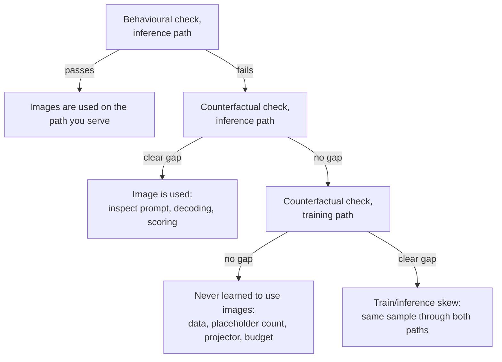

# Testing a VLM

A vision-language model (VLM) can finish training with a low loss and still answer, when it is run,
as if it had been given no image, and no error is raised. A robot policy built on such a backbone
receives the instruction and no usable view of the scene. Three checks find this before anything is
built on the model; in this repository the first of them returned 1 correct answer out of 300.

## The idea

A low training loss can mislead in two ways. Part of a caption can be predicted from the words
before it, so some of the loss falls without any image. And the loss is computed on the tensors
training fed, which says nothing about the tensors the model is given when it is served. What a
model can predict about text from text alone is called its **language prior**. Take one caption
written by `caption()` in
[`sim/pickup/caption_data.py`](../../sim/pickup/caption_data.py):

```text
robot arm over a table. from left to right: a red cube, a green can and a blue hex nut.
```

Everything up to the colon is fixed for a given camera (`robot arm over a table` for `front`,
`view from the robot gripper` for `wrist`). The list after it is not: the `pick_target` scene holds
3 of 4 objects, so by arithmetic there are 4 x 3 x 2 = 24 ordered lists of three, and 4 x 3 = 12
ordered pairs when one object is out of view. Which one is right is written only in the image. A
test of vision has to score that part.

Three checks follow.

| Check | Question | Needs |
|---|---|---|
| Behavioural | Served as it will be used, does the model give answers that exist only in the image? | generation and a computed ground truth, on held-out inputs |
| Counterfactual input | Does the output depend on the image? | two forward passes per sample (right image, mismatched image), no generation |
| Same sample, both paths | Do training and inference hand the model the same tensors? | the two preprocessing paths, no model |

The behavioural check says whether there is a problem. The other two say where it is.

## How it works

### 1. The behavioural check

A behavioural check gives the model an input it has not seen, lets it generate, and compares the
output with a known answer. Five properties make the score of
[`sim/pickup/vlm_check.py`](../../sim/pickup/vlm_check.py) worth trusting.

1. **Held-out inputs**, meaning inputs not used in training. Training captions come from scene
   seeds starting at 2,000,000 (`SEED0` in `caption_data.py`), the held-out set from seeds starting
   at 3,000,000.
2. **The answer is only in the image.** The check keeps captions that contain
   `from left to right:` and prompts with the caption up to that colon.
3. **Ground truth is computed.** `caption()` projects each object into the camera with `project()`,
   sorts the visible ones by horizontal image coordinate and joins their labels.
4. **The prompt is built by the training code.** The full caption goes through
   `apply_chat_template`, which applies the tokenizer's **chat template** (its rule for wrapping a
   message in role markers) and puts one `<image>` marker in front. `ImageCaptionPipeline` applies
   the same function to every training caption. The check then cuts the string after the colon,
   leaving `<|im_start|>User:<image>robot arm over a table. from left to right:`
   ([Generating Text](14-generation.md)).
5. **Decoding is greedy**: the highest-scoring token is taken at every step. `top_k=1` masks every
   logit below the largest one, so the draw inside `VLM.generate` (a `torch.multinomial` call,
   because `temperature` keeps its default 1.0) returns that token. The one exception is an exact
   tie for the maximum, which the bfloat16 logits of the script's `torch.autocast` make possible:
   tied tokens all survive the filter, the draw picks among them, and the script sets no seed.

One sample goes through these shapes. The JPEG is opened with PIL and the processor returns
`pixel_values` of shape `[1, 3, 224, 224]` and `input_ids` of shape `[1, T]`, in which the single
`<image>` has been expanded to 256 placeholder ids, copies of the `<image>` token id that mark where
image embeddings go. Inside `VLM.forward` the ViT and projector turn the image into
`[1, 256, 512]`, which replaces the embeddings at those 256 positions
([Joining Vision and Language](30-joining-vision-and-language.md)). `generate` appends up to 28
tokens. The script decodes only the new tokens, keeps the text before the first period, and computes
two scores:

- **Exact ordering**: the prediction equals the true list as a string, so every object must be
  named and in the right place.
- **Leftmost object**: the first item of the prediction equals the first item of the truth (the
  text before the first comma, or before `" and "` in a two-object list).

### 2. The counterfactual-input check

A counterfactual check changes one input, here the image, and holds everything else fixed.

It uses **teacher forcing**: the model is given the true caption and, at every position, predicts
the next token from the true tokens before it. The cross-entropy of those predictions is the same
quantity the training loop minimises ([Training a VLM](31-training-a-vlm.md)). No text is
generated, so prompt cutting, decoding settings and string matching cannot affect the result.

For a set of held-out samples, compute two numbers:

- $L_\text{right}$: the mean loss on each caption with its own image.
- $L_\text{mismatched}$: the mean loss on each caption with the image of another sample.

If the model reads its images, the mismatched image contradicts the caption and
$L_\text{mismatched}$ is clearly larger. If the two are about equal, the image is not helping the
model predict the caption along the path you used to feed it. Judge the gap against the losses
themselves: in the case below, 0.04 on a loss of about 1.9, with the mismatched image scoring
slightly lower, counts as none; 1.08 on a loss of 0.10 counts as clear.

### 3. The same sample through both paths

Background: the code that computes a model's inputs may differ between training and serving, and
a difference in what the two compute is called training/serving skew (Breck 2017, below). In this
repository training decodes JPEG bytes with `fast_image_decoder` in
[`decode_and_augment.py`](../../vla_foundry/data/augmentations/decode_and_augment.py), which calls
torchvision's `decode_image` and returns uint8 tensors laid out `[3, H, W]`, and
`ImageCaptionPipeline` pads the text to `seq_len + 1` = 321 tokens. The check opens the same kind
of file with PIL and sends one unpadded prompt.

The third check takes one sample, runs it through both paths, and compares what comes out: the
shape, type, minimum and maximum of `pixel_values`, and the decoded `input_ids`.

### Reading the three together

Running the counterfactual check twice, once per path, separates three situations.



The flowchart orders the checks by what each result implies, not by cost. The both-paths comparison
needs no model and is the cheapest of the three, so it can be run first and kept as a unit test. In
the case below a white pixel came out, by arithmetic, as 1 on one path and 509 on the other.

## In this repository

| What | Where |
|---|---|
| Held-out set | `custom_path.sh data` runs `caption_data` with `--scenes 1000 --seed0 3000000` into `data/custom/sim_captions_heldout` |
| Behavioural check | [`sim/pickup/vlm_check.py`](../../sim/pickup/vlm_check.py); arguments `--exp`, `--shards`, `--max` (default 300) |
| Image preprocessing | `SimpleVLMProcessor._process_image` in [`simple_vlm_processor.py`](../../vla_foundry/models/vision_language_backbones/simple_vlm_processor.py) |
| Scaling test | [`tests/essential/models/test_simple_vlm_processor_scaling.py`](../../tests/essential/models/test_simple_vlm_processor_scaling.py) |

Run the behavioural check on the newest checkpoint of `experiments/pickup/custom_vlm`:

```bash
sim/pickup/scripts/custom_path.sh check
```

It prints the first six truth and prediction pairs, the checkpoint path and both scores. The model
is rebuilt from `config_model.yaml` in the experiment directory; the processor is built by hand
(see "Where it goes wrong").

Run the scaling test, which needs neither a GPU nor a tokenizer download:

```bash
.venv/bin/python -m pytest tests/essential/models/test_simple_vlm_processor_scaling.py -q
```

It builds one random 8 x 8 uint8 image, passes it to `_process_image` as a numpy array, a PIL image
and a `[3, H, W]` tensor, and asserts that the numpy result lies within [-1, 1] and that the PIL and
tensor results match it (`torch.testing.assert_close`). This pins the scaling step only. No test in
the repository runs one sample through `ImageCaptionPipeline` and through `vlm_check.py` and
compares the results, so the differences in JPEG decoder (torchvision against PIL) and padding (321
tokens against none) are not covered.

There is no script for the counterfactual check; the lab notebook records its result. The sketch
below reuses the setup of `vlm_check.py` and excludes image-placeholder targets from the loss, as
`VLMBatchHandler.prepare_inputs_and_targets` does in training. It is not a file in the repository
and has not been executed; it was checked by reading against `VLM.forward` and
`SimpleVLMProcessor.__call__`.

```python
# continues sim/pickup/vlm_check.py after `proc` is built
import numpy as np
import torch.nn.functional as F

with tarfile.open(sorted(glob.glob(f"{a.shards}/*.tar"))[0]) as tar:
    files = {m.name: tar.extractfile(m).read() for m in tar.getmembers()}
keys = sorted(n[:-4] for n in files if n.endswith(".txt"))[:64]
texts = [apply_chat_template(proc, 1, files[k + ".txt"].decode()) for k in keys]
pils = [Image.open(io.BytesIO(files[k + ".jpg"])).convert("RGB") for k in keys]
# uint8 [3, H, W], the type and layout training's decoder returns
tensors = [torch.from_numpy(np.array(p)).permute(2, 0, 1) for p in pils]

def mean_loss(images):
    total = 0.0
    for image, text in zip(images, texts):
        x = proc([image], [text], padding=False)
        ids = x["input_ids"].cuda()
        with torch.no_grad(), torch.autocast("cuda", dtype=torch.bfloat16):
            logits = model(input_ids=ids, pixel_values=x["pixel_values"].cuda()).logits
        targets = ids[0, 1:].clone()
        targets[targets == proc.image_token_id] = -100
        total += F.cross_entropy(logits[0, :-1].float(), targets, ignore_index=-100).item()
    return total / len(texts)

for name, images in (("PIL", pils), ("uint8 tensor", tensors)):
    # keys sort as <seed>_front, <seed>_wrist: a shift of 2 gives the same camera in another scene
    print(name, "right", mean_loss(images), "mismatched", mean_loss(images[2:] + images[:2]))
```

To reproduce the old training path for a checkpoint trained before the fix, feed `t.float()` for
each tensor `t`: a float tensor is not divided by 255.

## What we measured

All numbers are from the [lab notebook](../lab-notebook.md), on machine A (one 24 GB RTX 4090)
unless noted. The model is stage 2 of the from-scratch path: 96.5M parameters, trained on 40,000
captioned sim renders for 400k samples.

**The first result.** The check gave 1/300 on exact ordering and 70/300 on the leftmost object; the
notebook's bug table rounds this to "captioning 0%". By arithmetic 70/300 is 23%, close to the 25%
that naming one of four labels at random would give. That comparison is an interpretation: how
often each object is leftmost in the held-out set was not measured.

**First suspect: the prompt.** A prompt in a format the model was not trained on can produce this
kind of failure, and it is the cheapest thing to inspect. `vlm_check.py` builds its prompt with
`apply_chat_template`, as the training pipeline does, which removes the chat template as a
difference but not the cut after the colon or the missing padding. What clears the prompt is the
next test, which generates no text and so involves no cut, and the fact that the check as it stands
scores 256/300 on a model trained with the fixed processor. The notebook records no score for a
prompt written by hand.

**The decisive test.** The teacher-forced loss on the true caption was computed with the right
image and with a mismatched one, feeding the images two ways:

| Images fed as | Right image | Mismatched image |
|---|---|---|
| PIL images, as the check feeds them | 1.93 | 1.89 |
| unscaled uint8 tensors, as training fed them | 0.10 | 1.18 |

On the inference path the image made no difference. On the training path the right image brought
the loss to 0.10 and a wrong one raised it to 1.18. This is the last branch of the flowchart: the
model had learned to use images, and at inference it was shown something else. The fault had to be
in the code between the image file and `pixel_values`.

**Root cause.** `SimpleVLMProcessor` scaled PIL and numpy images to [0, 1] and left uint8 tensors at
0 to 255. Both then went through the same normalisation, `(img - 0.5) / 0.5`. By arithmetic, a
white pixel became 1 from a PIL image and (255 - 0.5) / 0.5 = 509 from a tensor. The ViT was
trained on -1 to 509 and tested on [-1, 1], which by arithmetic covers 2 of those 510 units, about
0.4% of that range. A reading consistent with the equal losses, though not measured here, is that
every inference image looked to the ViT like a nearly uniform dark frame, so right and mismatched
images were indistinguishable.

**Fix and test.** The tensor branch of `_process_image` now divides uint8 tensors by 255, and
`test_simple_vlm_processor_scaling.py` holds the three input types to one output. With the fixed
processor the stage-2 model lists the objects in left-to-right order on 256 of the first 300
held-out `from left to right:` captions (85%; the notebook calls these 300 held-out scenes, and
each scene can contribute a front and a wrist image) and names the leftmost object on 285/300
(95%); its training loss is 0.058. Repeated on machine B, the same stages gave 249/300 (83%) and
279/300 (93%) with the same final loss of 0.058. Each is one training seed, and the notebook treats
differences of a few percent between single runs as noise. A checkpoint trained before the fix was
fitted to inputs up to 509 and keeps failing the check; stage 2 has to be trained again.

What this does not show: which errors make up the remaining 44 captions, how the model does on the
other caption forms, or that a policy built on the model uses what it learned. The notebook lists
the stage-3 policy built on stage 2 at 0/100 on `pick_target`, and the same architecture with a
randomly initialised VLM at 1/100
([The From-Scratch Path](62-the-from-scratch-path.md),
[Loss Is Not Success](91-loss-is-not-success.md)).

## Where it goes wrong

**The check shares the training path.** What you see: the check passes and the deployed model
ignores images. Why: a check that loads its samples through the training pipeline repeats
training's mistakes; here it would have fed unscaled tensors, where the loss with the right image
was 0.10. What to do: feed the check the way the served model is fed
([Train and Inference Must See the Same Thing](93-train-inference-skew.md)).

**A float image in 0 to 255.** The fix and the test cover uint8 input. `_process_image` treats a
float tensor or a float numpy array as already scaled, so a float image with values up to 255 still
comes out with a maximum of 509. How to check: print `pixel_values.min()` and `.max()` where your
code calls the processor (exercise 3).

**The mismatched image has the same answer.** Two scenes can share a caption, for example two
single-object captions that place the red cube in the same region, and swapping those images
changes nothing even for a working model. Average over tens of samples and take the substitute
from another scene, not from the other camera of the same scene.

**The check's processor disagrees with the config.** `vlm_check.py` constructs
`SimpleVLMProcessor()` with its default 224-pixel size and sets `proc.image_seq_length = 256` by
hand, matching `data.image_size` and `data.img_num_tokens` in
[`custom_vlm.yaml`](../../sim/pickup/configs/custom_vlm.yaml). If the ViT changes so that an image
no longer yields 256 tokens (another `patch_size`, for example), the assertion in `VLM.forward`
that counts placeholder ids against image tokens fails. Edit the two lines that build `proc` when
the config changes.

**Exact match fails for reasons that are not vision.** The comparison is string equality after
cutting at the first period. A list cut short by `max_new_tokens=28`, a missing article or an extra
space counts the same as a wrong object. Read the six printed pairs before interpreting a low
score, and work out what guessing would give.

## Background and further reading

Background: none of the following was measured here.

- Goyal, [Making the V in VQA Matter](https://arxiv.org/abs/1612.00837) (2016). Showed that
  visual-question-answering models could score well from language priors, and rebalanced the dataset
  by pairing each question with two similar images that have different answers.
- Li, [Evaluating Object Hallucination in Large Vision-Language Models](https://arxiv.org/abs/2305.10355)
  (2023). POPE: a behavioural check made of yes/no questions about whether an object is present.
- Karpathy, [A Recipe for Training Neural Networks](https://karpathy.github.io/2019/04/25/recipe/)
  (2019). A blog post that recommends an input-independent baseline, for example training with all
  inputs set to zero; the counterfactual check applies that idea to one input.
- Breck, [The ML Test Score](https://research.google/pubs/pub46555/) (IEEE Big Data, 2017). A rubric
  of 28 tests and monitoring needs for production machine-learning systems. One of them (Monitor 3)
  checks that training and serving features compute the same values; the paper says a difference is
  sometimes called training/serving skew.

## Check yourself

1. Run `sim/pickup/scripts/custom_path.sh check`. For each wrong prediction among the six printed
   pairs, say whether an object is wrong, the order is wrong, or the string differs for another
   reason.
2. Fill in the table from "The decisive test" for two other faults: a model that never learned to
   use images, and one that uses images but is prompted in the wrong format.
3. Run this and explain the third line of output:

   ```bash
   .venv/bin/python - <<'EOF'
   import numpy as np, torch
   from PIL import Image
   from vla_foundry.models.vision_language_backbones.simple_vlm_processor import SimpleVLMProcessor as P

   p = P.__new__(P)  # skips the tokenizer download
   p.image_size, p._mean, p._std = 224, 0.5, 0.5
   hwc = np.random.default_rng(0).integers(0, 256, size=(224, 224, 3), dtype=np.uint8)
   chw = torch.from_numpy(hwc).permute(2, 0, 1)
   for img in (Image.fromarray(hwc), chw, chw.float()):  # PIL, uint8 tensor, float tensor
       out = p._process_image(img)
       print(tuple(out.shape), out.min().item(), out.max().item())
   EOF
   ```

4. Using `caption()`, design a second behavioural check from the `is leftmost` caption form: write
   down the prompt, the ground truth and the guessing rate.
