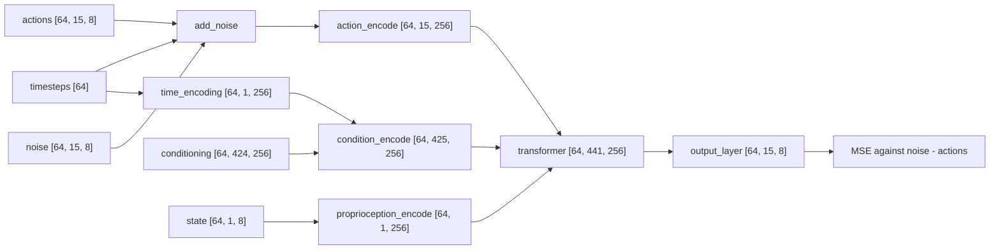

# Generating Actions with Flow Matching

A policy turns one observation into a short sequence of actions, and for many observations more than
one sequence is correct. A network trained with squared error to output "the" action learns the
average of the correct ones, which can be an action no demonstration contains. Flow matching is how
the action head (the part of the policy that outputs actions) in this repository avoids that: it
learns to carry random noise to actions, and each call returns one draw.

## The idea

**Regression** means feeding the observation in, reading the action out, and training with mean
squared error (MSE) against the demonstrated action. The output that minimises MSE is the mean of
all targets seen for that input, which is wrong when those targets disagree.

Take an action of two numbers. For one observation, half the demonstrations say $a_1 = (-1, 0)$
and half say $a_2 = (+1, 0)$: reach for one of two objects when nothing says which. The summed
squared distance to the two targets is smallest at $(0, 0)$, a point in no demonstration. On a
robot it is the gap between the objects. (The policies that failed here did something else:
[What we measured](#what-we-measured).)

A distribution with several separate peaks is **multimodal**, and each peak is a **mode**. The fix
is to stop predicting a point and learn to draw from the distribution: return $a_1$ on some calls
and $a_2$ on others, never the middle. One returned action is a **draw**; the procedure that
produces it is the **sampler**. Diffusion and flow matching both build it from three moves:

1. Take a demonstrated action and mix it with Gaussian noise by a random amount.
2. Train the network, given the mixture and the amount, to predict the noise or, equivalently, the
   direction between the noise and the action.
3. To act, start from pure noise and follow the predicted direction in a few moves, the
   **flow steps**, until no noise is left.

The second move is still MSE regression, which averages; the third still does not return the
average action.

<!-- interactive: flow-matching -->
*Figure: points of noise carried to two targets by the learned flow; with few flow steps, or a
field that hedges, the draws land between the targets.*

## How it works

### The path between an action and noise

Let $a$ be a clean action, $\epsilon$ noise of the same shape drawn from a standard normal, and
$s$ the noise level. The mixture is a point on the straight line from the action to the noise:

$$x_s = a + s\,(\epsilon - a) = (1 - s)\,a + s\,\epsilon$$

At $s = 0$ it is the action, at $s = 1$ the noise. Moving along the line as $s$ grows, the velocity
is the same everywhere: $\epsilon - a$. The network $v_\theta$ sees the mixture, the noise level and
the observation $o$, and is trained to output that velocity:

$$L = \mathbb{E}_{a,\,\epsilon,\,s}\;\big\lVert\,v_\theta(x_s, s, o) - (\epsilon - a)\,\big\rVert^2$$

Background: this is the straight-path case of flow matching (Lipman et al., below) and the
interpolation of rectified flow (Liu et al., below). The diffusion model DDPM (Ho et al., below)
mixes as $x_t = \sqrt{\bar\alpha_t}\,a + \sqrt{1 - \bar\alpha_t}\,\epsilon$, an arc instead of a
straight line, and its network predicts the noise.

### Why averaging directions does not average actions

Many pairs of action and noise produce the same mixture, so the target at a given point is not
unique, and the MSE-optimal output there is the average target. On the line,
$\epsilon - a = (x_s - a)/s$, which gives

$$v^*(x, s) = \mathbb{E}\,[\,\epsilon - a \mid x_s = x\,] = \frac{x - \hat a(x, s)}{s},
\qquad \hat a(x, s) = \mathbb{E}\,[\,a \mid x_s = x\,]$$

The ideal output is the vector from $\hat a$ to $x$, scaled by $1/s$; the sampler subtracts it, so
each flow step moves $x$ toward $\hat a$. Here $\hat a$ is the current best guess of the action:
the targets weighted by how likely each is to have produced $x$, which depends on the noise level.

- Near $s = 1$ the mixture is almost all noise and says nothing about which target it came from.
  The weights are equal and $\hat a \approx (0, 0)$, the regression answer.
- As $s$ shrinks, points from $a_1$ and points from $a_2$ separate, the weights go to 0 and 1, and
  $\hat a$ becomes the target on the side where $x$ is.

The averaging is still there, but it happens at each point of the path separately, and late on the
path the average is over one target only. Background: Lipman et al. (below) prove the general
statement: the averaged field, integrated exactly, carries the noise distribution onto the data
distribution, so draws land on the targets in the proportions the data has them.

The targets that enter $\hat a$ are the actions demonstrated for inputs the network does not tell
apart. A network that ignores the images learns the flow for every action in the data that starts
from that arm pose, and a draw is one clean action from that pool: right for some scene, not this
one ([What we measured](#what-we-measured)).

### The sampler

The sampler integrates the velocity backwards from noise in Euler steps, the flow steps:
$x \leftarrow x - v\,\Delta$, where $\Delta$ is the fraction of the path covered per flow step.
With the ideal field each flow step moves the point a fraction $\Delta / s$ of the way to the
current guess $\hat a$. Starting at $x = (0.5, 0.8)$ with ten flow steps:

```text
(0.45, 0.72) (0.41, 0.64) (0.37, 0.56) (0.35, 0.48) (0.35, 0.40)
(0.41, 0.32) (0.53, 0.24) (0.69, 0.16) (0.85, 0.08) (1.00, 0.00)
```

The first four flow steps head for the origin, the average. Around $s = 0.6$ the path bends, and it
ends on $(1, 0)$.

The same toy with 10,000 starting points drawn from a standard normal (arithmetic, not a
measurement; script in [Check yourself](#check-yourself)):

| Flow steps | Within 0.1 of a target | In the middle (first coordinate within ±0.5) |
|---|---|---|
| 1 | 0.0% | 100.0% |
| 2 | 13.9% | 41.2% |
| 4 | 89.6% | 3.8% |
| 10 | 100.0% | 0.0% |
| 10, weights flattened 16 times | 42.9% | 23.2% |

- One flow step is regression: a single jump from $s \approx 1$ lands on $\hat a$ at full noise,
  the mean of the targets.
- Few flow steps leave draws between the modes: the target is chosen mid-path, and a coarse sampler
  crosses that stretch in one or two jumps aimed at an outdated guess.
- A field that does not commit does the same: the last row divides the exponent of the weights by
  16, a stand-in for a network that hedges between its targets.

With a single target the toy lands on it in one flow step: how many a policy needs depends on how
far apart its modes for one observation are. A working sampler has a signature: two draws for one
input are either close together, within one mode, or about the distance between two modes apart.

## In this repository

The class is called `DiffusionPolicy`, but the preset
[`vla_foundry/config_presets/models/diffusion_policy.yaml`](../../vla_foundry/config_presets/models/diffusion_policy.yaml)
sets `use_flow_matching_scheduler: true`, and what it trains is the objective above.

| Piece | Where | What it does |
|---|---|---|
| Noise and target | `DiffusionPolicyBatchHandler` in [`vla_foundry/models/batch_handlers.py`](../../vla_foundry/models/batch_handlers.py) | `prepare_inputs` sets `batch["noise"] = torch.randn_like(batch["actions"])`; `prepare_inputs_and_targets` sets `targets = inputs["noise"] - inputs["actions"]` |
| Noise level | `DiffusionPolicy.forward` in [`vla_foundry/models/diffusion_policy/diffusion_policy.py`](../../vla_foundry/models/diffusion_policy/diffusion_policy.py) | `torch.randint(0, self.scheduler.num_timesteps, ...)`: one noise level $t$ per window in the batch, uniform over 0..999 (a timestep in the code, not a control step) |
| Mixture | `FlowMatchingScheduler.add_noise` in [`vla_foundry/models/diffusion/noise_scheduler_diffusers.py`](../../vla_foundry/models/diffusion/noise_scheduler_diffusers.py) | `x_start + scale * (noise - x_start) * mask_expanded`, where `scale` is the timestep divided by `self.num_timesteps`, so $s = t / 1000$ |
| Loss | `masked_mse_loss` in [`vla_foundry/losses.py`](../../vla_foundry/losses.py) | chosen by `loss_function: "mse"` in `vla_foundry/config_presets/hparams/diffusion_policy.yaml` |
| Flow step | `FlowMatchingScheduler.step` | `sample - model_output * (step_size / self.num_timesteps)`, clamped like the mixture to `clamp_range`: `[-3, 3]` in the preset, `(-1.5, 1.5)` by default in `NoiseSchedulerParams` ([40-action-spaces.md](40-action-spaces.md)) |

With `sim/pickup/configs/dp_vit_lang_reactive.yaml`, the config of the policy that works here
(batch 64, the current control step and 14 future ones, 8-D actions), the forward pass of one
optimiser step has these shapes:



The **conditioning** is the tensor the backbone hands to the action head, here 32 instruction
slots and 196 patch tokens from each of two camera frames
([50-what-the-action-head-sees.md](50-what-the-action-head-sees.md)). The noise level and the joint
state are separate inputs: `_build_transformer_input` puts the `time_encoding` row for $t$ in front
of the conditioning as one token (`diffusion_step_conditioning: concat`, the default).
`output_layer` reads the last 15 positions, the action-step tokens (one per predicted action).

### Ten flow steps across 1000 noise levels

`DiffusionPolicy.generate_actions` computes
`step_size = max(1, self.scheduler.num_timesteps // num_inference_steps)` and loops over
`range(self.scheduler.num_timesteps - 1, 0, -step_size)`. With 10 flow steps that is
`step_size = 100` and $t$ = 999, 899, ..., 99: ten passes of the action transformer, each followed
by a `step` that subtracts `100 / 1000` of the predicted direction. With 1 it is one pass at
$t$ = 999 that subtracts the whole direction. The backbone runs once per chunk (the 15 future
actions predicted in one go, [42-chunks-and-execution.md](42-chunks-and-execution.md)), before the
loop, through `get_action_conditioning`.

The count is `--flow_steps` in `sim/pickup/eval.py` (default 10); `eval.sh` passes it through, and
`PICKUP_OUT` keeps each setting in its own directory. For a run of the README's recipe (4000
demonstrations with random start poses and recoveries, `dp_vit_lang_reactive`, 5M samples; the
config saves averaged weights itself), on which 2 flow steps gave 94/100 against 94/100 with 10:

```bash
PICKUP_OUT=results/pickup/my_run/pick_target/flow_2 \
  sim/pickup/scripts/eval.sh experiments/pickup/my_run pick_target 100 --flow_steps 2
```

### The past action stays clean

`dp_vit_lang_reactive` has no past row: all 15 rows of its action sequence start as noise. The
configs with history (`dp_vit.yaml`, `dp_vit_lang.yaml`) keep the data preset's
`lowdim_past_timesteps: 1`: their 16 rows start with the action that was just executed, an input.
`forward` leaves it clean (`mask=future_mask`, then `torch.where`), `vla_foundry/train.py` passes
the same mask to the loss, and `generate_actions` restores the row after every flow step.

A clean previous action is also a shortcut: on 4000 `pick_target` demonstrations the policy with
history was at 2% after 3M samples where the one without was at 75-81%, both trained before the
position fix; after it, a history policy trained on demonstrations that begin with a hold frame
still ends at 0% / 4% after 5M samples ([field notes](../notes.md), "The previous action as an
input"). Probes show the first reads its target from that row ([52-history-and-shortcuts.md](52-history-and-shortcuts.md)).

## What we measured

All numbers are from the [lab notebook](../lab-notebook.md), on machine B (L40S GPUs, 128 CPU
cores) unless machine A is named. Success is closed-loop, on unseen layouts; pairs are raw / EMA
(the trained weights / their running average).

**Flow steps.** `dp_vit_lang_reactive` after 5M samples on 4000 plain `pick_target` demonstrations,
trained before the position-table fix ([12-positions.md](12-positions.md)), EMA weights, 8 actions
executed per chunk. Each cell is 100 layouts; a second number is a second set of 100.

| Flow steps | Success | Median latency per chunk |
|---|---|---|
| 1 | 61/100 | 21 ms |
| 2 | 89/100, 90/100 | 25 ms |
| 4 | 88/100, 86/100 | 32 ms |
| 10 (default) | 85/100, 83/100 | 71 ms |
| 20 | 79/100 | 87 ms |

Two flow steps cost 25 ms per chunk, ten 71 ms (measured while the same GPU trained another
model). On both sets 2 scored highest and 10 lowest of 2, 4 and 10; twenty were not better. On this
policy more than 2 were not needed.

On the policies trained after the position fix (final checkpoints, 100 layouts each;
[field notes](../notes.md), "Averaged weights and the sampler's settings"), 2 flow steps against 10
gave 94% against 93%, 98% against 98%, 84% against 84% and 94% against 94%, but 77% against 96% for
the policy trained with repeated early windows and 77% against 89% for the one trained with every
object named; the notebook adds 74/100 against 86/100 for random starts, recoveries and repeated
early windows together. Sweep the flow steps on the policy you will run.

One flow step returns the network's estimate of the mean chunk, the toy's first row, and still
succeeded in 61 layouts where the toy fails completely. A reading, not a separate measurement: once
the instruction and the images fix the object, the chunks that fit one observation lie close
together, so few flow steps suffice. The policies that lost 12 to 19 points with 2 show that this
does not hold for every policy.

**What a policy that ignores the scene draws.** On machine A (one RTX 4090, 24 GB) two first-round
`pick_target` policies, `dp_vit` and `vla_custom` (1500 demonstrations, 1.0M samples, 100 episodes
each), closed the gripper in every episode on empty table, a median of 110 mm and 89 mm from the
nearest object. That looked like a draw between the objects. The per-episode records say otherwise
([field notes](../notes.md), "A failing policy ignores the scene; it does not average"): the
closing positions fill the area where objects can spawn and do not gather between the objects of
their own scene.

The notebook's **slope** puts that in one number: the least-squares slope of where the gripper
first closed against where the named object was, 1 when it closes where the object is and 0 when
the place does not depend on the scene (100 layouts each):

| Policy, demonstrations, samples | Success | Slope |
|---|---|---|
| `dp_vit` (no language, history), 1500, 1.0M | 0% / 0% | 0.11 / 0.17 |
| `dp_vit_lang_reactive` (language, no history), 1500, 1.0M | 3% / 5% | 0.29 / 0.18 |
| same, 1500, 3.0M | 64% / 62% | 0.96 / 0.97 |
| same, 4000, 5.0M | 83% / 85% | 0.98 / 0.98 |

In the first row the sampler did what the objective says: the first chunk is a draw from all the
reaches in the training data. The other three share objective and sampler and differ only in
demonstrations and training samples; what changed is what the network had learned to use
([71-how-much-data-and-training.md](71-how-much-data-and-training.md)).

**The first chunk under two instructions.** In an open-loop test (the first chunk is compared with
the recorded expert's and never executed; 60 layouts per column) of `dp_vit_lang_reactive` (1500
demonstrations, the 1M-sample run) at 0.9M samples, trained weights, the chunk's end points under
the named object's instruction and under another object's instruction, one draw each, were 10.9 cm
apart on training layouts and 10.8 cm on unseen ones (medians), and 12.1 / 11.2 cm from the
expert's; the expert moves the gripper 30 cm. The chunk headed for the named object 35% / 48% of
the time: the instruction did not yet decide where it went. The test did not compare two draws for
one input.

## Where it goes wrong

**The gripper closes on empty table.** In the runs here that was never a draw between modes, so
read the slope before touching the sampler: `summarize.py` prints it for every evaluation
([92-measuring-failure.md](92-measuring-failure.md)).

```bash
.venv/bin/python -m sim.pickup.summarize --task pick_target --runs my_run
```

With a slope near 0 the network is not using the scene: check what the action head is given
([50-what-the-action-head-sees.md](50-what-the-action-head-sees.md)), whether the policy is given
its previous action ([52-history-and-shortcuts.md](52-history-and-shortcuts.md)), and whether
training ended before the policy started to look
([71-how-much-data-and-training.md](71-how-much-data-and-training.md)). A slope near 1 with a miss
of a centimetre or two is imprecision, and then the flow steps are worth a sweep. To see the spread
of draws, call `Policy.infer` twice on one observation without a `noise_seed`.

**A flow-step count that does not divide 1000.** With 7 flow steps the integer division gives
`step_size` 142, and the loop makes 8 passes that cover 1.136 of the path, 13.6% past the end.
The effect on a trained policy was not measured; use a divisor of 1000 (1, 2, 4, 5, 8, 10, 20, 25).

**Another scheduler.** `create_noise_scheduler` (`vla_foundry/models/diffusion/__init__.py`) can
return a DDPM scheduler, but the batch handler's target stays `noise - actions` and
`generate_actions` passes `step_size=`, which only `FlowMatchingScheduler.step` accepts.

**Sign and time direction.** Here $s = 0$ is the action, the target is noise minus action, and the
sampler subtracts. Background: the papers below put noise at time 0, and Liu et al. regress data
minus noise and add it; a sampler ported from them needs both flipped.

## Background and further reading

- Ho et al., *Denoising Diffusion Probabilistic Models*, 2020.
  [arXiv:2006.11239](https://arxiv.org/abs/2006.11239). Trains a network to predict the noise added
  by a fixed chain of small Gaussian steps and generates by reversing the chain.
- Lipman et al., *Flow Matching for Generative Modeling*, 2022.
  [arXiv:2210.02747](https://arxiv.org/abs/2210.02747). Trains a flow by regressing a vector field
  along fixed conditional paths, without simulating the flow during training.
- Liu et al., *Flow Straight and Fast* (rectified flow), 2022.
  [arXiv:2209.03003](https://arxiv.org/abs/2209.03003). Trains an ODE on straight-line
  interpolations between noise and data; retraining on the model's own pairs of noise and output
  straightens the trajectories, so fewer Euler steps are needed.
- Chi et al., *Diffusion Policy: Visuomotor Policy Learning via Action Diffusion*, 2023.
  [arXiv:2303.04137](https://arxiv.org/abs/2303.04137). Generates robot action sequences by
  conditional denoising and names multimodal action distributions as a case it handles.
- Black et al., *π0: A Vision-Language-Action Flow Model for General Robot Control*, 2024.
  [arXiv:2410.24164](https://arxiv.org/abs/2410.24164). A flow-matching action head on a pretrained
  vision-language model, run with 10 integration steps.

## Check yourself

1. Reproduce the trace and the toy table, then change the list at the bottom to `(7, 1)` and explain
   the result with [Where it goes wrong](#where-it-goes-wrong).

   ```bash
   .venv/bin/python - <<'EOF'
   import numpy as np

   targets = np.array([[-1.0, 0.0], [1.0, 0.0]])
   T = 1000

   def direction(x, t, blur=1.0):
       s = t / T
       d2 = ((x[:, None] - (1 - s) * targets) ** 2).sum(-1)
       w = np.exp(-(d2 - d2.min(1, keepdims=True)) / (2 * s * s * blur))
       w /= w.sum(1, keepdims=True)
       return (x - w @ targets) / s

   def sample(x, steps, blur=1.0, trace=False):
       step_size = max(1, T // steps)
       for t in range(T - 1, 0, -step_size):    # as in generate_actions
           x = x - direction(x, t, blur) * (step_size / T)
           if trace:
               print(t, x[0].round(2))
       return x

   sample(np.array([[0.5, 0.8]]), steps=10, trace=True)
   for steps, blur in [(1, 1), (2, 1), (4, 1), (10, 1), (10, 16)]:
       x = sample(np.random.default_rng(0).standard_normal((10000, 2)), steps, blur)
       miss = np.linalg.norm(x[:, None] - targets, axis=-1).min(1)
       print(f"steps {steps:2d} blur {blur:2d}: {100 * (miss < 0.1).mean():5.1f}% within 0.1 of a "
             f"target, {100 * (abs(x[:, 0]) < 0.5).mean():5.1f}% in the middle")
   EOF
   ```

2. Run `.venv/bin/python -m pytest tests/essential/models/test_noise_scheduler.py tests/essential/models/test_diffusion_policy.py -q`
   and find, in `test_diffusion_policy_generate_actions`, the assertion that the past actions come
   back unchanged. Name the line of `generate_actions` that makes it pass.
3. Sweep the flow steps on your own run and compare with the table above.

   ```bash
   for n in 1 2 4 10 20; do
     PICKUP_OUT=results/pickup/my_run/pick_target/flow_$n \
       sim/pickup/scripts/eval.sh experiments/pickup/my_run pick_target 100 --flow_steps $n --videos 0
   done
   .venv/bin/python -m sim.pickup.summarize --task pick_target --runs my_run
   ```

4. Two draws for one input are 0.2 cm apart in one policy and 11 cm apart in another (both
   made-up figures). Say which slope you expect for each, and why 11 cm is no reason to add flow steps.
