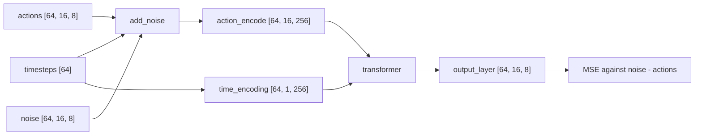

# Generating Actions with Flow Matching

A policy turns one observation into a short sequence of actions, and for many observations more than
one sequence is correct. A network trained with squared error to output "the" action learns the
average of the correct ones, which can be an action no demonstration contains. Flow matching is how
the action head (the part of the policy that outputs actions) in this repository avoids that: it
learns to carry random noise to actions, and each call draws one sample.

## The idea

**Regression** means feeding the observation in, reading the action out, and training with mean
squared error (MSE) against the demonstrated action. The output that minimises MSE is the mean of
all targets seen for that input, which is wrong when those targets disagree.

Take an action of two numbers. For one observation, half the demonstrations say $a_1 = (-1, 0)$
and half say $a_2 = (+1, 0)$: reach for one of two objects when nothing says which. The summed
squared distance to the two targets is smallest at $(0, 0)$, a point in no demonstration. On a
robot it is the gap between the objects.

A distribution with several separate peaks is **multimodal**, and each peak is a **mode**. The fix
is to stop predicting a point and learn to **sample**: return $a_1$ on some calls and $a_2$ on
others, never the middle. Diffusion and flow matching both do it with three moves:

1. Take a demonstrated action and mix it with Gaussian noise by a random amount.
2. Train the network, given the mixture and the amount, to predict the noise or, equivalently, the
   direction between the noise and the action.
3. To act, start from pure noise and follow the predicted direction in small steps until no noise
   is left.

Step 2 is still MSE regression and still averages. Why step 3 nevertheless does not return the
average action is explained below.

<!-- interactive: flow-matching -->
*Figure: points of noise carried to two targets by the learned flow, with a step-count slider; with
few steps or a weak model the samples land between the targets.*

## How it works

### The path between an action and noise

Let $a$ be a clean action, $\epsilon$ noise of the same shape drawn from a standard normal, and
$s$ the noise level. The mixture is a point on the straight line from the action to the noise:

$$x_s = a + s\,(\epsilon - a) = (1 - s)\,a + s\,\epsilon$$

At $s = 0$ it is the action and at $s = 1$ it is the noise. Moving along the line as $s$ grows, the
velocity is the same everywhere: $\epsilon - a$. The network $v_\theta$ sees the mixture, the noise
level and the observation $o$, and is trained to output that velocity:

$$L = \mathbb{E}_{a,\,\epsilon,\,s}\;\big\lVert\,v_\theta(x_s, s, o) - (\epsilon - a)\,\big\rVert^2$$

Background: this is the straight-path case of flow matching (Lipman et al., below) and the
interpolation of rectified flow (Liu et al., below). The diffusion model DDPM (Ho et al., below)
mixes as $x_t = \sqrt{\bar\alpha_t}\,a + \sqrt{1 - \bar\alpha_t}\,\epsilon$, where
$\bar\alpha_t$ falls towards 0 as the step $t$ grows. The squares of the two weights sum to 1, so
the path from action to noise is an arc, not a straight line. Its network predicts the noise
$\epsilon$, from which the direction follows, and its sampler adds fresh noise after every step.

### Why averaging directions does not average actions

Many pairs of action and noise produce the same mixture, so the target at a given point is not
unique, and the MSE-optimal output there is the average target. On the line,
$\epsilon - a = (x_s - a)/s$, which gives

$$v^*(x, s) = \mathbb{E}\,[\,\epsilon - a \mid x_s = x\,] = \frac{x - \hat a(x, s)}{s},
\qquad \hat a(x, s) = \mathbb{E}\,[\,a \mid x_s = x\,]$$

The ideal output is the vector from $\hat a$ to $x$, scaled by $1/s$; the sampler subtracts it, so
each step moves $x$ toward $\hat a$. Here $\hat a$ is the current best guess of the action: the
targets weighted by how likely each is to have produced $x$, which depends on the noise level.

- Near $s = 1$ the mixture is almost all noise and says nothing about which target it came from.
  The weights are equal and $\hat a \approx (0, 0)$, the regression answer.
- As $s$ shrinks, points from $a_1$ and points from $a_2$ separate, the weights go to 0 and 1, and
  $\hat a$ becomes the target on the side where $x$ is.

The averaging is still there, but it happens at each point of the path separately, and late on the
path the average is over one target only. Background: Lipman et al. (below) prove the general
statement: the averaged field, integrated exactly, carries the noise distribution onto the data
distribution, so samples land on the targets in the proportions the data has them.

When more than one action fits the observation, the loss cannot reach zero even for a perfect
network: at the high-noise end of the path the mixture is compatible with several actions and does
not determine the direction ([91-loss-is-not-success.md](91-loss-is-not-success.md)).

### Sampling

Sampling integrates the velocity backwards from noise with Euler steps: $x \leftarrow x - v\,\Delta$,
where $\Delta$ is the fraction of the path covered per step. With the ideal field each step moves
the sample a fraction $\Delta / s$ of the way to the current guess $\hat a$. Starting at
$x = (0.5, 0.8)$ with ten steps:

```text
(0.45, 0.72) (0.41, 0.64) (0.37, 0.56) (0.35, 0.48) (0.35, 0.40)
(0.41, 0.32) (0.53, 0.24) (0.69, 0.16) (0.85, 0.08) (1.00, 0.00)
```

The first four steps head for the origin, the average. Around $s = 0.6$ the path bends, and it ends
on $(1, 0)$.

The same toy with 10,000 starting points drawn from a standard normal:

| Steps | Field | Within 0.1 of a target | In the middle (first coordinate between -0.5 and 0.5) |
|---|---|---|---|
| 1 | ideal | 0.0% | 100.0% |
| 2 | ideal | 13.9% | 41.2% |
| 4 | ideal | 89.6% | 3.8% |
| 10 | ideal | 100.0% | 0.0% |
| 10 | weights flattened 16 times | 42.9% | 23.2% |

This is arithmetic on the toy, not a measurement of a trained policy; the script is in
[Check yourself](#check-yourself).

- One step is regression: a single step from $s \approx 1$ jumps to $\hat a$ at full noise, the
  mean of the targets.
- Few steps leave samples between the modes. The target is chosen mid-path, and a coarse sampler
  crosses that stretch in one or two jumps aimed at an outdated guess.
- A field that does not commit does the same. The last row divides the exponent of the weights by
  16, a stand-in for a network that has not learned which target applies.

A working sampler has a signature: two samples for one input are either close together, within the
spread of one mode, or about the distance between two modes apart.

## In this repository

The class is called `DiffusionPolicy`, but the preset
[`vla_foundry/config_presets/models/diffusion_policy.yaml`](../../vla_foundry/config_presets/models/diffusion_policy.yaml)
sets `use_flow_matching_scheduler: true`, and what it trains is the objective above.

| Piece | Where | What it does |
|---|---|---|
| Noise and target | `DiffusionPolicyBatchHandler` in [`vla_foundry/models/batch_handlers.py`](../../vla_foundry/models/batch_handlers.py) | `prepare_inputs` draws `noise = torch.randn_like(batch["actions"])`; `prepare_inputs_and_targets` sets `targets = inputs["noise"] - inputs["actions"]` |
| Noise level | `DiffusionPolicy.forward` in [`vla_foundry/models/diffusion_policy/diffusion_policy.py`](../../vla_foundry/models/diffusion_policy/diffusion_policy.py) | `torch.randint(0, self.scheduler.num_timesteps, ...)`: one timestep $t$ per sample, uniform over 0..999 |
| Mixture | `FlowMatchingScheduler.add_noise` in [`vla_foundry/models/diffusion/noise_scheduler_diffusers.py`](../../vla_foundry/models/diffusion/noise_scheduler_diffusers.py) | `x_start + scale * (noise - x_start) * mask_expanded`, where `scale` is the timestep divided by `self.num_timesteps`, so $s = t / 1000$ |
| Loss | `masked_mse_loss` in [`vla_foundry/losses.py`](../../vla_foundry/losses.py) | chosen by `loss_function: "mse"` in `vla_foundry/config_presets/hparams/diffusion_policy.yaml` |
| Sampling step | `FlowMatchingScheduler.step` | `sample - model_output * (step_size / self.num_timesteps)` |

With `sim/pickup/configs/dp_vit.yaml` (batch 64, one past step, the current step and 14 future
steps, 8-D actions) one training step has these shapes:



`time_encoding` is an `nn.Embedding` with `num_timesteps` rows. By default
(`diffusion_step_conditioning: concat`) `_build_transformer_input` puts it in front of the backbone
tokens (the outputs of the image or image-and-text encoder that the actions are conditioned on) as
one extra token ([50-what-the-action-head-sees.md](50-what-the-action-head-sees.md)).

`clamp_range: [-3, 3]` in the preset clips the mixture in `add_noise` and the sample after every
`step`, so no component of a generated normalised action
([40-action-spaces.md](40-action-spaces.md)) exceeds 3 in magnitude. A config that sets no range
gets the `NoiseSchedulerParams` default, `(-1.5, 1.5)`.

### Ten steps across 1000 timesteps

`DiffusionPolicy.generate_actions` computes
`step_size = max(1, self.scheduler.num_timesteps // num_inference_steps)` and loops over
`range(self.scheduler.num_timesteps - 1, 0, -step_size)`. With 1000 timesteps and 10 steps that is
`step_size = 100` and $t$ = 999, 899, ..., 99: ten passes of the action transformer, each followed
by a `step` that subtracts `100 / 1000` of the predicted direction, which covers the whole path.
The backbone runs once, before the loop, through `get_action_conditioning`.

The step count is `--flow_steps` in `sim/pickup/eval.py` (default 10):

```bash
sim/pickup/scripts/eval.sh experiments/pickup/dp_vit_pick_cube_1k pick_cube 50 --flow_steps 4
```

### The past action stays clean

The 16-step sequence starts with the action that was just executed: an input, not something to
generate, so it must not be noised.

- In training, `add_noise` receives `mask=future_mask` and multiplies the noise term by it. `forward`
  then applies `torch.where(future_mask.unsqueeze(-1), noisy_action, actions)`, which restores the
  original values where the mask is False: the past step, and steps past the end of an episode.
  `vla_foundry/train.py` passes `future_mask` as the loss mask, so those positions add nothing to
  the loss.
- At inference, `Policy.infer` builds a zero array of 16 rows, writes the last executed action into
  the first `past` rows and marks them in `past_mask`. `generate_actions` replaces the other rows
  with `torch.randn_like` and after every step sets
  `actions = original_past_actions + predicted_actions * (1 - past_mask_expanded)`. The server
  returns the rows from `past` on: `[15, 8]`. With `lowdim_past_timesteps: 0`
  (`sim/pickup/configs/dp_vit_lang_reactive.yaml`) there is no past row and all 15 start as noise.

## What we measured

**Number of steps.** `pick_cube`, the `dp_vit` checkpoint trained on 1000 demonstrations for 1.5M
samples (machine A), 50 episodes per setting, 8 actions executed per chunk (the sequence of actions
returned by one call, [42-chunks-and-execution.md](42-chunks-and-execution.md)): 86% with 4 flow
steps, 74% with 10 (the default, 37/50, 95% interval 60-84%), 84% with 25. The lab notebook records
that all intervals overlap, so this sweep does not show an effect of the step count between 4 and
25, and with an interval 24 points wide on the default setting it could not have shown a small one.
Nor does it test the multimodal case: `pick_cube` has one object, and with a single target the toy
lands on it even in one step. The notebook has no step sweep on `pick_target`.

**Where the gripper closed.** `pick_target`, three objects on the table, first round (machine A),
100 episodes per policy:

| Policy | Nearest object was the named one | Median miss to nearest object |
|---|---|---|
| `dp_vit`, no language | 32% | 110 mm |
| `vla_custom`, pretrained VLM | 33% | 89 mm |

Chance for the middle column is 33%. Both closed the gripper in 100% of episodes, at the right
height. The scripted expert, run through the same evaluation loop on machine B (100 layouts), closes
5 mm (median) from the object. A policy that could not tell which object was meant but sampled one
of the three cleanly would also score about 33%, yet would close millimetres from some object.

A median miss of 110 mm or 89 mm to the nearest object is what the "in the middle" column of the
toy would look like on the table, but it is not the only reading. A policy that localises badly
also misses a single target: the notebook's pooled-CLIP policy on `pick_cube` ran its grasp a few
centimetres from the one cube. The notebook has distances, not directions, and each closing point
follows several freshly sampled chunks, so it cannot tell these readings apart.

**Two samples for one input.** `dp_vit_lang_reactive` trained on the 1500 `pick_target` demos,
checkpoint at 0.9M samples (machine B), the first chunk (15 steps) from the first frame, 60 layouts:

| | Training layouts | Unseen layouts |
|---|---|---|
| Distance between two samples for the same input (median) | 10.9 cm | 10.8 cm |
| Policy's chunk heads for the named object | 35% | 48% |

The expert moves the gripper 30 cm in that chunk and heads for the named object in 100% of layouts.
The two samples differ only in the starting noise, yet they are about 11 cm apart; the notebook
does not say how that distance was taken (between chunk endpoints or otherwise). Image and
instruction together fix the destination, so a policy that used both would put the two samples
close together. Here the noise decides much of where the chunk goes, on training layouts as much as
on unseen ones. A median alone does not say whether the pairs split into "same place" and "one
object spacing apart" or are spread evenly.

## Where it goes wrong

**The gripper closes on empty table.** The target is multimodal for the input the action head
receives, and samples fall between modes. Check `grasp.closed_nearest_is_target_rate` and
`grasp.median_xy_err_nearest_mm` in `results.json`
([92-measuring-failure.md](92-measuring-failure.md)), then call `Policy.infer` twice on one
observation and compare the chunks: `sim/pickup/policy_server.py` sets no seed, so the starting
noise differs. No script here does that, but `sim/pickup/open_loop_check.py` already calls `infer`
once per shard sample; add a second call with the same arguments. `dp_vit` has no language input,
so nothing it receives identifies the target: check what the action head is given
([50-what-the-action-head-sees.md](50-what-the-action-head-sees.md)) before the sampler.

**A step count that does not divide 1000.** The loop uses integer division. With 7 steps,
`step_size` is 142 and the loop makes 8 passes that cover 8 × 0.142 = 1.136 of the path: the sample
is pushed 13.6% past the end. The effect on a trained policy was not measured here; use a divisor
of 1000 (4, 5, 8, 10, 20, 25).

**Another scheduler.** `create_noise_scheduler` (`vla_foundry/models/diffusion/__init__.py`) can
return a DDPM scheduler, but the batch handler's target stays `noise - actions` and
`generate_actions` passes `step_size=`, which only `FlowMatchingScheduler.step` accepts.

**Sign and time direction.** Here $s = 0$ is the action, the target is noise minus action, and the
sampler subtracts. Background: the flow-matching papers below put noise at time 0, and Liu et al.
regress data minus noise and add the prediction. A sampler ported from them without flipping both
sign and time index walks away from the data.

## Background and further reading

- Ho et al., *Denoising Diffusion Probabilistic Models*, 2020.
  [arXiv:2006.11239](https://arxiv.org/abs/2006.11239). Trains a network to predict the noise added
  by a fixed chain of small Gaussian steps and samples by reversing the chain.
- Lipman et al., *Flow Matching for Generative Modeling*, 2022.
  [arXiv:2210.02747](https://arxiv.org/abs/2210.02747). Trains a flow by regressing a vector field
  along fixed conditional paths, without simulating the flow during training.
- Liu et al., *Flow Straight and Fast* (rectified flow), 2022.
  [arXiv:2209.03003](https://arxiv.org/abs/2209.03003). Trains an ODE on straight-line
  interpolations between noise and data and shows that retraining on the model's own noise-sample
  pairs makes the trajectories straighter, so fewer Euler steps are needed. The objective here is
  trained once; the toy trace above bends.
- Chi et al., *Diffusion Policy: Visuomotor Policy Learning via Action Diffusion*, 2023.
  [arXiv:2303.04137](https://arxiv.org/abs/2303.04137). Generates robot action sequences by
  conditional denoising and names multimodal action distributions as a case it handles.
- Black et al., *π0: A Vision-Language-Action Flow Model for General Robot Control*, 2024.
  [arXiv:2410.24164](https://arxiv.org/abs/2410.24164). A flow-matching action head on a pretrained
  vision-language model, sampled with 10 integration steps.

## Check yourself

1. Reproduce the trace and the toy table, then change the list at the bottom to `(7, 1)` and explain
   the result with [Where it goes wrong](#where-it-goes-wrong).

   ```bash
   uv run python - <<'EOF'
   import numpy as np

   targets = np.array([[-1.0, 0.0], [1.0, 0.0]])
   T = 1000

   def direction(x, t, blur=1.0):
       s = t / T
       d2 = ((x[:, None] - (1 - s) * targets) ** 2).sum(-1)
       w = np.exp(-(d2 - d2.min(1, keepdims=True)) / (2 * s * s * blur))
       w /= w.sum(1, keepdims=True)
       return (x - w @ targets) / s

   def sample(x, steps, blur=1.0, trace=False):
       step_size = max(1, T // steps)
       for t in range(T - 1, 0, -step_size):    # as in generate_actions
           x = x - direction(x, t, blur) * (step_size / T)
           if trace:
               print(t, x[0].round(2))
       return x

   sample(np.array([[0.5, 0.8]]), steps=10, trace=True)
   for steps, blur in [(1, 1), (2, 1), (4, 1), (10, 1), (10, 16)]:
       x = sample(np.random.default_rng(0).standard_normal((10000, 2)), steps, blur)
       miss = np.linalg.norm(x[:, None] - targets, axis=-1).min(1)
       print(f"steps {steps:2d} blur {blur:2d}: {100 * (miss < 0.1).mean():5.1f}% within 0.1 of a "
             f"target, {100 * (abs(x[:, 0]) < 0.5).mean():5.1f}% in the middle")
   EOF
   ```

2. Run `uv run pytest tests/essential/models/test_noise_scheduler.py tests/essential/models/test_diffusion_policy.py -q`
   and find, in `test_diffusion_policy_generate_actions`, the assertion that the past actions come
   back unchanged. Name the line of `generate_actions` that makes it pass.
3. Suppose two samples for one input are 0.2 cm apart in one policy (a made-up figure) and 11 cm
   apart in another (the measurement above). Say what each distribution looks like and which
   further measurement would tell a clean two-mode sampler from a blurred one.
