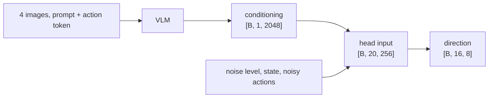

# Anatomy of a VLA

A vision-language-action model (VLA) is a robot policy that takes camera images and a language
instruction and outputs actions, usually by building on a vision-language model. The policies in
this repository have two parts, a backbone that turns the images and the instruction into vectors
and an action head that turns those vectors into motor commands, because reading a scene and
producing precise continuous motion are different jobs and the first can start from a model
trained on images and text.

## The idea

- The **backbone** is the network that reads the observation: a vision transformer (ViT), CLIP,
  or a vision-language model (VLM, [joining vision and language](30-joining-vision-and-language.md)).
- The **conditioning** is the tensor the backbone hands to the action head,
  `[batch, tokens, width]`, written `[B, N, D]` below.
- The **action head** is a second transformer. It receives the conditioning, the noise level, the
  joint state and a noisy action sequence, and predicts how to remove the noise
  ([flow matching](41-flow-matching.md)).
- A **chunk** is the sequence of 15 future actions a policy predicts in one go
  ([chunks and execution](42-chunks-and-execution.md)).

One `pick_target` window (a training example: the observations at one frame and the actions that
follow) for a policy with history, one that is also given the previous frame, state and action:
four 224x224 images (two cameras at control steps t-1 and t), the instruction "pick up the red
cube", and the state `[2, 8]` (seven joint angles and the gripper opening at t-1 and t). The policy
fills `[16, 8]`: the previous action in one slot, then the chunk for t to t+14, each action seven
joint targets and a gripper command. Without history (`*_reactive`) it gets two images and a
state `[1, 8]` and fills `[15, 8]`.

The head does not know what produced the conditioning, so one class, `DiffusionPolicy`, runs
every config below; they differ in the backbone (hence `N` and `D`) and in history. Despite the
class name, every head is trained with flow matching.

| Config | Backbone | `N` | `D` | Head sequence |
|---|---|---|---|---|
| `dp_clip` | CLIP, pooled | 5 | 512 | 24 |
| `dp_vit` | ViT, patch tokens | 784 | 256 | 803 |
| `dp_vit_reactive` | the same | 392 | 256 | 409 |
| `dp_vit_lang` | ViT patches + 32 text slots | 816 | 256 | 835 |
| `dp_vit_lang_reactive` | the same | 424 | 256 | 441 |
| `vla_qwen` | Qwen3-VL-2B, action token | 1 | 4 x LM width | 20 |
| `vla_qwen_tokens_reactive` | Qwen3-VL-2B, every token | 128 | 4 x LM width | 145 |
| `vla_custom` | VLM trained here, action token | 1 | 2048 | 20 |
| `vla_custom_tokens` | the same VLM, every token | 1040 | 2048 | 1059 |
| `vla_custom_tokens_reactive` | the same | 528 | 2048 | 545 |

The head sequence is one time token (the noise level), the `N` conditioning tokens, the state
tokens and the action-step tokens: `1 + N + 2 + 16` with history, `1 + N + 1 + 15` without. A
pooled vector stands for a whole image or instruction (four images and one instruction give 5); a
patch token is the vector of one image patch
([pooled vs patch tokens](21-pooled-vs-patch-tokens.md)). The action token is one extra token
after the VLM's prompt;
[what the action head sees](50-what-the-action-head-sees.md) compares 1 vector with 784.

`dp_vit_lang_reactive` solved `pick_target` here: with its trained weights it succeeds in 93% of
100 unseen layouts after 5M training samples on 4000 demonstrations (83% before the position table
was fixed). A layout is the scene a seed fixes: the objects, their poses, the named one and the
arm's start pose. This config has no VLM: the instruction's tokens get learned embeddings and meet
the patch tokens only in the action head ([language conditioning](51-language-conditioning.md)).
`vla_custom_tokens_reactive` gives the from-scratch VLA every token and no history as well: 86%
after 3M samples.

## How it works

### A training pass through `vla_custom`

The backbone is the stage-2 VLM of
[`custom_vlm.yaml`](../../sim/pickup/configs/custom_vlm.yaml): a ViT (224 px, patch 14, 256 wide,
6 layers), a linear projector, and a language model (512 wide, 12 layers, 8 heads) that is causal:
position `i` attends only to positions up to `i`. The head is a transformer 256 wide with 6 layers
and 4 heads, `is_causal: false`.

1. **Processor.** `SimpleVLMProcessor` scales the images to [-1, 1] and returns `pixel_values`
   `[4B, 3, 224, 224]`. It expands each `<image>` placeholder in the prompt into
   `img_num_tokens: 256` copies and tokenises, giving `input_ids` `[B, L]`. `L` is at most 1035:
   3 prompt tokens, 4 x 256 image tokens and at most 8 instruction tokens (comment in
   `vla_custom_tokens.yaml`).
2. **Action token.** `insert_after_last_real_token` puts one extra token id (`_action_token_id`,
   a new embedding row) directly after each row's last real token: `[B, L+1]`. Because the
   language model is causal, that is the only position that has read every image token and the
   whole instruction.
3. **VLM.** `VLM.forward` runs the ViT, `[4B, 256, 256]`, maps the result to the language model's
   width with `ModalityProjector`, `[4B, 256, 512]`, and writes those vectors over the embeddings
   of the image placeholders with `masked_scatter`. The language model returns one hidden state
   per layer, each `[B, L+1, 512]`.
4. **Conditioning.** `conditioning_from_hidden_states` reads the action token's position in the
   last `num_vlm_layers_to_use: 4` layers and concatenates them: `[B, 1, 2048]`.
5. **Noising.** Actions and state arrive normalised per channel
   ([action spaces](40-action-spaces.md)). `DiffusionPolicy.forward` draws one integer noise
   level per window, uniform over 0..999 (`timesteps` in the code; not control steps).
   `FlowMatchingScheduler.add_noise` computes `actions + s * (noise - actions)` with
   `s = timestep / 1000` and clamps to `clamp_range: [-3, 3]`. `future_mask`, a boolean
   `[B, 16]`, is true for the slots the policy must predict and false for the previous-action
   slot and for slots past the end of an episode; slots where it is false stay clean. Result
   `[B, 16, 8]`.
6. **Encoding.** `action_encode` (linear, 8 to 256) gives `[B, 16, 256]`. `time_encoding`, an
   embedding table with 1000 rows of width 2048, gives `[B, 1, 2048]`.
   `_build_transformer_input` concatenates time and conditioning to `[B, 2, 2048]` and maps them
   with `condition_encode` (linear, 2048 to 256). `proprioception_encode` (linear, 8 to 256) turns
   the state into `[B, 2, 256]`.
7. **Head.** The concatenation `[B, 20, 256]` goes through six non-causal layers, so every
   action-step token attends to every other token.
8. **Direction.** `output_layer` (linear, 256 to 8) is applied to the last 16 positions of the last
   layer's hidden state: `[B, 16, 8]`.
9. **Loss.** `DiffusionPolicyBatchHandler` sets the target to `noise - actions`.
   `vla_foundry/train.py` applies `masked_mse_loss` (`loss_function: "mse"`) with `future_mask`,
   so only predicted slots count.

Files, under `vla_foundry/models/`: `vision_language_backbones/` (`simple_vlm_processor.py`,
`vlm_foundry_backbone.py`, `base.py`), `vlm.py`, `diffusion_policy/diffusion_policy.py`,
`diffusion/noise_scheduler_diffusers.py`, `batch_handlers.py`; and `vla_foundry/losses.py`.



<!-- interactive: sequence-layout -->
*Figure: the VLM's token sequence, ending in the action token, and the head's: time token,
conditioning tokens, state tokens, action-step tokens.*

### What the other configs change

- **Every token** (`conditioning: all_tokens`). The helper of step 4 returns the last four
  layers' hidden states of every real prompt token, right-aligned behind zeros in exactly
  `conditioning_len` slots, the same in a training batch and when served: `[B, 1040, 2048]` in
  `vla_custom_tokens`.
- **No history** (`*_reactive`). `image_indices: [0]` and `lowdim_past_timesteps: 0`: no previous
  frame, state or action, and no clean slot.
- **A ViT with text slots** (`dp_vit_lang*`). `ViTBackboneWrapper` has no language model: it
  returns `text_tokens: 32` slots, learned embeddings of the prompt's token ids, then the patch
  tokens of every image.
- **Qwen** (`vla_qwen*`). `vlm_backbone` loads a Hugging Face model through `VLMHF`, with Qwen's
  own processor: a 224 px image becomes 49 tokens (comment in
  [`vla_qwen.yaml`](../../sim/pickup/configs/vla_qwen.yaml)). `VLMHFBackboneWrapper` calls the
  same two helpers, so it has both conditioning modes; with the action token it returns
  `[B, 1, 4 x lm_hidden_dim]` ([pretrained backbones](61-pretrained-backbones.md)). The head is
  `transformer_100m.yaml` (512 wide, 12 layers, 8 heads) with `is_causal: false`.

### A sampling pass

At inference [`policy_server.py`](../../sim/pickup/policy_server.py) (`Policy.infer`) sends the
observation through the same `RoboticsProcessor` as training and calls
`DiffusionPolicy.generate_actions`:

1. The backbone runs once per chunk; its conditioning is reused for every flow step.
2. `actions` is `[1, 16, 8]`. `past_mask`, a boolean `[1, 16]` true only for slot 0, marks the
   previous action; the other 15 slots are replaced with Gaussian noise.
3. The server passes `num_inference_steps = 10` by default (`--flow_steps` in
   `sim/pickup/eval.py`; without it `generate_actions` uses `scheduler.num_timesteps`: 999 head
   passes). `step_size` is then `1000 // 10 = 100` and the loop visits noise levels 999, 899, ...,
   99. Each flow step builds the same head input as in training, runs the head,
   and calls `FlowMatchingScheduler.step`: `actions - direction * (100 / 1000)`, clamped to
   [-3, 3]; the past slot is then restored.
4. The server maps the result back from normalised units with the processor's normaliser and
   returns the chunk, `[15, 8]`. The caller decides how many actions to execute before asking
   again (`--exec_horizon`, default 8).

## In this repository

**Assembly.** `create_model` in
[`vla_foundry/models/registry.py`](../../vla_foundry/models/registry.py) looks up
`model_params.type` among the names registered with `register_model`. For
`diffusion_policy` it finds `create_diffusion_policy` in
[`diffusion_policy/__init__.py`](../../vla_foundry/models/diffusion_policy/__init__.py), which
builds three objects and passes them to `DiffusionPolicy`: the backbone from
`get_vision_language_backbone`, the head from `create_model(model_params.transformer)`, and the
scheduler from `create_noise_scheduler`: a `FlowMatchingScheduler`, because every pickup policy
config sets `use_flow_matching_scheduler: true` (directly or through a preset) and none sets
`use_diffusers_scheduler`, which is checked first.

**Four backbones.** `get_vision_language_backbone` in
[`vision_language_backbones/__init__.py`](../../vla_foundry/models/vision_language_backbones/__init__.py)
dispatches on `vision_language_backbone.type`:

| `type` | Wrapper | Model inside |
|---|---|---|
| `clip_backbone` | `CLIPBackboneWrapper` | `CLIPHF` |
| `vit_backbone` | `ViTBackboneWrapper` | `ViT`, built directly, not through the registry |
| `vlm_backbone` | `VLMHFBackboneWrapper` | `VLMHF` (Hugging Face `AutoModelForImageTextToText`) |
| `vlm_foundry_backbone` | `VLMFoundryBackboneWrapper` | `VLM` rebuilt from an experiment's `config_model.yaml` |

Each wrapper implements `get_conditioning_embeddings_dim`, which `DiffusionPolicy.__init__` uses
to size `time_encoding` and `condition_encode`.

**Trained and frozen.**

| Config | Trained | Frozen |
|---|---|---|
| `dp_clip` | CLIP and the head | nothing |
| `dp_vit`, `dp_vit_reactive` | ViT and head, from random weights | nothing |
| `dp_vit_lang`, `dp_vit_lang_reactive` | the same and the text slots (`text_embedding`, `text_position`, `text_norm`) | nothing |
| `vla_custom`, `vla_custom_tokens`, `vla_custom_tokens_reactive` | the whole VLM and the head | nothing |
| `vla_qwen`, `vla_qwen_tokens_reactive` | the last 4 language-model layers, the final norm, the head | the rest of the VLM: vision tower, token embeddings, lower layers |

The Qwen row is `num_trainable_vlm_layers: 4`: `VLMHFBackboneWrapper._train_only_last_layers`
sets `requires_grad = False` on every VLM parameter and re-enables the last layers and the norm,
and `create_optimizer` (`vla_foundry/optimizer.py`) skips frozen parameters. The action token's
embedding row exists only without `all_tokens`: it is trained in `vla_custom` and stays frozen at
its initial value, the mean of the other rows, in `vla_qwen`.

The head's `Transformer` also owns a token-embedding table and a vocabulary projection (50,432 x
256 each, about 12.9M). The policy feeds `inputs_embeds` and reads `hidden_states[-1]`, collected
before `self.norm` and `self.output`, so both tables count in the totals without affecting the
loss: 25.8M of the 36M parameters of `dp_vit`. So does the VLM's vocabulary projection in
`vla_custom` (49,281 x 512, about 25.2M). The `text_embedding` table of `dp_vit_lang*` (about
12.6M) is used. This follows from the code; it was not measured.

```bash
# the recommended recipe: random start poses and recoveries, 94% / 94% here
sim/pickup/scripts/make_dataset.sh pick_target 4000 pick_target_4k --random_start --disturb_prob 0.5
sim/pickup/scripts/train_resilient.sh dp_vit_lang_reactive pick_target_4k my_run 5000000
sim/pickup/scripts/eval_checkpoints.sh experiments/pickup/my_run pick_target
grep -E "parameters" experiments/pickup/my_run.train.log   # total and trainable
# the from-scratch VLA, every token, no history: 86% / 87% after 3M samples, measured on data made
# without the two options above; needs experiments/pickup/custom_vlm (custom_path.sh data, llm, vlm)
sim/pickup/scripts/custom_path.sh vla pick_target_4k my_vla 3000000 pretrained vla_custom_tokens_reactive
```

## What we measured

From the [lab notebook](../lab-notebook.md); A is machine A (one RTX 4090, 24 GB), B is machine B
(L40S GPUs, 128 CPU cores).

| Policy | Parameters | Training throughput | Inference per chunk |
|---|---|---|---|
| `dp_vit` | 36M | about 620 samples/s (A) | 20-65 ms (A) |
| `dp_vit_lang_reactive` | 48.9M | about 1100 samples/s alone on a GPU (B) | median 71 ms at 10 flow steps, 25 ms at 2 (B, GPU also busy training) |
| `vla_custom` | 130.0M | 165 samples/s (A) | not recorded |
| `vla_qwen` | 2.2B, 306M trainable | 49 samples/s at batch 16 (A) | about 190 ms (A) |

Success on `pick_target` ([case study](101-case-pick-target.md)), 100 unseen layouts, one
training seed per run; pairs are raw / EMA weights (the trained weights and their running average).
The first six rows used the old position table, the last three the fixed one:

| Policy | Head receives | Demos | Samples | Success |
|---|---|---|---|---|
| `vla_custom` (A) | one vector, history | 1500 | 1.0M | 0/100; 1/100 with a random-init VLM |
| `vla_qwen` (A) | one vector, history | 1500 | 400k | 6/100 |
| `dp_vit_lang` (B) | tokens, history | 4000 | 3.0M (stopped) | 2% / 2% |
| `dp_vit_lang_reactive` (B) | tokens, no history | 1500 | 1.0M | 3% / 5% |
| same | same | 1500 | 3.0M | 64% / 62% |
| same | same | 4000 | 5.0M | 83% / 85% |
| same | same | 4000 | 5.0M | 93% (raw) |
| `vla_custom_tokens_reactive` (B) | every token, no history | 4000 | 3.0M | 86% / 87%; 75% / 85% with a random-init VLM |
| `vla_qwen_tokens_reactive` (B) | every token, no history | 4000 | 0.5M | 70% / 72% |

- **The VLM backbones.** With one vector the VLAs reached a final loss of ~0.03 (`vla_custom`) and
  0.03-0.04 (`vla_qwen`); both `vla_custom` policies closed at the named object in 33% and 29% of
  episodes (chance 33%). With every token they work, but those runs also dropped history and had
  more data. Pretraining the from-scratch VLM mainly makes the policy start to look earlier:
  after 0.25M samples, not about 1.0M. Neither from-scratch VLA beats the patch-token policy, at
  90% after the same 3M samples (fixed table, raw).
- **The budget.** The 83% / 85% run stood at 0% / 1% after 1.0M samples and at 4% / 36% after
  2.0M: looking at the scene arrives late, and in this run the averaged weights lead while it
  arrives ([how much data and training](71-how-much-data-and-training.md)).
- **History.** `dp_vit_lang` is not blind. At 2.5M samples (EMA weights) it succeeds in 1/100
  layouts as served, 22/100 when the first query's previous action is the expert's first
  command, and 77/100 when the expert drives the first 10 control steps: it reads the target
  from the previous-action slot. This run used the old table; after the fix history still failed
  (below; [history and shortcuts](52-history-and-shortcuts.md)).
- **The 83% / 85% policy** looks once: sent the first frame's images for the whole episode, it
  still closes at the named object in 99% of episodes and succeeds in 1/100
  ([what a policy looks at](95-what-a-policy-looks-at.md)). On it two flow steps matched ten: 1
  gave 61/100, 2 gave 89/100 and 90/100 (two sets of 100 layouts), 10 gave 85/100 and 83/100. On
  two of seven policies trained later, two steps cost 12 and 19 points: measure it on the policy
  you will run.

## Where it goes wrong

**Low loss, a complete grasp motion, an empty gripper.** The `vla_custom` row above: neither a near
miss nor a reach between the objects, since where it closes the gripper does not depend on the
scene. `.venv/bin/python -m sim.pickup.summarize` prints the slope of where the gripper closed
against where the named object was: near 1 for an imprecise policy, near 0 for one that is not
looking. Then check for a single conditioning vector, a previous-action
input, and a budget that ends before a comparable run started to look.

**The previous-action slot holds the answer.** A window at the first frame of a demonstration has
no previous action; the slot is filled with a copy of the first action, the expert's first
command, which already points at the target. When the policy is served, the slot holds the hold
command. Probe a policy with history with `eval.py --first_prev_action expert` and
`--expert_prefix 10`. `collect.py --hold_steps 1` begins every demonstration with a frame of the
robot at rest. It did not help: a history policy trained on such demonstrations, with the position
table fixed, ends at 0% / 4% after 5M samples. Start without history.

**Action-step tokens that share a position.** The rotary position table was computed in bfloat16
under autocast, leaving 641 distinct positions out of 2048: 15 action-step tokens shared 8
positions without history, 16 shared 4 with it, in training and serving alike. It is now computed
in float32 (`rotary_legacy_autocast` reproduces the old one). With the fixed table the same
recipe starts to look earlier and ends at 93% against 83% (trained weights); a second pair of runs,
differing in the table alone, ends at 96% / 96% against 90% / 89% ([positions](12-positions.md)).

**The action token behind padding.** Both VLM wrappers (`VLMFoundryBackboneWrapper` and
`VLMHFBackboneWrapper`) once appended the action token after the batch padding: one position later
for a short instruction in a training batch than when served alone. Both now insert it after the
last real token; effect on success not measured ([train/inference skew](93-train-inference-skew.md)).

**A backbone with random weights.** `create_vlm_foundry_backbone` loads weights only when
`resume_from_checkpoint` is set; with only `vlm_experiment_dir` it trains from random weights
without an error (`custom_path.sh vla ... scratch` does so on purpose). Check the command.

## Background and further reading

- Chi, "Diffusion Policy: Visuomotor Policy Learning via Action Diffusion", 2023.
  [arXiv:2303.04137](https://arxiv.org/abs/2303.04137). Action sequences generated by conditional
  denoising (DDPM); `DiffusionPolicy` takes its name from it.
- Mercat, "VLA Foundry: A Unified Framework for Training Vision-Language-Action Models", 2026.
  [arXiv:2604.19728](https://arxiv.org/abs/2604.19728). The framework this repository builds on.
- Brohan, "RT-2: Vision-Language-Action Models Transfer Web Knowledge to Robotic Control", 2023.
  [arXiv:2307.15818](https://arxiv.org/abs/2307.15818). The other common design, without a
  separate head: each action dimension is discretised into 256 bins and the VLM emits the bin
  numbers as text tokens ([the landscape](03-the-landscape.md) compares the designs).

[Pretrained backbones](61-pretrained-backbones.md) continues with `vla_qwen` and
[the from-scratch path](62-the-from-scratch-path.md) with `vla_custom`.

## Check yourself

1. List what the registry offers and find the backbone type that is missing from it:

   ```bash
   .venv/bin/python -c "
   import vla_foundry.models
   from vla_foundry.models.registry import list_registered_models
   print(sorted(list_registered_models()))"
   ```

2. Count the head passes for 1, 2, 10 and 7 flow steps and multiply by `step_size`; say what is
   different about 7:

   ```bash
   python3 -c "
   for n in (1, 2, 10, 7):
       s = 1000 // n; k = len(range(999, 0, -s)); print(n, k, k * s / 1000)"
   ```

3. Run the backbone tests, then explain from `_train_only_last_layers` why the action token's
   embedding is not trained in `vla_qwen` but is in `vla_custom`:

   ```bash
   .venv/bin/python -m pytest tests/essential/models/test_vlm_backbone_partial_freeze.py \
       tests/essential/models/test_backbone_conditioning.py \
       tests/essential/models/test_vlm_foundry_backbone_conditioning.py -q
   ```
