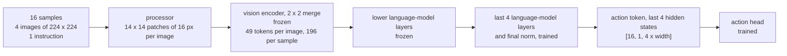

# Building on a Pretrained VLM

A pretrained vision-language model (VLM) is a vision encoder and a language model that were trained
together on images and text before any robot data existed. Used as the backbone of a policy, it
supplies the link between the words of an instruction and the objects in the camera frames, which
otherwise has to be learned from the demonstrations alone. The price is paid in image tokens, GPU
memory and training speed; the pretrained backbone configured here is Qwen3-VL-2B.

## The idea

[Anatomy of a VLA](60-anatomy-of-a-vla.md) splits a policy into a backbone that reads images and
text and an action head that produces motion. A pretrained backbone replaces the first part with a
model somebody else trained.

Background: RT-2 (Brohan et al., 2023) fine-tuned a web-trained VLM to emit robot actions as text
tokens and reported that knowledge from web data carried over to control. OpenVLA (Kim et al.,
2024) also outputs actions as tokens, from an open 7B model trained on robot demonstrations. π0
(Black et al., 2024) kept a pretrained VLM and added a flow-matching action expert. This repository
uses the same two parts but joins them differently: π0's action tokens attend to every VLM token,
while the head here receives one vector.

The configuration is [`sim/pickup/configs/vla_qwen.yaml`](../../sim/pickup/configs/vla_qwen.yaml).
The checkpoint is `Qwen/Qwen3-VL-2B-Thinking`, the edition the model card describes as
reasoning-enhanced; the policy generates no text and reads only hidden states. The worked example:
a batch of 16 samples, each with 4 images (cameras `front` and `wrist` at steps t-1 and t) of
224 x 224 pixels and one instruction such as "pick up the green can".



Frozen parameters are excluded from the update: `requires_grad = False`, no gradient, no optimizer
state.

The 49 tokens per image, the frozen and trained split and the single vector at the end are
decisions, not properties of the model. The first two are explained below;
[What the action head sees](50-what-the-action-head-sees.md) covers the third.

## How it works

### The processor and the image-token budget

A processor is the preprocessing code published with a model. It resizes each image, cuts it into
patches, tokenises the text, and writes one placeholder token into the prompt for every image token
the vision encoder will produce. The weights expect exactly its output, so a policy must use the
processor of its VLM.

Background, from the Qwen2-VL paper (Wang et al., 2024) and the Hugging Face image processor that
Qwen3-VL-2B reuses: the number of image tokens follows from the image size. The processor's `size`
setting holds two bounds on the pixel count, `shortest_edge` (minimum) and `longest_edge`
(maximum). An image outside the bounds is rescaled into them, and each side is rounded to a
multiple of 32. The published preprocessor config sets the minimum to 65,536 pixels (256 x 256) and
the maximum to 16,777,216.

The 32 comes from two steps. The vision encoder works on patches of 16 x 16 pixels. After it, the
model's patch merger combines each 2 x 2 block of neighbouring patch features into one token
(`spatial_merge_size: 2` in the published config), so 14 x 14 = 196 patches become 7 x 7 = 49
tokens of 32 x 32 pixels each.

A 224 x 224 frame has 50,176 pixels, fewer than the published minimum. With the default bounds it
would be scaled up to 256 x 256: 16 x 16 = 256 patches, 64 tokens, 256 tokens for 4 images
(arithmetic from the published config, not run here). `vla_qwen.yaml` keeps the frame at 224 x 224,
which gives 49 tokens per image and 196 for 4 images, as its comment states:

```yaml
processor_kwargs:
  size:
    shortest_edge: 50176
    longest_edge: 50176
img_num_tokens: 49
```

The override is also required. The included data preset,
`vla_foundry/config_presets/data/vla_diffusion.yaml`, names a PaliGemma processor and passes
`size: {height: 224, width: 224}`. `RoboticsProcessor.process_inputs` in
`vla_foundry/data/processor/robotics_processor.py` forwards `processor_kwargs` to the processor
call unchanged, and Qwen's image processor requires the two pixel-count keys.
[Pretrained vision encoders](22-pretrained-vision-encoders.md) compares these 32 px tokens with the
16 px patches of the ViT in `dp_vit.yaml`.

As the docstring and comments of `BatchHandler._slice_inputs_qwen` in
`vla_foundry/models/batch_handlers.py` describe it, Qwen's `pixel_values` is not
`[batch, 3, height, width]` but a flat `(total_patches, patch_dim)` tensor with a companion
`image_grid_thw` holding one `(t, h, w)` row per image. The worked example gives
16 x 4 x 196 = 12,544 rows and an `image_grid_thw` of shape `[64, 3]`. With the published patch
size 16 and temporal patch size 2, a row holds 3 x 2 x 16 x 16 = 1,536 values: the vision encoder's
patches span two video frames, so the processor repeats a still image to fill both (background: the
Hugging Face processor's layout).

### What reaches the action head

`VLMHFBackboneWrapper._prepare_inputs_for_action_token` appends one extra token id, the action
token, to every row of `input_ids` and extends the attention mask by one. A hidden state is the
output of one language-model layer, `[batch, tokens, width]`. The language model's attention is
causal, so the last position is the only one that can attend to every image and instruction token;
that is why the action token is appended at the end and read there (see
[Anatomy of a VLA](60-anatomy-of-a-vla.md)). `_extract_action_token_embeddings` takes position `-1`
from each of the last `num_vlm_layers_to_use` hidden states and concatenates them, giving
`[batch, 1, lm_hidden_dim x 4]`. The published model config lists a language-model width of 2048,
which makes that `[16, 1, 8192]`.

<!-- interactive: pooled-vs-tokens -->
*Figure: 196 image tokens per sample enter the VLM, and the action head receives one vector read at
the action token; the alternative beside it passes every patch token to the action head.*

### Memory: what fits in 24 GB

The lab notebook gives the sizes: 2.2B parameters in total, of which 306M are trained in this
configuration (the last 4 language-model layers and the action head). Training memory has four
parts: the weights, one gradient value per trained parameter, the optimizer's state (AdamW keeps a
running average of the gradient and of its square, two values per trained parameter), and the
activations kept for the backward pass.

The arithmetic uses 2 bytes per value. `VLMHF.__init__` calls `from_pretrained` without a dtype
argument, but `vla_foundry/main.py` then moves the model with
`model.to(device, dtype=get_model_precision(cfg))`, and `get_model_precision` in
`vla_foundry/distributed.py` returns `torch.bfloat16`, a 16-bit float format, for the preset's
`precision: amp_bf16`. The weights, their gradients and the AdamW state are stored in that format.
[Training a language model](13-training-a-language-model.md) describes the same mechanism.

| Part | Everything trained | 306M trained |
|---|---|---|
| Weights, 2.2B x 2 bytes | 4.4 GB | 4.4 GB |
| Gradients, one value per trained parameter | 4.4 GB | 0.6 GB |
| AdamW state, two values per trained parameter | 8.8 GB | 1.2 GB |
| Sum before activations | 17.6 GB | about 6.2 GB |

These figures are arithmetic; the lab notebook records no peak memory, only that the 306M
configuration trained at batch 16 on machine A, whose GPU has 24 GB. Full fine-tuning starts from
17.6 GB before any activation is stored, which leaves 6.4 GB of the 24 GB for the activations of a
backward pass through the vision encoder and every language-model layer. Whether that fits was not
measured here. The comment in `vla_qwen.yaml` gives "~36 GB (weights + gradients + AdamW state)";
that is the same sum at 4 bytes per value (2.2B x 16 bytes = 35.2 GB), the figure for float32
storage.

Activations grow with batch size and sequence length, so the memory left after the first three
parts sets the batch size. Background: PyTorch's autograd does not record operations whose inputs
need no gradient, so the frozen layers run as a plain forward pass and activations are kept only
from the first trained layer on.

### Which parameters train

`VLMHFBackboneWrapper.__init__` calls `_train_only_last_layers` when
`num_trainable_vlm_layers` is not `None`. The method:

1. Takes the first entry of `self._model.model.named_modules()` whose name ends in
   `language_model` or `text_model` and whose `layers` attribute is an `nn.ModuleList`. It raises
   `ValueError` if there is none, or if the requested number is outside `[0, len(layers)]`.
2. Sets `requires_grad = False` on every parameter of the VLM, vision encoder and token embeddings
   included. The action token's embedding row, which `__init__` adds with `resize_token_embeddings`
   and sets to the mean of the existing rows, therefore keeps that value.
3. Sets `requires_grad = True` on the last `num_layers` layers and, when `num_layers > 0`, on the
   language model's `norm` module.

`create_optimizer` in `vla_foundry/optimizer.py` skips parameters with `requires_grad = False`, so
the frozen part gets no optimizer state. The default, `None`, trains the whole VLM; `0` leaves only
the action head. `vla_qwen.yaml` sets `num_vlm_layers_to_use` and `num_trainable_vlm_layers` both
to 4: the trained layers are the ones whose hidden states are read out.

## In this repository

`VLMHF.__init__` in `vla_foundry/models/vlm_hf.py` loads the model with
`AutoModelForImageTextToText.from_pretrained`. `VLMHFBackboneWrapper` in
`vla_foundry/models/vision_language_backbones/vlm_hf_backbone.py` wraps it and is selected by
`type: vlm_backbone`; its config fields are `VLMBackboneParams` in
`vla_foundry/params/model_params.py`. `get_processor` in `vla_foundry/data/processor/__init__.py`
creates the processor. `tests/essential/models/test_vlm_backbone_partial_freeze.py` tests the
freezing rule on a fake VLM and downloads nothing.

In `vla_qwen.yaml`, `model.vision_language_backbone.hf_pretrained` and `data.processor` both name
the checkpoint. The other keys this chapter uses:

| Key | Value | Effect |
|---|---|---|
| `model.vision_language_backbone.num_vlm_layers_to_use` | 4 | hidden states read at the action token |
| `...num_trainable_vlm_layers` | 4 | last language-model layers left trainable |
| `data.processor_kwargs.size` | both bounds 50,176 | 49 tokens per 224 px image |
| `data.img_num_tokens` | 49 | records the count and does not set it: `get_processor` copies it into `image_seq_length` only for `simple_vlm` and PaliGemma processors |
| `data.num_workers`, `data.prefetch_factor` | 4, 2 | at most 8 batches queued (preset: 8 and 8) |

To train and evaluate (the first run downloads the model from the Hugging Face Hub):

```bash
sim/pickup/scripts/make_dataset.sh pick_target 1500 pick_target_1500
sim/pickup/scripts/train_resilient.sh vla_qwen pick_target_1500 vla_qwen 400000
sim/pickup/scripts/eval.sh experiments/pickup/vla_qwen pick_target 100
```

## What we measured

All numbers are from the lab notebook: `pick_target`, 1500 demonstrations (98,841 training
windows), machine A (one 24 GB RTX 4090), one training seed, closed-loop on unseen layouts.

| `vla_qwen` run, by samples | Loss | Success |
|---|---|---|
| 100k (1 epoch) | 0.087 | 0/50 |
| 200k (2) | 0.066 | 1/50 |
| 300k (3) | 0.039 | 6/50 |
| 400k (4), final | 0.03-0.04 | 6/100 |

Speed: `vla_qwen` at batch 16 trained at 49 samples/s on machine A and 45-48 samples/s on machine
B, against about 620 samples/s for `dp_vit` and 165 for `vla_custom` on machine A. Policy inference
took about 190 ms per chunk for the Qwen VLA and 20-65 ms for the 36M policy (machine A);
`DiffusionPolicy.generate_actions` runs the backbone once per chunk, so fewer flow steps do not
reduce its cost. Control runs at 20 Hz, 50 ms per step, so on a robot running in real time one Qwen
chunk would take almost four control steps. The simulator waits for the policy
(`sim/pickup/eval.py` blocks on the reply before `env.step`), so the success rates include no such
delay.

What this suggests. The other three policies of that round, one of which has no language input,
closed the gripper nearest the named object in 32%, 33% and 29% of episodes; chance is 33%. The
Qwen policy lifted the named object in 6 of 100 final episodes and no other object in any of 150.
These are two different measures. The notebook records where the gripper closed for the other three
policies and which object was lifted for the Qwen policy; it does not record wrong-object lifts for
the other three, and a policy that lifts nothing also lifts no wrong object. The Qwen statement
therefore rests on the few lifts that happened, 6 in the final 100 episodes. A policy that grasped
equally well but chose among the three objects at random would be expected to lift a wrong object
about twice as often as the right one, assuming the three objects are equally easy to grasp. The
result agrees with RT-2's premise that the pretrained VLM brings the link between instruction and
object.

What it does not prove:

- That the policy works. 94 of the 100 final episodes failed.
- That pretraining caused the difference. Each policy is one seed, and the runs differ in size, in
  training samples (400k against 1.0M) and in architecture at once.
- Whether more training would help. The run had 4 epochs. On `pick_cube` with 1000
  demonstrations, `dp_vit` scored 40% after 8 epochs and 74% after 23.
- Where the misses come from. The run combined a frozen vision encoder, 49 tokens of 32 px per
  image and a single conditioning vector; no run changed one alone, and the notebook does not
  record where this policy's gripper closed.

A further Qwen run was in progress when the notebook was written and has no result yet.

## Where it goes wrong

**Every batch fails in the processor.** No training step completes and the log repeats
`Handling webdataset error (ValueError(...))`: the processor call is a `wds.map` stage in
`vla_foundry/data/pipelines/robotics.py` whose handler, `log_and_continue` in
`vla_foundry/data/utils.py`, logs the exception and skips the batch. The cause is the preset's
`size: {height, width}`; the transformers 4.57.3 source (the version in `uv.lock`; not run here)
raises `size must contain 'shortest_edge' and 'longest_edge' keys.` Override
`processor_kwargs.size` as `vla_qwen.yaml` does.

**Out of memory in the first steps.** Check that `num_trainable_vlm_layers` is set. Without it the
whole VLM is trained, which the arithmetic above puts at 17.6 GB before activations, against about
6.2 GB with 306M trained. `vla_foundry/main.py` prints `Total parameters` and
`Trainable parameters` at start-up.

**The token count changes without an error.** Another render resolution or other size bounds
change the tokens per image, and `img_num_tokens` will not stop it. Print the `h` and `w` columns
of `image_grid_thw` for one batch; the tokens per image are `h x w / 4`.

**The run dies without a traceback, or hangs at 0% GPU.** Data-loader workers hand batches to the
trainer through shared memory, `/dev/shm` on Linux. Up to `num_workers x prefetch_factor` batches
wait there, and a model that consumes 49 samples/s (machine A; the config comment says ~50) keeps
that queue full. The `pixel_values` of one worked-example batch are 12,544 x 1,536 values, about
77 MB at 4 bytes each (arithmetic). The preset's 8 workers and prefetch 8 give 64 batches, about
4.9 GB; 4 and 2 give 8 batches, about 0.6 GB. The config comment records a 2 GB `/dev/shm` in the
container used here, and that overflowing it kills the run without a traceback. Check with
`df -h /dev/shm`. A dead worker leaves the trainer waiting forever;
`sim/pickup/scripts/train_resilient.sh` restarts a run that exits or whose log stops moving
([Surviving long runs](81-surviving-long-runs.md)).

**The action token follows the batch padding.** `_prepare_inputs_for_action_token` appends the
action token after the padded batch and the readout takes position `-1`.
`RoboticsProcessor.process_inputs` calls the processor with `padding=True` and sets no padding
side, so the tokenizer's default applies; print `processor.tokenizer.padding_side`. Background:
the published tokenizer config sets none, and the transformers default is right padding. A short
instruction in a training batch then has padding between its last word and the action token, and
none when served alone. In the from-scratch backbone this layout moved the probe one position (lab
notebook, "Bugs found and fixed"); whether it changes anything here was not tested. Background,
from `get_rope_index` in the Hugging Face source for Qwen3-VL (transformers 4.57.3): position ids
are assigned only to tokens whose attention mask is 1, and padding is masked from attention, which
would leave the action token at the same position in both cases. To check, run the backbone on one
instruction alone and batched with a longer one, and compare the two action-token vectors.
See [Train-inference skew](93-train-inference-skew.md).

## Background and further reading

- Brohan et al., [RT-2: Vision-Language-Action Models Transfer Web Knowledge to Robotic Control](https://arxiv.org/abs/2307.15818),
  2023. Co-fine-tuned a web-trained VLM on robot data with actions written as text tokens.
- Kim et al., [OpenVLA: An Open-Source Vision-Language-Action Model](https://arxiv.org/abs/2406.09246),
  2024. A 7B open VLA; reports fine-tuning on consumer GPUs with low-rank adaptation.
- Black et al., [π0: A Vision-Language-Action Flow Model for General Robot Control](https://arxiv.org/abs/2410.24164),
  2024. A flow-matching action model built on a pretrained VLM.
- Wang et al., [Qwen2-VL: Enhancing Vision-Language Model's Perception of the World at Any Resolution](https://arxiv.org/abs/2409.12191),
  2024. Introduced the dynamic-resolution scheme in which the image size decides the number of
  visual tokens.
- Bai et al., [Qwen3-VL Technical Report](https://arxiv.org/abs/2511.21631), 2025. The model family
  of the backbone used here.
- The [model card of Qwen/Qwen3-VL-2B-Thinking](https://huggingface.co/Qwen/Qwen3-VL-2B-Thinking).
  Its `config.json` and `preprocessor_config.json` give the width, patch sizes, merge size and
  pixel bounds quoted above.

## Check yourself

1. Run the freezing test and read the fake model it builds.

   ```bash
   .venv/bin/python -m pytest tests/essential/models/test_vlm_backbone_partial_freeze.py -q
   ```

   Which parameter names does the first test expect to be trainable for `num_layers = 2`, and why
   is `lm_head` not among them?

2. The simulator is changed to render 448 x 448 frames and both size bounds are set to 200,704.
   Work out the patches per image, the tokens per image and the image tokens per sample. Then name
   the key in `vla_qwen.yaml` that should be updated, and say whether the code would stop you if
   you forgot.

3. Print both data-loader settings, compute the largest number of queued batches for each, and
   compare their size with the output of `df -h /dev/shm` on the machine that trains.

   ```bash
   grep -nE "num_workers|prefetch_factor" sim/pickup/configs/vla_qwen.yaml vla_foundry/config_presets/data/vla_diffusion.yaml
   ```
