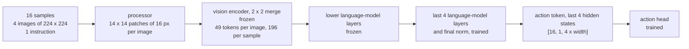

# Building on a Pretrained VLM

A pretrained vision-language model (VLM) is a vision encoder and a language model that were trained
together on images and text before any robot data existed. Used as the backbone of a policy, it
brings a link between the words of an instruction and the objects in the camera frames that
otherwise has to be learned from the demonstrations alone. The price is paid in image tokens, GPU
memory and training speed; the pretrained backbone configured here is Qwen3-VL-2B.

## The idea

[Anatomy of a VLA](60-anatomy-of-a-vla.md) splits a policy into a backbone that reads images and
text and an action head that produces motion. A pretrained backbone replaces the first part with a
model somebody else trained.

The task used here does not require a pretrained backbone. `dp_vit_lang_reactive`, a
48.9M-parameter policy (12.6M of it the instruction embedding table) trained from random weights
with the instruction as extra tokens next to the image patches
([Language conditioning](51-language-conditioning.md)) and no history (no previous frame, state or
action among its inputs), succeeds on 93% of 100 unseen layouts after 5M samples on 4000
demonstrations (trained weights, after the position fix; 94% / 94%, trained / averaged weights,
with random start poses and recoveries in the demonstrations; [case study](101-case-pick-target.md)).
The Qwen policy with one conditioning vector and history scored 6/100 (machine A) and 5% (machine B
rerun) after 0.4M samples; with every token, no history and 4000 demonstrations, 70% / 72% after
0.5M.

The configuration is [`sim/pickup/configs/vla_qwen.yaml`](../../sim/pickup/configs/vla_qwen.yaml)
and the model `Qwen/Qwen3-VL-2B-Thinking`; the policy generates no text and reads only hidden
states. The worked example: a batch of 16 samples, each with 4 images (cameras `front` and `wrist`
at control steps t-1 and t) of 224 x 224 pixels and one instruction such as "pick up the green
can".



The 49 tokens per image, the split into trained and frozen parameters (`requires_grad = False`: no
gradient, no optimiser state), the single vector for the action head and the history among the
inputs are decisions, not properties of the model. The first two are explained below.
[`vla_qwen_tokens_reactive.yaml`](../../sim/pickup/configs/vla_qwen_tokens_reactive.yaml) changes
the other two ([What the action head sees](50-what-the-action-head-sees.md),
[History and shortcuts](52-history-and-shortcuts.md)).

## How it works

### The processor and the image-token budget

A processor is the preprocessing code published with a model: it resizes each image, cuts it into
patches, tokenises the text, and writes one placeholder token into the prompt for every image token
the vision encoder will produce. A policy must use the processor of its VLM.

Background, from the Qwen2-VL paper (Wang et al., 2024) and the Hugging Face image processor that
Qwen3-VL-2B reuses: the image size decides the number of image tokens. The processor's `size`
holds two bounds on the pixel count, `shortest_edge` (minimum) and `longest_edge` (maximum); an
image outside them is rescaled, and each side is rounded to a multiple of 32. The published
minimum is 65,536 pixels (256 x 256).

The 32 comes from two stages. The vision encoder works on patches of 16 x 16 pixels, and the patch
merger combines each 2 x 2 block of patch features into one token (`spatial_merge_size: 2` in the
published config): 14 x 14 = 196 patches become 7 x 7 = 49 tokens of 32 x 32 pixels each, against
the 16 px patches of `dp_vit.yaml` ([Pretrained vision encoders](22-pretrained-vision-encoders.md)).

A 224 x 224 frame has 50,176 pixels, fewer than the published minimum. With the default bounds it
would be scaled up to 256 x 256, which is 64 tokens per image and 256 for 4 images (arithmetic from
the published config, not run here). `vla_qwen.yaml` keeps the frame at 224 x 224: 49 tokens per
image, 196 for 4 images.

```yaml
processor_kwargs:
  size:
    shortest_edge: 50176
    longest_edge: 50176
img_num_tokens: 49
```

The override is also required: the included data preset passes PaliGemma's
`size: {height: 224, width: 224}`, which Qwen's image processor rejects (see "Where it goes
wrong").

Qwen's `pixel_values` is a flat `(total_patches, patch_dim)` tensor with one `image_grid_thw` row
`(t, h, w)` per image (`BatchHandler._slice_inputs_qwen`, `vla_foundry/models/batch_handlers.py`):
12,544 rows of 3 x 2 x 16 x 16 = 1,536 values in the worked example, a still image repeated to fill
the published temporal patch size of 2 (background).

### What reaches the action head

A hidden state is the output of one language-model layer, `[batch, tokens, width]`; the published
model config lists a width of 2048. `VLMBackboneParams.conditioning` selects which hidden states
become the conditioning, the tensor the backbone hands to the action head. Both modes concatenate
the last `num_vlm_layers_to_use` layers along the width, 4 x 2048 = 8192.

- `action_token`, the default, used by `vla_qwen.yaml`. `VLMHFBackboneWrapper.__init__` adds one
  row to the token-embedding table for a new special token, the action token, and
  `insert_after_last_real_token` (`vla_foundry/models/vision_language_backbones/base.py`) writes
  its id directly after the last real token of every row, in front of any batch padding. Attention
  in the language model is causal, so only a position behind the prompt can attend to every image
  and instruction token. `conditioning_from_hidden_states` reads the hidden states there:
  `[16, 1, 8192]`.
- `all_tokens`. No token is added. The conditioning is the hidden states of every real prompt
  token, right-aligned and zero-padded in front to `conditioning_len` tokens, so that its length
  does not depend on the rest of the batch. `vla_qwen_tokens_reactive.yaml` sets
  `conditioning_len: 128` and sends one frame per camera, 98 image tokens: `[16, 128, 8192]`. The
  images precede the instruction in the prompt (`apply_chat_template` in
  `vla_foundry/data/processor/__init__.py`), so under causal attention their states were computed
  without it.

<!-- interactive: pooled-vs-tokens -->
*Figure: 196 image tokens per sample enter the VLM; the action head receives one vector read at the
action token or, beside it, every token.*

### Memory: what fits in 24 GB

The [lab notebook](../lab-notebook.md) gives the sizes: 2.2B parameters, of which 306M are trained
in `vla_qwen.yaml` (the last 4 language-model layers and the action head). Training memory has four
parts: the weights, one gradient value per trained parameter, the optimiser's state (AdamW keeps
two running averages, so two values per trained parameter), and the activations kept for the
backward pass.

The arithmetic uses 2 bytes per value throughout: `vla_foundry/main.py` moves the model to
`get_model_precision(cfg)` (`vla_foundry/distributed.py`), which returns `torch.bfloat16` for the
preset's `precision: amp_bf16` ([Training a language model](13-training-a-language-model.md)).

| Part | Everything trained | 306M trained |
|---|---|---|
| Weights, 2.2B x 2 bytes | 4.4 GB | 4.4 GB |
| Gradients | 4.4 GB | 0.6 GB |
| AdamW state | 8.8 GB | 1.2 GB |
| Sum before activations | 17.6 GB | about 6.2 GB |
| Averaged weights with `--ema.enabled True`, 2.2B x 4 bytes | 8.8 GB more | 8.8 GB more |

These figures are arithmetic; the lab notebook records no peak memory, only that the 306M
configuration trained at batch 16 on machine A (one RTX 4090, 24 GB). Whether full fine-tuning fits
was not measured. The "~36 GB" in the comment of `vla_qwen.yaml` is the same sum at 4 bytes per
value.

The last row: `create_ema_model` in `vla_foundry/models/ema.py` copies the whole model, frozen
layers included, and `main.py` keeps the copy on the GPU in float32. Whether it fits in 24 GB next
to the rest was not measured.

Activations are kept only from the first trained layer on (background: PyTorch's autograd does not
record operations whose inputs need no gradient).

### Which parameters train

`VLMHFBackboneWrapper.__init__` calls `_train_only_last_layers` when
`num_trainable_vlm_layers` is not `None`. The method:

1. Takes the first module in `self._model.model.named_modules()` named `language_model` or
   `text_model` whose `layers` is an `nn.ModuleList`, and raises `ValueError` if there is none or
   the requested number is outside `[0, len(layers)]`.
2. Sets `requires_grad = False` on every parameter of the VLM, vision encoder and token embeddings
   included, so the action token's embedding row keeps the mean of the existing rows that
   `__init__` gave it.
3. Sets `requires_grad = True` on the last `num_layers` layers and, when `num_layers > 0`, on the
   language model's `norm`.

`create_optimizer` in `vla_foundry/optimizer.py` skips parameters with `requires_grad = False`.
The default, `None`, trains the whole VLM; `0` leaves only the action head. Both Qwen configs read
out and train the last 4 layers.

## In this repository

`VLMHF` (`vla_foundry/models/vlm_hf.py`) loads the model with
`AutoModelForImageTextToText.from_pretrained`. `VLMHFBackboneWrapper`
(`vla_foundry/models/vision_language_backbones/vlm_hf_backbone.py`) wraps it and is selected by
`type: vlm_backbone`; its config fields are `VLMBackboneParams` in
`vla_foundry/params/model_params.py`.

Both configs name the model in `model.vision_language_backbone.hf_pretrained` and
`data.processor`. Other keys:

| Key | `vla_qwen.yaml` | `vla_qwen_tokens_reactive.yaml` | Effect |
|---|---|---|---|
| `model.vision_language_backbone.conditioning`, `...conditioning_len` | `action_token`, 0 (defaults) | `all_tokens`, 128 | one vector, or every prompt token at a fixed length |
| `data.image_indices`, `data.lowdim_past_timesteps` | `[-1, 0]`, 1 (preset) | `[0]`, 0 | history: 4 images (196 tokens), previous state and action; none: 2 images (98) |
| `data.img_num_tokens` | 49 | 49 | records the count without setting it: `get_processor` (`vla_foundry/data/processor/__init__.py`) uses it only for `simple_vlm` and PaliGemma processors |

The recommended first run is `dp_vit_lang_reactive` on 4000 demonstrations with random start poses
and recoveries (`make_dataset.sh pick_target 4000 pick_target_4k --random_start --disturb_prob 0.5`)
for 5M samples; its config switches averaged weights on ([README](../../README.md), "What you
get"), not a Qwen policy. To train the configuration measured below and evaluate every checkpoint:

```bash
sim/pickup/scripts/make_dataset.sh pick_target 1500 pick_target_1500
# the first run downloads the model from the Hugging Face Hub
# PICKUP_NUM_CHECKPOINTS=4: a checkpoint every 100k samples, as in the table below
PICKUP_NUM_CHECKPOINTS=4 sim/pickup/scripts/train_resilient.sh vla_qwen pick_target_1500 vla_qwen 400000
sim/pickup/scripts/eval_checkpoints.sh experiments/pickup/vla_qwen pick_target 100
.venv/bin/python -m sim.pickup.summarize --task pick_target --runs vla_qwen
```

`summarize.py` prints one row per checkpoint: success, how often the gripper closed at the named
object, and the slope of where it closed against where the named object was.
`vla_qwen_tokens_reactive` takes the same commands with its own config name, and the probes of
[What a policy looks at](95-what-a-policy-looks-at.md) apply unchanged.

## What we measured

All numbers are from the lab notebook, one training seed per run, closed-loop on unseen layouts.
The `vla_qwen` recipe ran twice on `pick_target` with 1500 demonstrations (98,841 training
windows): on machine A in the first round, and again on machine B (L40S GPUs, 128 CPU cores,
`vla_qwen_pt1500`), which also recorded where the gripper closed.

| Samples | Machine A: loss | success | Machine B: success | closed at the named object | slope | median miss to named |
|---|---|---|---|---|---|---|
| 100k (1 epoch) | 0.087 | 0/50 | 1% | 33% | 0.04 | 175 mm |
| 200k (2) | 0.066 | 1/50 | 3% | 60% | 0.53 | 105 mm |
| 300k (3) | 0.039 | 6/50 | 2% | 60% | 0.62 | 98 mm |
| 400k (4), final | 0.03-0.04 | 6/100 | 5% | 71% | 0.68 | 83 mm |

`vla_qwen_tokens_reactive` (every token, no history, 4000 demonstrations, machine B, after the
fix) closed at the named object 71% / 80% of the time after 0.10M samples (trained / averaged
weights) and ended at 70% / 72% after 0.5M, closing at the named object 98% / 99% of the time,
15 / 14 mm off.

Speed: `vla_qwen` at batch 16 trained at 49 samples/s on machine A and 45-48 on machine B, against
about 1100 for `dp_vit_lang_reactive` alone on a GPU.

Policy inference took about 190 ms per chunk of 15 actions for the Qwen VLA (machine A): almost
four control steps at 20 Hz. `dp_vit` (36.3M) took 20-65 ms on machine A, and
`dp_vit_lang_reactive` takes 71 ms per chunk at 10 flow steps on machine B.
`DiffusionPolicy.generate_actions` runs the backbone once per chunk, so fewer flow steps (the
sampler's steps from noise to actions) shorten only the head's share. The simulator waits for the
policy (`eval.py` blocks on the reply before `env.step`), so the success rates include no such
delay.

What this suggests. The other three policies of the first round closed at the named object in
32%, 33% and 29% of episodes (chance is 33%): where they closed did not depend on the scene
([field notes](../notes.md), "A failing policy ignores the scene; it does not average"). The Qwen
policy with the same single vector did look: after 0.4M samples on machine B it closed at the
named object 71% of the time (slope 0.68, 83 mm off). It pointed at the right object and did not
grasp it ([field notes](../notes.md), "Pretraining a backbone: mainly an earlier start"), and on
machine A it never lifted an object other than the named one in 150 episodes (lab notebook,
"`pick_target`, first round"). This agrees with the premise of RT-2 (Brohan et al., 2023;
background): a web-trained VLM brings the link between instruction and object.

What it does not prove:

- That the policy works. 94 of the 100 final episodes on machine A failed.
- That pretraining caused the difference, or is needed for it. Each policy is one seed, and the
  runs differ in size, training samples (400k against 1.0M) and architecture at once. Measured
  since on the from-scratch VLA: pretraining bought mainly an earlier start (it looks after 0.25M
  samples instead of about 1.0M; 86% / 87% against 75% / 85% at 3M), and a policy with no language
  model reaches 93-98% (same field-notes entry).
- What more training would do. The runs had 4 epochs; on the same 1500 demonstrations
  `dp_vit_lang_reactive` (48.9M) scored 0-3% up to 1.2M samples and 64% / 62% at 3M, 30.4 epochs
  ([How much data and training](71-how-much-data-and-training.md)). 5-6% after 4 epochs cannot be
  read as the limit of this design.
- Where the misses come from. The runs combined a frozen vision encoder, 49 tokens of 32 px per
  image, one conditioning vector, history and a 4-epoch budget; the every-token run changed three
  things at once (conditioning, history, number of demonstrations).

## Where it goes wrong

**Every batch fails in the processor.** No optimiser step completes and the log repeats
`Handling webdataset error (ValueError(...))`: the processor call is a `wds.map` stage in
`vla_foundry/data/pipelines/robotics.py` whose handler, `log_and_continue`
(`vla_foundry/data/utils.py`), logs the exception and skips the batch. The cause is the
`size: {height, width}` of the preset `vla_foundry/config_presets/data/vla_diffusion.yaml`, which
`RoboticsProcessor.process_inputs` forwards unchanged; the transformers 4.57.3 source (the version
in `uv.lock`; not run here) raises `size must contain 'shortest_edge' and 'longest_edge' keys.`
Override `processor_kwargs.size` as `vla_qwen.yaml` does.

**Out of memory in the first optimiser steps.** Check that `num_trainable_vlm_layers` is set and
whether `--ema.enabled` is on (memory table above). `vla_foundry/main.py` prints
`Total parameters` and `Trainable parameters` at start-up.

**The token count changes without an error.** Another render resolution or other size bounds
change the tokens per image, and `img_num_tokens` will not stop it. Print the `h` and `w` columns
of `image_grid_thw` for one batch; the tokens per image are `h x w / 4`. In `all_tokens` mode a
prompt longer than `conditioning_len` does raise a `ValueError`, in
`conditioning_from_hidden_states`.

**The run dies without a traceback, or hangs at 0% GPU.** Data-loader workers hand batches to the
trainer through shared memory (`/dev/shm` on Linux), where up to `num_workers x prefetch_factor`
batches wait; at 49 samples/s that queue stays full. One worked-example batch's `pixel_values` is
about 77 MB at 4 bytes per value (arithmetic): the preset's 8 workers and prefetch 8 queue about
4.9 GB, the `num_workers: 4` and `prefetch_factor: 2` of `vla_qwen.yaml` about 0.6 GB, and its
comment records a 2 GB `/dev/shm` here. Check with `df -h /dev/shm`. A dead worker leaves the
trainer waiting forever; `train_resilient.sh` restarts such a run
([Surviving long runs](81-surviving-long-runs.md)).

**A few percent after a few epochs, read as a verdict on the backbone.** The runs above had three
of the four causes the [roadmap](../roadmap.md) names for the first round's failures: one
conditioning vector, the previous action as an input, and a short training budget. The fourth, the
half-precision position table, merged positions only above 256 and did not reach their 20-token
action head ([Positions](12-positions.md)). With history, `dp_vit_lang` (48.9M) stood at 2% after
3M samples on 4000 demonstrations, against 81% / 75% for `dp_vit_lang_reactive` without it, both
before the position fix: the history policy reads the target from its previous action
([History and shortcuts](52-history-and-shortcuts.md)). After the fix, a history
policy trained on demonstrations that begin with a hold frame ends at 0% / 4% after 5M samples
([field notes](../notes.md), "The previous action as an input"). The probe below gives the
first query the expert's first command as previous action (1/100 to 22/100 for `dp_vit_lang`).
Evaluate every checkpoint and read the slope next to the success rate
([Measuring how a policy fails](92-measuring-failure.md)). `vla_qwen_tokens_reactive.yaml` removes
the first two causes.

```bash
PICKUP_OUT=results/pickup/vla_qwen/pick_target/prev_expert \
  sim/pickup/scripts/eval.sh experiments/pickup/vla_qwen pick_target 100 --first_prev_action expert
```

**Conditioning that depends on the rest of the batch.** In the machine A run the action token was
appended after the batch padding, so a short instruction's action token sat behind padding in a
training batch and not when served alone; whether that changed a Qwen prompt's conditioning (its
padding is masked from attention) was not tested.
`tests/essential/models/test_backbone_conditioning.py` pins the new layout on a stand-in model
([Train/inference skew](93-train-inference-skew.md)).

## Background and further reading

- Brohan et al., [RT-2: Vision-Language-Action Models Transfer Web Knowledge to Robotic Control](https://arxiv.org/abs/2307.15818),
  2023. Co-fine-tuned a web-trained VLM on robot data with actions written as text tokens.
- Black et al., [π0: A Vision-Language-Action Flow Model for General Robot Control](https://arxiv.org/abs/2410.24164),
  2024. A flow-matching action model built on a pretrained VLM.
- Wang et al., [Qwen2-VL: Enhancing Vision-Language Model's Perception of the World at Any Resolution](https://arxiv.org/abs/2409.12191),
  2024. Introduced the scheme in which the image size decides the number of visual tokens.
- Bai et al., [Qwen3-VL Technical Report](https://arxiv.org/abs/2511.21631), 2025. The model family
  of the backbone used here.
- The [model card of Qwen/Qwen3-VL-2B-Thinking](https://huggingface.co/Qwen/Qwen3-VL-2B-Thinking).
  Its `config.json` and `preprocessor_config.json` give the width, patch sizes, merge size and
  pixel bounds quoted above.

## Check yourself

1. Run the freezing test and read the fake model it builds.

   ```bash
   .venv/bin/python -m pytest tests/essential/models/test_vlm_backbone_partial_freeze.py -q
   ```

   Which parameter names does the first test expect to be trainable for `num_layers = 2`, and why
   is `lm_head` not among them?

2. The simulator is changed to render 448 x 448 frames and both size bounds are set to 200,704.
   Work out the patches and tokens per image and the image tokens per sample. Name the key in
   `vla_qwen.yaml` that should be updated, and say whether the code would stop you if you forgot.
   What would `vla_qwen_tokens_reactive.yaml` do with such frames at its first batch?

3. Run the conditioning tests.

   ```bash
   .venv/bin/python -m pytest tests/essential/models/test_backbone_conditioning.py -q
   ```

   In `test_pretrained_backbone_reads_the_action_token_behind_the_last_real_token`, which ids does
   the stand-in model receive for the short row? Where would the action token sit if it were
   appended to the padded batch, and which assertion would fail first?
