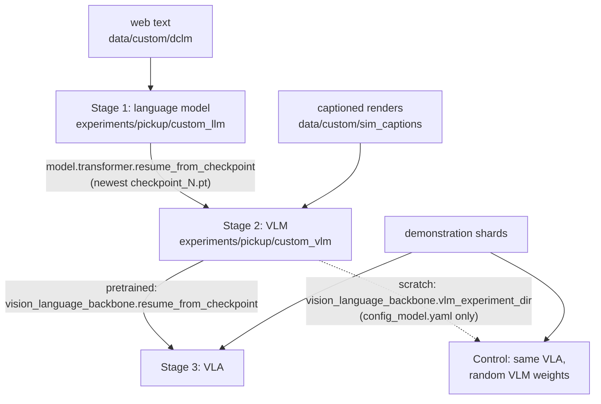

# The From-Scratch Path

A vision-language-action model (VLA) can be built on a vision-language model (VLM) that someone else
trained ([Building on a pretrained VLM](61-pretrained-backbones.md)), or every part can be trained
in order from random weights: a language model, a VLM on top of it, a policy on top of that. This
repository has the second path because every weight in the result is then accounted for, and
because it allows a control: the same policy with and without the earlier stages.

## The idea

Each stage produces a model that contains the previous one. Stage 1 trains a language model, a
causal transformer (each position attends only to earlier ones), on web text. Stage 2 adds a vision
transformer (ViT) and a projector (a linear layer into the language model's width) and trains the
resulting VLM on captioned renders of the simulator. Stage 3 adds an action transformer, the
action head, trained with [flow matching](41-flow-matching.md), which turns noise into a chunk of
15 actions in a few flow steps, and trains the VLA on demonstrations.

**Pretraining** is training a model on one task so that its weights become the starting point for
another. **Initialisation** is the set of values the weights hold before a run starts: random
numbers, or the result of pretraining. In a demonstration, the only thing that ties the words
"green can" to an object is where the expert then moves
([Language conditioning](51-language-conditioning.md)). A policy can learn the tie from that
alone, but late: `dp_vit_lang_reactive`, the policy that solves `pick_target` here, has no
pretrained part, and trained with the old position table it closed the gripper at the object the
instruction named about as often as chance for its first million training samples (with the table
fixed, 65% of the time after 1.0M). The hope behind stages 1 and 2 is that a VLM which already ties
the words to image regions gives the policy a head start.

That hope needs a **control**: a second run identical except in the one thing under test, here
the same stage-3 policy with a VLM whose weights are random. A difference larger than the
run-to-run noise is what stages 1 and 2 together bought. Equal scores mean either that pretraining
did not help or that the policy could not use it.

## How it works

### Stage 1: a language model on web text

[`sim/pickup/text_data.py`](../../sim/pickup/text_data.py) writes one file of the DCLM-baseline
dataset into tar shards.
[`custom_llm.yaml`](../../sim/pickup/configs/custom_llm.yaml) includes the preset
`vla_foundry/config_presets/models/transformer_100m.yaml` (12 layers, 8 heads, width 512, causal),
sets `vocab_size: 49280` and tokenises with `HuggingFaceTB/SmolVLM2-256M-Video-Instruct` at
`seq_len: 256` and batch size 32: `[32, 256]` token ids in, `[32, 256, 49280]` logits out
([Training a language model](13-training-a-language-model.md)).

The vocabulary size is not free to choose: `SimpleVLMProcessor`
([`simple_vlm_processor.py`](../../vla_foundry/models/vision_language_backbones/simple_vlm_processor.py)),
which stages 2 and 3 use, loads the same tokenizer by default, and a token id must mean the same
token in all three stages.

### Stage 2: a VLM on captioned renders

[`sim/pickup/caption_data.py`](../../sim/pickup/caption_data.py) renders `pick_target` and
`pick_cube` scenes, in 70% of them after up to 69 control steps of the scripted expert, and writes
a caption for each camera image from one of four templates in `caption`:

```text
robot arm over a table. the green can is in the right side of the image, near the centre.
robot arm over a table. from left to right: a red cube, a green can and a blue hex nut.
robot arm over a table with a green can, a blue hex nut and a red cube. the red cube is leftmost.
view from the robot gripper. the red cube is to the left of the green can.
```

The captions use the object words of the task instructions and state where the objects are
([Training a VLM](31-training-a-vlm.md)). Scene seeds start at 2,000,000 (`SEED0`), held-out
scenes at 3,000,000, demonstrations at 0 and evaluation at 1,000,000, so no layout (the scene a
seed fixes) is shared.

[`custom_vlm.yaml`](../../sim/pickup/configs/custom_vlm.yaml) sets `model.type: vlm` with the same
transformer preset and a ViT of width 256 with 6 layers. Its `vocab_size` stays at the preset's
50432, which `VLMParams.init_shared_attributes` (`vla_foundry/params/model_params.py`) treats as
unset and replaces with the length of the processor's tokenizer. Each image takes 256 of the 320 positions (`img_num_tokens: 256`,
`seq_len: 320`), which leaves 64 for text
([Joining vision and language](30-joining-vision-and-language.md)).

### Stage 3: a policy on the VLM

Three configs set `model.type: diffusion_policy` with
`vision_language_backbone.type: vlm_foundry_backbone` and a non-causal action transformer (every
position attends to every other) of width 256 with 6 layers. They differ in the **conditioning**,
the tensor the VLM hands to the action head (key `conditioning`, read in
`VLMFoundryBackboneWrapper._extract_action_conditioning`), and in **history**: whether the policy
is also given the previous frame of each camera, the previous joint state and its previous action.
At batch size 32:

| Config | `conditioning` | Conditioning tensor | History |
|---|---|---|---|
| [`vla_custom.yaml`](../../sim/pickup/configs/vla_custom.yaml) | `action_token` (the default) | `[32, 1, 2048]`: the last 4 layers' hidden states (4 x 512) of the action token, one special token placed after the prompt | yes |
| [`vla_custom_tokens.yaml`](../../sim/pickup/configs/vla_custom_tokens.yaml) | `all_tokens` | `[32, 1040, 2048]`: the same four layers at every image and text token, padded in front to `conditioning_len: 1040` | yes |
| [`vla_custom_tokens_reactive.yaml`](../../sim/pickup/configs/vla_custom_tokens_reactive.yaml) | `all_tokens` | `[32, 528, 2048]`, padded to `conditioning_len: 528` | no |

With history, two cameras at two frames each (`image_indices: [-1, 0]`) give four images, 1024
image tokens per sample. Without it (`image_indices: [0]`, `lowdim_past_timesteps: 0`) there are
two images and 512 image tokens, and the action head's sequence has no previous-action slot.

### How weights move between stages



**Stage 1 to stage 2.** `create_vlm` in `vla_foundry/models/vlm.py` builds the transformer and the
ViT. If `model_params.transformer.resume_from_checkpoint` is set, it reads the `state_dict` (the
weights) of that file and calls `transformer.load_state_dict(sd, strict=True)`. Only the
transformer is loaded; the ViT and the projector start random. With `strict=True` the call raises
when the two configs differ in the transformer preset or in the vocabulary size, which is why
stage 1 fixes its vocabulary at 49,280.

**Stage 2 to stage 3.** `create_vlm_foundry_backbone` in
[`vla_foundry/models/diffusion_policy/__init__.py`](../../vla_foundry/models/diffusion_policy/__init__.py)
needs the VLM's architecture and, optionally, its weights.

1. It reads `resume_from_checkpoint` and `vlm_experiment_dir` under
   `model.vision_language_backbone`.
2. Without a directory, it derives one from the path of the weights file,
   `<experiment_dir>/checkpoints/checkpoint_N.pt`, two levels up. With neither key set it raises
   `ValueError`, unless a `vlm_config_model.yaml` lies next to the VLA's own config.
3. It loads `VLMParams` from `<experiment_dir>/config_model.yaml` and builds the VLM with
   `load_pretrained=False`, which stops `create_vlm` from following the VLM's own stage-1 pointer.
4. If a weights file is set (and the caller asked for pretrained weights), it calls
   `load_model_checkpoint(vlm, ckpt_path)`.

So with only `vlm_experiment_dir`, the control takes the shape of the model from stage 2 and no
weight from stages 1 or 2.

## In this repository

[`sim/pickup/scripts/custom_path.sh`](../../sim/pickup/scripts/custom_path.sh) runs one stage per
call.

```bash
sim/pickup/scripts/custom_path.sh data    # web text, 20,000 captioned scenes, 1000 held-out scenes
sim/pickup/scripts/custom_path.sh llm     # stage 1 -> experiments/pickup/custom_llm
sim/pickup/scripts/custom_path.sh vlm     # stage 2 -> experiments/pickup/custom_vlm
sim/pickup/scripts/custom_path.sh check   # held-out captioning check of stage 2

sim/pickup/scripts/make_dataset.sh pick_target 4000 pick_target_4k
# vla <dataset> <run_name> <samples> [pretrained|scratch] [config] [extra main.py arguments]
PICKUP_NUM_CHECKPOINTS=12 sim/pickup/scripts/custom_path.sh vla pick_target_4k vla_pre 3000000 \
  pretrained vla_custom_tokens_reactive
PICKUP_NUM_CHECKPOINTS=12 sim/pickup/scripts/custom_path.sh vla pick_target_4k vla_rand 3000000 \
  scratch vla_custom_tokens_reactive
sim/pickup/scripts/eval_checkpoints.sh experiments/pickup/vla_pre pick_target 100
sim/pickup/scripts/eval_checkpoints.sh experiments/pickup/vla_rand pick_target 100
.venv/bin/python -m sim.pickup.summarize --task pick_target --runs vla_pre vla_rand
```

The two `vla` lines reproduce the measured pair: every token, no history, 4000 demonstrations, 3M
samples, a checkpoint every 0.25M samples (the default is 6 checkpoints). Without the fifth
argument the config is `vla_custom_tokens`, which has history.

- `data` skips a dataset whose `manifest.jsonl` exists. Each scene yields two image-caption pairs.
- `llm` and `vlm` write `experiments/pickup/<name>.train.log` and take their budgets from
  `PICKUP_LLM_SAMPLES` (default 500000) and `PICKUP_VLM_SAMPLES` (default 400000). `vlm` refuses
  to start without a stage-1 checkpoint.
- `check` runs [`sim/pickup/vlm_check.py`](../../sim/pickup/vlm_check.py) on up to 300 held-out
  captions (`--max`); [Testing a VLM](32-testing-a-vlm.md) covers the scoring.
- `vla` refuses to start without `experiments/pickup/custom_vlm/config_model.yaml`, for both
  initialisations, and runs under `train_resilient.sh`, which restarts a dead or stalled run from
  its newest checkpoint. Extra arguments go after all five positional ones.
- The pickup policy configs set `ema.enabled: true`, so every run saves a running average of the
  weights (the EMA weights, `ema_N.pt`) next to the trained ones. `eval_checkpoints.sh` evaluates
  both for every checkpoint, and with `PICKUP_WATCH=1` it follows a run that is still training.

## What we measured

All numbers are from the [lab notebook](../lab-notebook.md), on machine A (one RTX 4090, 24 GB)
unless machine B (L40S GPUs, 128 CPU cores) is named. The stage table, the first comparison and
the `dp_vit_lang*` numbers not marked otherwise come from runs trained before the position-table
fix ("Where it goes wrong"); the repeated comparison and its retrained stage-2 VLM come from after.

| Stage | Data | Budget | Result |
|---|---|---|---|
| 1. Language model, 91.4M | 61,000 DCLM-baseline web documents | 500k samples, batch 32, about 15 min at 550 samples/s | loss 6.3 -> 4.1, grammatical English (machine B: final loss 4.15) |
| 2. VLM, 96.5M | 40,000 captioned sim renders | 400k samples, about 15 min at 437 samples/s | loss 0.058; on 300 held-out scenes, objects listed in left-to-right order 85% of the time (256/300), leftmost object named 95% (285/300). Retrained after the fix (machine B): loss 0.059, order 267/300 = 89%, leftmost 286/300 = 95% |
| 3. VLA, 130.0M, everything trainable | 1500 `pick_target` demos | 1.0M samples, about 1.7 h at 165 samples/s | 0/100 |

### The first comparison

The pair used `vla_custom.yaml` on `pick_target` (three objects on the table, one named in the
instruction): 1500 demonstrations, 1.0M samples, one training run per policy, 100 unseen layouts.
The last four rows describe the moment the gripper first closed; **closed at the named object**
means that the object nearest the gripper then was the one the instruction named (chance: 33%).

| | Pretrained VLM | Random-init VLM |
|---|---|---|
| Success | 0/100 | 1/100 |
| Final training loss | ~0.03 | ~0.03 |
| Closed the gripper | 100% | 100% |
| Closed at the named object | 33% | 29% |
| Median miss to the named object | 175 mm | 174 mm |
| Median miss to the nearest object | 89 mm | 89 mm |

Zero against one out of 100 is no difference, and no proof that pretraining is useless.

1. **The task is solvable.** The scripted expert scores 99/100 through the same evaluation loop.
2. **Neither policy was looking at the scene.** Both closed at the named object at chance, at the
   right height (within about 3 mm) around control step 34-44 as the expert does, but 89 mm
   (median) from the nearest object. They were not aiming between the objects: where a failing
   policy closed did not depend on the scene ([notes.md](../notes.md), "A failing policy ignores
   the scene; it does not average"). A low loss does not contradict this
   ([Loss is not success](91-loss-is-not-success.md)).
3. **The stage-2 VLM had part of the information.** It named the leftmost object in 285 of 300
   held-out scenes, so it ties the object words to coarse image regions. Its captions give
   positions only as thirds of the image or as an ordering.

This is a floor effect: when every variant fails, a difference between them cannot show.

### Why both stayed at the floor

Three properties of the pair stood in the way. The numbers for the last two come from a
48.9M-parameter patch-token policy with instruction tokens and no VLM (`dp_vit_lang`,
`dp_vit_lang_reactive`) on machine B, as trained weights / EMA weights.

- **One conditioning vector.** The named object's position has to be written into the values of
  one vector by a VLM that only the action loss trains
  ([What the action head sees](50-what-the-action-head-sees.md)). On `pick_target` the
  same from-scratch VLA goes from 0/100 with one vector to 86% / 87% with every token, but history
  and the number of demonstrations changed with it; a run that changes only the conditioning was
  not made.
- **History.** `vla_custom.yaml` has it. With the previous frame, state and action as inputs,
  `dp_vit_lang` was at 2% / 2% after 3.0M samples on 4000 demonstrations; without them
  `dp_vit_lang_reactive` was at 81% / 75%. The history policy reads its target from its previous
  action: 1/100 as served, 22/100 when the previous action sent with the first query was the
  expert's first command, 77/100 when the expert drove the first 10 control steps
  ([History and shortcuts](52-history-and-shortcuts.md)). Demonstrations that begin with a frame
  of the robot at rest (`collect.py --hold_steps 1`) did not cure it: trained after the position
  fix, that policy ends at 0% / 4% after 5M samples, and where it closes never depends on the
  scene.
- **The budget.** After 1.0M samples on 1500 demonstrations `dp_vit_lang_reactive` was at 3% / 5%;
  with 3.0M samples 64% / 62%, and with 4000 demonstrations and 5.0M samples 83% / 85%. That last
  run closed at the named object in 35% / 32% of episodes after 1.0M samples and in 95% / 98%
  after 2.0M: looking at the scene arrives late and all at once
  ([How much data and training](71-how-much-data-and-training.md)).

Which of the three held the VLA pair down was not isolated. The field notes ("Pretraining a
backbone: mainly an earlier start") conclude that neither policy could have found the object, so
the first comparison says nothing about pretraining.

### The comparison repeated

Trained again on machine B without the three obstacles (every token, no history, 4000
demonstrations, 3M samples, the retrained stage-2 VLM), trained / EMA weights:

| Samples | Pretrained: success | closed at the named object | Random: success | closed at the named object |
|---|---|---|---|---|
| 0.25M | 5% / 43% | 81% / 97% | 0% / 0% | 33% / 28% |
| 0.5M | 31% / 50% | 99% / 100% | 0% / 1% | 39% / 33% |
| 1.0M | 73% / 62% | 99% / 99% | 9% / 4% | 84% / 68% |
| 2.0M | 81% / 88% | 100% / 100% | 69% / 81% | 100% / 100% |
| 3.0M (final) | 86% / 87% | 100% / 100% | 75% / 85% | 100% / 100% |

Four checks:

1. **Both runs left the floor.** Both end closing at the named object every time.
2. **The curves differ in when looking starts.** The **slope** of where the gripper first closed
   against where the named object was is 1 when it closes where the object is and 0 when the place
   does not depend on the scene. The pretrained run is at 0.87 / 0.97 after 0.25M samples; the
   random one is at -0.09 / -0.04 there and 0.87 / 0.73 at 1.0M.
3. **The end points are close.** 11 points apart with trained weights, 2 with EMA weights, from
   one seed each.
4. **Same code on both sides.** Both VLAs and their VLM used the fixed table; the reference run
   used the old one (83% / 85%). Trained again with the fixed table it ends at 93% (trained
   weights), and a second pair with other seeds ends at 96% / 96% against 90% / 89%. The VLA pair
   should be read against those runs.

The field notes ("Pretraining a backbone: mainly an earlier start") read this as an earlier start:
stages 1 and 2 moved the onset from about 1.0M to 0.25M samples, not the end point. Neither VLA
beats the patch-token policy with the fixed table at the same 3M samples (90%).

<!-- interactive: onset -->
*Figure: success, closed at the named object and slope against training samples for the
pretrained and the random-init VLA: the slope rises first, success follows, and the random one
starts about 0.75M samples later.*

A pair that succeeds needs probing too: the plain patch-token policy (85%) looks at the scene once,
and with the object moved 80 mm at control step 20 it succeeded in 0 of 96 episodes
([What a policy looks at](95-what-a-policy-looks-at.md)).

## Where it goes wrong

**The VLM reaches a low loss and ignores images at inference.** The stage-2 model first scored
1/300 on exact ordering and 70/300 on the leftmost object: `SimpleVLMProcessor` scaled PIL and
numpy images to [0, 1] but left the uint8 tensors that training fed at 0-255
([Train and inference must see the same thing](93-train-inference-skew.md) tells this
train/inference skew in full). Run `custom_path.sh check` before stage 3.

**A partial stage is passed on silently.** The script's `latest` helper returns a run's
highest-numbered `checkpoint_N.pt`, and stages 1 and 2 are not wrapped in the restart loop, so a
run that died halfway leaves a file that the next stage accepts. A finished run logs the line
below (`vla_foundry/main.py`); check that each count is above 0:

```bash
grep -c "Model has seen the desired number of samples" \
  experiments/pickup/custom_llm.train.log experiments/pickup/custom_vlm.train.log
```

**Stages from both sides of the position-table fix.** The rotary position table was computed in
bfloat16 under autocast, which left 641 distinct positions out of 2048;
`vla_foundry/positional_embedding.py` now computes it in float32
([Telling tokens where they are](12-positions.md)). Stage 1 (256-token sequences) was not
affected, stage 2 (320) was. Retrain an older stage 2 before building a new stage 3 on it.
`positional_embedding_type: rotary_legacy_autocast` reproduces the old table, for evaluating old
runs only.

**Both runs of a pair report the same result.** Two evaluations started on one port both talked to
the server that had bound it first, and the second filed the other run's results under its own
name (about 40 evaluations here, redone). `eval.sh` now takes a free port, and `eval.py` stops
unless the server reports the checkpoint it asked for.

**The VLA cannot be rebuilt without the VLM's directory.** `create_vlm_foundry_backbone` reads the
VLM experiment's `config_model.yaml` every time the model is constructed, including in
`sim/pickup/policy_server.py` before the VLA's weights are loaded. Keep
`experiments/pickup/custom_vlm` for as long as a policy built on it is evaluated.

## Background and further reading

None of the following was measured here.

- Mercat et al., *VLA Foundry: A Unified Framework for Training Vision-Language-Action Models*,
  2026, [arXiv:2604.19728](https://arxiv.org/abs/2604.19728). The framework this repository is
  built on; it releases one model trained from scratch through the three stages and one built on
  the pretrained Qwen3-VL.
- Li et al., *DataComp-LM: In search of the next generation of training sets for language models*,
  2024, [arXiv:2406.11794](https://arxiv.org/abs/2406.11794). DCLM-baseline, the stage-1 text, is
  the dataset its model-based filtering produced.

## Check yourself

1. Render 64 scenes and read their captions. Find an example of each of the four templates in
   `caption`, explain why the first is the most common, and say which one `vlm_check.py` scores.

   ```bash
   MUJOCO_GL=egl .venv/bin/python -m sim.pickup.caption_data --out data/custom/captions_demo --scenes 64 --workers 4
   for f in data/custom/captions_demo/*.tar; do tar -xf "$f" -C data/custom/captions_demo; done
   grep "" data/custom/captions_demo/*.txt
   ```

2. Read the factory and list which of the four items under "Stage 2 to stage 3" run for
   `pretrained` and which for `scratch`. Then find the condition in `create_vlm` that
   `load_pretrained=False` turns off.

   ```bash
   sed -n 27,71p vla_foundry/models/diffusion_policy/__init__.py
   sed -n 275,301p vla_foundry/models/vlm.py
   ```

3. For an evaluated pretrained-versus-scratch pair, decide from the columns `At named object` and
   `Slope` whether the two success rates may be compared at all, and find the first checkpoint at
   which each run's slope is above 0.5.

   ```bash
   .venv/bin/python -m sim.pickup.summarize --task pick_target --runs vla_pre vla_rand
   ```
