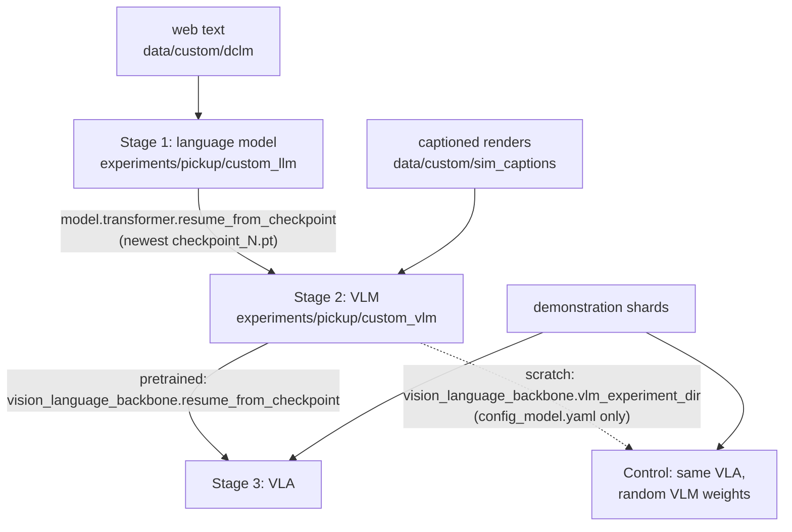

# The From-Scratch Path

A vision-language-action model (VLA) can be built on a vision-language model (VLM) that someone else
trained ([Building on a pretrained VLM](61-pretrained-backbones.md)), or every part can be trained
in order from random weights: a language model, a VLM on top of it, a policy on top of that. A
robot policy does not need the second path. This repository has it because every weight in the
result is then accounted for, and because it allows a control: the same policy with and without the
earlier stages.

## The idea

Each stage produces a model that contains the previous one. Stage 1 trains a language model, a
causal transformer (each position attends only to earlier ones), on web text. Stage 2 adds a vision
transformer (ViT) and a projector and trains the resulting VLM on captioned renders of the
simulator. Stage 3 adds an action transformer trained with [flow matching](41-flow-matching.md),
which turns noise into a chunk of actions in a few steps, and trains the VLA on 1500
demonstrations.

**Pretraining** is training a model on one task so that its weights become the starting point for
another. **Initialisation** is the set of values the weights hold before a run starts: random
numbers, or the result of pretraining. Stage 3 has only 1500 demonstrations, and the only thing in
them that ties the words "green can" to an object is where the expert then moves. The hope behind
stages 1 and 2 is that a model which already ties the words to image regions makes that part free
for the policy, so it does not have to be learned from so weak a signal.

That hope needs a **control**: a second run identical in every respect except the one under
test. Here it is the stage-3 policy with the same architecture, data and budget, and a VLM whose
weights are random. If the two runs differ by more than the run-to-run noise (one training seed
each here), stages 1 and 2 together bought the difference. The control removes both at once;
nothing measured here separates what the web-text stage contributes from what the captioning stage
does. If the runs score the same, either pretraining did not help or the policy could not use it.
Telling those two apart is the hard part.

## How it works

### Stage 1: a language model on web text

[`sim/pickup/text_data.py`](../../sim/pickup/text_data.py) downloads one file of the DCLM-baseline
dataset (`REPO`, `FILENAME`) and writes its documents into tar shards (archive files of up to 4096
documents each) with a `manifest.jsonl`.

[`custom_llm.yaml`](../../sim/pickup/configs/custom_llm.yaml) includes the preset
`vla_foundry/config_presets/models/transformer_100m.yaml` (12 layers, 8 heads, width 512, causal)
and sets `vocab_size: 49280`. The data section tokenizes with
`HuggingFaceTB/SmolVLM2-256M-Video-Instruct` at `seq_len: 256`, and the batch size is 32:
`[32, 256]` token ids in, `[32, 256, 49280]` logits out
([Training a language model](13-training-a-language-model.md)).

The vocabulary size is not free to choose. `SimpleVLMProcessor`
([`simple_vlm_processor.py`](../../vla_foundry/models/vision_language_backbones/simple_vlm_processor.py)),
which stages 2 and 3 use, loads the same tokenizer by default. A token id must mean the same token
in all three stages, and the embedding table must keep its number of rows, or stage 2 cannot load
the stage-1 weights.

### Stage 2: a VLM on captioned renders

[`sim/pickup/caption_data.py`](../../sim/pickup/caption_data.py) builds the image-text pairs. For
each scene seed, `work` sets the task (`pick_target` in 80% of scenes, `pick_cube` with a single
red cube in the rest), resets the `PickupEnv`, advances the scripted expert a random number of
steps (0 to 69) in 70% of scenes so that the arm appears in the poses of a pick, renders the
`front` and `wrist` cameras and writes one caption per image. `caption` projects each object into
the image. With none in view it writes "no objects are in view."; with exactly one it always uses
the first template below; with two or more it picks one of the four at random:

```text
robot arm over a table. the green can is in the right side of the image, near the centre.
robot arm over a table. from left to right: a red cube, a green can and a blue hex nut.
robot arm over a table with a green can, a blue hex nut and a red cube. the red cube is leftmost.
view from the robot gripper. the red cube is to the left of the green can.
```

The captions use the object words of the task instructions and state where the objects are, so
predicting them requires reading positions from the image. Scene seeds start at 2,000,000
(`SEED0`), held-out scenes at 3,000,000, demonstrations at 0 and evaluation at 1,000,000, so no
layout is shared.

[`custom_vlm.yaml`](../../sim/pickup/configs/custom_vlm.yaml) sets `model.type: vlm` with the same
transformer preset and a ViT of width 256 with 6 layers. It does not override the preset's
`vocab_size: 50432`. That value equals the `TransformerParams` default, which
`VLMParams.init_shared_attributes` in `vla_foundry/params/model_params.py` treats as unset and
replaces with the length of the processor's tokenizer. One image goes through these shapes
([Joining vision and language](30-joining-vision-and-language.md)):

1. Pixels `[1, 3, 224, 224]`. With `patch_size: 14` the ViT cuts a 16 x 16 grid and returns
   `[1, 256, 256]`.
2. `ModalityProjector` in [`vla_foundry/models/vlm.py`](../../vla_foundry/models/vlm.py), one linear
   layer without bias, maps width 256 to the language model's 512: `[1, 256, 512]`.
3. The processor has expanded the `<image>` placeholder to 256 copies (`img_num_tokens: 256`).
   `VLM.forward` embeds the token ids and overwrites those 256 positions with the projected patches.
4. The language model runs on the result; `seq_len: 320` leaves 64 positions for text.

### Stage 3: a policy on the VLM

[`vla_custom.yaml`](../../sim/pickup/configs/vla_custom.yaml) and
[`vla_custom_tokens.yaml`](../../sim/pickup/configs/vla_custom_tokens.yaml) set
`model.type: diffusion_policy` with `vision_language_backbone.type: vlm_foundry_backbone` and a
non-causal action transformer (every position attends to every other) of width 256 with 6 layers.
Two cameras at two frames each (`image_indices: [-1, 0]`) give four images, 1024 image tokens, per
sample. The configs differ in one key, `conditioning`, which decides what the action head receives
from the VLM (`VLMFoundryBackboneWrapper._extract_action_conditioning`). At batch size 32:

| Config | `conditioning` | Conditioning tensor |
|---|---|---|
| `vla_custom.yaml` | `action_token` (the default) | `[32, 1, 2048]`: the last 4 layers' hidden states (4 x 512) of one token added after the prompt |
| `vla_custom_tokens.yaml` | `all_tokens` | `[32, 1040, 2048]`: the same four layers at every image and text token, padded in front to `conditioning_len: 1040` |

<!-- interactive: pipeline -->
*Figure: the loop stage 3 shares with every other policy here: scripted expert, demonstrations,
shards, training, policy server, simulator, success count on unseen layouts. Stages 1 and 2 only
change what the training box starts from.*

### How weights move between stages



**Stage 1 to stage 2.** `create_vlm` in `vla_foundry/models/vlm.py` builds the transformer and the
ViT. If `model_params.transformer.resume_from_checkpoint` is set, it reads the checkpoint's
`state_dict` and calls `transformer.load_state_dict(sd, strict=True)`. Only the transformer is
loaded; the ViT and the projector start random. Background, from PyTorch: `strict=True` makes any
missing or unexpected tensor an error, and a tensor with a different shape is an error under either
setting. The call therefore raises when the two configs differ in the transformer preset (missing
or extra tensors) or in the vocabulary (the embedding and output tables have one row per entry),
which is why stage 1 fixes its vocabulary at 49,280.

**Stage 2 to stage 3.** `create_vlm_foundry_backbone` in
[`vla_foundry/models/diffusion_policy/__init__.py`](../../vla_foundry/models/diffusion_policy/__init__.py)
needs the VLM's architecture and, optionally, its weights.

1. It reads `resume_from_checkpoint` and `vlm_experiment_dir` from the backbone parameters.
2. Without a directory, it derives one from the checkpoint path
   `<experiment_dir>/checkpoints/checkpoint_N.pt`, two levels up. With neither key set, it looks
   for a `vlm_config_model.yaml` next to the VLA's own config, a file written only when a model is
   published to the Hugging Face hub (`vla_foundry/hf_hub.py`), and otherwise raises `ValueError`.
   `custom_path.sh` always sets one of the keys.
3. It loads `VLMParams` from `<experiment_dir>/config_model.yaml` and builds the VLM with
   `load_pretrained=False`, which stops `create_vlm` from following the VLM's own stage-1 pointer.
4. If a checkpoint path is set (and the caller asked for pretrained weights), it calls
   `load_model_checkpoint(vlm, ckpt_path)`.

The control follows from step 4: with only `vlm_experiment_dir`, the architecture is read from
stage 2 and no weight is loaded, so nothing from stages 1 and 2 enters the control except the shape
of the model.

## In this repository

[`sim/pickup/scripts/custom_path.sh`](../../sim/pickup/scripts/custom_path.sh) runs one stage per
call, with four configs.

```bash
sim/pickup/scripts/custom_path.sh data    # web text, 20,000 captioned scenes, 1000 held-out scenes
sim/pickup/scripts/custom_path.sh llm     # stage 1 -> experiments/pickup/custom_llm
sim/pickup/scripts/custom_path.sh vlm     # stage 2 -> experiments/pickup/custom_vlm
sim/pickup/scripts/custom_path.sh check   # held-out captioning check of stage 2

sim/pickup/scripts/make_dataset.sh pick_target 1500 pick_target_1500
# vla <dataset> <run_name> <samples> [pretrained|scratch] [config]
sim/pickup/scripts/custom_path.sh vla pick_target_1500 vla_pre  1000000 pretrained vla_custom
sim/pickup/scripts/custom_path.sh vla pick_target_1500 vla_rand 1000000 scratch    vla_custom
sim/pickup/scripts/eval.sh experiments/pickup/vla_pre  pick_target 100
sim/pickup/scripts/eval.sh experiments/pickup/vla_rand pick_target 100
```

The two `vla` lines are the one-vector pair. Without the fifth argument the config is
`vla_custom_tokens`.

- `data` skips a dataset whose `manifest.jsonl` exists. Each scene yields two image-caption pairs,
  so 20,000 scenes give 40,000.
- `llm` and `vlm` call `vla_foundry/main.py` directly, pass extra arguments on to it and write
  `experiments/pickup/<name>.train.log`. `vlm` refuses to start without a stage-1 checkpoint. The
  budgets are `PICKUP_LLM_SAMPLES` (default 500000) and `PICKUP_VLM_SAMPLES` (default 400000).
- `check` runs [`sim/pickup/vlm_check.py`](../../sim/pickup/vlm_check.py) and passes extra
  arguments to it (`--max` sets the number of captions, 300 by default). The VLM completes
  held-out captions after `from left to right:` with greedy decoding (the most probable token at
  each step, [Generating text](14-generation.md)); [Testing a VLM](32-testing-a-vlm.md) covers the
  scoring.
- `vla` refuses to start without `experiments/pickup/custom_vlm/config_model.yaml`, for both
  initialisations, then hands over to `train_resilient.sh`, which restarts a dead or stalled run
  from its newest checkpoint. Extra arguments reach `main.py` only after all five positional ones,
  so the initialisation and the config must then be given explicitly.

The config keys that pass weights between stages are the three in the diagram above; the script
sets them on the command line.

## What we measured

All numbers are from the lab notebook, on machine A (one RTX 4090, 24 GB) unless noted.

| Stage | Data | Budget | Result |
|---|---|---|---|
| 1. Language model, 91.4M | 61,000 DCLM-baseline web documents | 500k samples, batch 32, about 15 min at 550 samples/s | loss 6.3 -> 4.1, grammatical English (machine B: final loss 4.15) |
| 2. VLM, 96.5M | 40,000 captioned sim renders | 400k samples, about 15 min at 437 samples/s | loss 0.058; on 300 held-out scenes, objects listed in left-to-right order 85% of the time (256/300), leftmost object named 95% (285/300) |
| 3. VLA, 130.0M, everything trainable | 1500 `pick_target` demos | 1.0M samples, about 1.7 h at 165 samples/s | 0/100 |

The three training runs sum to about 2.2 hours; stage 3 was timed with the one-vector config, and
generating the data is not included.

The first comparison used `vla_custom.yaml`, one conditioning vector, on `pick_target`: three
objects on the table, one named in the instruction. Each policy was trained once and evaluated on
100 unseen layouts. The last four rows describe the moment the gripper first closed.

| | Pretrained VLM | Random-init VLM | `dp_vit`: patch tokens, no language input |
|---|---|---|---|
| Success | 0/100 | 1/100 | 1/100 |
| Final training loss | ~0.03 | ~0.03 | 0.069 |
| Closed the gripper | 100% | 100% | 100% |
| Nearest object was the named one | 33% | 29% | 32% |
| Median miss to the named object | 175 mm | 174 mm | 185 mm |
| Median miss to the nearest object | 89 mm | 89 mm | 110 mm |

Both VLAs reached a lower training loss than `dp_vit` and no higher success; the loss says the
chunks resemble the expert's on average, not that the gripper reaches an object
([Loss is not success](91-loss-is-not-success.md)).

Zero against one out of 100 is no difference; the notebook treats a few percent between single runs
as noise. That still does not show that pretraining is useless. Three measurements say why.

1. **The task is solvable.** The scripted expert scores 99/100 through the same evaluation loop.
2. **Neither policy found any object.** With three objects, the nearest one is the named one 33% of
   the time by chance; the two policies are at 33% and 29%. Both closed the gripper 89 mm (median)
   from the nearest object, at the right height (within about 3 mm) around step 34-44, as the
   expert does. For scale: a 30 mm offset added to its grasp point cuts the expert itself to 30%
   over all objects.
3. **The stage-2 VLM had part of the information.** It named the leftmost object in 285 of 300
   held-out scenes, so it ties the object words to coarse image regions. Its captions give
   positions only as thirds of the image or as an ordering, so the check does not show that it
   encoded positions to the centimetre a grasp needs.

Knowing which object is which existed in the pretrained VLM and did not arrive at the gripper: the
named-object rate stayed at chance. Two initialisations can only be told apart if the policy is
able to use what a good one offers. Both runs scored at the bottom of the scale. This is a floor
effect: when every variant fails, a difference between them cannot show.

The suspected cause is the interface. Under `vla_custom.yaml` the action head sees one vector of
2048 numbers, and the object positions have to be encoded in its values by a backbone that only the
action loss trains to do so ([What the action head sees](50-what-the-action-head-sees.md)). That
reading is an inference, not a measurement of this pair, and the evidence for it is partial. On
`pick_cube` with 200 demonstrations a policy with one pooled vector per image scored 2/50 and one
with every patch as a token scored 15/50
([One vector or many tokens](21-pooled-vs-patch-tokens.md)), but those two also differ in their
vision encoder (pretrained CLIP ViT-B/32 against a small ViT trained from scratch). Against it:
`dp_vit` in the table above already feeds every patch as a token and missed the nearest object by
110 mm (median), so one vector cannot be the whole explanation on `pick_target` at this budget.

The comparison is being run again with `conditioning: all_tokens`. The lab notebook lists the
all-token VLA, with and without pretraining, among the runs still in progress, and the effect of
`all_tokens` as not yet measured, so there is no result to report. One caution for reading it when
it arrives: in the second round (machine B) `dp_vit_lang_reactive`, a patch-token policy with
instruction tokens and no VLM, reached 3% / 5% success on the same 1500 demos at 1M samples (raw
weights / EMA weights, an exponential moving average of the weights over training), with the named
object nearest in 49% / 41% of episodes. On 4000 demos it was at 95% / 98% for the named object and
4% / 36% success at its 2.0M-sample checkpoint, while still training. Many tokens were not
sufficient at the smaller budget; a rerun at that budget may fail for reasons unrelated to
pretraining, and would then be as uninformative as the first.

## Where it goes wrong

**The VLM reaches a low loss and ignores images at inference.** Before a fix, the stage-2 model
scored 1/300 on exact ordering and 70/300 on the leftmost object. `SimpleVLMProcessor` scaled PIL
and numpy images to [0, 1] but left uint8 tensors at 0-255; training fed tensors and the check
feeds PIL images. A teacher-forced test (the true caption is fed in and the loss of predicting each
next token is measured, so nothing is generated) made it visible: with PIL images the loss was the
same for the right and a mismatched image (1.93 vs 1.89); with the unscaled tensors the model was
trained on it was 0.10 vs 1.18. `_process_image` now scales uint8 tensors too. Run
`custom_path.sh check` before stage 3.

**Stage 1 runs out of memory.** At batch 128 the float32 logits for 128 x 256 positions over a
49,280-token vocabulary are 6.5 GB per tensor, and the run failed. `custom_llm.yaml` uses batch 32.

**A partial stage is passed on silently.** The script's `latest` helper returns a run's
highest-numbered checkpoint, whatever it is, and stages 1 and 2 are not wrapped in the restart
loop, so a run that died halfway leaves a checkpoint that the next stage accepts. A finished run
logs a completion line (`vla_foundry/main.py`), the one `train_resilient.sh` tests for. Before
moving on, check that this prints a count above 0 for each file:

```bash
grep -c "Model has seen the desired number of samples" \
  experiments/pickup/custom_llm.train.log experiments/pickup/custom_vlm.train.log
```

**The VLA cannot be rebuilt without the VLM's directory.** For a run made here,
`create_vlm_foundry_backbone` reads the VLM experiment's `config_model.yaml` every time the model
is constructed, including in `sim/pickup/policy_server.py` before the VLA checkpoint is loaded.
Keep `experiments/pickup/custom_vlm` for as long as a policy built on it is evaluated.

**The VLM is taken for a general one.** Stage 2 saw renders of one table with four objects and
templated captions, on top of a language model at loss 4.1. Nothing here measures it on
photographs, other objects or other phrasings. This path buys understanding and a control; a
backbone that knows the world outside the simulator comes from
[Building on a pretrained VLM](61-pretrained-backbones.md).

## Background and further reading

None of the following was measured here.

- Mercat et al., *VLA Foundry: A Unified Framework for Training Vision-Language-Action Models*,
  2026, [arXiv:2604.19728](https://arxiv.org/abs/2604.19728). The framework this repository is
  built on; it releases one model trained from scratch through the three stages and one on a
  pretrained Qwen3-VL backbone.
- Li et al., *DataComp-LM: In search of the next generation of training sets for language models*,
  2024, [arXiv:2406.11794](https://arxiv.org/abs/2406.11794). A testbed for experiments in curating
  language-model training data; DCLM-baseline, the stage-1 text, is the dataset its model-based
  filtering produced.
- Marafioti et al., *SmolVLM: Redefining small and efficient multimodal models*, 2025,
  [arXiv:2504.05299](https://arxiv.org/abs/2504.05299). The family of small VLMs whose tokenizer
  the three stages share; nothing else of it is used here.
- Brohan et al., *RT-2: Vision-Language-Action Models Transfer Web Knowledge to Robotic Control*,
  2023, [arXiv:2307.15818](https://arxiv.org/abs/2307.15818). The other route: a VLM pretrained on
  web data, co-fine-tuned on robot trajectories and web vision-language tasks to emit robot actions
  as text tokens.

## Check yourself

1. Render 64 scenes and read their captions. Find an example of each of the four templates in
   `caption`, explain why the first is the most common, and say which one `vlm_check.py` scores.

   ```bash
   MUJOCO_GL=egl .venv/bin/python -m sim.pickup.caption_data --out /tmp/captions_demo --scenes 64 --workers 4
   for f in /tmp/captions_demo/*.tar; do tar -xf "$f" -C /tmp/captions_demo; done
   grep "" /tmp/captions_demo/*.txt
   ```

2. Read the factory and list which of its four steps run for `pretrained` and which for `scratch`.
   Then find the condition in `create_vlm` that `load_pretrained=False` turns off.

   ```bash
   sed -n 27,71p vla_foundry/models/diffusion_policy/__init__.py
   sed -n 275,301p vla_foundry/models/vlm.py
   ```

3. After stages 1 and 2, run the check and compare with the two runs in the lab notebook: 256/300
   and 285/300 on machine A, 249/300 and 279/300 on machine B. If the leftmost-object rate is far
   below both, start with the first failure listed above.

   ```bash
   sim/pickup/scripts/custom_path.sh check
   ```

4. For an evaluated pretrained-versus-scratch pair, decide from the named-object rate and the
   median miss whether the two success rates may be compared at all.

   ```bash
   .venv/bin/python -m sim.pickup.summarize --task pick_target
   ```
