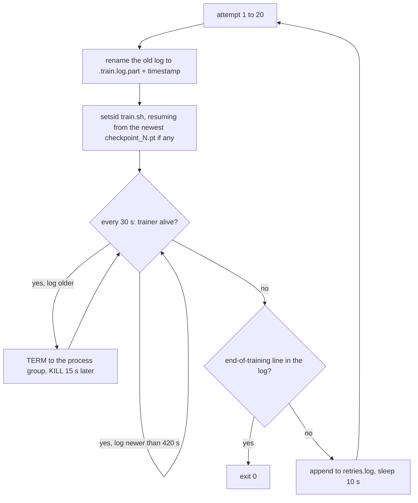

# Surviving Long Runs

The from-scratch stages in the [lab notebook](../lab-notebook.md) took about 15 minutes each for
the language model and the VLM and about 1.7 hours for the policy. For that long one process has
to stay alive, keep its data-loader workers alive and share a machine with other jobs. None of
the failures in this chapter is a modelling problem; each is given with its symptom, its cause
and the remedy used here.

## The idea

A long run survives when three things are in place:

- a **checkpoint**, saved state from which training can continue (weights, optimiser state,
  position in the data), written often enough that a restart loses little;
- a **liveness signal**, something visible from outside that changes only while training makes
  progress;
- a **supervisor**, a process that starts the trainer, watches the signal and restarts from the
  newest checkpoint.

Worked example. `vla_custom` trained on 1.0M samples in about 1.7 h at 165 samples/s on machine
A, whose runs "died or hung several times and were resumed from checkpoints" (lab notebook). With
the 6 checkpoints `train.sh` asks for by default, `main.py` budgets `1,000,000 // 6 = 166,666`
samples per checkpoint window and `get_datastring_input` rounds that up to whole shards (the
archive files the dataset is split into), so a checkpoint is written about every 17 minutes at
that speed (arithmetic). A crash then costs at most about 17 minutes if something restarts the
run; a hang costs the rest of the night if nothing notices it.

## How it works

### A run that dies without a traceback

A Python exception leaves a traceback in the log. A trainer that the kernel kills outright
(signal 9, for example from the out-of-memory killer) writes nothing: the log stops.

**Shared memory.** Data-loader workers are separate processes that hand finished batches to the
trainer through shared memory, on Linux the `/dev/shm` mount
([`sim/pickup/README.md`](../../sim/pickup/README.md)). Background, from the PyTorch `DataLoader`
documentation: each worker loads `prefetch_factor` batches ahead, so up to
`num_workers x prefetch_factor` batches exist at once. That bounds what sits in the mount; it is
not its level. `get_wds_dataloader` (`vla_foundry/data/dataloader.py`) passes
`pin_memory=True`; background: PyTorch then copies each arriving batch into pinned (page-locked)
memory in the trainer and can free the shared copy.

For `dp_vit.yaml` a batch is 64 samples of 4 images (two cameras at t-1 and t) of 3 x 224 x 224
float32 values (`PassthroughProcessor`): `64 x 4 x 150,528 x 4 bytes = 154 MB` (arithmetic; the
README says about 150 MB). With `num_workers: 8` and `prefetch_factor: 4` the bound is 32
batches, 4.9 GB (arithmetic; the level in `/dev/shm` was not measured). The README says
containers often get 64 MB to 2 GB. The comment in
[`vla_qwen.yaml`](../../sim/pickup/configs/vla_qwen.yaml) records a 2 GB `/dev/shm` here and a
model that, at about 50 samples/s, keeps the queue full; that config sets `num_workers: 4` and
`prefetch_factor: 2`.

Background, from the PyTorch source (`torch/csrc/DataLoader.cpp`): a worker stopped by a bus
error, the signal that a write into a full `/dev/shm` produces, prints `Unexpected bus error encountered in
worker. This might be caused by insufficient shared memory (shm)`, and the trainer raises
`DataLoader worker (pid ...) is killed by signal: Bus error`. Search the log for `Bus error`
before calling a death silent. The README and the config comment report a death without a
traceback; the lab notebook has no measurement of it.

**Memory and hardware.** The header of `train_resilient.sh` names "out of memory, a hardware
fault" as ways a worker dies. The lab notebook records that machine A was unreliable, not why.
Background: `dmesg -T` shows whether the Linux kernel killed a process for lack of memory or
reported a hardware error.

### A run that hangs at 0% GPU

Measured here (lab notebook, "Bugs found and fixed"): a dead data-loader worker leaves the trainer
waiting forever, and the run sits at 0% GPU. Nothing exits, so nothing restarts, and no error is
written.

`get_wds_dataloader` builds its `wds.WebLoader` without a `timeout` argument. Background, from the
PyTorch `DataLoader` documentation and source: the default `timeout` is 0, which puts no limit on
the wait for a batch; independently, the loader checks every few seconds whether its workers are
alive and raises `RuntimeError: DataLoader worker (pid ...) exited unexpectedly` when one has
exited. A worker that is gone is therefore normally reported as a crash, and the endless wait
belongs to a worker that is still present but produces nothing. The lab notebook does not record
what state the worker process was in. The remedy covers both: a crash exits and is restarted, a
silent log is killed and restarted.

The liveness signal is the training log. `train.sh` filters the trainer's output through
`grep --line-buffered -vE "step/s|^$"`, which drops the progress-bar lines, so between checkpoints
the log grows only when `train_one_checkpoint` (`vla_foundry/train.py`) logs, every
`log_every_n_steps` steps (default 20). For `vla_custom` at batch 32 and 165 samples/s that is
a line about every 4 s (arithmetic); 420 s of silence is about a hundred missed lines.

### The retry loop



That is [`train_resilient.sh`](../../sim/pickup/scripts/train_resilient.sh). `setsid` starts
`train.sh` in a new session, which also makes it the leader of a new process group, the set of
processes one `kill` can address; the trainer and its workers inherit that group, so one signal
reaches all of them. TERM asks a process to exit and can be handled; KILL cannot be caught. The
exit code is ignored: a run counts as finished only when its log contains
`Model has seen the desired number of samples`, the line `vla_foundry/main.py` writes at the end.
After the last attempt the wrapper exits with status 1.

On resume `main.py` restores the weights, checkpoint number, global step and the shuffle seeds of
the shards (`load_model_checkpoint`); the optimiser (`load_optimizer`); with EMA on, the averaged
weights in `ema_N.pt`, an exponential moving average of the weights kept beside the trained ones
(`load_ema_checkpoint`); and the position reached in each shard list, with the sample count
(`load_data_chunks`).

### Threads

Numerical libraries each start a pool of one thread per core by default; the comment in
[`_common.sh`](../../sim/pickup/scripts/_common.sh) calls them "mostly spinning" (background: a
spinning thread uses CPU while it waits for work). A dozen such processes oversubscribe the
machine: there are more runnable threads than cores, so the kernel keeps switching between them
and every process slows down, including the data-loader workers that feed training. The symptom
is a load average (roughly the number of threads running or waiting for a CPU, averaged over
recent minutes) far above the core count.

The processes that multiplied here were policy servers: `eval.sh` starts one per evaluation to
load a checkpoint and answer the simulator's requests for actions over a local socket.
Background, from the PyTorch multiprocessing notes: with N cores and M processes, give each
process at most floor(N/M) threads, 10 for 128 cores and 12 servers. The work here is GPU-bound
or single-threaded (same comment), so the scripts use 4.

`_common.sh` sets `threads=${PICKUP_CPU_THREADS:-4}` and exports `OMP_NUM_THREADS`,
`MKL_NUM_THREADS`, `OPENBLAS_NUM_THREADS` and `NUMEXPR_NUM_THREADS` with that value unless they
are already set. `train.sh`, `eval.sh`, `make_dataset.sh` and `custom_path.sh` source it. A
command typed by hand gets no cap, for example
`.venv/bin/python -m sim.pickup.eval --task pick_target --episodes 100 --expert --out results/pickup/expert/pick_target`.

### One GPU for compute and for rendering

PyTorch computes on a GPU through CUDA, NVIDIA's interface for computing on a GPU; MuJoCo
renders camera frames on one through EGL, the interface it uses here to render without a
display. The two number the GPUs independently. `PICKUP_GPU=<n>` in `_common.sh` exports
`CUDA_DEVICE_ORDER=PCI_BUS_ID` and `CUDA_VISIBLE_DEVICES=<n>`. Background, from NVIDIA's CUDA environment-variable reference:
the default order is `FASTEST_FIRST`, and `PCI_BUS_ID` enumerates by bus id, so that `<n>` means
what `nvidia-smi` shows. Background, from the source of the EGL module in MuJoCo 4.0.1, the
version `uv.lock` pins (`python/mujoco/egl/__init__.py`): it reads `CUDA_VISIBLE_DEVICES` to
order the EGL devices and treats `MUJOCO_EGL_DEVICE_ID` as an explicit choice. The scripts never
set the second variable.

## In this repository

| File | Role |
|---|---|
| `sim/pickup/scripts/train.sh` | one training attempt; output goes to `experiments/pickup/<run>.train.log`; `PICKUP_NUM_CHECKPOINTS` (6) |
| `sim/pickup/scripts/train_resilient.sh` | the retry loop; `PICKUP_STALL_SECONDS` (420; it also covers start-up and checkpoint saving, so raise it for a slow model), `PICKUP_MAX_ATTEMPTS` (20); writes `<run>.retries.log` |
| `sim/pickup/scripts/_common.sh` | interpreter, `MUJOCO_GL=egl`, `PICKUP_CPU_THREADS`, `PICKUP_GPU` |
| `sim/pickup/scripts/eval_checkpoints.sh` | evaluates every checkpoint; `PICKUP_WATCH=1` follows a live run |
| `sim/pickup/runstate.py` | `Run` and `Evals`: run state read from log and result files only; `gpus`: one `nvidia-smi` query |
| `sim/pickup/monitor.py` | the terminal dashboard |

`stat -c` and `setsid`, which the wrappers call, are Linux tools. `setsid` inside the wrapper
detaches the trainer, not the wrapper, so the wrapper itself has to be started detached. One way,
for a run and its evaluations on GPU 2:

```bash
mkdir -p experiments/pickup
PICKUP_GPU=2 setsid nohup sim/pickup/scripts/train_resilient.sh \
    dp_vit_lang_reactive pick_target_1500 my_run 1000000 --ema.enabled True \
    </dev/null >experiments/pickup/my_run.launch.log 2>&1 &
PICKUP_GPU=2 PICKUP_WATCH=1 PICKUP_EVAL_JOBS=2 setsid nohup \
    sim/pickup/scripts/eval_checkpoints.sh experiments/pickup/my_run pick_target 100 \
    </dev/null >experiments/pickup/my_run.eval.log 2>&1 &
.venv/bin/python -m sim.pickup.monitor
```

### Pre-flight checklist

1. **Environment.** `uv sync --group preprocessing --group sim`, and no `uv pip install` after it.
2. **Short run first**: `PICKUP_NUM_CHECKPOINTS=2
   sim/pickup/scripts/train.sh <config> <dataset> smoke 20000`, then
   `sim/pickup/scripts/eval.sh experiments/pickup/smoke <task> 5`.
3. **Shared memory.** Compare `df -h /dev/shm` with `num_workers x prefetch_factor x` one batch.
4. **Disk.** Every checkpoint writes `checkpoint_N.pt`, `optimizer_N.pt` and, with EMA,
   `ema_N.pt` (`save_checkpoint`, `vla_foundry/file_utils.py`); none is deleted
   (`max_checkpoint_limit` defaults to `None`).
5. **Run name.** `experiments/pickup/<name>` must not exist unless you mean to resume it, and
   `pgrep -af "main.py.*--name <name>"` must print nothing.
6. **GPU.** Pass a free one as `PICKUP_GPU`; keep `MUJOCO_EGL_DEVICE_ID` unset.
7. **Ports.** Nothing to set: `eval_checkpoints.sh` unsets `PICKUP_PORT`, and every `eval.sh` it
   starts takes a free port from the operating system. A fixed `PICKUP_PORT` matters only for
   `eval.sh` run by hand; `check_server` in `sim/pickup/eval.py` stops a client that reaches a
   server holding another run's checkpoint.
8. **Detach**, as above.

### What to watch in the dashboard

For runs and evaluations `monitor.py` knows only what the log and result files say; the GPU
panel comes from `nvidia-smi`.

| On screen | Meaning | Action |
|---|---|---|
| `▲` (stalled) | log silent for 180 s: hung, or dead; the files cannot tell which | under the wrapper, wait until 420 s; otherwise check with `pgrep` and resume by hand |
| `↻N` after the name | lines in `<run>.retries.log` containing `ended` or `stalled`; a hang writes both, a crash one | read the `.train.log.part*` files for the cause; a checkpoint count that never changes suggests an error that repeats, such as a wrong config |
| GPU bar grey, memory bar filled | utilisation under 5% while memory is allocated | next to a `▲` run, the signature of a hang |
| `closed-loop success by checkpoint`, `best`, `at named`, `miss` | a success sparkline (a one-line chart of block characters) per weight kind, raw and ema; then the best checkpoint's success rate, how often its gripper closed at the named object, and its median miss | the only columns that say whether the policy works |

<!-- interactive: loss-vs-success -->
*Figure: the loss curve of one run next to the closed-loop success of its checkpoints on the same
sample axis. The dashboard draws the same pair as sparklines: loss in a terminal at least 150
columns wide, success at any width, one per weight kind. Only success says whether the policy
picks anything up; see [Loss is not success](91-loss-is-not-success.md).*

## What we measured

All from the lab notebook.

- **Threads**, on the 128-core machine. Without a cap, each policy server started 256 threads
  and used 14-22 cores; twelve of them pushed the load average to 570 and roughly halved training
  throughput (for example 1069 -> 410 samples/s). With `OMP_NUM_THREADS=4` a server has 12 threads
  and uses under one core. The counts cover every thread of a process, not one library's pool: 256 is
  twice the core count and 12 three times the cap. Several libraries each keep a pool (hence four
  variables in `_common.sh`) and a core can present two hardware threads; which accounts for the
  factors was not recorded.
- **EGL order.** On a multi-GPU machine the EGL device order differed from `nvidia-smi`'s: two
  devices in the middle of EGL's list were GPUs 0 and 1. MuJoCo 4.0.1 orders EGL devices by
  `CUDA_VISIBLE_DEVICES`, and a render with that variable set to one GPU used that GPU only.
- **Lockfile.** `uv pip install -e .` after `uv sync` replaced the locked `draccus` 0.11.5 with
  0.11.6.

These show that the thread cap and the single GPU variable worked on the machines used. How often
a run fails, whether a resumed run ends as good as an uninterrupted one, and the best thread
count were not measured.

## Where it goes wrong

**The job ends with the ssh connection.** [Field notes](../notes.md), section 10: "A job started
inside an ssh session dies with the connection." Background: when the connection drops, the
terminal ssh created is closed and the kernel sends SIGHUP, the hang-up signal, to the login
shell; a process that does not handle SIGHUP is terminated by it. From the Bash manual: a shell
that receives SIGHUP exits, and an interactive shell first resends it to its jobs. The launch
command above removes each link: `nohup` runs the command with SIGHUP ignored, `setsid` runs it
in a new session, which has no terminal to lose (nohup(1), setsid(2)), and the redirections keep
it from reading or writing the closed terminal. `tmux`, which keeps a shell running on the
server, also works.

**A script edited while it runs.** Field notes: "Bash reads scripts as it goes; an in-place edit
made a running evaluation fail with a syntax error halfway through." Background: Bash reads one
complete command from the file, runs it, then reads the next from the position where it stopped;
after an edit that position can fall in the middle of a word. A whole loop is one command, read
before it starts (Bash manual, Aliases), so the loops in `train_resilient.sh` and
`eval_checkpoints.sh` are safe once running, while a straight-line script such as `eval.sh`,
which waits on a server and a client between its lines, is exposed at every line. The loops also
start `train.sh` and `eval.sh` afresh for every attempt and checkpoint, so an edit to those, or
to the Python code, takes effect mid-run. Run long jobs from a checkout you are not editing.

**Lockfile drift.** `uv.lock` is the lockfile: the exact version of every dependency, recorded so
that every install is the same. `FOUNDRY.md` gives `uv sync`, then `uv pip install -e .`.
`pyproject.toml` takes `draccus` from a git repository without a pinned revision, `uv.lock` pins
0.11.5 at one commit, and the second command resolves again outside the lockfile. `uv sync` alone
installs the project: the lockfile lists `vla-foundry` as editable, that is, as a link to the
checkout, so code changes need no reinstall. To check, compare `uv pip show draccus` with
`grep -A 2 '^name = "draccus"' uv.lock`; to repair, run `uv sync` again. Background, from uv's
documentation: syncing installs packages from the lockfile and is "exact" by default, meaning
packages not selected for installation are removed; `uv sync --locked` fails instead of rewriting
a `uv.lock` that no longer matches `pyproject.toml`.

**Two trainers, one directory.** `main.py` creates `experiments/pickup/<name>` with
`exist_ok=True` and takes no lock. `save_checkpoint` names files by checkpoint number alone, and
`train.sh` opens `<name>.train.log` with `>`. Two `train.sh` processes with one `--name` therefore
overwrite each other's checkpoints and log. One route to a duplicate, read from the code and not
observed here: the wrapper dies with its ssh session, the trainer it started in a separate
session keeps running, and the run is started again. The new wrapper renames the old log to
`.part<timestamp>` (the orphan keeps writing into it), resumes from the newest checkpoint, and
from then on both trainers write the same `checkpoint_N.pt` names while only one is watched.

## Background and further reading

None of the following was measured here.

- PyTorch documentation, [`torch.utils.data`](https://docs.pytorch.org/docs/stable/data.html):
  `num_workers`, `prefetch_factor`, `pin_memory` and `timeout` of `DataLoader`.
- PyTorch 2.7.0 source,
  [`torch/csrc/DataLoader.cpp`](https://github.com/pytorch/pytorch/blob/v2.7.0/torch/csrc/DataLoader.cpp):
  the messages for a worker killed by a signal.
- PyTorch documentation,
  [Multiprocessing best practices](https://docs.pytorch.org/docs/stable/notes/multiprocessing.html):
  CPU oversubscription and the floor(N/M) thread limit.
- Docker documentation, [Running containers](https://docs.docker.com/engine/containers/run/):
  `--shm-size` sets the size of `/dev/shm`; 64 MB when omitted.
- NVIDIA, CUDA Programming Guide,
  [CUDA Environment Variables](https://docs.nvidia.com/cuda/cuda-programming-guide/05-appendices/environment-variables.html):
  `CUDA_VISIBLE_DEVICES` and `CUDA_DEVICE_ORDER`.
- MuJoCo 4.0.1, [`python/mujoco/egl/__init__.py`](https://github.com/google-deepmind/mujoco/blob/4.0.1/python/mujoco/egl/__init__.py):
  how the EGL device is chosen.
- uv documentation, [Locking and syncing](https://docs.astral.sh/uv/concepts/projects/sync/):
  what `uv sync` installs, exact syncing, `--locked`.
- Bash Reference Manual, [Signals](https://www.gnu.org/software/bash/manual/html_node/Signals.html)
  (SIGHUP) and [Aliases](https://www.gnu.org/software/bash/manual/html_node/Aliases.html) (a
  compound command is read in full before it runs); manual pages
  [`setsid(2)`](https://man7.org/linux/man-pages/man2/setsid.2.html) and
  [`nohup(1)`](https://man7.org/linux/man-pages/man1/nohup.1.html).

Related: [The training loop](80-the-training-loop.md),
[Closed-loop evaluation](90-closed-loop-evaluation.md).

## Check yourself

1. A run of 5,000,000 samples at about 1100 samples/s with 6 checkpoints dies just before its
   second checkpoint. Work out roughly how many samples and minutes are lost.
2. Run `df -h /dev/shm` on the training machine and compute the upper bound on queued batches for
   `sim/pickup/configs/dp_vit_lang_reactive.yaml` (2 images per sample). Decide whether it fits.
3. While an evaluation runs, list the processes with the most threads:
   `ps -eo pid,nlwp,pcpu,args --sort=-nlwp | head -5`. Repeat with `PICKUP_CPU_THREADS=1`.
