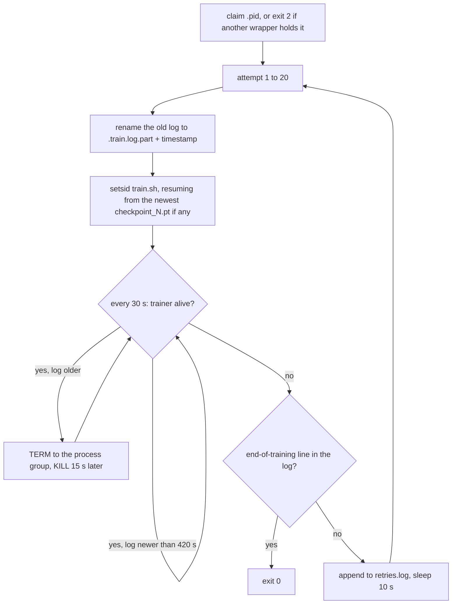

# Surviving Long Runs

The runs that solve `pick_target` in the [lab notebook](../lab-notebook.md) are 5M training samples
long. For that long one process has to stay alive, keep its data-loader workers alive and share a
machine with evaluations, dataset builds and other runs. None of the failures in this chapter is a
modelling problem; each is given with its symptom, its cause and the remedy used here.

## The idea

A long run survives when three things are in place:

- a **checkpoint**, the training state saved at one point (weights, optimiser state, position in
  the data), written often enough that a restart loses little;
- a **liveness signal**, something visible from outside that changes only while training makes
  progress;
- a **supervisor**, a process that starts the trainer, watches the signal and restarts from the
  newest checkpoint.

It also has neighbours. A default that suits one job alone on a machine (a thread per core, one
fixed port) fails when a dozen jobs take it at once, so each job is given its own and checks what
answers it.

Worked example. The README's recommended run is 5M samples of `dp_vit_lang_reactive`, which trained
at about 1100 samples/s alone on a GPU of machine B (L40S GPUs, 128 CPU cores): about 76 minutes
(arithmetic). With every checkpoint evaluated on the same GPU, such runs took 77 to 87 minutes each
(lab notebook, Throughput). With the 6 checkpoints `train.sh` asks for by default, `main.py` budgets
`5,000,000 // 6 = 833,333` samples between two of them ([The training
loop](80-the-training-loop.md)): a checkpoint about every 13 minutes (arithmetic). A crash then
costs up to that if something restarts the run; a hang costs the rest of the night if nothing
notices it. Machine A (one RTX 4090, 24 GB) needed both: its runs "died or hung several times and
were resumed from checkpoints" (lab notebook).

## How it works

### A run that dies without a traceback

A Python exception leaves a traceback in the log. A trainer that the kernel kills outright
(signal 9, for example from the out-of-memory killer) writes nothing: the log stops. Background:
`dmesg -T` shows whether the Linux kernel killed a process for lack of memory or reported a
hardware error.

**Shared memory.** Data-loader workers are separate processes that hand finished batches to the
trainer through shared memory, on Linux the `/dev/shm` mount
([`sim/pickup/README.md`](../../sim/pickup/README.md)). Background, from the PyTorch `DataLoader`
documentation: each worker loads `prefetch_factor` batches ahead, so up to
`num_workers x prefetch_factor` batches exist at once.

For `dp_vit.yaml` a batch is 64 samples of 4 images (two cameras at t-1 and t) of 3 x 224 x 224
float32 values (`PassthroughProcessor`): `64 x 4 x 150,528 x 4 bytes = 154 MB` (arithmetic; the
README says about 150 MB). With `num_workers: 8` and `prefetch_factor: 4` the bound is 32
batches, 4.9 GB; the level actually reached was not measured. Containers often get 64 MB to 2 GB
(README). The remedy is fewer workers or less prefetch:
[`vla_qwen.yaml`](../../sim/pickup/configs/vla_qwen.yaml), whose comment records a 2 GB
`/dev/shm` here, sets `num_workers: 4` and `prefetch_factor: 2`.

Background, from the PyTorch source (`torch/csrc/DataLoader.cpp`): a worker that writes into a
full `/dev/shm` is stopped by a bus error, and the trainer raises `DataLoader worker (pid ...) is
killed by signal: Bus error`. Search the log for `Bus error` before calling a death silent. The
lab notebook has no measurement of such a death; the README and the config comment report one.

### A run that hangs at 0% GPU

Measured here (lab notebook, "Bugs found and fixed"): a dead data-loader worker leaves the trainer
waiting forever, and the run sits at 0% GPU.

`get_wds_dataloader` (`vla_foundry/data/dataloader.py`) builds its `wds.WebLoader` without a
`timeout` argument. Background, from the PyTorch `DataLoader` documentation and source: the default
`timeout` of 0 puts no limit on the wait for a batch, while a worker that has exited is reported
within seconds (`DataLoader worker (pid(s) ...) exited unexpectedly`). A wait without end fits a
worker that is present but stuck just as well; the lab notebook records the symptom only.

The liveness signal is the training log. `train.sh` filters the trainer's output through
`grep --line-buffered -vE "step/s|^$"`, which drops the progress-bar lines, so between checkpoints
the log grows only when `train_one_checkpoint` (`vla_foundry/train.py`) logs, every
`log_every_n_steps` optimiser steps (default 20). For the recommended run, at batch 64 and about
1100 samples/s, that is a line about every 1.2 s (arithmetic); 420 s of silence is about 360
missed lines.

### The retry loop



That is [`train_resilient.sh`](../../sim/pickup/scripts/train_resilient.sh), a wrapper around
`train.sh`. `setsid` starts `train.sh` in a new session and so in a new process group, which the
trainer and its workers inherit: one `kill` of the group reaches all of them. TERM asks a process to
exit and can be handled; KILL cannot be caught. The exit code is ignored: a run counts as finished
only when its log contains `Model has seen the desired number of samples`, the line
`vla_foundry/main.py` writes at the end. After the twentieth attempt the wrapper exits with status
1.

To end a run on purpose, send the wrapper INT or TERM (Ctrl-C, or `kill`): its `stop` handler
writes `experiments/pickup/<run>.stopped`, stops the trainer's group and exits with status 130.
The marker tells a stopped run from a hung one, whose log looks the same; starting the run again
removes it.

On resume `main.py` restores the weights, the count of optimiser steps and the shuffle seeds, the
optimiser, the position in the data and the averaged weights in `ema_N.pt`, an exponential moving
average (EMA) of the weights that a run with `ema.enabled` keeps beside the trained ones; when that
file does not exist, the average starts from the resumed weights. The policy configs here switch EMA
on (`ema: enabled: true`), except the two with a Qwen backbone: runs relaunched by hand without
`--ema.enabled True` had come up without averaged weights ([field notes](../notes.md), "Operating
many runs on one machine").

### Threads

Numerical libraries each start a pool of one thread per core by default; the comment in
[`_common.sh`](../../sim/pickup/scripts/_common.sh) calls them "mostly spinning" (background: a
spinning thread uses CPU while it waits). A dozen such processes oversubscribe the machine: with
more runnable threads than cores every process slows down, the data-loader workers that feed
training included. The symptom is a load average (the recent average number of threads running or
waiting for a CPU) far above the core count.

The processes that multiplied here were policy servers: `eval.sh` starts one per evaluation to serve
one checkpoint's actions to the simulator. The work here is GPU-bound or single-threaded (same
comment), so `_common.sh` sets `threads=${PICKUP_CPU_THREADS:-4}` and exports `OMP_NUM_THREADS`,
`MKL_NUM_THREADS`, `OPENBLAS_NUM_THREADS` and `NUMEXPR_NUM_THREADS` with that value unless they are
already set. `train.sh`, `eval.sh`, `make_dataset.sh` and `custom_path.sh` source it; a command
typed by hand, such as the expert check in the pickup README, gets no cap.

### One GPU for compute and for rendering

PyTorch computes through CUDA, NVIDIA's interface for GPU computing; MuJoCo renders camera frames
through EGL, which needs no display. The two number the GPUs independently. `PICKUP_GPU=<n>` in
`_common.sh` exports `CUDA_DEVICE_ORDER=PCI_BUS_ID`, so that `<n>` means what `nvidia-smi` shows
(background, from NVIDIA's CUDA environment-variable reference: the default order is
`FASTEST_FIRST`), and `CUDA_VISIBLE_DEVICES=<n>`. Background, from the source of the EGL module in
MuJoCo 4.0.1, the version `uv.lock` pins (`python/mujoco/egl/__init__.py`): it reads
`CUDA_VISIBLE_DEVICES` to order the EGL devices and treats `MUJOCO_EGL_DEVICE_ID` as an explicit
choice. The scripts never set the second variable.

### One port per evaluation

A policy server listens on a port, a number on the local machine that one process at a time can
hold. `eval.sh` asks the operating system for a free one unless `PICKUP_PORT` is set.
`policy_server.py` binds it before loading the model, so a taken port ends the server at once,
and `eval.sh` goes on only when its own server's log says `listening on`. The client then asks
the server which weights file it loaded and stops unless it belongs to the run it was started
for (`check_server` in `sim/pickup/eval.py`); under `eval_checkpoints.sh` the checkpoint number
and the kind of weights must match too. The answer is saved in `results.json` as
`server.checkpoint`.

## In this repository

| File | Role |
|---|---|
| `sim/pickup/scripts/train.sh` | one training attempt; output goes to `experiments/pickup/<run>.train.log`; `PICKUP_NUM_CHECKPOINTS` (6) |
| `sim/pickup/scripts/train_resilient.sh` | the retry loop; `PICKUP_STALL_SECONDS` (420; it also covers start-up and checkpoint saving, so raise it for a slow model), `PICKUP_MAX_ATTEMPTS` (20); writes `<run>.retries.log` |
| `sim/pickup/scripts/eval_checkpoints.sh` | evaluates every checkpoint, trained and averaged weights; `PICKUP_WATCH=1` follows a live run |
| `sim/pickup/monitor.py`, `monitor_server.py` | the terminal dashboard and the same state as a web page; both only read files (training logs, `.retries.log`, `.stopped`, results) and `nvidia-smi` (`runstate.py`) |

`stat -c` and `setsid`, which the wrappers call, are Linux tools. `setsid` inside the wrapper
detaches the trainer, not the wrapper, so the wrapper itself has to be started detached. One way,
for the README's recommended run (after
`sim/pickup/scripts/make_dataset.sh pick_target 4000 pick_target_4k --random_start --disturb_prob 0.5`)
and its evaluations on GPU 0:

```bash
mkdir -p experiments/pickup
PICKUP_GPU=0 setsid nohup sim/pickup/scripts/train_resilient.sh \
    dp_vit_lang_reactive pick_target_4k my_run 5000000 \
    </dev/null >experiments/pickup/my_run.launch.log 2>&1 &
PICKUP_GPU=0 PICKUP_WATCH=1 PICKUP_EVAL_JOBS=2 setsid nohup \
    sim/pickup/scripts/eval_checkpoints.sh experiments/pickup/my_run pick_target 100 \
    </dev/null >experiments/pickup/my_run.eval.log 2>&1 &
.venv/bin/python -m sim.pickup.monitor
```

`pkill -f "train_resilient.sh.* my_run "` stops that run through the `stop` handler. Stop the
evaluator as well: with `PICKUP_WATCH=1` it polls until the log reports the end of training.

### Pre-flight checklist

1. **Environment.** `uv sync --group preprocessing --group sim`, and no `uv pip install` after it.
2. **Short run first**: `PICKUP_NUM_CHECKPOINTS=2
   sim/pickup/scripts/train.sh <config> <dataset> smoke 20000`, then
   `sim/pickup/scripts/eval.sh experiments/pickup/smoke <task> 5`.
3. **Shared memory.** Compare `df -h /dev/shm` with `num_workers x prefetch_factor x` one batch.
4. **Disk.** Every checkpoint writes `checkpoint_N.pt`, `optimizer_N.pt` and, with EMA,
   `ema_N.pt` (`save_checkpoint`, `vla_foundry/file_utils.py`); none is deleted
   (`max_checkpoint_limit` defaults to `None`). For `dp_vit_lang_reactive` (48.9M parameters,
   float32 under the default `amp_bfloat16` autocast): 196 MB of weights, 391 MB for AdamW's two
   moment estimates per parameter, 196 MB of averaged weights; about 0.8 GB per checkpoint, 9 GB for
   the eleven of a run with `PICKUP_NUM_CHECKPOINTS=10` (arithmetic).
5. **Run name.** `experiments/pickup/<name>` must not exist unless you mean to resume it, and
   `pgrep -af "main.py.*--name <name>"` must print nothing.
6. **GPU and port.** Pass a free GPU as `PICKUP_GPU`; keep `MUJOCO_EGL_DEVICE_ID` and
   `PICKUP_PORT` unset.

### What to watch in the dashboard

In `monitor.py`:

| On screen | Meaning | Action |
|---|---|---|
| `▲` (stalled) | log silent for 180 s: hung or dead; the files cannot tell which (a hung run sits at 0% GPU in the GPU panel, lab notebook) | under the wrapper, wait until 420 s; otherwise check with `pgrep` and resume by hand |
| `■` (stopped) | the same, with a `<run>.stopped` marker | none |
| `↻N` after the name | lines in `<run>.retries.log`: two for a hang, one for a crash | read the `.train.log.part*` files; a checkpoint count that never changes suggests an error that repeats, such as a wrong config |
| `closed-loop success by checkpoint`, `best`, `at named`, `miss` | a success sparkline (a one-line chart of block characters) per weight kind, raw and ema; then the best checkpoint's success rate, how often its gripper closed at the named object, and its median miss | the only columns that say whether the policy works ([Loss is not success](91-loss-is-not-success.md)) |

<!-- interactive: onset -->
*Figure: success, how often the gripper closed at the named object, and the slope of where it
closed against where the named object was (1: at the object; 0: independent of the scene),
against training samples, for several runs side by side.*

A success near 0% at the first checkpoints does not mean a broken run: the 4000-demonstration run
that went on to solve the task in [How much data and training](71-how-much-data-and-training.md) was
at 4% / 2% (trained / averaged weights) after 1.5M samples, when its slope had already reached
0.47 / 0.37.

**Space the checkpoints.** `main.py` divides the budget evenly, so the default
`PICKUP_NUM_CHECKPOINTS=6` checkpoints a 5M run about every 0.83M samples (arithmetic), and the
stretch from 1M to 2M samples, where that run's slope rose from 0.11 to 0.81 (trained weights), gets
one checkpoint, at about 1.67M. The machine B runs set
`PICKUP_NUM_CHECKPOINTS=10`: one every 0.5M samples, about every 7.6 minutes at 1100 samples/s
(arithmetic). More checkpoints cost disk (pre-flight item 4) and evaluation time, and shorten what a
crash loses.

**Judge a young run by the slope.** While success is near 0, the slope and how often the gripper
closed at the named object are the columns that move; a slope that stays near 0 is a reason to check
the inputs and the data before buying more samples ([Measuring failure](92-measuring-failure.md)).
`.venv/bin/python -m sim.pickup.summarize --runs my_run` prints all of them for every evaluated
checkpoint; the dashboard shows the best checkpoint's only.

## What we measured

All from the lab notebook.

- **Threads**, on machine B. Without a cap, each policy server started 256 threads and used
  14-22 cores; twelve of them pushed the load average to 570 and roughly halved training
  throughput (for example 1069 -> 410 samples/s). With `OMP_NUM_THREADS=4` a server has 12 threads
  and uses under one core.
- **EGL order.** On a multi-GPU machine the EGL device order differed from `nvidia-smi`'s: two
  devices in the middle of EGL's list were GPUs 0 and 1. A render with `CUDA_VISIBLE_DEVICES` set
  to one GPU used that GPU only.
- **Lockfile.** `uv pip install -e .` after `uv sync` replaced the locked `draccus` 0.11.5 with
  0.11.6.
- **Ports.** Two evaluations started on the same port both talked to whichever policy server had
  bound it first, and the second one filed the other run's results under its own name: about 40
  evaluations. They were found through the checkpoint path each result recorded, deleted and
  redone; no number in the lab notebook comes from them.
- **Evaluating beside training.** 4-5 policy servers on the same GPU of machine B slowed
  `dp_vit_lang_reactive` from about 1100 to 570-700 samples/s.

Not measured: how often a run fails, whether a resumed run ends as good as an uninterrupted one,
and the best thread count.

## Where it goes wrong

All six happened here and are in the [field notes](../notes.md), "Operating many runs on one
machine".

**The job ends with the ssh connection.** Background: when the connection drops, the login shell
receives SIGHUP, the hang-up signal, and an interactive Bash passes it on to its jobs; a process
that does not handle it is terminated. In the launch command above `nohup` makes the command
ignore SIGHUP, `setsid` gives it a session with no terminal to lose, and the redirections keep it
from the closed terminal. `tmux` also works.

**A script edited while it runs.** An in-place edit made a running evaluation fail with a syntax
error halfway through. Background: Bash reads a script one command at a time while it runs, so
after an edit the next read can start in the middle of a word. A whole loop is one command (Bash
manual, Aliases), so the loops in `train_resilient.sh` and `eval_checkpoints.sh` are safe once
running, but each pass starts `train.sh`, `eval.sh` and the Python code afresh, and a
straight-line script such as `eval.sh` is exposed at every line. Run long jobs from a checkout
you are not editing.

**Lockfile drift.** `uv.lock` records the exact version of every dependency. `uv pip install -e .`,
which [`FOUNDRY.md`](../../FOUNDRY.md) once gave after `uv sync` (it now gives `uv sync` alone),
resolves again outside it, and `pyproject.toml` takes `draccus` from a git repository without a
pinned revision. To check, compare `uv pip show draccus` with
`grep -A 2 '^name = "draccus"' uv.lock`; to repair, run `uv sync` again.

**Two trainers, one directory.** `main.py` creates `experiments/pickup/<name>` with `exist_ok=True`,
`save_checkpoint` names files by checkpoint number alone, and `train.sh` opens `<name>.train.log`
with `>`: two trainers with one `--name` overwrite each other's checkpoints and log. A queue script
that reused a name started a second trainer in the directory of a live run; it was caught before it
wrote a checkpoint. `train_resilient.sh` now holds `experiments/pickup/<run>.pid` while it runs, and
a second copy started with the same run name exits with status 2. Not covered: `train.sh` or
`main.py` started by hand, and (read from the code) a trainer whose wrapper died with its ssh
session, since the wrapper traps INT and TERM but not SIGHUP; for those the pre-flight `pgrep` check
still applies.

**A result filed under the wrong run.** Nothing failed when two evaluations shared a port; the
sign was a result that looked too good. Now a shared port stops the evaluation
(`policy server exited before it was ready`, or the client's "is serving" message), and
`summarize.py` and both dashboards leave out `ckpt_*` results whose `server.checkpoint` does not
match their directory ([Closed-loop evaluation](90-closed-loop-evaluation.md)).

**Two dataset builds at once.** Preprocessing (`preprocess_robotics_to_tar.py`) spreads its work
over processes with Ray. Two builds started together shared one Ray instance, and the second died
with an error about `num_cpus`. `make_dataset.sh` now passes `--ray_address local`, with which
each build starts its own instance (background: Ray's documentation of `ray.init`); a
preprocessing command typed by hand needs the same flag.

## Background and further reading

None of the following was measured here.

- PyTorch documentation, [`torch.utils.data`](https://docs.pytorch.org/docs/stable/data.html):
  `num_workers`, `prefetch_factor` and `timeout` of `DataLoader`.
- PyTorch 2.7.0 source,
  [`torch/csrc/DataLoader.cpp`](https://github.com/pytorch/pytorch/blob/v2.7.0/torch/csrc/DataLoader.cpp):
  the messages for a worker killed by a signal.
- Docker documentation, [Running containers](https://docs.docker.com/engine/containers/run/):
  `--shm-size` sets the size of `/dev/shm`; 64 MB when omitted.
- NVIDIA, CUDA Programming Guide,
  [CUDA Environment Variables](https://docs.nvidia.com/cuda/cuda-programming-guide/05-appendices/environment-variables.html):
  `CUDA_VISIBLE_DEVICES` and `CUDA_DEVICE_ORDER`.
- MuJoCo 4.0.1, [`python/mujoco/egl/__init__.py`](https://github.com/google-deepmind/mujoco/blob/4.0.1/python/mujoco/egl/__init__.py):
  how the EGL device is chosen.
- Ray documentation, [`ray.init`](https://docs.ray.io/en/latest/ray-core/api/doc/ray.init.html):
  how `address` chooses between joining an instance and starting one.
- Bash Reference Manual, [Signals](https://www.gnu.org/software/bash/manual/html_node/Signals.html)
  (SIGHUP) and [Aliases](https://www.gnu.org/software/bash/manual/html_node/Aliases.html) (a
  compound command is read in full before it runs); manual pages
  [`setsid(2)`](https://man7.org/linux/man-pages/man2/setsid.2.html) and
  [`nohup(1)`](https://man7.org/linux/man-pages/man1/nohup.1.html).

## Check yourself

1. Run `df -h /dev/shm` on the training machine and compute the upper bound on queued batches for
   `sim/pickup/configs/dp_vit_lang_reactive.yaml` (2 images per sample). Decide whether it fits.
2. While an evaluation runs, list the processes with the most threads:
   `ps -eo pid,nlwp,pcpu,args --sort=-nlwp | head -5`. Repeat with `PICKUP_CPU_THREADS=1`.
3. Print the weights file that served one of your evaluations and compare it with the result's
   directory:
   `.venv/bin/python -c "import json; print(json.load(open('results/pickup/my_run/pick_target/ckpt_1_ema/results.json'))['server']['checkpoint'])"`.
