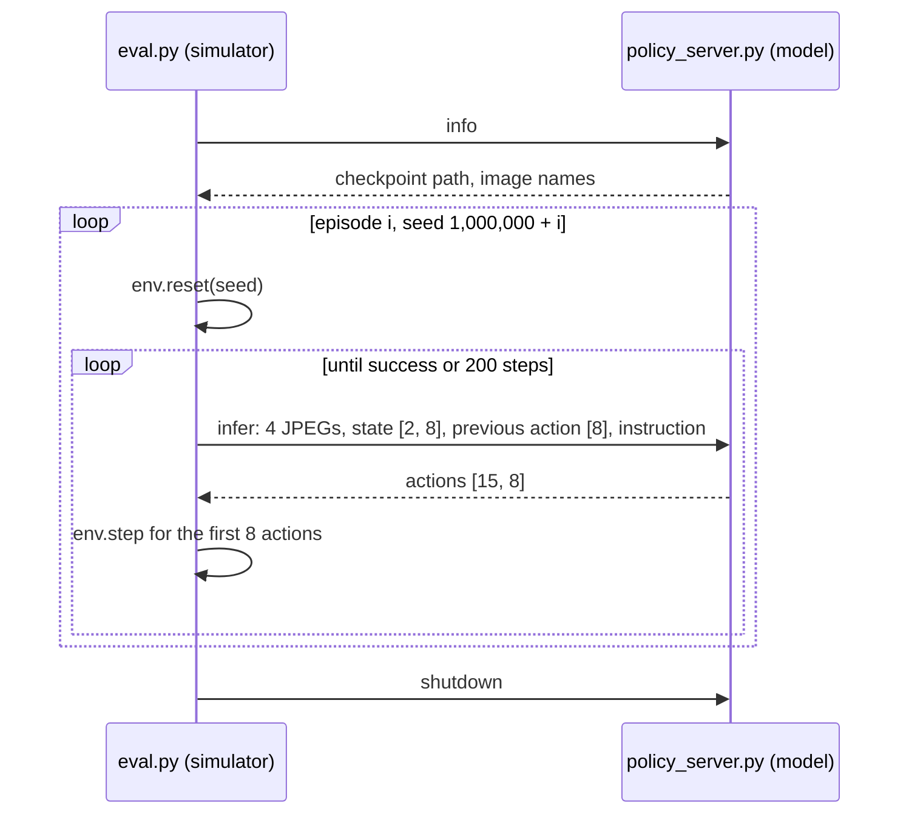

# Closed-Loop Evaluation

**Closed-loop evaluation** runs a policy inside the simulator, where every action it outputs
changes the next observation it receives, and counts how many attempts end in success. An
**open-loop** check, by contrast, compares predicted actions with recorded ones on stored
observations and never executes them, so an error cannot change what the policy sees next. Only
the closed-loop count says whether a policy can do its task
([91-loss-is-not-success.md](91-loss-is-not-success.md)), and it comes from a small random sample,
so reading it takes some statistics as well as the harness.

## The idea

An **episode** is one attempt at the task from a fresh scene. A **layout** is everything that
defines the scene: the arm's starting pose, which objects are on the table, where they lie, and
which one the instruction names. Here a layout is generated from one integer **seed**, so a seed
names a layout exactly.

To measure a policy, take $n$ layouts it was not trained on, run one episode on each and count the
successes $k$. The **success rate** is $\hat p = k/n$. From the lab notebook: the `dp_vit` policy
trained on 1000 `pick_cube` demonstrations for 1.5M samples lifted the cube in 37 of 50 episodes,
so $\hat p = 0.74$.

That 74% is an estimate. Each episode passes or fails, so $k$ follows a **binomial
distribution**: the number of successes in $n$ independent trials that each succeed with
probability $p$. Here $p$ is the rate the policy would reach over every layout the generator can
produce; the $n$ evaluated layouts are a sample of them. The standard deviation of $k/n$ is

$$\sqrt{p(1-p)/n}$$

At $p = 0.5$ this is 7.1 percentage points for 50 episodes and 5.0 for 100. The measured rate
typically moves by about that much between evaluations of an unchanged policy on different
layouts. Repeating an evaluation on the same seeds varies only the policy's own sampling noise, so
it moves less.

A second example, by binomial arithmetic, not measurement: a policy whose true rate is 3%,
evaluated on 100 layouts, scores 0 or 1 successes 19% of the time and 6 or more 8% of the time.
Either reading alone is unremarkable for one policy; both in a pair of evaluations on different
layouts happens about 3% of the time.

## How it works

### One evaluation

The model and the simulator run in separate processes and exchange Python dictionaries over a
local socket.



1. `main` in `sim/pickup/eval.py` gives episode `ep` the seed `args.seed_start + ep` (default
   start `EVAL_SEED_START = 1_000_000`), and `PickupEnv.reset` in `sim/pickup/env.py` draws the
   whole layout from `np.random.default_rng(seed)`. Demonstrations are collected from seed 0
   upward (`--seed` in `sim/pickup/collect.py`), so evaluation layouts are disjoint from training
   layouts.
2. When its action queue is empty, `eval.py` sends `infer`: the `front` and `wrist` frames at the
   previous and the current step, the two states, the last executed command `env.last_action`,
   the instruction and the number of flow steps (the integration steps of the action sampler,
   [41-flow-matching.md](41-flow-matching.md)).
3. `Policy.infer` in `sim/pickup/policy_server.py` runs the training preprocessing
   (`RoboticsProcessor.process_inputs`), calls `model.generate_actions`, denormalises and returns
   `[1 + future, 8]`: 15 actions, one **chunk**, the block of future actions the policy predicts
   per call. `eval.py` executes the first `--exec_horizon` of them (default 8) and asks again
   ([42-chunks-and-execution.md](42-chunks-and-execution.md)).
4. The episode ends on success or after `--max_steps` control steps (default 200, 10 s at 20 Hz).
   Nothing else ends it, so every failure is a timeout.

### The success test

`PickupEnv.step` decides success from simulator state, not from images. `lifted_objects` lists
every object more than `LIFT_HEIGHT = 0.08` m above its settled rest height. `lift_count` goes up
by one on each control step where the named object is in that list and resets to zero otherwise.
`success` is `lift_count >= HOLD_STEPS` (10): the named object held 8 cm up for 0.5 s without
interruption. `info["wrong_object"]` is true on a step where something is lifted and the named
object is not.

### From a count to an interval

A **95% confidence interval** is a range computed by a procedure that contains the true rate in
about 95% of repeated evaluations. `eval.py` computes the **Wilson interval** with $z = 1.96$,
the number of standard deviations that leaves 5% in the two tails of a normal distribution. It is
the set of rates $p$ for which the observed $\hat p$ lies within $z$ standard deviations of $p$,
with the standard deviation $\sqrt{p(1-p)/n}$ taken at $p$, not at $\hat p$.
Solving $|\hat p - p| \le z\sqrt{p(1-p)/n}$ for $p$ gives a centre and a half-width:

$$\text{centre} = \frac{\hat p + z^2/2n}{1 + z^2/n}, \qquad
\text{half} = \frac{z}{1 + z^2/n}\sqrt{\frac{\hat p(1-\hat p)}{n} + \frac{z^2}{4n^2}}$$

For 37/50: centre $= (0.74 + 0.0384)/1.0768 = 0.723$, half $= 0.118$, interval 60% to 84%.

Background: the textbook (Wald) interval $\hat p \pm z\sqrt{\hat p(1-\hat p)/n}$ has zero width at
0 or $n$ successes, which claims certainty from a finite sample. The Wilson interval (Wilson,
1927) does not: 0/50 gives 0 to 7.1%. Brown et al. (2001) show that the Wald interval covers the
true rate less often than claimed, recommend the Wilson or the Jeffreys interval for small $n$ (40
or fewer), and find both close to the simpler Agresti-Coull interval above that.

Widths at the two episode counts used here, from the formula:

| Observed rate | 50 episodes | 100 episodes |
|---|---|---|
| 0% | 0 to 7.1% | 0 to 3.7% |
| 6% | 2.1 to 16.2% | 2.8 to 12.5% |
| 50% | 36.6 to 63.4% | 40.4 to 59.6% |
| 74% | 60.4 to 84.1% | 64.6 to 81.6% |

The width is proportional to $1/\sqrt{n}$: halving it takes four times the episodes.

### Comparing two policies

**Overlapping intervals.** If the intervals of two evaluations do not overlap, the difference is
larger than evaluation noise explains. The reverse check is conservative: intervals can overlap a
little while a direct test of the difference still finds one. By arithmetic, 40/100 and 55/100
have intervals 31-50% and 45-64%, which overlap, yet the 15-point gap is 2.1 standard deviations
of the difference ($\sqrt{(0.4 \cdot 0.6 + 0.55 \cdot 0.45)/100} = 7.0$ points). Use overlap as a
first look, and the standard deviation of the difference or the paired test below for close
calls. Overlap is never evidence that two policies are equal.

**The same seeds for every policy.** Because the layout depends only on the seed, two evaluations
with the same task, `--seed_start` and episode count face identical scenes and instructions, and
the outcomes can be compared in **pairs**, layout by layout. Background: with paired pass/fail
outcomes, only the layouts where the two policies disagree carry information, and an exact sign
test on those counts (the exact form of McNemar's test) can detect differences that two
overlapping intervals hide. Its **p-value** is the probability of a split at least as lopsided as
the observed one if each disagreement were equally likely to go either way; below 0.05 is the
usual threshold for calling a difference real.

**One training seed against several.** A **training seed** is a different integer from a layout
seed: it seeds the random number generators of a training run, so two runs of one recipe with
different training seeds end as two different policies. `vla_foundry/main.py` seeds the run and
the shuffling of its data files (shards) from `hparams.seed` (default 42), and every result in
the lab notebook is one training seed per run. The Wilson interval covers only the randomness of
evaluation: which layouts were drawn, and the policy's sampling noise
(`DiffusionPolicy.generate_actions` starts every chunk from `torch.randn_like` noise, and
`policy_server.py` sets no random seed). An interval therefore describes one checkpoint.
Background: Agarwal et al. (2021) argue that point estimates from a handful of training runs are
unreliable and recommend reporting uncertainty across runs. A claim about a method needs several
training seeds.

## In this repository

One evaluation, from the repository root:

```bash
sim/pickup/scripts/eval.sh experiments/pickup/dp_vit_pick_cube_1k pick_cube 50
```

`sim/pickup/scripts/eval.sh` starts `policy_server.py` in the background, logs it to
`policy_server.log` in the output directory, waits until that log says `listening on`, then runs
`eval.py` with `--shutdown_server`. It also passes `--expect_run` (and `--expect_number`,
`--expect_weights` when `PICKUP_CHECKPOINT`, `PICKUP_WEIGHTS` are set); `check_server` in
`eval.py` stops before the first episode if the server reports another run, checkpoint number or
weights kind. Arguments after the episode count (default 50) go to `eval.py`.

| Setting | Effect |
|---|---|
| `PICKUP_CHECKPOINT` | evaluate this checkpoint number, not the newest. Either file of the pair (`checkpoint_N.pt`, `ema_N.pt`) may be named; `PICKUP_WEIGHTS`, or its default when unset, decides which is loaded |
| `PICKUP_WEIGHTS=raw\|ema` | trained weights, or their **EMA** (an exponential moving average of the weights kept during training); unset, `Policy.__init__` serves EMA when the run's config has `ema.enabled` |
| `PICKUP_OUT` | output directory, default `results/pickup/<run>/<task>` |
| `PICKUP_PORT` | socket port; unset, `eval.sh` asks the operating system for a free one, so evaluations can run side by side. `eval.py` and `policy_server.py` run by hand default to `--port 6200` |
| `--exec_horizon`, `--flow_steps`, `--seed_start`, `--max_steps`, `--videos` | actions executed per chunk (8), flow steps (10), first seed, timeout, rollouts saved as mp4 (5) |
| `--expert` | only with `python -m sim.pickup.eval` directly (Check yourself 1): `ScriptedExpert` through the same loop, no server. Not for `eval.sh`, whose server would never be shut down |

`results.json` contains:

| Field | Content |
|---|---|
| `episodes`, `successes`, `success_rate`, `success_ci95` | $n$, $k$, $\hat p$, Wilson bounds |
| `per_target`, `mean_steps_success` | successes and episodes per named object; mean length of successful episodes |
| `wrong_object_rate` | share of episodes with a step where an object was up and the named one was not |
| `grasp` | `diagnostics.summarize`: where the gripper first closed ([92-measuring-failure.md](92-measuring-failure.md)) |
| `inference_latency_ms` | mean, median and 95th percentile per chunk |
| `task`, `exec_horizon`, `flow_steps`, `seed_start`, `interventions` | the settings used; `interventions` records `--expert_prefix`, `--prefix_target`, `--stale_images`, `--first_prev_action` and the `--disturb` settings |
| `wall_time_s`, `server` | duration; checkpoint path actually loaded, parameter count, image names |
| `per_episode` | seed, target, instruction, success, steps, `wrong_object`, `prefix_goal`, `disturbed` and the grasp record of every episode |

**Every checkpoint.** A **checkpoint** is a copy of the weights saved during training;
`sim/pickup/scripts/train.sh` writes 6 per run by default.
`sim/pickup/scripts/eval_checkpoints.sh` evaluates each one, newest first, 100 episodes by default,
into `results/pickup/<run>/<task>/ckpt_<N>_<raw|ema>/`. It skips checkpoint files younger than 60 s
and evaluations that already have a `results.json`, and claims work by creating the output
directory, so several workers (`PICKUP_EVAL_JOBS`) share a run. A claim left without results for
1800 s (`PICKUP_STALE_SECONDS`) is taken over. A failed evaluation gives its claim back and is
retried after 20 s, so a checkpoint that cannot be loaded shows up as the same
`== <run> checkpoint N` line repeating. No videos are saved unless `PICKUP_VIDEOS` is set. With
`PICKUP_WATCH=1` it polls every 30 s until the training log reports the end of the run:

```bash
sim/pickup/scripts/train_resilient.sh dp_vit_lang pick_target_1500 my_run 1000000 --ema.enabled True &
PICKUP_WATCH=1 PICKUP_EVAL_JOBS=2 sim/pickup/scripts/eval_checkpoints.sh experiments/pickup/my_run pick_target 100 &
```

**Reading the curve.**

```bash
.venv/bin/python -m sim.pickup.summarize --task pick_target --runs my_run
.venv/bin/python -m sim.pickup.monitor --once
```

`sim/pickup/summarize.py` prints one Markdown row per `results.json`: count, interval, grasp
diagnostics, per-object counts. `checkpoint_samples` reads the `Samples: X / Y` lines of the
training log to place each checkpoint on the training axis. `runs_table` in
`sim/pickup/monitor.py` draws one sparkline of success per weights kind, next to the loss.

<!-- interactive: loss-vs-success -->
*Figure: the training loss of a run against samples seen, with the closed-loop success of each
checkpoint and its Wilson interval. For the `vla_qwen` run in the lab notebook the loss falls from
0.087 to 0.03-0.04 while success reads 0/50, 1/50, 6/50 and 6/100.*

`tutorials/STATISTICAL_COMPARISON.md` documents a different pipeline, `vla_foundry/eval/`, with a
sequential test (STEP) whose episode budget is fixed in advance. The pickup harness does not use
it.

## What we measured

All numbers are from `tutorial/lab-notebook.md`: unseen layouts, one training seed per run.

**The harness itself.** The scripted expert through the same loop scored 100/100 on `pick_target`
on machine B, 99/100 on machine A, and 49/50 on `pick_cube`: the task is solvable and the success
test fires.

**Intervals at 50 episodes** (`pick_cube`, machine A). Pooled CLIP on 200 demos scored 2/50
(1-14%). `dp_vit` scored 15/50 (19-44%) on 200 demos, 20/50 (28-54%) on 1000 demos at 500k samples
and 37/50 (60-84%) at 1.5M. The first and the last are separated from everything else; 30% and 40%
are not separated from each other.

**The inference-setting sweep.** On the 74% checkpoint, 50 episodes each: default (8 actions per
chunk, 10 flow steps) 74%; 4 actions per chunk 84%; 15 actions per chunk 78%; 4 flow steps 86%; 25
flow steps 84%. The notebook records that all intervals overlap; the formula gives 60-84%, 71-92%,
65-87%, 74-93% and 71-92%. The sweep does not show that any setting beats the default; reporting
the best of five (86%) as an improvement would be selecting on noise.

**6% against 1%.** On `pick_target`, first round, `vla_qwen` scored 6/100 and `dp_vit` scored
1/100. The formula gives 2.8-12.5% and 0.2-5.4%, which overlap, and by arithmetic a Fisher exact
test (whether two pass/fail counts fit one shared rate) gives a two-sided p-value of 0.12. These
counts do not support "the pretrained backbone is better", "language input helps" or "six times
the success rate"; each policy is also one training run. They do show that both policies fail a
task the expert solves. The evidence that the two behave differently is elsewhere in the notebook:
the Qwen policy never lifted an object other than the named one in 150 episodes, while `dp_vit`
closed nearest the named object 32% of the time (chance: 33%).

**A curve.** The same Qwen run read 6/50 at 300k samples and 6/100 at 400k. Read as rates, 12% then
6% looks like a decline; the intervals (5.6-23.8% and 2.8-12.5%) overlap.

**A difference that is not evaluation noise.** The notebook's by-checkpoint table for
`dp_vit_lang_reactive` on 4000 demos, a run still in progress when it was written, reads 4% (raw
weights) and 36% (EMA weights) at the 2.0M-sample checkpoint. The EMA per-object counts sum to
36/100; taking the raw evaluation as 100 layouts too, the intervals are 1.6-9.8% and 27.3-45.8%,
far apart. It is one intermediate checkpoint of one training seed: at 1.5M samples the same run
read 4% raw and 2% EMA, so this does not show that EMA weights are better in general. The run has
no final result yet and none is reported here.

## Where it goes wrong

- **The evaluation stops before the first episode.** `eval.sh` waits for `listening on` in
  `policy_server.log`. If the server exits first (bad checkpoint, port taken: `policy_server.py`
  binds the port before loading the model), the script prints the last five lines of that log and
  exits. Run by hand, `connect` in `eval.py` retries the socket for 600 s before raising.
- **The wrong policy was evaluated.** Two evaluations given the same `PICKUP_PORT` both reach
  whichever server bound it first. `eval.sh` makes `eval.py` stop with "the policy server on port
  ... is serving ..." in that case, and `summarize.py` leaves out `ckpt_*` results whose
  `server.checkpoint` does not match their directory. For evaluations started by hand, check
  `server.checkpoint` in `results.json`. Comparing raw weights of one run with EMA weights of
  another confounds two changes; the 4% against 36% above is the same checkpoint.
- **Picking the best checkpoint.** `summarize.py --best` and the `best` column of `monitor.py`
  take the maximum over all evaluations of a run, 12 for a run with EMA. The maximum of noisy
  readings is biased upward. Re-evaluate the chosen checkpoint on fresh layouts
  (`--seed_start 1000100`) and report that number.
- **Seeds below 1,000,000.** `--seed_start 0` evaluates on layouts that have demonstrations: a
  deliberate check (the pooled-CLIP policy scored 0/20 on its own training layouts), not a
  generalisation number.
- **Nothing is evaluated on macOS.** `age` in `eval_checkpoints.sh` calls `stat -c %Y`, the GNU
  form. BSD `stat` rejects `-c`, so every checkpoint is skipped.
- **Changed settings.** `--max_steps`, `--exec_horizon`, `--flow_steps` and the intervention flags
  (`--expert_prefix`, `--stale_images`, `--first_prev_action`, `--disturb`) change the test.
  `results.json` stores all of them except `--max_steps`; check them before comparing two files.

## Background and further reading

- Wilson, "Probable Inference, the Law of Succession, and Statistical Inference" (1927),
  [doi:10.1080/01621459.1927.10502953](https://doi.org/10.1080/01621459.1927.10502953). The
  interval `eval.py` computes.
- Brown et al., "Interval Estimation for a Binomial Proportion" (2001),
  [doi:10.1214/ss/1009213286](https://doi.org/10.1214/ss/1009213286). Shows that the textbook
  (Wald) interval has erratic coverage and recommends the Wilson or Jeffreys interval for small
  samples and the Agresti-Coull interval for larger ones.
- Agarwal et al., "Deep Reinforcement Learning at the Edge of the Statistical Precipice" (2021),
  [arXiv:2108.13264](https://arxiv.org/abs/2108.13264). Argues for reporting uncertainty across
  training runs when only a few are available.
- Kress-Gazit et al., "Robot Learning as an Empirical Science: Best Practices for Policy
  Evaluation" (2024), [arXiv:2409.09491](https://arxiv.org/abs/2409.09491). Recommends reporting
  experimental conditions, statistical analysis and failure modes with success rates.
- Snyder et al., "Is Your Imitation Learning Policy Better than Mine? Policy Comparison with
  Near-Optimal Stopping" (2025), [arXiv:2503.10966](https://arxiv.org/abs/2503.10966). The STEP
  sequential test that `tutorials/STATISTICAL_COMPARISON.md` refers to.

## Check yourself

1. Run the expert through the harness; compare with the lab notebook.

   ```bash
   .venv/bin/python -m sim.pickup.eval --task pick_target --episodes 100 --expert --out results/pickup/expert/pick_target
   ```

2. Evaluate one checkpoint twice on the same layouts and count the episodes whose outcome changed;
   every change is the policy's sampling noise.

   ```bash
   PICKUP_OUT=results/pickup/my_run/pick_target/repeat_a sim/pickup/scripts/eval.sh experiments/pickup/my_run pick_target 100
   PICKUP_OUT=results/pickup/my_run/pick_target/repeat_b sim/pickup/scripts/eval.sh experiments/pickup/my_run pick_target 100
   .venv/bin/python - results/pickup/my_run/pick_target/repeat_a/results.json results/pickup/my_run/pick_target/repeat_b/results.json <<'EOF'
   import json, sys
   from math import comb

   a, b = ({e["seed"]: e["success"] for e in json.load(open(p))["per_episode"]} for p in sys.argv[1:3])
   seeds = sorted(set(a) & set(b))
   only_a = sum(a[s] and not b[s] for s in seeds)
   only_b = sum(b[s] and not a[s] for s in seeds)
   m, k = only_a + only_b, min(only_a, only_b)
   p = min(1.0, 2 * sum(comb(m, i) for i in range(k + 1)) / 2**m) if m else 1.0
   print(f"{len(seeds)} shared layouts: first only {only_a}, second only {only_b}, sign test p = {p:.3f}")
   EOF
   ```

   `p` is the p-value of the sign test; for the same checkpoint twice it should be large. The
   script also compares two policies evaluated on the same seeds.
3. The sweep read 74% at the default and 84% with 4 actions per chunk, 50 episodes each. Using the
   standard deviation of a difference, $\sqrt{(p_1(1-p_1) + p_2(1-p_2))/n}$, find the $n$ per
   setting at which a 10-point gap equals 1.96 standard deviations. (About 126.) If the true gap
   is 10 points, the observed gap falls short of that threshold in about half of such experiments;
   for an 80% chance of exceeding it, replace 1.96 by 1.96 + 0.84. (About 257.)
4. Open one `results.json` and find, for the first failed episode, its `seed`, `steps`,
   `wrong_object` and `close_nearest`. Every failure has `steps` equal to `--max_steps`, because
   only success ends an episode early. Decide which failure it was: another object was lifted
   (`wrong_object` true), the gripper closed nearest another object (`close_nearest` differs from
   `target`), or it closed nearest the named object and still failed.
