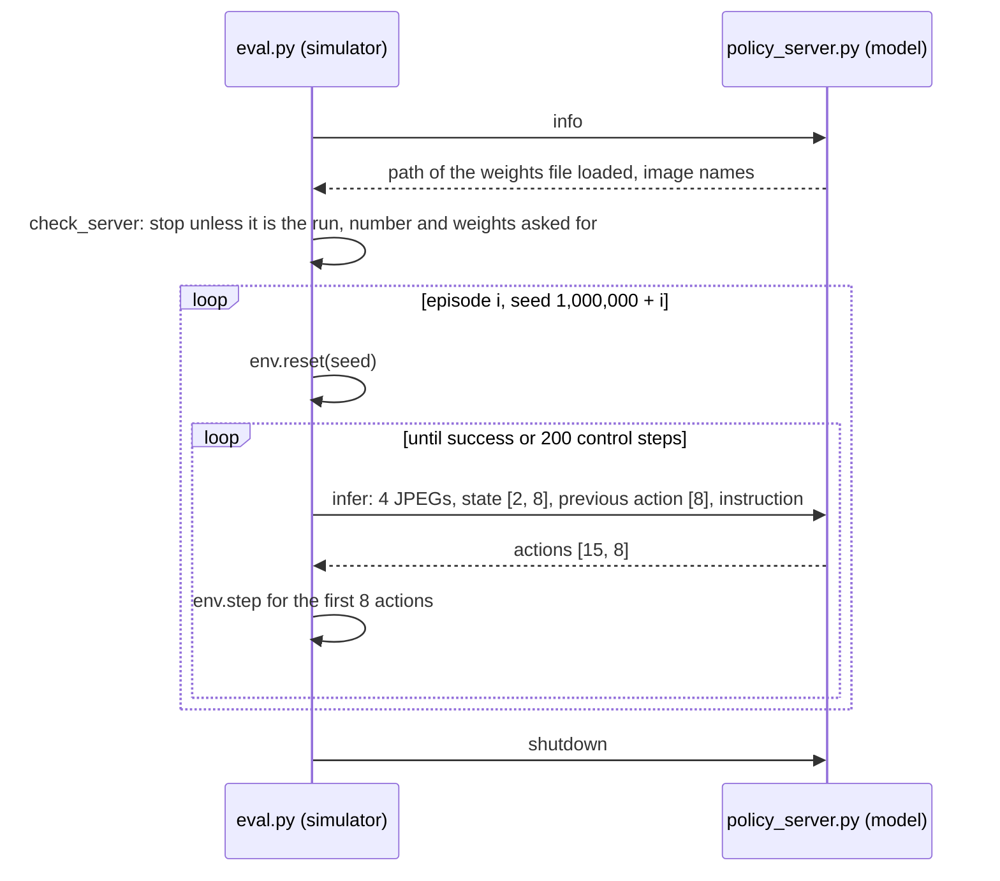

# Closed-Loop Evaluation

**Closed-loop evaluation** runs a policy inside the simulator, where every action it outputs
changes the next observation it receives, and counts how many attempts end in success. An
**open-loop** check compares predicted actions with recorded ones and never executes them. Only
the closed-loop count says whether a policy can do its task
([91-loss-is-not-success.md](91-loss-is-not-success.md)), and it comes from a limited number of
random scenes, so reading it takes statistics as well as the harness.

## The idea

An **episode** is one attempt at the task from a fresh scene. A **layout** is everything that
defines the scene: which objects are on the table, where they lie, which one the instruction
names, and the arm's start pose. Here a layout is generated from one integer **seed**, so a seed
names a layout exactly.

To measure a policy, take $n$ layouts it was not trained on, run one episode on each and count the
successes $k$. The **success rate** is $\hat p = k/n$. The running example of this chapter is the
reference policy, `dp_vit_lang_reactive` ([51-language-conditioning.md](51-language-conditioning.md))
on 4000 `pick_target` demonstrations and 5M samples, trained after the position fix
([12-positions.md](12-positions.md)): it succeeded in 93 of 100 episodes with its trained weights,
so $\hat p = 0.93$.

That 93% is an estimate. Each episode passes or fails, so $k$ follows a **binomial
distribution**: the number of successes in $n$ independent trials that each succeed with
probability $p$. Here $p$ is the rate over every layout the generator can produce; an evaluation
draws $n$ of them. The standard deviation of $k/n$ is

$$\sqrt{p(1-p)/n}$$

At $p = 0.93$ this is 2.6 percentage points for 100 episodes; at $p = 0.5$ it is 5.0 for 100 and
7.1 for 50. The measured rate moves by about that much between evaluations of unchanged weights
on different layouts: the same weights scored 96/100 on the next 100 seeds. Repeating an
evaluation on the same seeds changes only the noise each draw of the policy starts from.

## How it works

### One evaluation

The model and the simulator run in separate processes and exchange Python dictionaries over a
local socket.



1. **Which policy answers.** `main` in [`sim/pickup/eval.py`](../../sim/pickup/eval.py) sends
   `info`; the server replies with the path of the weights file it loaded, and `check_server`
   exits before the first episode unless that is the run, the **checkpoint** (the training state
   saved at one point of a run) and the kind of weights asked for (`--expect_run`,
   `--expect_number`, `--expect_weights`).
2. **Layouts.** Episode `ep` gets the seed `args.seed_start + ep` (default start
   `EVAL_SEED_START = 1_000_000`); `PickupEnv.reset` in
   [`sim/pickup/env.py`](../../sim/pickup/env.py) draws the whole layout from
   `np.random.default_rng(seed)`. Demonstrations use seeds from 0 upward (`--seed` in
   [`sim/pickup/collect.py`](../../sim/pickup/collect.py)), so evaluation layouts are disjoint
   from training layouts.
3. **A query.** When its action queue is empty, `eval.py` sends `infer`: the `front` and `wrist`
   frames of the previous and the current control step, the two states, the last executed command
   `env.last_action`, the instruction and the number of flow steps (the integration steps that
   turn noise into actions, [41-flow-matching.md](41-flow-matching.md)).
4. **A chunk.** `Policy.infer` in
   [`sim/pickup/policy_server.py`](../../sim/pickup/policy_server.py) keeps the inputs the run's
   config names (a policy without **history** gets no previous frames, state or action), runs the
   training preprocessing (`RoboticsProcessor.process_inputs`), calls `model.generate_actions`,
   denormalises and returns `[1 + future, 8]`: one **chunk** of 15 actions. `eval.py` executes
   the first `--exec_horizon` of them (default 8) and asks again
   ([42-chunks-and-execution.md](42-chunks-and-execution.md)).
5. **The end.** The episode ends on success or after `--max_steps` control steps (default 200,
   10 s at 20 Hz).

### The success test

`PickupEnv.step` decides success from simulator state, not from images. `lifted_objects` lists
every object more than `LIFT_HEIGHT = 0.08` m above its settled rest height. `lift_count` counts
the consecutive control steps on which the named object is in that list, and `success` is
`lift_count >= HOLD_STEPS` (10): the named object held 8 cm up for 0.5 s.

### From a count to an interval

A **95% confidence interval** is a range computed by a procedure that contains the true rate in
about 95% of repeated evaluations. `eval.py` computes the **Wilson interval** with $z = 1.96$,
which leaves 5% in the two tails of a normal distribution. It is the set of rates $p$ within
whose $z$ standard deviations, $\sqrt{p(1-p)/n}$ taken at $p$, the observed $\hat p$ lies.
Solving for $p$:

$$\text{centre} = \frac{\hat p + z^2/2n}{1 + z^2/n}, \qquad
\text{half} = \frac{z}{1 + z^2/n}\sqrt{\frac{\hat p(1-\hat p)}{n} + \frac{z^2}{4n^2}}$$

For 93/100: centre $= (0.93 + 0.0192)/1.0384 = 0.914$, half $= 0.052$, interval 86% to 97%. The
width is roughly proportional to $1/\sqrt{n}$: an observed 50% gives 40-60% for 100 episodes and
37-63% for 50. Unlike the textbook interval $\hat p \pm z\sqrt{\hat p(1-\hat p)/n}$, it does not
shrink to zero width at 0 or $n$ successes.

### Comparing two policies

**Overlapping intervals.** If the intervals of two evaluations do not overlap, the difference is
larger than evaluation noise explains: on the averaged weights (a running average of the weights
that training keeps next to the trained ones) of the same recipe trained before the position fix,
one flow step read 61/100 (51-70%) against 85/100 (77-91%) with ten
([41-flow-matching.md](41-flow-matching.md)). The converse does not hold. The trained weights of
that run read 83/100 against the 93/100 above; the intervals, 74-89% and
86-97%, overlap, yet the gap is 2.2 standard deviations of the difference between two independent
readings ($\sqrt{(0.83 \cdot 0.17 + 0.93 \cdot 0.07)/100} = 4.5$ points). Overlap is never
evidence that two policies are equal.

**The same seeds for every policy.** Two evaluations with the same task, `--seed_start` and
episode count face identical layouts, so their outcomes can be compared in **pairs**. Background:
only the layouts where the two disagree carry information, and an exact sign test on them can
detect differences that overlapping intervals hide. Its **p-value** is the probability of a split
at least as lopsided as the observed one if each disagreement were equally likely to go either way.

**One training seed against several.** A Wilson interval describes one weights file. Another
**training seed** (`hparams.seed`, default 42; `data.seed` sets the order of the windows) trains
another policy, and a claim about a method needs several (background: Agarwal et al., 2021). The
close call above was settled that way: a second pair of runs with other seeds, differing in the
position table alone, ends at 96/100 (96/100 averaged) with the fixed table against 90/100
(89/100) with the old one, and the fixed table again starts to look earlier
([12-positions.md](12-positions.md)).

## In this repository

One evaluation, from the repository root:

```bash
sim/pickup/scripts/eval.sh experiments/pickup/my_run pick_target 100
```

[`sim/pickup/scripts/eval.sh`](../../sim/pickup/scripts/eval.sh) starts `policy_server.py`
(logged to `policy_server.log` in the output directory), waits until that log says
`listening on`, then runs `eval.py` with `--shutdown_server` and `--expect_run <run>` (plus
`--expect_number`, `--expect_weights` when `PICKUP_CHECKPOINT`, `PICKUP_WEIGHTS` are set).
Arguments after the episode count (default 50) go to `eval.py`.

| Setting | Effect |
|---|---|
| `PICKUP_CHECKPOINT` | the checkpoint to evaluate (default: the newest), as the path of its `checkpoint_N.pt` or `ema_N.pt` |
| `PICKUP_WEIGHTS=raw\|ema` | the trained weights, or their **EMA** (an exponential moving average kept during training); unset, `Policy.__init__` serves EMA when the run's config has `ema.enabled` |
| `PICKUP_OUT` | output directory, default `results/pickup/<run>/<task>` |
| `PICKUP_PORT` | socket port; unset, `eval.sh` takes a free one (run by hand, both programs default to 6200) |
| `--exec_horizon`, `--flow_steps`, `--seed_start`, `--max_steps`, `--videos` | actions executed per chunk (8), flow steps (10), first seed, timeout, rollouts saved as mp4 (5) |
| `--stale_images`, `--expert_prefix`, `--prefix_target`, `--first_prev_action` | probes: frozen cameras; the expert drives the first control steps, toward the named or another object; the expert's first command as first previous action ([95](95-what-a-policy-looks-at.md)) |
| `--random_start` | a random gripper start pose, drawn from the seed, in place of the home pose ([95](95-what-a-policy-looks-at.md)) |
| `--disturb reach\|grasp\|drift` | the named object is moved once per episode, 80 mm (`--disturb_mm`): at control step `--disturb_step` (default 15) of the reach, or as the gripper first closes; with `drift` it slides on a smooth random path at `--drift_cm_s` (2 cm/s) until held ([95](95-what-a-policy-looks-at.md)) |
| `--expert` | `ScriptedExpert` through the same loop, no server; run `eval.py` itself, not `eval.sh` |

`results.json`, written through a temporary file (`write_json`) so that no reader sees half of it,
contains:

| Field | Content |
|---|---|
| `task`, `episodes`, `successes`, `success_rate`, `success_ci95` | the task, $n$, $k$, $\hat p$, Wilson bounds |
| `per_target`, `mean_steps_success`, `wrong_object_rate` | successes and episodes per named object; mean control steps of successes; share of episodes that lifted another object |
| `grasp` | `diagnostics.summarize`: where the gripper first closed ([92-measuring-failure.md](92-measuring-failure.md)) |
| `exec_horizon`, `flow_steps`, `noise`, `random_start`, `seed_start`, `interventions` | the settings used; `interventions` holds the probe and `--disturb` flags |
| `server`, `inference_latency_ms`, `wall_time_s` | the `info` reply, with the weights file loaded; latency per chunk; duration |
| `per_episode` | seed, target, instruction, success, steps, `wrong_object`, `prefix_goal`, `disturbed` and the grasp record of every episode |

**Every checkpoint.** A checkpoint holds the weights and data position in `checkpoint_N.pt`, the
optimiser state in `optimizer_N.pt` and, with `ema.enabled` (on in the pickup policy configs; no
flag needed), the EMA weights in `ema_N.pt`
([80-the-training-loop.md](80-the-training-loop.md)). `train.sh` writes 6 checkpoints per run
unless `PICKUP_NUM_CHECKPOINTS` says otherwise; the runs on machine B used 10.
[`sim/pickup/scripts/eval_checkpoints.sh`](../../sim/pickup/scripts/eval_checkpoints.sh)
evaluates the raw and the EMA weights of every checkpoint, newest first, 100 episodes by default,
into `results/pickup/<run>/<task>/ckpt_<N>_<raw|ema>/`. It skips evaluations that already have a
`results.json`, and several workers (`PICKUP_EVAL_JOBS`) can share a run. With `PICKUP_WATCH=1`
it polls until the training log reports the end of the run. The recommended first real run
([`README.md`](../../README.md)), evaluated while it trains:

```bash
sim/pickup/scripts/make_dataset.sh pick_target 4000 pick_target_4k --random_start --disturb_prob 0.5
sim/pickup/scripts/train_resilient.sh dp_vit_lang_reactive pick_target_4k my_run 5000000 &
PICKUP_WATCH=1 PICKUP_EVAL_JOBS=2 sim/pickup/scripts/eval_checkpoints.sh experiments/pickup/my_run pick_target 100 &
```

**Reading the curve.**

```bash
.venv/bin/python -m sim.pickup.summarize --task pick_target --runs my_run
.venv/bin/python -m sim.pickup.monitor --once
```

[`sim/pickup/summarize.py`](../../sim/pickup/summarize.py) prints one Markdown row per
`results.json`: the count with its interval, how often the gripper **closed at the named
object** (the object nearest the gripper when it first closed was the one the instruction named),
the **slope**, the median miss and per-object counts. The slope is the least-squares slope of
where the gripper first closed against where the named object was, both table axes pooled
(`close_slope`): near 1, the gripper goes where the object is, however imprecisely; near 0, where
it closes does not depend on the scene. The policies that failed here were near 0: they did not
reach between the objects, they ignored them
([92-measuring-failure.md](92-measuring-failure.md)).
[`sim/pickup/monitor.py`](../../sim/pickup/monitor.py) draws success as one sparkline per weights
kind, next to the loss.

<!-- interactive: loss-vs-success -->
*Figure: the training loss of a run against samples seen, with the closed-loop success of each
checkpoint and its Wilson interval. In the notebook's `vla_qwen` run the loss falls from 0.087 to
0.03-0.04 while success reads 0/50, 1/50, 6/50 and 6/100.*

## What we measured

All numbers are from [`tutorial/lab-notebook.md`](../lab-notebook.md): unseen layouts, one
training seed per run. Intervals in brackets apply the formula to the notebook's counts.

**The harness itself.** The scripted expert through the same loop scored 100/100 on `pick_target`
on machine B (L40S GPUs, 128 CPU cores), 99/100 on machine A (one RTX 4090, 24 GB), and 49/50 on
`pick_cube`: the task is solvable and the success test fires.

**Raw against EMA, one checkpoint.** `eval_checkpoints.sh` evaluates both weights files of every
checkpoint, and the intervals say when they differ. In the 4000-demonstration run before the fix,
at 2.0M samples, in the middle of the transition, in which the policy starts to use the scene
([71-how-much-data-and-training.md](71-how-much-data-and-training.md)), the trained weights read
4/100 (1.6-9.8%) and the averaged ones 36/100 (27.3-45.8%): separated. Before the transition and
after it the two agree within noise, and not every run shows the gap: in the 3M-sample run on 1500
demonstrations they stay within 9 points of each other. Save and evaluate both.

**A second set of 100 layouts.** The final checkpoints of eight runs (averaged weights where the
run saved them; the demonstrations are described in
[72-which-demonstrations-teach.md](72-which-demonstrations-teach.md)), evaluated again on seeds
1,000,100 to 1,000,199:

| Demonstrations | Seeds from 1,000,000 | Seeds from 1,000,100 |
|---|---|---|
| one instruction per layout, before the fix | 85/100 | 83/100 |
| one instruction per layout | 93/100 | 96/100 |
| early windows repeated | 96/100 | 100/100 |
| every object named | 89/100 | 93/100 |
| recoveries (object moved, expert recovers) | 84/100 | 93/100 |
| random start poses | 98/100 | 97/100 |
| random start poses and recoveries | 94/100 | 87/100 |
| the same, early windows repeated | 86/100 | 74/100 |

The same weights differ by 1 to 12 points between the sets, and the order changes: random start
poses with recoveries lead recoveries alone by 10 points, then trail by 6. A gap of a few points on
100 layouts is not a ranking.

**Inference settings are part of the test.** `--flow_steps` and `--exec_horizon` change what is
measured, so a reading holds for the settings stored in its `results.json`. Two flow steps read
89/100 against 85/100 with ten on the policy before the fix, matched ten on most policies after
it and cost 12 to 19 points on three of the seven; executing fewer actions per chunk did not help
([41-flow-matching.md](41-flow-matching.md), [42-chunks-and-execution.md](42-chunks-and-execution.md)).
Compare two settings on the same seeds, on the policy that will run.

## Where it goes wrong

- **The evaluation stops before the first episode.** The server exited before `listening on`
  (a weights file that fails to load, or a taken port); `eval.sh` prints the end of
  `policy_server.log`.
- **The wrong policy was evaluated.** Two evaluations on one port both talked to the server that
  bound it first, and the second filed the other run's results as its own: about 40 evaluations
  here. Now `eval.sh` takes a free port, `check_server` stops when the reply names
  another weights file, and `summarize.py` and the
  monitors leave out `ckpt_*` results whose `server.checkpoint` does not match their directory.
  Run by hand, `eval.py` checks only what `--expect_*` asks for.
- **A flat 0% is read as a failed design.** Looking at the scene can arrive late and all at once
  ([71-how-much-data-and-training.md](71-how-much-data-and-training.md)), so the first checkpoints
  of a run that ends well can all read near 0. Evaluate every checkpoint and watch the slope,
  which moves before success does.
- **A success rate is read as a policy that watches the scene.** With nothing moving, one look at
  the first frame can be enough to succeed. The probes in the settings table test it: frozen
  cameras, expert handover and disturbances
  ([95-what-a-policy-looks-at.md](95-what-a-policy-looks-at.md),
  [103-case-self-correction.md](103-case-self-correction.md)). Give each probe its own
  `PICKUP_OUT`, check `interventions` in its `results.json`, and run the expert with the same flags
  (`--expert --disturb reach`; with `--expert_reactive` it plans again when the object has moved)
  to know what the task allows.
- **Picking the best checkpoint.** `summarize.py --best` and the `best` column of `monitor.py`
  take the maximum over a run's evaluations, which is biased upward: from 3.0M samples on, the 12
  readings of the 4000-demonstration run before the fix lie between 75% and 86% and pool to
  983/1200 = 82%, at which one reading has a standard deviation of 3.8 points. Re-evaluate the
  chosen checkpoint on fresh layouts (`--seed_start 1000100`) and report that.
- **Seeds below 1,000,000.** `--seed_start 0` evaluates on layouts that have demonstrations: a
  deliberate check, not a generalisation number.
- **Nothing is evaluated on macOS.** `eval_checkpoints.sh` calls GNU `stat -c %Y`; BSD `stat`
  rejects `-c`, so every checkpoint is skipped.
- **Changed settings.** `--max_steps`, `--exec_horizon`, `--flow_steps`, `--random_start`, the
  probes and `--disturb` change the test; `results.json` stores all but `--max_steps`. Run without
  `PICKUP_OUT`, they overwrite the plain evaluation's `results.json`.

## Background and further reading

- Wilson, "Probable Inference, the Law of Succession, and Statistical Inference" (1927),
  [doi:10.1080/01621459.1927.10502953](https://doi.org/10.1080/01621459.1927.10502953). The
  interval `eval.py` computes.
- Brown et al., "Interval Estimation for a Binomial Proportion" (2001),
  [doi:10.1214/ss/1009213286](https://doi.org/10.1214/ss/1009213286). The textbook (Wald)
  interval has erratic coverage; Wilson or Jeffreys recommended for small $n$.
- Agarwal et al., "Deep Reinforcement Learning at the Edge of the Statistical Precipice" (2021),
  [arXiv:2108.13264](https://arxiv.org/abs/2108.13264). Argues for reporting uncertainty across
  training runs.
- Snyder et al., "Is Your Imitation Learning Policy Better than Mine? Policy Comparison with
  Near-Optimal Stopping" (2025), [arXiv:2503.10966](https://arxiv.org/abs/2503.10966). A
  sequential test the framework's own pipeline uses (`tutorials/STATISTICAL_COMPARISON.md`); the
  pickup harness does not.

## Check yourself

1. Run the expert through the harness; compare with the lab notebook.

   ```bash
   .venv/bin/python -m sim.pickup.eval --task pick_target --episodes 100 --expert --out results/pickup/expert/pick_target
   ```

2. Evaluate the same weights twice on the same layouts and once on the next 100. Every episode
   whose outcome changes between the first two is noise of the draws.

   ```bash
   PICKUP_OUT=results/pickup/my_run/pick_target/repeat_a sim/pickup/scripts/eval.sh experiments/pickup/my_run pick_target 100
   PICKUP_OUT=results/pickup/my_run/pick_target/repeat_b sim/pickup/scripts/eval.sh experiments/pickup/my_run pick_target 100
   PICKUP_OUT=results/pickup/my_run/pick_target/seeds2 sim/pickup/scripts/eval.sh experiments/pickup/my_run pick_target 100 --seed_start 1000100
   .venv/bin/python - results/pickup/my_run/pick_target/repeat_a/results.json results/pickup/my_run/pick_target/repeat_b/results.json <<'EOF'
   import json, sys
   from math import comb

   a, b = ({e["seed"]: e["success"] for e in json.load(open(p))["per_episode"]} for p in sys.argv[1:3])
   seeds = sorted(set(a) & set(b))
   only_a = sum(a[s] and not b[s] for s in seeds)
   only_b = sum(b[s] and not a[s] for s in seeds)
   m, k = only_a + only_b, min(only_a, only_b)
   p = min(1.0, 2 * sum(comb(m, i) for i in range(k + 1)) / 2**m) if m else 1.0
   print(f"{len(seeds)} shared layouts: first only {only_a}, second only {only_b}, sign test p = {p:.3f}")
   EOF
   ```

   `p` is the p-value of the sign test: large for the same weights twice. The same script
   compares two policies on shared seeds.
3. 10 flow steps read 85/100 and 2 read 89/100. How many episodes per setting make that gap
   1.96 standard deviations of the difference, $\sqrt{(p_1(1-p_1) + p_2(1-p_2))/n}$? (About 540.)
4. Make `check_server` fire: serve one run by hand and ask for another.

   ```bash
   .venv/bin/python -m sim.pickup.policy_server --checkpoint_dir experiments/pickup/my_run --port 6200 &
   .venv/bin/python -m sim.pickup.eval --task pick_target --episodes 1 --port 6200 --expect_run another_run --out results/pickup/check_server_test
   kill %1
   ```
