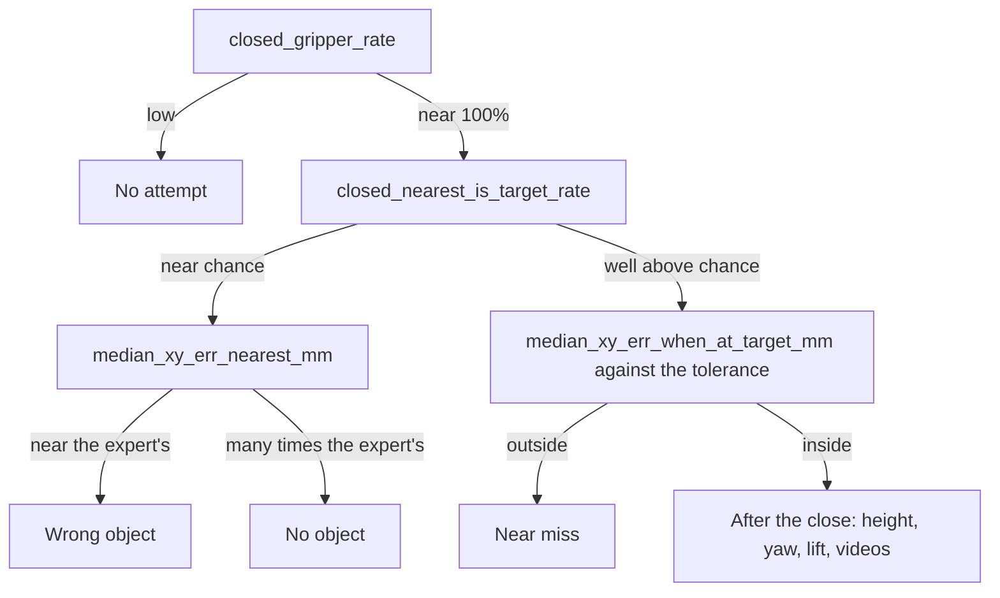

# Measuring How a Policy Fails

A success rate counts the episodes that ended well and says nothing about the rest. A policy at 1%
may be one centimetre from working or twenty, and the two need different repairs. Three diagnostics
in this repository tell them apart: a probe that records where the gripper is when it first closes,
a map of those positions, and a measurement of how much error the task forgives.

## The idea

[Closed-loop evaluation](90-closed-loop-evaluation.md) reduces an episode to one bit. On
`pick_target` (three objects on the table, an instruction that names one) different failures
produce the same zero:

| Failure | What the arm does | What it points to |
|---|---|---|
| No attempt | never closes the gripper | a stall or a timeout |
| Wrong object | grasps accurately, at an object not named | the instruction does not reach the actions |
| No object | runs the whole motion where nothing is | the scene does not reach the actions, or the policy averages over candidate targets ([flow matching](41-flow-matching.md)) |
| Near miss | closes slightly off the named object | precision: data, training, sampling |
| Lost grasp | closes on the object, loses it in the lift | height, finger angle, timing |

A **probe** is a recorder inside the evaluation loop that reads the simulator's true state, the
position of the gripper and of every object, at one chosen moment of every episode. The moment
used here is the first command to close the gripper, because that is when the policy commits to a
place.

An invented episode: the instruction is "pick up the green can" and at that moment the gripper is
130 mm from the cube, 106 mm from the can and 158 mm from the hex nut. The nearest object is the
can, so this episode counts as "nearest object was the named one", with a miss of 106 mm to both.
Over 100 episodes these become a rate and two medians. A wrong-object policy has a small miss to
the nearest object and a named-object rate at chance, 1/3 with three objects: what a policy that
ignores the instruction scores on average. A no-object policy has both misses large. A near-miss
policy has a high named-object rate and a miss of a few centimetres, just outside what the task
forgives.

## How it works

1. **The moment.** The gripper command is the eighth action dimension, 1 for open and 0 for closed
   ([What an action is](40-action-spaces.md)). The probe fires once per episode, at the first
   action whose command is below 0.5, before that action is executed.
2. **The positions.** The **tool centre point** (TCP) is the reference point between the
   fingertips. The probe keeps the horizontal position of the TCP and of each object, the TCP
   height, and the **yaw** of the fingers: the rotation about the vertical axis of the direction in
   which they close.
3. **Two references.** The distance to the named object tells whether the gripper went where it
   was told; the distance to the nearest object, whether it went to anything. `PickupEnv.reset`
   draws the target uniformly from the three objects on the table, so a policy that ignores the
   instruction and closes in every episode scores 1/3 on average.
4. **The scale.** The **scripted expert** (`ScriptedExpert` in
   [`sim/pickup/expert.py`](../../sim/pickup/expert.py), the hand-written controller that reads the
   true object pose and produced the [demonstrations](70-demonstrations.md)) goes through the same
   loop and probe and gives the numbers of a working policy. Run again with its grasp point
   displaced sideways by a fixed distance, it gives the error that still succeeds.

Read the summary from the top:



The scale for "many times the expert's" is the distance from a random point of the spawn area to
the nearest object; exercise 2 computes it.

## In this repository

**The probe** is `GraspProbe` in [`sim/pickup/diagnostics.py`](../../sim/pickup/diagnostics.py).
At the first action with `action[7] < 0.5`, `GraspProbe.update(action)` reads `env.tcp_pos()` (the
`tcp` site on the hand in [`env.py`](../../sim/pickup/env.py)) and `env.object_pos(n)` for every
name in `env.active`, and stores:

| Field | Content |
|---|---|
| `close_step`, `close_nearest` | `env.steps`, the control steps executed so far; the object nearest to the TCP in the table plane |
| `close_xy_err_target`, `close_xy_err_nearest` | horizontal distance in metres from the TCP to the named and to the nearest object |
| `close_z_above_grasp` | TCP z minus `max(z of the named object's body origin, 0.018)`, in metres: the height `ScriptedExpert._plan` gives its grasp point |
| `close_yaw_err_target` | angle in radians between the finger closing axis (`env.tcp_yaw()`) and the object's graspable axis, wrapped by its `grasp_sym` in `OBJECTS`; `None` for the can and the hex nut, which accept any angle |
| `close_tcp_xy`, `close_object_xy` | table-plane positions of the gripper and of every object |

`GraspProbe.result()` returns that record, or the same keys set to `None` if the gripper never
closed, and `closes`, the number of times the command went from open to closed.

**The wiring** is three lines in `main` of [`eval.py`](../../sim/pickup/eval.py): a
`GraspProbe(env)` per episode, `probe.update(action)` before `env.step(action)`, and
`**probe.result()` merged into the episode's entry in `per_episode`.

**The summary** is `summarize(episodes)` in `diagnostics.py`, stored under `grasp` in
`results.json`:

| Key | Definition |
|---|---|
| `closed_gripper_rate`, `closed_nearest_is_target_rate` | share of all episodes with a close command; share of all episodes where `close_nearest` is the target |
| `median_xy_err_target_mm`, `median_xy_err_nearest_mm` | median miss to the named and to the nearest object, over episodes with a close |
| `median_xy_err_when_at_target_mm` | median miss to the named object, over episodes where it was the nearest |
| `median_z_above_grasp_mm`, `median_yaw_err_deg` | medians of the height and of the yaw error in degrees, the yaw over episodes where the named object was nearest |
| `within_10mm_of_target_rate`, also 20 and 30 mm | share of all episodes that closed within that distance of the named object |
| `close_vs_target_slope`, `close_vs_target_r2` | per table axis, slope and $R^2$ of a least-squares line (`_fit`) of the closing position against the named object's position: near 1 if the gripper goes to that object, near 0 if it ignores where that object is |
| `by_target` | per named object: episodes, median miss, yaw error and height |

`summarize` also returns `retried_rate`, the share of episodes with a second close. The lab
notebook holds no value for it, the fit or `by_target`. The last line `eval.py` prints holds the
two rates and the two medians of the first two rows.

**The map** is [`grasp_map.py`](../../sim/pickup/grasp_map.py). `offsets` subtracts an object's
position from the gripper's, once for the named object and once for `close_nearest`. `draw` plots
them as Braille dots, green for a success and red for a failure, with rings at 1 cm and 2 cm.
`describe` adds the median and the shares within 10 mm and 20 mm.

<!-- interactive: grasp-map -->
*Figure: two top-down maps per policy, centred on the named and on the nearest object, a dot per
episode where the gripper first closed. The expert's dots are tight on both maps; a policy that
picks objects at random is tight on the nearest-object map only; one that aims at nothing is
scattered on both.*

**The tolerance** is [`grasp_tolerance.py`](../../sim/pickup/grasp_tolerance.py). Per episode,
`_worker` draws an angle uniformly and adds `offset * (cos, sin, 0)` to all four waypoints in
`expert.waypoints` (approach, descend, close, lift), on top of the expert's own placement noise,
`rng.normal(0, 0.003, 2)` in `ScriptedExpert._plan`. Four objects share the default 320 episodes
per offset, so a per-object cell rests on about 80.

The commands, from the repository root:

```bash
# 1. the reference: the scripted expert
.venv/bin/python -m sim.pickup.eval --task pick_target --episodes 100 --expert \
    --out results/pickup/expert/pick_target

# 2. a trained policy -> results/pickup/<run>/pick_target/results.json
sim/pickup/scripts/eval.sh experiments/pickup/<run> pick_target 100

# 3. both maps at one scale (half-width 30 cm)
.venv/bin/python -m sim.pickup.grasp_map results/pickup/expert/pick_target/results.json \
    results/pickup/<run>/pick_target/results.json --extent_cm 30

# 4. the tolerance
.venv/bin/python -m sim.pickup.grasp_tolerance --out results/pickup/grasp_tolerance.json
```

At ±30 cm one dot is about 1 cm, so the rings and the expert's cluster merge at the centre.
Without `--extent_cm` each map fits its own data.

## What we measured

All numbers are from the [lab notebook](../lab-notebook.md), which used two computers with
different MuJoCo builds: machine A (one RTX 4090) and machine B (L40S GPUs).

**The reference.** The scripted expert on `pick_target`, 100 unseen layouts, machine B: 100/100,
the gripper closes 5 mm (median) from the object, 98% within 10 mm.

**Three policies at 0-1%.** The notebook's first round of `pick_target` runs, on machine A: 1500
demonstrations, 1.0M training samples, 100 episodes each. `dp_vit` sees image patches and no
instruction.

| Policy | Success | Nearest object was the named one | Median miss to named | Median miss to nearest |
|---|---|---|---|---|
| `dp_vit`, no language | 1/100 | 32% | 185 mm | 110 mm |
| `vla_custom`, pretrained VLM | 0/100 | 33% | 175 mm | 89 mm |
| `vla_custom`, random-init VLM | 1/100 | 29% | 174 mm | 89 mm |

Read down the flowchart:

- The gripper closed in 100% of episodes for all three, at the right height (within about 3 mm)
  around step 34-44, as the expert does. The motion was learned.
- The named-object rate, 29% to 33%, is at the chance level of 33%. `dp_vit` is the control; the
  two `vla_custom` policies receive the instruction and score what the control scores.
- The median miss to the *nearest* object is 89 to 110 mm. The expert closes 5 mm (median) from
  the named object (machine B), and its miss to the nearest object cannot be larger. These are not
  accurate grasps of a wrong object: the motion ran about 10 cm from any object.

That rules out the near-miss reading. At 30 mm, the largest offset in the tolerance measurement
below, the expert succeeds in 30% of episodes on machine A (all objects). These policies were about
three times further than that from the closest object and six times further from the named one.

This is the "No object" row of the first table for all three: the gripper closed far from every
object, named or not. The probe does not say why. For `vla_custom` one candidate cause, the single
conditioning vector, is the subject of [What the action head sees](50-what-the-action-head-sees.md);
the notebook lists the effect of `conditioning: all_tokens` as not yet measured. `dp_vit` receives
every patch token and shows the same signature, so that is not the whole explanation.

**The tolerance.** Machine B (MuJoCo 4.0.1), 320 episodes per offset:

| Offset | Cube | T block | Can | Hex nut | All |
|---|---|---|---|---|---|
| 0 mm | 100% | 100% | 100% | 100% | 100% |
| 5 mm | 97% | 100% | 99% | 99% | 99% |
| 10 mm | 99% | 100% | 94% | 97% | 98% |
| 15 mm | 95% | 100% | 76% | 93% | 91% |
| 20 mm | 93% | 98% | 29% | 70% | 72% |
| 25 mm | 73% | 89% | 15% | 31% | 52% |
| 30 mm | 32% | 76% | 3% | 15% | 32% |

On machine A (an earlier MuJoCo 4.0 build), with the same seeds, the cube and T block columns are
identical and the two round objects are much harder: the can is at 94% with no offset, 60% at
10 mm and 18% at 20 mm.

<!-- interactive: tolerance -->
*Figure: grasp success of the offset expert against the offset, one curve per object. The cube and
T block curves stay above 90% to 20 mm; the can and hex nut curves fall earlier.*

The cube and the T block forgive 20 mm (93% and 98%); the can at 20 mm is at 29%. "Within 2 cm"
passes for two objects and fails for a third, which a success rate averaged over objects hides.
The can and the hex nut have cylinders as collision shapes in `OBJECTS` (radius 23 and 23.5 mm);
the cube and the T block have boxes. That the curved surface is the cause is an inference from
that pairing, not a measurement. The simulator build is the one known difference between the
machines and has not been isolated as the cause; measure the tolerance on the machine that
evaluates.

The table is the expert with one error added and its height, finger angle and timing intact. A
policy with the same sideways error has its own errors in those too, so the table is an optimistic
reference for it: an inference, not a measurement.

**The probe as a progress signal.** `dp_vit_lang_reactive` (instruction tokens, no history) on 4000
demonstrations, machine B, was evaluated by checkpoint while training toward 5M samples. The
notebook lists this run as in progress: the rows are its intermediate checkpoints, and there is no
final result. Raw / EMA weights (EMA: an exponential moving average of the weights kept during
training):

| Samples | Success | Nearest object was the named one | Median miss to named |
|---|---|---|---|
| 1.0M | 0% / 1% | 35% / 32% | 138 / 154 mm |
| 1.5M | 4% / 2% | 61% / 49% | 102 / 104 mm |
| 2.0M | 4% / 36% | 95% / 98% | 32 / 18 mm |

At 1.5M success has moved by a few percent, which the notebook treats as noise between single
runs, while the named-object rate has left chance. At 2.0M both sets of weights go to the named
object and differ in precision. The EMA weights succeed on 9/28 cans, 10/24 cubes, 13/25 hex nuts
and 4/23 T blocks. The T block forgives the largest offset in the tolerance table and has the
fewest lifts here, on a small count. The notebook has no per-object miss or yaw for this run, so
the cause is open; `by_target` in `results.json` is where to look.

## Designing a probe for another task

1. **Pick the moment.** It is defined by what the policy does and not by the outcome, occurs in
   failed episodes too, and lies where the policy commits. For a placing task that is the first
   open command after a grasp.
2. **Record positions, raw.** Store the true position of the tool and of every candidate target. A
   new statistic then needs no new rollouts: `grasp_map.py` draws both maps from `close_tcp_xy`,
   `close_object_xy`, `target`, `close_nearest` and `success` alone (it reads `close_step` only to
   word its message for a file without positions).
3. **Use two references and a known chance level.** The distance to the intended target cannot
   tell a wrong choice from no choice; the distance to the nearest candidate can. Draw the target
   independently of the layout and evaluate a policy that cannot know it.
4. **Compare with the expert.** Run it through the same loop and probe, then perturb it by known
   amounts along the dimension the probe measures.

## Where it goes wrong

| What you see | Why | What to do |
|---|---|---|
| A named-object rate of 38% read as "better than chance" | The Wilson 95% interval for a proportion ([Closed-loop evaluation](90-closed-loop-evaluation.md); `eval.py` applies it to the success rate) for 38 of 100 is about 29% to 48% and contains the 33% of chance (arithmetic, not a measurement) | More episodes; a no-language control |
| The named-object rate is high and success is low | Nearest is not near: the example above counts at 106 mm | Read `median_xy_err_when_at_target_mm`, the `within_*` rates and the map |
| Good numbers at the close, nothing lifted | The probe sees one instant, before the fingers move; a slip in the lift is not recorded | Read `close_z_above_grasp`, `close_yaw_err_target` and the `rollout_*_fail.mp4` files |
| The map and `results.json` disagree on the named-object rate or on the shares within 10 and 20 mm | `panel` and `describe` count over episodes with a close; `summarize` divides by all episodes | Read `closed_gripper_rate` first |

## Background and further reading

Background, not measured here:

- Kress-Gazit et al., "Robot Learning as an Empirical Science: Best Practices for Policy
  Evaluation" (2024), [arXiv:2409.09491](https://arxiv.org/abs/2409.09491). Argues that a success
  rate needs documented evaluation conditions, further metrics, statistical analysis and a
  description of failure modes.
- Wilson, "Probable Inference, the Law of Succession, and Statistical Inference" (1927),
  [doi:10.1080/01621459.1927.10502953](https://doi.org/10.1080/01621459.1927.10502953). The
  interval `eval.py` computes, defined in [Closed-loop evaluation](90-closed-loop-evaluation.md).

## Check yourself

1. Run commands 1 and 3 for the expert alone and compare the median and the share within 10 mm
   with the reference. Run command 4 and decide which machine's table yours reproduces.

2. The script replaces each episode's gripper position with a random point of the spawn area
   (`SPAWN_X`, `SPAWN_Y` in `env.py`) and prints the median distance to the nearest object. Compare
   it with the "median miss to nearest" column of the first-round policies.

   ```bash
   .venv/bin/python - <<'EOF'
   import json
   import numpy as np
   r = json.load(open("results/pickup/expert/pick_target/results.json"))
   rng = np.random.default_rng(0)
   miss = []
   for e in r["per_episode"]:
       p = np.array([rng.uniform(0.38, 0.62), rng.uniform(-0.22, 0.22)])
       miss.append(min(np.linalg.norm(p - xy) for xy in e["close_object_xy"].values()))
   print(f"random point: median {1000 * np.median(miss):.0f} mm from the nearest object")
   EOF
   ```

3. Design a probe for "put the cube in the bowl": the moment, the positions, the two references,
   the chance level, and the perturbation that measures the tolerance.
