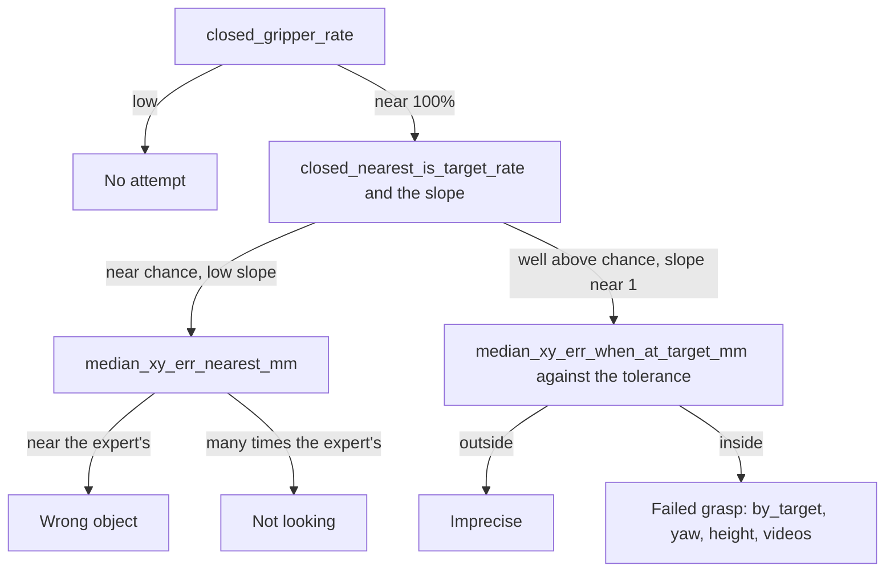

# Measuring How a Policy Fails

A success rate counts the episodes that ended well and says nothing about the rest. A policy at 1%
may be one centimetre from working, or it may close its gripper at a place that has nothing to do
with the scene, and the two need different repairs. Four diagnostics tell them apart: a record of
where the gripper is when it first closes, the slope of that place against the object's, a map,
and a measurement of how much error the task forgives.

## The idea

[Closed-loop evaluation](90-closed-loop-evaluation.md) reduces an episode to one bit. On
`pick_target` (three objects on the table, an instruction that names one) different failures
produce the same zero:

| Failure | What the arm does | What it points to |
|---|---|---|
| No attempt | never closes the gripper | a stall or a timeout |
| Wrong object | grasps accurately, at an object not named | the instruction does not reach the actions |
| Not looking | runs the whole motion at a place that does not depend on the scene | the policy does not use the scene, or not yet |
| Imprecise | closes off the named object, by more than the grasp forgives | precision: data, training budget, the sampler's settings |
| Failed grasp | closes at the named object and lifts nothing | height, finger angle, timing |

A **probe** is a recorder inside the evaluation loop that reads the simulator's true state, the
position of the gripper and of every object, at one chosen moment of every episode: here the
first command to close the gripper, when the policy commits to a place.

An invented episode: the instruction is "pick up the green can" and at that moment the gripper is
130 mm from the cube, 106 mm from the can and 158 mm from the hex nut. The nearest object is the
can, so the episode **closed at the named object**, with a miss of 106 mm. Over 100 episodes
these become a rate and two medians, the miss to the named and to the nearest object. The target
is drawn uniformly from the three objects (`PickupEnv.reset`), so a policy that ignores the
instruction closes at the named object in 1/3 of episodes on average: chance.

The **slope** asks of the same records whether the gripper closes elsewhere when the named object
lies elsewhere. It is the least-squares slope of the gripper's coordinate against the named
object's, over the episodes of one evaluation. Invented numbers on one axis: the object lies at
0.40, 0.50 and 0.60 m in three episodes. A gripper that closes at 0.41, 0.49 and 0.60 m gives a
slope of 0.95; one that closes at 0.52, 0.47 and 0.51 m gives -0.05. Near 1 the gripper follows
the object, however imprecisely; near 0 where it closes does not depend on the scene.

## How it works

The probe reads the horizontal position of the **tool centre point** (TCP), the reference point
between the fingertips, and of each object, the TCP height, and the **yaw** of the fingers: the
rotation about the vertical axis of the direction in which they close. It also counts how often
the gripper command goes from open to closed; a second close is a second grasp attempt. Three
things turn the records into a diagnosis:

1. **Two references.** The distance to the named object tells whether the gripper went where it
   was told; the distance to the nearest object, whether it went to anything.
2. **The slope.** One number per evaluation. It needs no chance level, so it still works with one
   object on the table, where the nearest object is always the named one.
3. **The scale.** The **scripted expert** (`ScriptedExpert` in
   [`sim/pickup/expert.py`](../../sim/pickup/expert.py), the hand-written controller that reads the
   true object pose and produced the [demonstrations](70-demonstrations.md)) goes through the same
   loop and probe and gives the numbers of a working policy. With its grasp point displaced
   sideways by a fixed distance, it gives the **tolerance**: the error that still succeeds.

Read the summary from the top:



The scale for "many times the expert's" is the distance from a random point of the spawn area to
the nearest object; exercise 2 computes it. Readings between the two branches belong to a policy
that has started to look.

## In this repository

**The probe** is `GraspProbe` in [`sim/pickup/diagnostics.py`](../../sim/pickup/diagnostics.py).
`main` in [`eval.py`](../../sim/pickup/eval.py) creates one per episode and calls its
`update(action)` before `env.step(action)`. At the first action with `action[7] < 0.5` (the
gripper command, 1 for open and 0 for closed: [What an action is](40-action-spaces.md)) it reads
`env.tcp_pos()`, the `tcp` site on the hand in [`env.py`](../../sim/pickup/env.py), and
`env.object_pos(n)` for every name in `env.active`, and stores:

- `close_step` (`env.steps`, the control steps executed so far) and `close_nearest`;
- `close_xy_err_target` and `close_xy_err_nearest`, the horizontal distances in metres to the
  named and to the nearest object;
- `close_z_above_grasp`, TCP z minus `max(z of the named object's body origin, 0.018)` in metres:
  the height `ScriptedExpert._plan` gives its grasp point;
- `close_yaw_err_target`, the angle in radians between the finger closing axis (`env.tcp_yaw()`)
  and the object's graspable axis, wrapped by its `grasp_sym` in `OBJECTS`; `None` for the can and
  the hex nut, which accept any angle;
- `close_tcp_xy` and `close_object_xy`, the table-plane positions of the gripper and of every
  object.

`GraspProbe.result()` returns that record, or the same keys set to `None` if the gripper never
closed, and `closes`, the number of times the command went from open to closed. `eval.py` merges
it into the episode's entry in `per_episode`.

**The summary** is `summarize(episodes)` in `diagnostics.py`, stored under `grasp` in
`results.json`. Its rates divide by all episodes: `closed_gripper_rate`,
`closed_nearest_is_target_rate` (closed at the named object), `within_10mm_of_target_rate` (also
20 and 30 mm) and `retried_rate` (two or more closes). `median_xy_err_target_mm`,
`median_xy_err_nearest_mm` and `median_z_above_grasp_mm` are over the episodes with a close;
`median_xy_err_when_at_target_mm` and `median_yaw_err_deg` over those that closed at the named
object. `close_vs_target_slope` and `close_vs_target_r2` hold a least-squares fit per table axis,
`by_target` the medians per named object.

**The slope** in the lab notebook's Slope columns is one number, `close_slope` in
[`summarize.py`](../../sim/pickup/summarize.py). It pools the two table axes: per axis it centres
both coordinates, then it divides the summed cross-products by the summed squares of the object's
coordinate. `summarize.py` prints one row per `results.json`, slope included.

**The map** is [`grasp_map.py`](../../sim/pickup/grasp_map.py), which draws the figure below in
the terminal, with rings at 1 cm and 2 cm.

<!-- interactive: grasp-map -->
*Figure: two top-down maps per policy, centred on the named and on the nearest object, one dot per
episode where the gripper first closed. The expert's dots are tight on both; a policy that picks
objects at random is tight on the second only; one that is not looking is scattered on both.*

**The tolerance** is [`grasp_tolerance.py`](../../sim/pickup/grasp_tolerance.py). Per episode,
`_worker` draws an angle uniformly and adds `offset * (cos, sin, 0)` to all four waypoints in
`expert.waypoints`. Four objects share the default 320 episodes per offset, so a per-object cell
rests on about 80.

The commands, from the repository root:

```bash
# 1. the reference: the scripted expert
.venv/bin/python -m sim.pickup.eval --task pick_target --episodes 100 --expert \
    --out results/pickup/expert/pick_target

# 2. a trained policy -> results/pickup/<run>/pick_target/results.json
sim/pickup/scripts/eval.sh experiments/pickup/<run> pick_target 100

# 3. both maps at one scale: half-width 30 cm, about 1 cm per dot
#    (without --extent_cm each map fits its own data)
.venv/bin/python -m sim.pickup.grasp_map results/pickup/expert/pick_target/results.json \
    results/pickup/<run>/pick_target/results.json --extent_cm 30

# 4. the tolerance
.venv/bin/python -m sim.pickup.grasp_tolerance --out results/pickup/grasp_tolerance.json

# 5. every checkpoint (trained and, where the run saved them, averaged weights),
#    then one row per evaluation with the slope
sim/pickup/scripts/eval_checkpoints.sh experiments/pickup/<run> pick_target
.venv/bin/python -m sim.pickup.summarize --task pick_target --runs <run>

# 6. second attempts: the named object is moved as the gripper first closes
PICKUP_OUT=results/pickup/<run>/pick_target/disturb_grasp \
    sim/pickup/scripts/eval.sh experiments/pickup/<run> pick_target 100 --disturb grasp
```

## What we measured

All numbers are from the [lab notebook](../lab-notebook.md): one training seed per run and, unless
stated, 100 episodes per evaluation on unseen **layouts** (the objects on the table, their places,
the named one and the arm's start pose, all fixed by a seed). The first round ran on machine A
(one RTX 4090, 24 GB), the rest on machine B (L40S GPUs, 128 CPU cores). Pairs are raw / EMA: the
trained weights and their running average. Unless marked, the runs predate the fix of the rotary
position table ([Positions](12-positions.md)).

**The reference.** The scripted expert on `pick_target`, machine B: 100/100, the gripper closes
5 mm (median) from the object, 98% within 10 mm.

**Three policies at 0-1%.** First round, 1500 demonstrations, 1.0M training samples. `dp_vit` sees
image patches and no instruction; `vla_custom` is the from-scratch VLA.

| Policy | Success | Closed at the named object | Median miss to named | Median miss to nearest |
|---|---|---|---|---|
| `dp_vit`, no language | 1/100 | 32% | 185 mm | 110 mm |
| `vla_custom`, pretrained VLM | 0/100 | 33% | 175 mm | 89 mm |
| `vla_custom`, random-init VLM | 1/100 | 29% | 174 mm | 89 mm |

Down the flowchart: the gripper closed in 100% of episodes, at the right height (within about
3 mm), around control step 34-44, as the expert does: the motion was learned. It closed at the
named object in 29% to 33% of episodes: chance. The median miss to the *nearest* object is 89 to
110 mm, against the expert's 5 mm: neither accurate grasps of a wrong object nor near misses.

That is the "Not looking" row, first misread as a reach toward a point between the objects. The
per-episode records say otherwise ([field notes](../notes.md), "A failing policy ignores the
scene; it does not average"): the closing positions fill the area where objects can spawn and do
not gather between the objects of their own scene, and the miss stays the same against the objects
of another episode. In the three second-round runs on this budget that never started to look
(machine B, 22 evaluations each, pooled), the slope per table axis lies between 0.00 and 0.09 and
$R^2$ is at most 0.006.

The diagnostics name the failure, not its cause. The [roadmap](../roadmap.md) lists four: a
single conditioning vector for `vla_custom`
([What the action head sees](50-what-the-action-head-sees.md)), the previous action as an input, a
budget that ended before a policy starts to look, and a position table computed in half precision.

**A policy that points.** `vla_qwen` (a pretrained Qwen3-VL-2B backbone, also a single
conditioning vector, with history: the previous frame, state and action as inputs; machine B, 1500
demonstrations, 0.40M samples) fails differently: 5% success, 71% closed at the named object,
slope 0.68, median miss 83 mm. It heads for the named object and stops far outside the tolerance:
imprecise, not blind.

**The tolerance.** Machine B (MuJoCo 4.0.1), 320 episodes per offset:

| Offset | Cube | T block | Can | Hex nut | All |
|---|---|---|---|---|---|
| 0 mm | 100% | 100% | 100% | 100% | 100% |
| 10 mm | 99% | 100% | 94% | 97% | 98% |
| 15 mm | 95% | 100% | 76% | 93% | 91% |
| 20 mm | 93% | 98% | 29% | 70% | 72% |
| 30 mm | 32% | 76% | 3% | 15% | 32% |

On machine A (an earlier MuJoCo 4.0 build), with the same seeds, the cube and T block columns are
identical and the two round objects, whose collision shapes are cylinders, are much harder: the
can is at 94% with no offset, 60% at 10 mm and 18% at 20 mm. The build has not been isolated as
the cause; measure the tolerance on the machine that evaluates.

<!-- interactive: tolerance -->
*Figure: grasp success of the offset expert against the offset, one curve per object.*

"Within 2 cm" passes for the cube and the T block (93% and 98%) and fails for the can (29%), which
a success rate averaged over objects hides.

**The same diagnostics during training.** `dp_vit_lang_reactive` (the instruction as tokens, no
history) on 4000 demonstrations, at checkpoints of a 5.0M-sample run:

| Samples | Success | Closed at the named object | Slope | Median miss to named |
|---|---|---|---|---|
| 1.0M | 0% / 1% | 35% / 32% | 0.11 / 0.14 | 138 / 154 mm |
| 1.5M | 4% / 2% | 61% / 49% | 0.47 / 0.37 | 102 / 104 mm |
| 2.0M | 4% / 36% | 95% / 98% | 0.81 / 0.96 | 32 / 18 mm |
| 5.0M (final) | 83% / 85% | 100% / 100% | 0.98 / 0.98 | 7 / 7 mm |

At 1.0M the run reads like the three failures above. At 1.5M success is still noise while the slope
has left zero. At 2.0M the raw weights are imprecise: 95% closed
at the named object, 32 mm from it, where the expert offset by 30 mm is at 32% (all objects). The
slope moves first, then the miss shrinks, then success follows (field notes, "Looking at the scene
arrives late, and all at once"). Trained again after the position fix, the same run has a slope
of 0.58 after 1.0M samples and ends at 93% (trained weights). A second pair of runs with other
seeds, differing in the position table alone, ends at 96% / 96% with the fixed table and
90% / 89% with the old one; at 1.0M the fixed table's slope is again ahead (0.77 against 0.25).

A budget can end inside this transition. On 1500 demonstrations the same policy read 3% / 5%
when trained for 1.0M samples (slope 0.29 / 0.18) and 64% / 62% when trained for 3.0M
(0.96 / 0.97), so no 1.0M-sample result in this chapter shows the limit of a design
([How much data and training](71-how-much-data-and-training.md),
[the `pick_target` case study](101-case-pick-target.md)).

**The failures that remain.** From 3.0M samples on, that run closes at the named object in at
least 99% of episodes, slope at least 0.97: what is left is the last leaf of the flowchart. Its 12
evaluations from there on (raw and EMA), pooled by object, with medians:

| Object | Success | Miss: successes, failures | Yaw error: successes, failures | Height above the grasp point, failures |
|---|---|---|---|---|
| green can | 311/336 = 93% | 5 mm, 12 mm | - | 3 mm |
| blue hex nut | 283/300 = 94% | 7 mm, 30 mm | - | -0 mm |
| red cube | 236/288 = 82% | 8 mm, 16 mm | 20 deg, 32 deg | -1 mm |
| yellow T block | 153/276 = 55% | 9 mm, 15 mm | 35 deg, 64 deg | 9 mm |

Yaw error is measured against the grasps the expert uses (four on the cube; two on the T block,
across the stem), so it is at most 45 and 90 degrees. The T block forgives the largest offset in
the tolerance table and fails most often, with a median miss of 15 mm in its failures, an offset
at which the expert is at 100%. Sideways position is not what fails: the failed T-block grasps
are a median of 64 degrees off and close 9 mm above the grasp height. The tolerance table is thus
an optimistic reference for a policy: it is the expert with one error added and its height,
finger angle and timing intact.

Here too the diagnostics named the failure and not its cause: most of it was the position bug
(field notes, "What still fails"). After the fix, pooled over the last three checkpoints, the
T block is at 60/69 = 87% and the cube at 68/72 = 94%.

## Where it goes wrong

**Noise read as a signal.** Over 100 episodes, 37% closed at the named object is chance: the
Wilson 95% interval for 37 of 100 is about 28% to 47% (arithmetic), and `dp_vit`, which has no
language input, read 31% / 37% in the second round. Its slope read 0.11 / 0.17 in the same
evaluations, and 0.04 and 0.09 on the two axes with its 22 evaluations pooled. Read both across
checkpoints, or pool evaluations: a trend counts, one value does not.

**A low slope read as an inability.** `dp_vit_lang` is `dp_vit_lang_reactive` with history. On the
4000 demonstrations it read 2% / 2% after 3.0M samples, slope 0.11 / 0.08. Its 2.5M-sample
checkpoint (EMA) closes at the named object in 30% of episodes as served, and in 97% when the
previous action sent with its first query is the expert's first command
(`--first_prev_action expert`; success 1/100 and 22/100). It is not blind: it reads the target
from its previous action ([History and shortcuts](52-history-and-shortcuts.md)).

**A perfect first close read as watching the scene.** The 85% checkpoint (EMA) closes at the
named object in 100% of episodes, 7 mm from it. Sent the first frame's images throughout
(`--stale_images`), it still does so in 99%, 17 mm from it, and succeeds in 1/100: it looks once.
With the object moved as the gripper first closes (`--disturb grasp`), it succeeds in 1/99 and
closes a second time in 29, the episodes `retried_rate` counts. A policy trained after the fix on
demonstrations in which the expert recovers succeeds in 78/99 and closes a second time in all 99;
the scripted expert scores 0/100 with its one plan and 100/100 when it plans again. Such
evaluations, which change one thing about an episode, are the probes of
[What a policy looks at](95-what-a-policy-looks-at.md).

## Background and further reading

Background, not measured here:

- Kress-Gazit et al., "Robot Learning as an Empirical Science: Best Practices for Policy
  Evaluation" (2024), [arXiv:2409.09491](https://arxiv.org/abs/2409.09491). Argues that a success
  rate needs documented conditions, further metrics, statistical analysis and a description of
  failure modes.
- Wilson, "Probable Inference, the Law of Succession, and Statistical Inference" (1927),
  [doi:10.1080/01621459.1927.10502953](https://doi.org/10.1080/01621459.1927.10502953). The
  interval `eval.py` computes, defined in [Closed-loop evaluation](90-closed-loop-evaluation.md).

## Check yourself

1. Run commands 1 and 3 for the expert alone and compare the median and the share within 10 mm
   with the reference. Run command 4 and decide which machine's table yours reproduces.

2. The script replaces each episode's closing position with a random point of the spawn area
   (`SPAWN_X`, `SPAWN_Y` in `env.py`) and prints both median misses and the slope. Compare them
   with the first-round table.

   ```bash
   .venv/bin/python - <<'EOF'
   import json
   import numpy as np
   from sim.pickup.summarize import close_slope

   r = json.load(open("results/pickup/expert/pick_target/results.json"))
   rng = np.random.default_rng(0)
   nearest, named = [], []
   for e in r["per_episode"]:
       p = np.array([rng.uniform(0.38, 0.62), rng.uniform(-0.22, 0.22)])
       d = {n: np.linalg.norm(p - xy) for n, xy in e["close_object_xy"].items()}
       nearest.append(min(d.values()))
       named.append(d[e["target"]])
       e["close_tcp_xy"] = p.tolist()
   print(f"random point: median {1000 * np.median(nearest):.0f} mm from the nearest object, "
         f"{1000 * np.median(named):.0f} mm from the named one, slope {close_slope(r):.2f}")
   EOF
   ```

3. After command 5, pool several evaluations by object and outcome, as in "The failures that
   remain", and name each object's leaf of the flowchart from its failures' median miss and its
   column of the tolerance table.

   ```bash
   .venv/bin/python - results/pickup/<run>/pick_target/ckpt_*/results.json <<'EOF'
   import json
   import sys
   from collections import defaultdict
   import numpy as np

   rows = defaultdict(list)
   for path in sys.argv[1:]:
       for e in json.load(open(path))["per_episode"]:
           if e["close_step"] is not None:
               rows[e["target"], e["success"]].append(e)

   def med(eps, key, scale):
       vals = [e[key] for e in eps if e[key] is not None]
       return f"{scale * np.median(vals):.0f}" if vals else "-"

   for (target, ok), eps in sorted(rows.items()):
       print(f"{target:6s} {'lifted' if ok else 'failed'} {len(eps):4d}"
             f"  miss {med(eps, 'close_xy_err_target', 1000)} mm"
             f"  yaw {med(eps, 'close_yaw_err_target', 180 / np.pi)} deg"
             f"  height {med(eps, 'close_z_above_grasp', 1000)} mm")
   EOF
   ```
