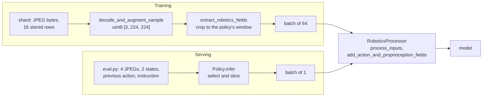

# Train and Inference Must See the Same Thing

A model is trained on tensors produced by a data pipeline and then run on tensors produced by a
server. When the two differ, the model still runs and returns output of the right shape. A robot
policy has many places for this to happen: its server assembles images, joint states, the previous
action and an instruction from a live simulator, where training read them from files.

## The idea

**Train/inference skew** is any difference between the representation of an input that reaches the
model in training and the representation of the same input that reaches it when served.
Background: published work calls this training-serving skew. Zinkevich's *Rules of Machine
Learning* uses that name for the resulting gap in performance and lists three causes; this chapter
is about the first, a discrepancy in how data is handled in the two pipelines.

The **serving path** is the code between a raw observation and the model call at run time; here
that is `Policy.infer` in [`sim/pickup/policy_server.py`](../../sim/pickup/policy_server.py). The
vision-language model (VLM) of case 1 has no server; the check script
[`sim/pickup/vlm_check.py`](../../sim/pickup/vlm_check.py) plays that role there.

A camera frame is an array of integers from 0 to 255. Before a fix described below,
`SimpleVLMProcessor` divided an image by 255 when it arrived as a PIL image or a uint8 numpy array
and did not when it arrived as a `torch.uint8` tensor. Both then went through the same
normalisation, `(img - 0.5) / 0.5`. By arithmetic:

| Pixel value | Fed as PIL or uint8 numpy | Fed as a uint8 tensor (before the fix) |
|---|---|---|
| 0 | -1 | -1 |
| 128 | 0.004 | 255 |
| 255 | 1 | 509 |

Both results are `float32` tensors of shape `[1, 3, 224, 224]`. Training fed tensors, the check
fed PIL images. The training loss gave no sign, because the training path is consistent with
itself, and the symptom looked like a model that had not learned.

## How it works

Training and serving share part of their code and differ before it. A **shard** is a tar file of
training samples. Each sample is a **window**: the states and actions around one step, stored as
16 rows (1 past, the current step, 14 future), with the camera frames at t-1 and t.



The batch of 64 is `per_gpu_batch_size` in `dp_vit_lang.yaml`. The four cases:

| Case | Training input | Serving input | Test |
|---|---|---|---|
| Pixel range | values up to 509 | values in [-1, 1] | yes |
| Probe token position | after the batch padding | directly after the prompt | yes |
| Zero treated as unset | would have held the current and the next state (found before such a run) | the current state twice | yes |
| History for a policy without history | one frame per camera, one state | the same: `Policy.infer` selects from what the client sends | none |

Cases 1 to 3 were bugs. Case 4 is a skew the server prevents, with no test to keep it so.

### Case 1: pixel value range

**Symptom.** The stage-2 VLM of the from-scratch path listed the objects of a held-out scene in the
right order in 1 of 300 cases.

**Cause.** `ImageCaptionPipeline` decodes images with `Augmentations.decode_and_augment_sample`,
which calls `fast_image_decoder` and returns uint8 tensors laid out `[3, H, W]`. `vlm_check.py`
opens each JPEG with PIL. The two types took different branches of `_process_image` in
[`simple_vlm_processor.py`](../../vla_foundry/models/vision_language_backbones/simple_vlm_processor.py).

**Fix.** The tensor branch now reads
`img.float() / 255.0 if img.dtype == torch.uint8 else img.float()`. A checkpoint trained on the old
range does not become correct under the new processor; it has to be trained again
([Testing a VLM](32-testing-a-vlm.md)).

**Test.** `test_uint8_inputs_share_one_value_range` passes one random uint8 image to
`_process_image` as a numpy array, a PIL image and a tensor, and requires equal results within
[-1, 1].

### Case 2: a probe token whose position depends on padding

A **probe token** is an extra token whose hidden state is read out as a summary of the prompt. In
`conditioning: action_token` mode, `VLMFoundryBackboneWrapper`
([`vlm_foundry_backbone.py`](../../vla_foundry/models/vision_language_backbones/vlm_foundry_backbone.py))
adds one action token to the prompt and hands its hidden states from the last
`num_vlm_layers_to_use` layers to the **action head**, the transformer that turns noise into
actions, as its **conditioning**: the tensor it reads but does not predict.

**Symptom.** None isolated; the lab notebook records the effect on success as not measured.

**Cause.** `RoboticsProcessor.process_inputs` tokenizes with `padding=True`, which pads every row
to the longest prompt in the batch ([Tokens](10-tokens.md)). The token used to be appended to the
padded batch. With the toy ids of the test (image placeholder 7, pad 0, action token `A`):

```text
row padded to 9, token appended:  7 7 7 7 3 4 0 0 0 A    A at index 9, three pads before it
same prompt served alone:         7 7 7 7 3 4 A          A at index 6
after the fix, in both cases:     7 7 7 7 3 4 A 0 0 0    A at index 6
```

The server processes one prompt per request, so nothing is padded. Two things then differ for the
probe in training. Its distance to every real token grows by the number of pads, and with rotary
position encoding, the default in `model_params.py`, attention scores depend on that distance
([Positions](12-positions.md)). It also attends to the pads: `Transformer.forward` in
`vla_foundry/models/transformer.py` sets `attention_mask = None` for a causal model when
`use_cache` is false, because the causal mask, under which a token attends only to earlier
positions, already hides right-hand padding from real tokens. That does not cover a token placed
after the padding. The toy row shifts the token by three positions; the lab notebook describes the
shift in the real data as one position, behind one padding token.

<!-- interactive: padding-shift -->
*Figure: two prompts of different length, padded on the right. A token appended to the batch lands
after the padding in the short row; with the fix it follows the last real token.*

**Fix.** `_prepare_inputs_for_action_token` concatenates the token, then reorders each row with a
stable `argsort` on the mask so that real tokens come first. `_extract_action_conditioning` reads
index `real.sum(dim=1) - 1`, the last real token of each row.

**Test.** `test_conditioning_does_not_depend_on_padding` in
`test_vlm_foundry_backbone_conditioning.py` feeds one prompt alone and padded to 9 and requires
equal conditioning to within `1e-5`, for both conditioning modes. `test_vit_backbone_text.py` has a
test of the same name for `ViTBackboneWrapper._embed_text`.

### Case 3: a zero treated as "not set"

`lowdim_past_timesteps` is the number of past steps of state and action a policy receives. The
configs without history set it to 0.

**Symptom.** None: the field notes ([`tutorial/notes.md`](../notes.md)) record that it was found
by reading the code before a config with 0 past steps was run.

**Cause.** `add_action_and_proprioception_fields` in
[`robotics_processor.py`](../../vla_foundry/data/processor/robotics_processor.py) chooses how many
state rows become the `proprioception` input, the robot's own measured state (7 joint angles and
the gripper opening): rows `0` to `num_past_steps`. It used to compute that number as
`lowdim_past_timesteps or default`. In Python 0 is **falsy**, treated as false in a condition, so
`0 or 1` is `1`, and 0 past steps fell back to `self.normalizer.lowdim_past_timesteps`, which the
notes give as 1. A window for a policy without history starts at the current step, so rows 0 and 1
are the current state and the state one control step later. At serving there is no future state:
`Policy.infer` fills the rows after the current one with copies of the current state. The input
contained part of the answer in training and a repeated state when served.

**Fix.** An explicit `if num_past_steps is None:` before the fallback. The same `or` idiom remains
in `NormalizationParams.init_shared_attributes` (`normalization_params.py`), where with the pickup
data it resolves to the statistics' 1 past step.

**Test.** `test_proprioception_past_steps.py` builds a state tensor whose value at each row equals
the row index. With 0 past steps and 15 rows (the current step and 14 future ones) the output must
be `[0.0]`. With 1 past step, or with `None`, and 16 rows it must be `[0.0, 1.0]`.

### Case 4: history handed to a policy without history

**Symptom.** None: the server prevents this skew.

**Cause.** The client, `main` in [`sim/pickup/eval.py`](../../sim/pickup/eval.py), sends every
policy the same request: four JPEGs (`front_t-1`, `front_t0`, `wrist_t-1`, `wrist_t0`), two states
`[previous, current]` and the previous action.
[`dp_vit_lang_reactive.yaml`](../../sim/pickup/configs/dp_vit_lang_reactive.yaml) sets
`image_indices: [0]` and `lowdim_past_timesteps: 0`: that policy was trained on two images, one
state and no previous action. Taking the first `past + 1` states has the right shape and gives the
policy a state one control step old. Taking the first two entries of the request's image
dictionary in place of selecting by name would give it `front_t-1` and `front_t0`: two front
frames, one of them a step old, and no wrist frame. Neither raises an error.

**Fix.** `Policy.__init__` reads `past`, `future` and `image_names` from the run's saved
`config.yaml`. `Policy.infer` then:

- decodes only the images named in `self.image_names` (`front_t0`, `wrist_t0` for this config);
- keeps `state[-(self.past + 1):]`, the last row when `past` is 0;
- writes the previous action into `action_seq[: self.past]`, which is no row when `past` is 0.

**Test.** There is none: no test in `tests/` imports `sim.pickup.policy_server`. The property to
pin is that a request with two distinct states yields `proprioception` equal to the normalised
second state when `past` is 0.

### The method

**1. One sample through both paths.** Take one stored window. Run it through the training pipeline
and through the serving path, each up to the model call, and compare every tensor's shape, type,
range and values. Expected differences are the batch dimension, the padded length, and the future
rows of `actions`: expert targets in training, placeholder rows at serving (zeros in
`Policy.infer` that `process_inputs` normalises like any action, so they need not print as 0).
`DiffusionPolicy.generate_actions` replaces those rows with noise wherever `past_mask`, a boolean
per action row that is true for rows already executed, is false.

This comparison stops at the model's inputs. It finds case 1 and, when values are compared, cases
3 and 4. It cannot find case 2, where the inputs differ only in the expected padded length and the
error is in what the model computes from them. That takes the invariance test in step 2.

**2. Behavioural counterfactual tests.** A counterfactual test changes one input, holds the rest
fixed, and states in advance what the output must do. A *sensitivity* test requires a change:
`test_instruction_changes_the_conditioning` swaps one instruction token and requires the text
slots (the first 6 conditioning positions, which hold the instruction) to differ and the patch
slots (the rest, one per image patch) to stay equal. An *invariance* test requires no change: the
padding tests above. On a trained model the same idea is the right image against a mismatched one
([Testing a VLM](32-testing-a-vlm.md)) or, in closed loop, the named-object rate against chance
([Measuring failure](92-measuring-failure.md)).

**3. Unit tests that pin invariants.** An invariant is a property that must hold for every input,
such as "the conditioning of a sample is a function of that sample only". The tests here need no
checkpoint: `SimpleVLMProcessor.__new__` and `object.__new__(RoboticsProcessor)` create the object
without running `__init__`, so no tokenizer is downloaded, and the data makes a wrong index
visible, such as a state whose value is its row number.

## In this repository

**The shared processor.** `RoboticsPipeline.save_configs` in
[`robotics.py`](../../vla_foundry/data/pipelines/robotics.py) writes the processor's data
parameters to `config_processor.yaml` and saves the normaliser next to it. `Policy.__init__`
restores both with `RoboticsProcessor.from_pretrained(checkpoint_dir)`. `Policy.infer` decodes
JPEG bytes with `fast_image_decoder`, as training does, then calls `process_inputs` and
`add_action_and_proprioception_fields`, the last two calls of the training pipeline. The
chat template, tokenizer, image scaling, normalisation statistics and state-row count have one
implementation. Two saved files configure the server: `config_processor.yaml` for the
processor, and `config.yaml`, from which `Policy.__init__` takes `past`, `future`, `image_names`
and `max_text_seq_len`. Training writes both from the same config.

Run the tests that pin the invariants:

```bash
.venv/bin/python -m pytest \
    tests/essential/models/test_simple_vlm_processor_scaling.py \
    tests/essential/models/test_vlm_foundry_backbone_conditioning.py \
    tests/essential/models/test_vit_backbone_text.py \
    tests/essential/data/test_proprioception_past_steps.py -v
```

For the both-paths comparison, print a fingerprint of every tensor at the model boundary (a helper
that is not in the repository and was not run for this chapter):

```python
import torch

def fingerprint(batch):
    for name, value in batch.items():
        if isinstance(value, torch.Tensor) and value.numel() > 0:
            v = value.float()
            print(f"{name:22s} {tuple(value.shape)!s:20s} {value.dtype!s:14s} "
                  f"min {v.min():9.3f} max {v.max():9.3f}")
```

Call it on `inputs` in `Policy.infer` just before `generate_actions`, and on one batch from the
training data loader. These are different samples, so only shape, type and range can be compared:
enough for a scale error like case 1, not for cases 2 to 4. To compare values, pass the JPEG
bytes, the state rows up to the current step and the instruction of one stored window to
`Policy.infer` and compare with the same window from the loader, with any image augmentation in
the run's config switched off.

## What we measured

All numbers are from the [lab notebook](../lab-notebook.md).

Before the pixel-range fix the stage-2 VLM scored 1/300 on exact left-to-right ordering and 70/300
on the leftmost object, on held-out scenes. A teacher-forced check on that model, which scores the
true caption given the image, gave:

| Images fed as | Loss, right image | Loss, mismatched image |
|---|---|---|
| PIL | 1.93 | 1.89 |
| unscaled uint8 tensors, as in training | 0.10 | 1.18 |

The image mattered on the training path and not on the path the check used. With the fixed
processor the stage-2 model scores 256/300 (85%) on ordering and 285/300 (95%) on the leftmost
object on machine A, and 249/300 (83%) and 279/300 (93%) when the stages were repeated on machine B.

This does not show how large the effects of cases 2 to 4 are, or that no further skew exists.

## Where it goes wrong

Sharing the processor removes the skew that comes from writing preprocessing twice, and not the
rest. Case 1 used one class with two input types; the policy server avoids that by decoding to the
uint8 tensors training uses. Case 2 comes from the batch the shared code is called on. Cases 3 and
4 come from the rows it is given: training crops stored windows in `extract_robotics_fields`,
serving builds `action_seq`, `state_seq` and `past_mask` by hand. What remains:

| What you see | Why | How to check | What to do |
|---|---|---|---|
| The first step of an episode differs (policies with history only) | In the first training window the previous action is a copy of the expert's first command (`padding_strategy: copy`); the client sends the pose held after reset ([Chunks and execution](42-chunks-and-execution.md)) | Run `sim.pickup.eval` with `--first_prev_action expert` against the default `hold` | Not measured here |
| A check and the served model disagree | The check built its own inputs: `vlm_check.py` sets `image_seq_length = 256` by hand, equal to `img_num_tokens` in `custom_vlm.yaml` only by agreement | Read how the check builds its inputs | Feed checks the way the server is fed |
| Nothing, for the Qwen policy | `VLMHFBackboneWrapper` (`vlm_hf_backbone.py`, used by `vla_qwen.yaml`) still appends the action token to the padded batch and reads index `-1`; the processor's padding side was not checked here | The padded-against-alone test, on that wrapper | Port the fix |

A unit test on a randomly initialised model shows that an output depends on the right inputs, not
that a trained policy uses them.

## Background and further reading

Background, not measured here:

- Zinkevich, *Rules of Machine Learning: Best Practices for ML Engineering*, an undated online
  guide from Google
  ([developers.google.com](https://developers.google.com/machine-learning/guides/rules-of-ml)).
  Rule 32: re-use code between the training and the serving pipeline. Rule 37: measure the skew.
- Breck et al., *The ML Test Score: A Rubric for ML Production Readiness and Technical Debt
  Reduction*, 2017 ([research.google](https://research.google/pubs/pub46555/)). A list of 28 tests
  and monitoring needs, one of which is that features computed in training and in serving have the
  same values.
- Ribeiro et al., *Beyond Accuracy: Behavioral Testing of NLP models with CheckList*, 2020
  ([arXiv:2005.04118](https://arxiv.org/abs/2005.04118)). Behavioural tests for models, including
  invariance tests, where a perturbation must not change the prediction, and directional
  expectation tests, where it must change it in a known direction.

## Check yourself

1. Compute by hand what a pixel value of 200 becomes in `_process_image` for a uint8 tensor and for
   a `float32` tensor holding the same number. Then check:

   ```bash
   .venv/bin/python -c "
   import torch
   from vla_foundry.models.vision_language_backbones.simple_vlm_processor import SimpleVLMProcessor as P
   p = P.__new__(P); p.image_size = 8
   p._mean = p._std = torch.full((3, 1, 1), 0.5)
   x = torch.full((3, 8, 8), 200, dtype=torch.uint8)
   print(p._process_image(x).max().item(), p._process_image(x.float()).max().item())"
   ```

2. In `add_action_and_proprioception_fields`, replace the `is None` check in your head with
   `self.data_params.lowdim_past_timesteps or self.normalizer.lowdim_past_timesteps`. State which
   case of `test_proprioception_past_steps.py` fails and what list it returns. Check in a scratch
   copy, or read the two cases:

   ```bash
   .venv/bin/python -m pytest tests/essential/data/test_proprioception_past_steps.py -v
   ```

3. Write the missing test for case 4. It has to call `Policy.infer`: a test that rebuilds
   `state_seq` in the test file checks a copy, not the server. Create the object with
   `object.__new__(Policy)`, set `past = 0`, `total = 15`, `image_names = []` and the other
   attributes `infer` reads (`cfg`, `device`, `autocast`, `action_field`, `state_field`), give it
   a stub `processor` and `model` that record their arguments, call `infer` with two distinct
   states, and assert that every recorded state row equals the second state.
