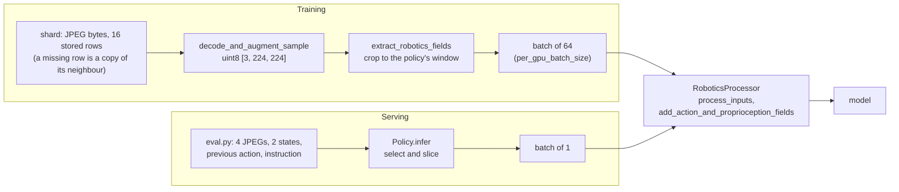

# Train and Inference Must See the Same Thing

A model is trained on tensors produced by a data pipeline and then run on tensors produced by a
server. When the two differ, the model still runs and returns output of the right shape. A robot
policy's server assembles images, joint states, the previous action and an instruction from a live
simulator, where training read them from files: many places for the two to differ.

## The idea

**Train/inference skew** is any difference between the representation of an input that reaches the
model in training and the representation of the same input that reaches it when served.
Background: published work calls this training-serving skew, and Zinkevich's *Rules of Machine
Learning* names its first cause: data handled differently in the two pipelines.

The **serving path** is the code between a raw observation and the model call at run time: the
client loop in [`sim/pickup/eval.py`](../../sim/pickup/eval.py), which builds each request, and
`Policy.infer` in [`sim/pickup/policy_server.py`](../../sim/pickup/policy_server.py), which turns
it into tensors. For the vision-language model (VLM) of case 1 the check script
[`sim/pickup/vlm_check.py`](../../sim/pickup/vlm_check.py) plays that role.

A camera frame is an array of integers from 0 to 255. Before its fix, `SimpleVLMProcessor` divided
an image by 255 when it arrived as a PIL image or a uint8 numpy array and did not when it arrived
as a `torch.uint8` tensor. Both then went through the same normalisation, `(img - 0.5) / 0.5`. By
arithmetic:

| Pixel value | Fed as PIL or uint8 numpy | Fed as a uint8 tensor (before the fix) |
|---|---|---|
| 0 | -1 | -1 |
| 128 | 0.004 | 255 |
| 255 | 1 | 509 |

Both results are `float32` tensors of shape `[1, 3, 224, 224]`. Training fed tensors, the check
fed PIL images. The training loss gave no sign, because the training path is consistent with
itself, and the symptom looked like a model that had not learned.

## How it works

Training and serving share part of their code and differ before it. A **shard** is a tar file of
stored **windows**. A window is one training example: the observations at one frame
and the actions that follow, stored as 16 rows of state and action (1 past, the current control
step, 14 future) with the camera frames at t-1 and t.



The field notes ([`tutorial/notes.md`](../notes.md), "Train/inference mismatches hide in
preprocessing") list five mismatches, none of which raised an error. Cases 1 to 3 below were bugs
in code and case 4 is a preprocessing default. Case 5 was identical on both paths and cost success
all the same.

### Case 1: pixel value range

**Symptom.** The stage-2 VLM of the from-scratch path listed the objects of a held-out scene in the
right order in 1 of 300 cases.

**Cause.** `ImageCaptionPipeline` decodes images with `Augmentations.decode_and_augment_sample`,
which calls `fast_image_decoder` and returns uint8 tensors laid out `[3, H, W]`. `vlm_check.py`
opens each JPEG with PIL. The two types took different branches of `_process_image` in
[`simple_vlm_processor.py`](../../vla_foundry/models/vision_language_backbones/simple_vlm_processor.py).

**Fix.** The tensor branch now reads
`img.float() / 255.0 if img.dtype == torch.uint8 else img.float()`. A model trained on the
old range has to be trained again
([Testing a VLM](32-testing-a-vlm.md)).

**Test.** `test_uint8_inputs_share_one_value_range` passes one random uint8 image to
`_process_image` as a numpy array, a PIL image and a tensor, and requires equal results within
[-1, 1].

### Case 2: an action token whose position depended on padding

The **action token** (`_action_token_id`) is the single special token appended to a VLM prompt. In
`conditioning: action_token` mode, `VLMFoundryBackboneWrapper`
([`vlm_foundry_backbone.py`](../../vla_foundry/models/vision_language_backbones/vlm_foundry_backbone.py))
hands its hidden states from the last `num_vlm_layers_to_use` layers to the **action head**, the
transformer that turns noise into actions, as its **conditioning**: the tensor the backbone hands
over, `[batch, tokens, width]`, here with one token.

**Symptom.** None isolated.

**Cause.** `RoboticsProcessor.process_inputs` tokenises with `padding=True`, which pads every row
to the longest prompt in the batch ([Tokens](10-tokens.md)). The token used to be appended to the
padded batch. With the toy ids of the test (image placeholder 7, pad 0, action token `A`):

```text
row padded to 9, token appended:  7 7 7 7 3 4 0 0 0 A    A at index 9, three pads before it
same prompt served alone:         7 7 7 7 3 4 A          A at index 6
after the fix, in both cases:     7 7 7 7 3 4 A 0 0 0    A at index 6
```

The server processes one prompt per request and pads nothing; in training two things differed.
The action token's distance to every real token grew by the number of pads, and with rotary
position encoding, the default in `model_params.py`, attention scores depend on that distance
([Positions](12-positions.md)). It also attended to the pads: for a causal model
`Transformer.forward` in `vla_foundry/models/transformer.py` sets `attention_mask = None` when `use_cache` is false, since
the causal mask already hides right-hand padding from real tokens, though not from a token placed
after it. In the real data the notebook gives a shift of one position.

<!-- interactive: padding-shift -->
*Figure: two prompts of different length, padded on the right. A token appended to the batch lands
after the padding in the short row; with the fix it follows the last real token.*

**Fix.** `insert_after_last_real_token` in
[`base.py`](../../vla_foundry/models/vision_language_backbones/base.py) concatenates the token,
then reorders each row with a stable `argsort` on the mask so that real tokens come first.
`conditioning_from_hidden_states`, next to it, reads the last real token of each row. Both VLM
wrappers call them, `VLMHFBackboneWrapper` (used by `vla_qwen.yaml`) included.

**Test.** `test_conditioning_does_not_depend_on_padding` in
`test_vlm_foundry_backbone_conditioning.py` feeds one prompt alone and padded to 9 and requires
equal conditioning to within `1e-5`, in both conditioning modes. `test_backbone_conditioning.py`
covers the helpers and the Hugging Face wrapper; `test_vit_backbone_text.py` tests
`ViTBackboneWrapper._embed_text` the same way.

### Case 3: a zero treated as "not set"

`lowdim_past_timesteps` is the number of past control steps of state and action a policy receives.
The configs without **history** (the previous frame, state and action as inputs) set it to 0.

**Symptom.** None: it was found by reading the code before such a config was run (field notes).

**Cause.** `add_action_and_proprioception_fields` in
[`robotics_processor.py`](../../vla_foundry/data/processor/robotics_processor.py) takes rows `0` to
`num_past_steps` of the state as the `proprioception` input, the robot's own measured state. It
computed that number as `lowdim_past_timesteps or default`, and in Python 0 is **falsy**, treated
as false in a condition, so 0 became the 1 past control step of the dataset statistics. Without
history the window starts at the current control step: rows 0 and 1 are the current state and the
state one control step later, part of the answer. When served, `Policy.infer` repeats the current
state.

**Fix and test.** An explicit `if num_past_steps is None:`. `test_proprioception_past_steps.py`
builds a state whose value is its row index: with 0 past control steps the output must be `[0.0]`,
with 1 or `None`, `[0.0, 1.0]`.

### Case 4: the previous action at the first frame

A policy with history (`dp_vit_lang.yaml`) receives its previous action as row 0 of 16 action
rows.

**Symptom.** On three objects the policy with history hardly ever succeeded where the same
policy without history did ([History and shortcuts](52-history-and-shortcuts.md) has the runs).

**Cause.** A window that starts at the first frame of a demonstration has no previous action.
[`preprocess.yaml`](../../sim/pickup/configs/preprocess.yaml) sets `padding_strategy: copy`, so
`PaddingStrategy.copy_edge` fills row 0 with a copy of row 1: the expert's first command, which
already points at the target. When served, `eval.py` sends `env.last_action`, which after
`PickupEnv.reset` is the **hold command**: the start joint angles with the gripper open. In
training the answer was in the input; when served it is absent.

The serving side of this row is built in `Policy.infer`. It allocates `action_seq` with `total`
rows of zeros, writes the previous action into the first `past` of them, and sets `past_mask` to
true on those rows. `DiffusionPolicy.generate_actions` keeps the masked rows as given at every
flow step and starts the others from noise. Row by row, at the first frame of an episode:

| Row of `actions` | Training window | Served query |
|---|---|---|
| 0 (previous action, clean) | copy of row 1: the expert's first command | `env.last_action`: the hold command |
| 1 (current control step) | the expert's first command, noised | zeros, replaced by noise |
| 2 to 15 | the expert's next 14 commands, noised | zeros, replaced by noise |

Rows 1 to 15 differ by design. Row 0 is an input on both sides and should not differ.

**What was tried.** `collect.py --hold_steps 1` begins every demonstration with one frame of the
robot at rest, so the first windows hold what serving provides. It did not cure the policy
([History and shortcuts](52-history-and-shortcuts.md)). Closing a skew does not remove a shortcut
present on both paths: from the second control step on, the previous action predicts the next one,
and in that run it was enough to keep the policy from looking.

**Test.** Two **probes**, evaluations of a trained policy with one thing about the episode
changed: `eval.py --first_prev_action expert` sends the expert's first command with the first
query; `--expert_prefix 10` lets the expert drive the first 10 control steps. The first restores
the training-side row 0 and nothing else, so it measures this skew alone.

### Case 5: a position table computed in half precision

**Symptom.** None: both paths built the same table; the cost showed when a run was repeated after
the fix.

**Cause.** `RotaryEmbedding._update_cos_sin_tables` in
[`positional_embedding.py`](../../vla_foundry/positional_embedding.py) builds the table of rotary
position angles in the first forward pass. With `precision: amp_bf16` that pass runs under
**autocast**, which on a GPU executes many operations in bfloat16, a 16-bit float with 8
significant bits. The product of position and frequency was one of them, so tokens far along the
sequence shared a position ([Positions](12-positions.md) has the arithmetic).

Both paths ran the same code, so this case belongs here for what the fix
did. The table is not stored in a checkpoint (only `inv_freq` is a buffer); it is rebuilt from code
whenever a model runs. Weights trained on the old table and loaded by the fixed code are served
positions they never saw: a skew between the code that trained a weights file and the code that
serves it.

**Fix.** The angles are computed in float32 with autocast off; only the finished cosines and sines
are cast. For weights trained before the fix, `positional_embedding_type: rotary_legacy_autocast`
reproduces the old table.

**Test.** `test_rotary_precision.py` builds the table under bfloat16 autocast for 1024 positions
and requires every row to be distinct and its cosines and sines to match a float32 reference
within 0.01. `test_legacy_table_reproduces_the_old_collapse` requires the legacy option to still
collapse 2048 positions; it needs a GPU and is skipped without one.

### The method

**1. One window through both paths.** Run one stored window through the training pipeline and
through the serving path, each up to the model call, and compare every tensor's shape, type, range
and values. The batch dimension, the padded length and the future rows of `actions` are expected
to differ: expert targets in training, placeholders at serving, which
`DiffusionPolicy.generate_actions` replaces with noise.

The comparison stops at the model's inputs. It finds case 1 and, when values are compared, case 3.
It finds case 4 only if the window starts at a demonstration's first frame and the serving side is
fed what the client sends there. It cannot find case 2, whose inputs differ only in padded
length, or case 5, where nothing differs.

**2. Behavioural counterfactual tests.** A counterfactual test changes one input, holds the rest
fixed, and states in advance what the output must do. A *sensitivity* test requires a change:
`test_instruction_changes_the_conditioning` swaps one instruction token and requires the text
slots of the conditioning to differ and the patch slots to stay equal. An *invariance* test
requires no change: the padding tests above. On a trained model the same idea is the right image
against a mismatched one ([Testing a VLM](32-testing-a-vlm.md)), how often the gripper closed at
the named object against chance ([Measuring failure](92-measuring-failure.md)), or a probe as in
case 4 ([What a policy looks at](95-what-a-policy-looks-at.md)).

**3. Unit tests that pin invariants.** An invariant is a property that must hold for every input,
such as "the conditioning of a window depends on that window only". The tests here need no
trained weights: `object.__new__(RoboticsProcessor)` creates the object without running
`__init__`, and each test builds inputs whose values show a wrong index (in
`test_proprioception_past_steps.py`, a state whose value is its row index).

## In this repository

**The shared processor.** `RoboticsPipeline.save_configs` in
[`robotics.py`](../../vla_foundry/data/pipelines/robotics.py) writes the processor's data
parameters to `config_processor.yaml` and saves the normaliser next to it; `Policy.__init__`
restores both with `RoboticsProcessor.from_pretrained(checkpoint_dir)`. `Policy.infer` decodes
JPEG bytes with `fast_image_decoder`, as training does, then calls `process_inputs` and
`add_action_and_proprioception_fields`, the two processor calls of the training pipeline. Chat
template, tokenizer, image scaling, normalisation statistics and state-row count have one
implementation.

Run the tests that pin the invariants:

```bash
.venv/bin/python -m pytest \
    tests/essential/models/test_simple_vlm_processor_scaling.py \
    tests/essential/models/test_vlm_foundry_backbone_conditioning.py \
    tests/essential/models/test_backbone_conditioning.py \
    tests/essential/models/test_vit_backbone_text.py \
    tests/essential/models/test_rotary_precision.py \
    tests/essential/data/test_proprioception_past_steps.py -v
```

The probes of case 4, for a run trained with history, each result in its own directory:

```bash
PICKUP_OUT=results/pickup/my_run/pick_target/first_expert \
    sim/pickup/scripts/eval.sh experiments/pickup/my_run pick_target 100 --first_prev_action expert
PICKUP_OUT=results/pickup/my_run/pick_target/prefix_10 \
    sim/pickup/scripts/eval.sh experiments/pickup/my_run pick_target 100 --expert_prefix 10
```

For the both-paths comparison, print a fingerprint of every tensor at the model boundary (a helper
that is not in the repository; the comparison was not run for this chapter):

```python
import torch

def fingerprint(batch):
    for name, value in batch.items():
        if isinstance(value, torch.Tensor) and value.numel() > 0:
            v = value.float()
            print(f"{name:22s} {tuple(value.shape)!s:20s} {value.dtype!s:14s} "
                  f"min {v.min():9.3f} max {v.max():9.3f}")
```

Call it on `inputs` in `Policy.infer` just before `generate_actions`, and on one batch from the
training data loader. These are different windows, so only shape, type and range can be compared:
enough for case 1. To compare values, feed `Policy.infer` one stored window with the previous
action the client would send, and compare with the same window from the loader.

## What we measured

All numbers are from the [lab notebook](../lab-notebook.md).

**Case 1.** Before the pixel-range fix the stage-2 VLM scored 1/300 on exact left-to-right
ordering and 70/300 on the leftmost object, on held-out scenes. A teacher-forced check on that
model, which scores the true caption given the image, gave:

| Images fed as | Loss, right image | Loss, mismatched image |
|---|---|---|
| PIL | 1.93 | 1.89 |
| unscaled uint8 tensors, as in training | 0.10 | 1.18 |

The image mattered on the training path and not on the path the check used. A model trained with
the fixed processor on machine A (one RTX 4090, 24 GB) orders 256/300 held-out scenes correctly
([Testing a VLM](32-testing-a-vlm.md) has the rest).

**Case 4.** On machine B (L40S GPUs, 128 CPU cores), the first probe alone took the policy with
history (`dp_vit_lang_pt4k`, 4000 demonstrations, trained before the position fix; the checkpoint
at 2.5M samples, averaged weights) from 1/100 to 22/100 on 100 unseen **layouts** (objects,
places, the named one, the arm's start pose); the full probe table is in
[History and shortcuts](52-history-and-shortcuts.md). One row of one query matters.

**Case 5.** The old table had 641 distinct positions out of 2048. `dp_vit_lang_reactive` (patch
tokens, instruction tokens, no history) on `pick_target` with 4000 demonstrations, trained again
with the fixed table, ends at 93% against 83% on 100 unseen layouts (trained weights, 5.0M
samples). That old-table run predates the fix, so other code changes come with the table. The
legacy option served as a control: a second pair of runs with other seeds, one of them trained
with `--model.transformer.positional_embedding_type rotary_legacy_autocast`, differs in the table
alone ([Positions](12-positions.md) has its result).

**Not measured.** The effect of case 2 on success. Nothing here shows that no further skew exists.

## Where it goes wrong

Sharing the processor removes only the skew that comes from writing preprocessing twice: in all
five cases shared code was fed something different, or built a table of its own. What remains:

| What you see | Why | How to check | What to do |
|---|---|---|---|
| A check and the served model disagree | The check built its own inputs: `vlm_check.py` sets `image_seq_length = 256` by hand ([Testing a VLM](32-testing-a-vlm.md)) | Read how the check builds its inputs | Feed checks the way the server is fed |
| Nothing: a policy without history gets a state one control step old | The client sends every policy `[previous, current]`; slicing from the front has the right shape. Only `state[-(self.past + 1):]` in `Policy.infer` prevents it ([Chunks and execution](42-chunks-and-execution.md)), and no test imports `sim.pickup.policy_server` | Send two distinct states and read `proprioception` | Write the test (exercise 3) |
| A result that belongs to another run | Two evaluations on one port reached the server that bound it first; about 40 evaluations here were filed under the wrong run and redone | Compare the weights file a `results.json` records with its directory | Use `eval.sh`: it takes a free port, and `check_server` in `eval.py` stops when another run answers |

A unit test on a randomly initialised model shows that an output depends on the right inputs, not
that a trained policy uses them.

## Background and further reading

Background, not measured here:

- Zinkevich, *Rules of Machine Learning: Best Practices for ML Engineering*, an undated online
  guide
  ([developers.google.com](https://developers.google.com/machine-learning/guides/rules-of-ml)).
  Rule 32: re-use code between the training and the serving pipeline. Rule 37: measure the skew.
- Breck et al., *The ML Test Score: A Rubric for ML Production Readiness and Technical Debt
  Reduction*, 2017 ([research.google](https://research.google/pubs/pub46555/)). One of its 28
  tests: features computed in training and in serving have the same values.
- Ribeiro et al., *Beyond Accuracy: Behavioral Testing of NLP models with CheckList*, 2020
  ([arXiv:2005.04118](https://arxiv.org/abs/2005.04118)). Invariance tests, where a perturbation
  must not change the prediction, and directional expectation tests, where it must change it in a
  known direction.

## Check yourself

1. Compute by hand what a pixel value of 200 becomes in `_process_image` for a uint8 tensor and for
   a `float32` tensor holding the same number. Then check:

   ```bash
   .venv/bin/python -c "
   import torch
   from vla_foundry.models.vision_language_backbones.simple_vlm_processor import SimpleVLMProcessor as P
   p = P.__new__(P); p.image_size = 8
   p._mean = p._std = torch.full((3, 1, 1), 0.5)
   x = torch.full((3, 8, 8), 200, dtype=torch.uint8)
   print(p._process_image(x).max().item(), p._process_image(x.float()).max().item())"
   ```

2. In `add_action_and_proprioception_fields`, replace the `is None` check in your head with
   `self.data_params.lowdim_past_timesteps or self.normalizer.lowdim_past_timesteps`. Say which
   test case fails and what list it returns, then read both:

   ```bash
   .venv/bin/python -m pytest tests/essential/data/test_proprioception_past_steps.py -v
   ```

3. Write the missing test for the state the server selects. Create the object with
   `object.__new__(Policy)`, set `past = 0`, `total = 15`, `image_names = []` and the other
   attributes `infer` reads (`cfg`, `device`, `autocast`, `action_field`, `state_field`), give it
   a stub `processor` and `model` that record their arguments, call `Policy.infer` with two
   distinct states, and assert that every recorded state row equals the second.

4. An episode's first three actions are 10, 11 and 12. Say what rows 0 to 3 of the window at its
   first frame hold, and what `eval.py` sends in place of row 0. Then check the padding:

   ```bash
   .venv/bin/python -c "
   import numpy as np
   from vla_foundry.data.preprocessing.robotics.preprocess_masks import PaddingStrategy
   actions = np.arange(10.0, 13.0).reshape(3, 1)
   print(PaddingStrategy.copy_edge(actions, 1, 0).ravel())"
   ```
