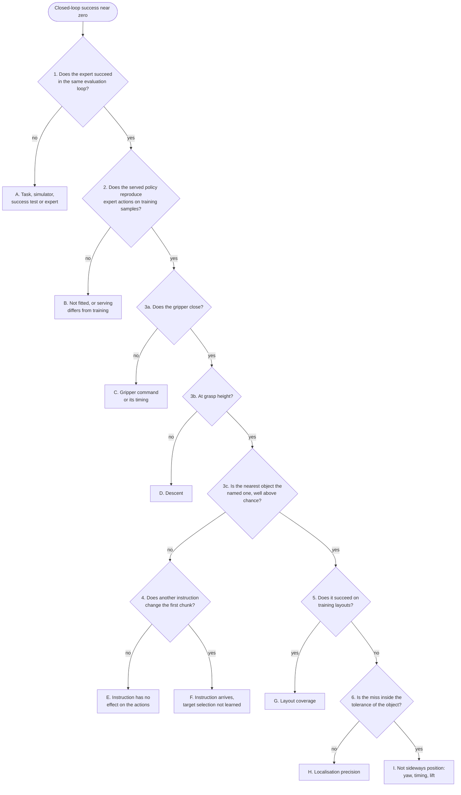

# A Debugging Flowchart

A success rate near zero says that something is wrong and not what. A broken success test, a
preprocessing mismatch, a policy that ignores the instruction and a policy that misses by a
centimetre all produce it, and each needs a different fix. This chapter orders the checks of this
repository from symptom to cause, so that each removes a group of causes before anything is
retrained.

## The idea

A robot policy sits at the end of a chain: task definition, expert (a scripted controller that
solves the task from the simulator's true object positions and produces the demonstrations),
demonstrations, preprocessing, training, serving (the policy server, which turns an observation
into a chunk of 15 future actions), execution, success test. **Closed-loop success**, the fraction
of episodes in which the policy completes the task when run in the simulator on its own outputs,
is measured after the last link and is low if any link is broken.

Retraining tests one guess per run (the lab notebook lists about 1.7 h for 1.0M samples of the
130M VLA); the checks below need an evaluation or less. Two rules order them:

1. **Upstream first.** A fault early in the chain voids every later measurement, so the task is
   checked before the policy and the serving path before the behaviour.
2. **Every answer must change the next step.** The training loss fails this rule: on `pick_cube` a
   final loss of 0.040 went with 2/50 (pooled CLIP, 200 demos) and a higher one, 0.058, with 37/50
   (`dp_vit`, 1000 demos).

Worked example, from the [lab notebook](../lab-notebook.md): `dp_vit` scored 1/100 on `pick_target`
(machine A) on unseen layouts; a layout is the set of objects and poses one seed produces.
Decision numbers refer to the chart below; decision 2 is absent, here and in What we measured,
because the notebook records no output of `open_loop_check.py`.

- **Decision 1.** The expert, through the same evaluation loop on that machine, scored 99/100.
  Task and scoring are sound.
- **3a, 3b.** The policy closed its gripper in 100% of episodes, within about 3 mm of the right
  height, around step 34-44, as the expert does. It learned the motion.
- **3c.** The nearest object was the named one in 32% of episodes; chance with three objects is
  33%. The median miss was 185 mm to the named object and 110 mm to the *nearest*. It aimed at no
  object.
- **Leaf E, read from the config instead of running decision 4.**
  [`sim/pickup/configs/dp_vit.yaml`](../../sim/pickup/configs/dp_vit.yaml) has no `text_tokens`
  key, and `ViTBackboneWrapper` (`vla_foundry/models/vision_language_backbones/vit_backbone.py`)
  embeds the instruction only when `text_tokens > 0` (default 0).

Two evaluations (the expert, then the policy) and one look at a config found a cause that no amount
of training removes: the model is never given the target's name. It was not the only cause. With
instruction tokens added (`dp_vit_lang`, machine B) success was 3% with raw and 2% with EMA
weights, and the named-object rate, 35% and 29%, stayed at chance.

## How it works



| Leaf | Likely causes | Read |
|---|---|---|
| A | success test, step limit, assets or simulator build, the expert | [Closed-Loop Evaluation](90-closed-loop-evaluation.md) |
| B | loss never fell; wrong checkpoint or weights; pixel range, normaliser or token position differs when served | [Train and Inference Must See the Same Thing](93-train-inference-skew.md) |
| C | gripper dimension of the action; episode ends before the close | [Action Chunks and Closed-Loop Execution](42-chunks-and-execution.md) |
| D | joint targets or state input during the descent | [What an Action Is](40-action-spaces.md) |
| E | no text input in the config; one pooled conditioning vector | [What the Action Head Sees](50-what-the-action-head-sees.md) |
| F | too few training samples; the windows that need the instruction are a small share of the data | [Imitation Learning and Why It Breaks](43-imitation-learning.md) |
| G | too few distinct layouts | [Demonstrations](70-demonstrations.md) |
| H | conditioning without spatial detail; training budget; spread between samples | [One Vector or Many Tokens](21-pooled-vs-patch-tokens.md), [Generating Actions with Flow Matching](41-flow-matching.md) |
| I | finger yaw, close timing, lift and hold | [Measuring How a Policy Fails](92-measuring-failure.md) |

No policy in the lab notebook landed on leaf C or D, and the pooled-vector cause under E was not
isolated (`vla_qwen`, also conditioned on one vector, never lifted an object other than the named
one in 150 episodes); these are candidates, not findings.

**1. The expert in the same evaluation loop.** `eval.py --expert` replaces the served policy with
`ScriptedExpert`; the `PickupEnv`, the seeds from `EVAL_SEED_START = 1_000_000`, the `GraspProbe`
and the success test in `PickupEnv.step` (the named object more than `LIFT_HEIGHT = 0.08` m above
its rest height for `HOLD_STEPS = 10` consecutive steps) stay the same. If the expert fails here,
no policy can be judged here.

**2. Expert actions through the serving path.** `open_loop_check.py` builds the `Policy` class of
`policy_server.py`, reads windows from the training shards and calls `Policy.infer`, the function
the server calls for every chunk (shape `[15, 8]`). The check is open-loop: predictions are compared
with the recorded actions and never executed. It prints the mean absolute error per joint over the
chunk, for the first action, and for a baseline that repeats the previous action. Predictions not
clearly below the baseline mean an unfitted model or different tensors when served. Passing
excludes only leaf B: the errors are measured on expert states
([Loss Is Not Success](91-loss-is-not-success.md)).

**3. The first close.** `eval.py` calls `GraspProbe.update` with every action before executing it.
At the first action whose gripper command `action[7]` is below 0.5 the probe stores the step, the
nearest object, the table-plane distance from the gripper to the named and to the nearest object,
the table-plane positions of the gripper and of every object, and the height above the expert's
grasp height for the named object. `summarize` turns the records into the `grasp` block of
`results.json`. Read it in order: `closed_gripper_rate` (3a), `median_z_above_grasp_mm` (3b),
`closed_nearest_is_target_rate` (3c), then `median_xy_err_target_mm` next to
`median_xy_err_nearest_mm`. A small miss to the nearest object with a large one to the named
object is a policy that grasps but picks at random; with two large misses it aims at no object.

Reference values from the lab notebook: expert 99/100 or 100/100 (decision 1); closing within
about 3 mm of grasp height (3b); chance 33% with three objects, where a no-language policy ranged
from 26% to 39% over its checkpoints on 100 episodes, so that band is chance (3c).

<!-- interactive: grasp-map -->
*Figure: two top-down maps per policy, one dot per episode where the gripper first closed, rings at
1 cm and 2 cm, the left map centred on the named object and the right on the nearest one.
`grasp_map.py` draws the same in the terminal.*

**4. Another instruction, the same scene.** First read the config: a `vit_backbone` without
`text_tokens` has no text input, which is leaf E. Otherwise serve one frame with two instructions.
`DiffusionPolicy.generate_actions` starts the future actions from `torch.randn_like`, so two calls
with identical input differ; that spread is the scale. `Policy.infer` also passes `noise_seed` to
`torch.manual_seed`: two calls with one seed start from the same noise, so what differs between
them is the instruction. A same-seed difference near zero means the chunk does not depend on the
instruction (leaf E). A clear difference, with a gripper that still closes at chance, means the
input arrives and target selection is not learned (leaf F); far below the fresh-noise spread, the
effect is weak.

**5. Training layouts.** Demonstrations use environment seeds from 0 (`collect.py --seed`, default
0), and `eval.py --seed_start 0` replays those layouts with the same named object: at the default
`--targets_per_layout 1`, `collect.py` passes `target_index=None` to `PickupEnv.reset` and
`eval.py` omits it. Success there with failure on seeds `1_000_000+` is a coverage problem
(leaf G); failure rules that out.

**6. The tolerance of the object.** `grasp_tolerance.py` runs the expert with a fixed sideways
offset added to every waypoint and reports success per object. The tolerance differs by object, so
compare `grasp.by_target[<object>].median_xy_err_mm` with that object's column, and
`within_10mm_of_target_rate` and `within_20mm_of_target_rate` with the `all` column; `per_target`
gives the success per object. A median hides half the episodes, and the offset is added to the
expert's own scatter of about 5 mm, so the comparison is approximate. A miss outside the tolerance
is a precision problem (leaf H); inside it, sideways position is not what fails (leaf I).

## In this repository

Run from the repository root, with two names set:

```bash
run=dp_vit_lang_pt1500   # a directory under experiments/pickup
data=pick_target_1500    # a directory under data/preprocessed
```

| Decision | Command | Read |
|---|---|---|
| 1 | `.venv/bin/python -m sim.pickup.eval --task pick_target --episodes 100 --expert --out results/pickup/expert/pick_target` | the last two `[eval]` lines |
| 2 | `.venv/bin/python -m sim.pickup.open_loop_check --checkpoint_dir experiments/pickup/$run --shards data/preprocessed/$data/shards` | three lines of per-joint error |
| 3 | `sim/pickup/scripts/eval.sh experiments/pickup/$run pick_target 100`, then `.venv/bin/python -m sim.pickup.grasp_map results/pickup/$run/pick_target/results.json` | the `grasp` block; the two maps |
| 4 | the snippet below | two medians |
| 5 | `PICKUP_OUT=results/pickup/$run/pick_target_train sim/pickup/scripts/eval.sh experiments/pickup/$run pick_target 20 --seed_start 0` | success rate |
| 6 | `.venv/bin/python -m sim.pickup.grasp_tolerance --out results/pickup/grasp_tolerance.json` | success per object and offset |

Notes from the code:

- `open_loop_check.py` passes `None` as the checkpoint, so `Policy` loads the newest one, with EMA
  weights when the run was trained with them: an exponential moving average of the weights over
  training, saved as `ema_N.pt` next to the directly trained "raw" `checkpoint_N.pt`.
- Without `PICKUP_OUT`, decision 5 overwrites the `results.json` of decision 3.
- `eval.py` also has interventions for what a policy depends on: `--expert_prefix K` with
  `--prefix_target named|distractor` (the expert drives the first K steps toward the named or
  another object), `--stale_images` (the first frame is sent throughout) and
  `--first_prev_action expert`.
- For a policy built on the from-scratch VLM, test the backbone before decision 2
  ([Testing a VLM](32-testing-a-vlm.md)):
  `.venv/bin/python -m sim.pickup.vlm_check --exp experiments/pickup/custom_vlm --shards data/custom/sim_captions_heldout`.

No script under `sim/pickup/` wraps decision 4. This snippet, not run for this chapter, builds the
request as `eval.py` does on the first step of an episode. Save it as `instruction_swap.py` in the
repository root and run `.venv/bin/python instruction_swap.py experiments/pickup/$run`; `sim` is
not an installed package, so a file kept elsewhere needs `PYTHONPATH=.` in front of the command.

```python
import sys

import numpy as np

from sim.pickup.env import OBJECTS, PickupEnv
from sim.pickup.eval import _jpeg
from sim.pickup.policy_server import Policy

policy = Policy(sys.argv[1], None, "cuda")
env = PickupEnv("pick_target")
spread, swap = [], []
for seed in range(1_000_000, 1_000_020):
    obs = env.reset(seed=seed)
    images = {f"{cam}_t{i}": _jpeg(obs[cam]) for cam in env.camera_names for i in ("-1", "0")}
    state = [obs["state"].tolist()] * 2

    def chunk(name, noise_seed=None):  # [15, 8]
        text = f"pick up the {OBJECTS[name]['label']}"
        return policy.infer(images, state, env.last_action, text, noise_seed=noise_seed)

    a, b = env.active[:2]
    spread.append(np.abs(chunk(a) - chunk(a))[:, :7].mean())
    swap.append(np.abs(chunk(a, seed) - chunk(b, seed))[:, :7].mean())
print(f"same instruction, fresh noise: {np.median(spread):.4f} rad per joint")
print(f"two instructions, same noise : {np.median(swap):.4f} rad per joint")
```

## What we measured

Numbers are from the [lab notebook](../lab-notebook.md); pairs are raw / EMA weights. Three more
policies taken through the chart:

| Policy | Readings | Leaf | What followed |
|---|---|---|---|
| Pooled CLIP, `pick_cube`, 2/50 | one object, so 3c passes; 0/20 on its own training layouts; closes a few centimetres from the cube | H | patch tokens with the same 200 demos: 15/50 |
| `vla_custom`, pretrained VLM, 0/100 | closed 100%, named 33%, miss 175 mm and 89 mm | E or F: decision 4 was not run | `conditioning: all_tokens`; effect not yet measured |
| `dp_vit_lang_reactive`, 1500 demos, 1.0M samples, 3% / 5% | named 49% / 41%, miss to named 127 / 139 mm | F | below |

Leaf B was met at the VLM stage: before the pixel-range fix the stage-2 VLM scored 1/300 on exact
ordering of held-out scenes, the quantity `vlm_check.py` prints; after it, 256/300 (machine A).

**Leaf F in detail.** For `dp_vit_lang_reactive` the closed-loop named-object rate rose with
training, from 28% / 31% at 0.3M samples to 45% / 48% at 0.9M, while the no-language policy stayed
between 26% and 39%. That rate is the evidence that the instruction arrives, weakly. An open-loop
test of the first chunk at 0.9M samples (60 layouts; its script is not in the repository) did not
show it: the chunk headed for the named object in 35% of training layouts and 48% of unseen ones
(so unfamiliar layouts were not the cause), and the no-language policy gave the same picture
(32-42%). Two samples for the same input ended 10.9 cm apart (median, training layouts) in a chunk
where the expert moves the gripper 30 cm: the spread decision 4 is read against.

`dp_vit_lang_reactive` on 4000 demos (one instruction per layout), at intermediate checkpoints of a
run that was still training toward 5M samples and has no final result:

| Samples | Success | Named object nearest | Median miss to named |
|---|---|---|---|
| 1.0M | 0% / 1% | 35% / 32% | 138 / 154 mm |
| 1.5M | 4% / 2% | 61% / 49% | 102 / 104 mm |
| 2.0M | 4% / 36% | 95% / 98% | 32 / 18 mm |

That run differs from the 1500-demo run in data and in samples, and the 3M-sample run on 1500
demos was also unfinished, so which mattered is open.

**Decision 6 on the 2.0M checkpoint.** With EMA weights the policy passes 3c (98%) with a median
miss of 18 mm. Decision 5 was not run; the notebook has no evaluation of this checkpoint on
training layouts. On machine B a 20 mm offset leaves the expert at 93% on the cube, 98% on the T
block, 70% on the hex nut and 29% on the can (18% on machine A: use the table of the machine that
evaluates). The policy succeeded on 10/24 cubes, 4/23 T blocks, 13/25 hex nuts and 9/28 cans,
fewest on the object that tolerates sideways error best. The notebook has one median over all
objects and no yaw error, so it cannot say why; `grasp.by_target` and `median_yaw_err_deg` in that
run's `results.json` separate leaf H from leaf I.

## Where it goes wrong

| What you see | Why | What to do |
|---|---|---|
| One checkpoint or one set of weights picks the wrong leaf | In the 4000-demo table the leaf changes between 1.0M and 2.0M samples, and at 2.0M success is 4% raw against 36% EMA | `sim/pickup/scripts/eval_checkpoints.sh` evaluates every checkpoint, raw and EMA |
| The height reading is off while the policy goes to other objects | `close_z_above_grasp` is measured against the *named* object, and object heights differ | Read 3b on episodes where `close_nearest` equals `target` |
| `open_loop_check` on a `*_reactive` run prints `samples: 0` and stops with a `TypeError` | The shards hold one past step (`past_lowdim_steps: 1` in `preprocess.yaml`) and these configs set `lowdim_past_timesteps: 0`, so the padded-window test (`future_mask[policy.past:]`) includes the stored past step and rejects every window | Use it with one-past-step policies |

## Background and further reading

Background, not measured here.

- Karpathy, *A Recipe for Training Neural Networks*, 2019
  ([blog post](https://karpathy.github.io/2019/04/25/recipe/)). Six stages for supervised training:
  inspect the data; build an end-to-end training and evaluation skeleton with simple baselines
  (including overfitting one small batch); overfit; regularise; tune; squeeze out the rest.
  Decisions 1 and 2 are the second stage's counterparts for a policy.
- Kress-Gazit, *Robot Learning as an Empirical Science: Best Practices for Policy Evaluation*, 2024
  ([arXiv:2409.09491](https://arxiv.org/abs/2409.09491)). Recommends documented test conditions,
  metrics beyond the success rate, statistical analysis and descriptions of failure modes.
- Ross, *A Reduction of Imitation Learning and Structured Prediction to No-Regret Online Learning*,
  2011 ([arXiv:1011.0686](https://arxiv.org/abs/1011.0686)). Shows that a policy trained only on
  expert states meets states its own errors lead to, and introduces DAgger, which retrains on
  expert labels for the states the learner visits; why decision 2 cannot be the last.

## Check yourself

1. Run decision 1 for 20 episodes and read 3a, 3c and the two misses in the last `[eval]` line.
   State which leaf an expert at 60% would point to, and why decisions 2 to 6 would then say
   nothing.

   ```bash
   .venv/bin/python -m sim.pickup.eval --task pick_target --episodes 20 --expert --videos 0 --out results/pickup/expert/check
   ```

2. A policy closes in 100% of episodes, the nearest object is the named one in 33%, and the median
   miss to the nearest object is 89 mm. Name the next decision and the leaves it separates.
3. From the machine B tolerance table in the lab notebook, give the offset range in which the can
   drops below 50%, and name the `grasp` field to compare with it.
