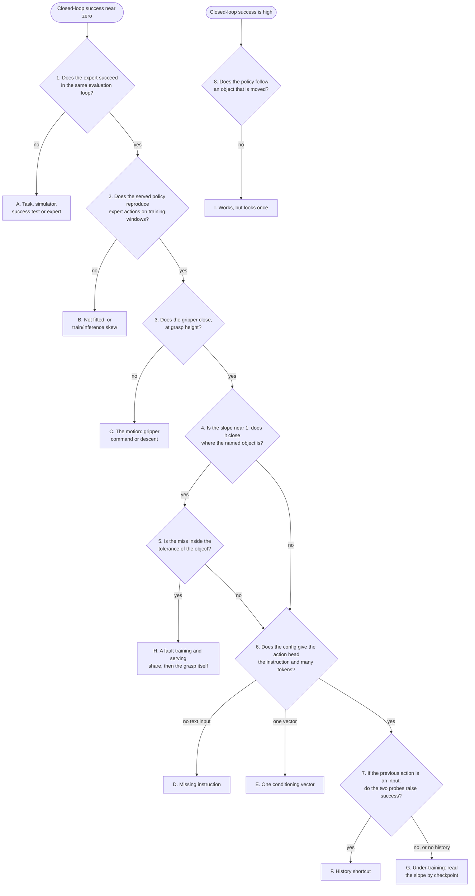

# A Debugging Flowchart

A success rate near zero says that something is wrong and not what. A broken success test, a
preprocessing mismatch, a missing instruction, a single conditioning vector, a policy that reads
its target from its own previous action and one stopped before it began to look all produce it,
and each needs a different fix. The checks below go from symptom to cause before anything is
retrained.

## The idea

A robot policy sits at the end of a chain: task definition, scripted expert, demonstrations,
preprocessing, training, serving (the policy server, which turns an observation into a **chunk**, the 15 future
actions a policy predicts in one go), execution, success test. **Closed-loop success**, the
fraction of episodes in which the policy completes the task when run in the simulator on its own
outputs, is measured after the last link and is low if any link is broken.

Retraining tests one guess per run: the lab notebook lists about 1.7 h for 1.0M samples of the
130M VLA. A **sample** is one **window** (the observations at one frame plus the actions that
follow) drawn by the data loader. The checks below need an evaluation or less. Two rules order
them:

1. **Upstream first.** A fault early in the chain voids every later measurement, so the task is
   checked before the policy and the serving path before the behaviour.
2. **Every answer must change what is done next.** The training loss fails this rule: on
   `pick_cube` a final loss of 0.040 went with 2/50 (pooled CLIP, 200 demonstrations) and a higher
   one, 0.058, with 37/50 (`dp_vit`, 1000 demonstrations).

Worked example, from the [lab notebook](../lab-notebook.md): `dp_vit` scored 1/100 on `pick_target`
on machine A (one RTX 4090, 24 GB), on unseen **layouts** (which objects are on the table, where,
which one the instruction names, and the arm's start pose; the seed fixes it). Decision numbers
refer to the chart below.

- **Decision 1.** The expert scored 99/100 through the same evaluation loop: task and scoring are
  sound.
- **Decision 2.** It reproduces recorded expert actions as well as the 74% `pick_cube` policy
  ([field notes](../notes.md), "Loss and open-loop error do not predict success"): not leaf B.
- **Decision 3.** The policy closed its gripper in 100% of episodes, within about 3 mm of the right
  height: it learned the motion.
- **Decision 4.** The nearest object was the named one in 32% of episodes, where chance is 33%; the
  median miss was 185 mm to the named object and 110 mm to the *nearest*. It did not reach between
  the objects; it did not look.
- **Decision 6.** [`sim/pickup/configs/dp_vit.yaml`](../../sim/pickup/configs/dp_vit.yaml) has no
  `text_tokens` key, and `ViTBackboneWrapper` (`vla_foundry/models/vision_language_backbones/vit_backbone.py`)
  embeds the instruction only when `text_tokens > 0`: leaf D.

Three checks and a config found a cause no training removes, but not the only one: What we
measured follows the task through leaves F to I, to 83% / 85% (trained / averaged weights) before
the position-table fix, 93% after it and 98% / 98% with random start poses.

## How it works



| Leaf | Likely causes | Read |
|---|---|---|
| A | success test, episode length, simulator build, the expert | [Closed-loop evaluation](90-closed-loop-evaluation.md) |
| B | loss never fell; wrong weights file; pixel range, normaliser or token position differs when served | [Train/inference skew](93-train-inference-skew.md) |
| C | gripper dimension of the action; joint targets during the descent | [What an action is](40-action-spaces.md) |
| D | no text input, on a task with several objects | [Language conditioning](51-language-conditioning.md) |
| E | one vector per image, or one for the whole prompt | [What the action head sees](50-what-the-action-head-sees.md) |
| F | the previous action is an input and, in training, holds the answer | [History and shortcuts](52-history-and-shortcuts.md) |
| G | the budget ended before the policy started to look, or while it was starting | [Data and training budgets](71-how-much-data-and-training.md) |
| H | a fault both paths share, such as the position table; then finger yaw, height at the close, lift | [Positions](12-positions.md), [Measuring failure](92-measuring-failure.md) |
| I | one start pose, nothing moves, no grasp fails; remedy: random start poses and recoveries in the data | [Probing a policy that works](95-what-a-policy-looks-at.md) |

No policy here landed on leaf C. On `pick_target` the two VLAs given every token
reach 86% / 87% and 70% / 72%, against 0-6% with one vector, but history and the number of
demonstrations changed too (field notes, "One pooled vector is not enough for grasping").

**1. The expert in the same evaluation loop.** `eval.py --expert` replaces the served policy with
`ScriptedExpert`; the environment, the seeds from `EVAL_SEED_START = 1_000_000`, the `GraspProbe`
and the success test in `PickupEnv.step` stay the same.

**2. Expert actions through the serving path.** `open_loop_check.py` passes windows from the
training shards to `Policy.infer`, the function the policy server calls for every chunk. The check
is **open-loop**: predictions are compared with the recorded actions, never executed. On `pick_cube`
the served policies came within 0.01-0.04 rad per joint, repeating the previous action within
0.05-0.2 rad. Errors not clearly below that baseline mean an unfitted model or
**train/inference skew**: tensors that differ when served. Passing excludes only leaf B, because the
errors are measured on expert states ([Loss Is Not Success](91-loss-is-not-success.md)).

**3. The first close.** `GraspProbe` in `diagnostics.py` records where the gripper and every
object are at the first action whose gripper command `action[7]` is below 0.5, before it is
executed; `closed_gripper_rate` and `median_z_above_grasp_mm` in the `grasp` block of
`results.json` answer this decision.

**4. The slope.** `closed_nearest_is_target_rate` is **closed at the named object**: the object
nearest the gripper when it first closed was the one the instruction named. Chance is 33% with
three objects. The **slope** is the
least-squares slope of where the gripper closed against where the named object was, both table
axes pooled: 1 if it closes where the object is, 0 if where it closes does not depend on the scene.
`summarize.py` prints it; `results.json` holds it per axis as `close_vs_target_slope`. A slope near
0 with large misses to the named and to the nearest object is a policy that is not looking, not an
imprecise one ([Measuring failure](92-measuring-failure.md)).

**5. The tolerance of the object.** `grasp_tolerance.py` runs the expert with a fixed sideways
offset added to every waypoint and reports success per object. Compare
`grasp.by_target[<object>].median_xy_err_mm` with that object's column. Outside the tolerance, go on to decision 6; inside it, leaf H.

**6. What the action head is given.** `vla_foundry/main.py` saves the resolved config of a run as
`experiments/pickup/<run>/config.yaml`. Under `model.vision_language_backbone`, `type: vit_backbone`
with `text_tokens: 0` has no text input: leaf D. `conditioning: action_token`, the default of
`vlm_backbone` and `vlm_foundry_backbone`, hands over the hidden states of **the action token**,
the single special token appended to the prompt: one vector. `clip_backbone` gives one pooled
vector per image and one for the text. Both are leaf E (the VLM backbones also accept
`conditioning: all_tokens`). Under `data`, `image_indices` with `-1` and `lowdim_past_timesteps: 1`
are **history** (the previous frame, state and action as inputs): decision 7.

**7. The two probes of a policy with history.** `eval.py --first_prev_action expert` sends the
expert's first command as the previous action of the first query, in place of the hold command
the robot is under;
`--expert_prefix 10` lets the expert drive the first 10 control steps. A policy that scores far
better with either reads its target from its own past: leaf F. In a window that starts at a
demonstration's first frame the previous-action slot holds a copy of the first action
(`padding_strategy: copy` in `preprocess.yaml`), which already points at the target.

**Leaf G: the slope by checkpoint.** A **checkpoint** is the training state saved at one point.
`eval_checkpoints.sh` evaluates every one with both sets of weights; `summarize.py` lists the slope
against training samples. The policies here began to use the scene in one **transition**: the
slope moved first, then the miss shrank, then success followed. A rising slope under 0% success
means the run needs more samples; a flat one says nothing until the budget passes the point where
a comparable run's rose.

<!-- interactive: onset -->
*Figure: success, closed at the named object and the slope against training samples, several runs
side by side. The slope leaves zero before success does.*

**Leaf H: the shared fault first.** A policy that looks and misses inside the tolerance fails at
the grasp or carries a fault that training and serving share, which decision 2 cannot see. The
rotary position table was one: computed in bfloat16 under autocast, it held 641 distinct positions
out of 2048, and the 15 action-step tokens of the no-history policy shared 8.
`tests/essential/models/test_rotary_precision.py` checks that every position gets its own rotation.
Run such tests first; then `grasp.by_target` gives the yaw error and height at the close per object.

**8. An object that is moved.** `eval.py --disturb reach` moves the named object once, at control
step `--disturb_step` (default 15), by `--disturb_mm` millimetres (default 80); `--disturb grasp`
moves it as the gripper first closes, so that succeeding takes a second attempt. Over the moved
episodes, read the success, the second grasp attempts and how far the gripper closed from the old
and the new place. A policy that closes where the object was and does not try again decided from
its first look: leaf I. The reference is the expert with one plan per episode (`eval.py --expert`)
and planning again (`--expert_reactive`). `--random_start`, `--stale_images` and
`--expert_prefix 10 --prefix_target distractor` probe the same habit.

## In this repository

Run from the repository root:

```bash
# my_run and pick_target_4k are the names in the README's recipe (the pickup configs switch
# averaged weights on themselves; train.sh saves 6 checkpoints unless PICKUP_NUM_CHECKPOINTS says otherwise):
#   sim/pickup/scripts/train_resilient.sh dp_vit_lang_reactive pick_target_4k my_run 5000000
run=my_run            # a directory under experiments/pickup
data=pick_target_4k   # a directory under data/preprocessed
out=results/pickup/$run/pick_target

# 1. the expert in the same loop: the last two [eval] lines
.venv/bin/python -m sim.pickup.eval --task pick_target --episodes 100 --expert --out results/pickup/expert/pick_target

# 2. expert actions through the serving path: three lines of per-joint error
.venv/bin/python -m sim.pickup.open_loop_check --checkpoint_dir experiments/pickup/$run --shards data/preprocessed/$data/shards

# 3, 4. the first close and the slope: the grasp block of $out/results.json, the
#       "At named object" and "Slope" columns, the two maps
sim/pickup/scripts/eval.sh experiments/pickup/$run pick_target 100
.venv/bin/python -m sim.pickup.summarize --task pick_target --runs $run
.venv/bin/python -m sim.pickup.grasp_map $out/results.json

# 5. the tolerance: success per object and offset
.venv/bin/python -m sim.pickup.grasp_tolerance --out results/pickup/grasp_tolerance.json

# 6. what the action head is given
.venv/bin/python -c "
import sys, yaml
c = yaml.safe_load(open(sys.argv[1]))
b, d = c['model']['vision_language_backbone'], c['data']
print(b['type'], {k: b[k] for k in ('text_tokens', 'conditioning') if k in b})
print('image_indices', d.get('image_indices'), 'lowdim_past_timesteps', d.get('lowdim_past_timesteps'))
" experiments/pickup/$run/config.yaml

# 7. the two probes of a policy with history: compare their rows in summarize with the plain one
PICKUP_OUT=$out/first_expert sim/pickup/scripts/eval.sh experiments/pickup/$run pick_target 100 --first_prev_action expert
PICKUP_OUT=$out/prefix10 sim/pickup/scripts/eval.sh experiments/pickup/$run pick_target 100 --expert_prefix 10

# leaf G. every checkpoint, trained and averaged weights; then summarize again: Slope against Samples
sim/pickup/scripts/eval_checkpoints.sh experiments/pickup/$run pick_target

# leaf H. a fault training and serving share: the invariant tests, the position table among them
.venv/bin/python -m pytest tests/essential/models/test_rotary_precision.py

# 8. an object that is moved, during the reach and at the grasp; another start pose
PICKUP_OUT=$out/disturb_reach20 sim/pickup/scripts/eval.sh experiments/pickup/$run pick_target 100 --disturb reach --disturb_step 20
PICKUP_OUT=$out/disturb_grasp sim/pickup/scripts/eval.sh experiments/pickup/$run pick_target 100 --disturb grasp
PICKUP_OUT=$out/random_start sim/pickup/scripts/eval.sh experiments/pickup/$run pick_target 100 --random_start
```

Notes from the code:

- `eval.sh` and `open_loop_check.py` serve the newest checkpoint, with averaged weights when the
  run has them; `PICKUP_CHECKPOINT` and `PICKUP_WEIGHTS=raw|ema` choose another for `eval.sh`.
- Without `PICKUP_OUT` a probe overwrites the `results.json` of decision 3.
- `successes` in a disturbance's `results.json` includes episodes in which no free place was found
  and nothing moved. This counts the moved ones:

```bash
.venv/bin/python - $out/disturb_reach20/results.json <<'EOF'
import json, math, statistics, sys
r = json.load(open(sys.argv[1]))
moved = [e for e in r["per_episode"] if (e["disturbed"] or {}).get("to_xy")]
closed = [e for e in moved if e["close_tcp_xy"]]
for key in ("from_xy", "to_xy"):
    d = statistics.median(math.dist(e["close_tcp_xy"], e["disturbed"][key]) for e in closed)
    print(f"closed {1000 * d:.0f} mm (median) from {key}")
print(sum(e["success"] for e in moved), "of", len(moved), "moved episodes succeeded;",
      sum(e["closes"] >= 2 for e in moved), "had a second grasp attempt")
EOF
```

## What we measured

From the [lab notebook](../lab-notebook.md); pairs are trained / averaged weights (EMA, an
exponential moving average of the trained ones). The first two rows and the VLM are machine A, the
rest machine B (L40S GPUs, 128 CPU cores); 100 unseen layouts per evaluation.

| Policy | Readings | Leaf | What followed |
|---|---|---|---|
| Pooled CLIP, `pick_cube`, 2/50 | 0/20 on its own training layouts; closes a few centimetres from the cube | E | patch tokens, same 200 demonstrations: 15/50 |
| `vla_custom`, pretrained VLM, 0/100 | closed at the named object 33%, misses 175 / 89 mm (named / nearest); one conditioning vector, history, 1.0M samples | E; F and G possible | `conditioning: all_tokens`, no history, 4000 demonstrations, 3.0M samples: 86% / 87% (random-init backbone 75% / 85%) |
| `dp_vit_lang` (history), 4000 demonstrations, stopped at 3.0M samples, 2% / 2% | closed at the named object 30% / 35%, slope 0.11 / 0.08 | F | the probes below |
| `dp_vit_lang_reactive` (no history), 1500 demonstrations, 1.0M samples, 3% / 5% | closed at the named object 49% / 41%, slope 0.29 / 0.18 | G | 3.0M samples: 64% / 62%; 4000 demonstrations, 5.0M: 83% / 85% |
| the same, 4000 demonstrations, 5.0M, 83% / 85% | slope 0.98 / 0.98; failed T-block grasps inside the tolerance | H | position table fixed: 93% (trained weights) |
| `dp_vit` (history), `pick_cube`, 62% / 70% | slope 1.03 / 1.03, miss 14 / 14 mm | H | position table fixed: 96% / 98% |
| `dp_vit_lang_reactive` after the fix, 93% | object moved at step 20: 0/97; at the grasp: 0/100 | I | random start poses: 98% / 98%; recoveries: 89% / 84%, follows a moved object |

Leaf B was met on the stage-2 VLM: a pixel-range skew left it at 1/300 on exact ordering of
held-out scenes, 256/300 after the fix (machine A; [Train/inference skew](93-train-inference-skew.md)).

**Leaf F in detail.** The history policy at 2.5M samples (averaged weights, trained before the
position fix) scored 1/100 as served, closing at the named object in 30% of episodes. With the
expert's first command as its first previous action: 22/100 and 97%; with the expert driving the
first 10 control steps: 77/100 and 100%. Without history the same data gave 81% / 75% at 3.0M
samples. Trained after the fix on demonstrations that begin with a hold frame (`collect.py
--hold_steps 1`), the history policy ends at 0% / 4% after 5.0M samples, its slope between -0.11 and
0.12 throughout: from the second step on, the previous action still predicts the next one.
On the single cube history costs nothing (the table above).

**Leaf G in detail.** `dp_vit_lang_reactive` on 4000 demonstrations, by checkpoint, and the same
run after the position fix (trained weights):

| Samples | Success | Slope | After the fix: success, slope |
|---|---|---|---|
| 1.0M | 0% / 1% | 0.11 / 0.14 | 8%, 0.58 |
| 1.5M | 4% / 2% | 0.47 / 0.37 | 58%, 0.94 |
| 2.0M | 4% / 36% | 0.81 / 0.96 | 40%, 0.97 |
| 5.0M (final) | 83% / 85% | 0.98 / 0.98 | 93%, 0.98 |

At 1.5M success says nothing has happened; the slope says the policy has started to look. The 1500-demonstration run ended at 1.0M samples inside this transition; with 3.0M samples
the same policy on the same data crossed it between 1.2M (3% / 0%, slope 0.52 / 0.14) and 1.8M
(44% / 43%, slope 1.00 / 0.95). Averaged
weights led during this transition, not in every run ([The training loop](80-the-training-loop.md)).

**Leaf H in detail.** Over the 85% policy's checkpoints from 3.0M samples on, the T block is lifted
in 153/276 episodes (55%). Its failed grasps closed 15 mm (median) from the object, where a 15 mm
offset leaves the expert at 100%, with a median yaw error of 64 degrees against 35 on the
successes: it looked like the grasp angle. Most of it was the position table: the recipe trained
after the fix, pooled over its last three checkpoints, lifts the T block in 60/69 (87%)
([the `pick_target` case](101-case-pick-target.md); the single cube in
[the `pick_cube` case](100-case-pick-cube.md)).

**Leaf I in detail.** The 85% policy (averaged weights), object moved 80 mm at control step 20:
0/96, closing 8 mm (median) from the old place, 78 mm from the new. Moved as the gripper first
closed: 1/99, a second attempt in 29/99. The expert with one plan per episode also fails (0/99,
0/100); planning again, 96/96 and 100/100. Trained after the fix on other demonstrations:

| Demonstrations | Unchanged task | Random start | Moved at step 10 / 20 / 30 | Moved at the grasp |
|---|---|---|---|---|
| one clean pass per layout | 93/100 | 9/100 | 12/100, 0/97, 0/100 | 0/100, 8 retried |
| random start poses | 98/100 | 97/100 | 94/100, 50/98, 0/100 | 0/100, 2 retried |
| recoveries | 84/100 | 68/100 | 88/100, 79/96, 85/100 | 78/99, 99 retried |
| random start poses and recoveries | 94/100 | 91/100 | 92/100, 89/98, 94/100 | 89/100, 100 retried |

Random start poses make the policy follow an early move; only recoveries make it follow a late one
and try again. Both in the same demonstrations give both: 89-94% under every disturbance, also from
a random start pose (the README's recipe).

## Where it goes wrong

| What you see | Why | What to do |
|---|---|---|
| One checkpoint or one set of weights picks the wrong leaf | In the 4000-demonstration table the leaf changes between 1.0M and 2.0M samples; at 2.0M success is 4% trained against 36% averaged | Evaluate every checkpoint, both sets of weights |
| The height reading is off while the policy goes to other objects | `close_z_above_grasp` is measured against the *named* object, and object heights differ | Read it on episodes where `close_nearest` equals `target` |
| `open_loop_check` stops with "no window without padding among the samples read" | Every window it read was padded in the rows the policy reads | Raise `--samples` |
| A policy that looks ends at leaf H, and decision 2 finds nothing | Training and serving share the fault, as the old position table did | Run the invariant tests ([Positions](12-positions.md)) before working on the grasp |

## Background and further reading

Background, not measured here.

- Karpathy, *A Recipe for Training Neural Networks*, 2019
  ([blog post](https://karpathy.github.io/2019/04/25/recipe/)). Six stages for supervised training,
  the second an end-to-end skeleton with simple baselines; decisions 1 and 2 are its counterparts
  for a policy.
- Kress-Gazit, *Robot Learning as an Empirical Science: Best Practices for Policy Evaluation*, 2024
  ([arXiv:2409.09491](https://arxiv.org/abs/2409.09491)). Recommends documented test conditions,
  metrics beyond the success rate and descriptions of failure modes.
- Ross, *A Reduction of Imitation Learning and Structured Prediction to No-Regret Online Learning*,
  2011 ([arXiv:1011.0686](https://arxiv.org/abs/1011.0686)). A policy trained only on expert states
  meets states its own errors lead to; DAgger retrains on expert labels for the states the learner
  visits. Why decision 2 cannot be the last, and why leaf I is fixed in the data.

## Check yourself

1. Run decision 1 for 20 episodes and read the last `[eval]` line. State which leaf an expert at
   60% would point to, and why the other decisions would then say nothing.

   ```bash
   .venv/bin/python -m sim.pickup.eval --task pick_target --episodes 20 --expert --videos 0 --out results/pickup/expert/check
   ```

2. A policy closes in 100% of episodes at grasp height, at the named object in 33% of them, with a
   slope near 0. Name the next decision, the config entries it reads and where each leads.
3. A policy has a slope of 1.03 and misses by 14 mm an object that tolerates 15 mm. Name the leaf,
   the first thing to run, and why decision 2 could not have found the position-table fault.
4. Run decision 8 on a policy that succeeds and count the moved episodes with the snippet above.
   Which numbers send it to leaf I, and which demonstrations would you collect next?
